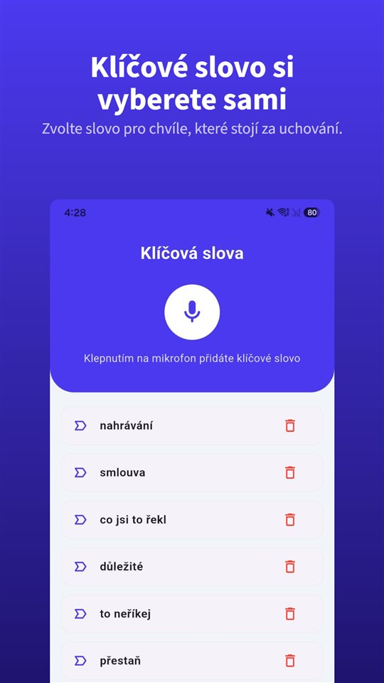

„Máte chvilku? Pojďte ke mně.“

V kanceláři vedoucí a někdo z personálního. Na stole už vytištěná dohoda. „Bude lepší, když se rozejdeme dohodou. Jinak budeme muset řešit výpověď a to nechcete.“

O pár týdnů později z toho rozhovoru zbývá jediné: **váš podpis.**

Dohodu lze napadnout jen tím, co se dělo před podpisem. A to, co se dělo před podpisem, byl rozhovor.

## Česko a Slovensko vedle sebe

| Otázka | Česko | Slovensko |
|---|---|---|
| Forma dohody | Písemně (§ 49 ZP) | Písemně (§ 60 ZP) |
| Žaloba na neplatnost | Do 2 měsíců (§ 72 ZP) | Do 2 měsíců (§ 77 ZP) |
| Podpora po dohodě nebo vlastní výpovědi | Od 2026 stejná pro všechny | Nezávisí na způsobu skončení |
| Odstupné | Jen při organizačních důvodech | Zde neověřeno |
| Vlastní rozhovor nahrát | K ochraně svých práv bez svolení (§ 88 OZ) | Jen se svolením, s výjimkami (§ 12 OZ) |

## Dohoda musí být písemná, a důvod v ní rozhoduje

**Dohoda o rozvázání pracovního poměru** se uzavírá **písemně** (**§ 49 zákoníku práce**). Důvody skončení v ní musí být uvedeny, **pokud to zaměstnanec požaduje**. Písemně se dává i **výpověď zaměstnance** (§ 50).

Na důvodu přitom záleží víc, než se zdá. **Odstupné** (§ 67) náleží jen tehdy, když pracovní poměr končí výpovědí nebo **dohodou z organizačních důvodů** – zrušení nebo přemístění zaměstnavatele, **nadbytečnost** zaměstnance (§ 52 písm. a) až c)). Dohoda „bez uvedení důvodu“ nebo „na žádost zaměstnance“ odstupné nezakládá.

Proto: **nepodepisujte v kanceláři**. Vezměte si návrh domů a požádejte, aby v dohodě byl uveden skutečný důvod.

## Dva měsíce na žalobu

Neplatnost rozvázání pracovního poměru – výpovědi i **dohody** – lze uplatnit **žalobou u soudu nejpozději do dvou měsíců** ode dne, kdy měl pracovní poměr skončit (**§ 72 zákoníku práce**). Lhůta je **prekluzivní**: když uplyne, právo zaniká.

Jak daleko musí nátlak zajít, ukazuje rozhodnutí **Nejvyššího soudu 21 Cdo 81/2019**. Zaměstnankyně podepsala dohodu poté, co byla přes **30 hodin zadržena**, vyslýchána, strávila noc v cele a byla k zaměstnavateli přivedena. Soud uzavřel, že tyto okolnosti **vyvolaly obdobný stav jako bezprávná výhrůžka** a její vůle **nebyla utvářena svobodně** – dohoda byla **absolutně neplatná**. Zároveň zdůraznil, že pouhá **tíseň** není totéž co **psychický nátlak**.

Jinými slovy: záleží na tom, **co přesně se v té místnosti dělo a říkalo.**

## Podpora v nezaměstnanosti: od roku 2026 bez penalizace

Tady se v Česku nedávno změnilo něco podstatného. Dříve dostával jen **45 % průměrného čistého výdělku** ten, kdo **bez vážného důvodu** skončil zaměstnání **sám nebo dohodou**. Od **1. ledna 2026** byla tato penalizace **zrušena**: výše podpory je **stejná pro všechny uchazeče**, bez ohledu na to, jak pracovní poměr skončil.

Dohoda vás tedy už nestojí část podpory. O to víc ale rozhoduje o **odstupném**.

## Nahrát vlastní rozhovor k ochraně svých práv

Podle **§ 86 občanského zákoníku** nelze bez svolení pořizovat zvukový záznam soukromého života člověka. Podle **§ 88 odst. 1** však svolení **není třeba**, pokud se záznam **pořídí nebo použije k výkonu nebo ochraně jiných práv nebo právem chráněných zájmů**, a podle **§ 90** nesmí jít o nepřiměřené využití. Doložit, jak k podpisu dohody došlo, je přesně takový případ.

**Ústavní soud** v nálezu **II. ÚS 1774/14** z 9. prosince 2014 rozhodl, že tajně pořízený záznam **nelze jako důkaz odmítnout jen proto**, že obsahuje projevy osobní povahy. Víc v [Je legální nahrávat rozhovor bez souhlasu?](/blog/cs/nahravani-rozhovoru/).

Problémem je okamžik. Takový rozhovor se svolá narychlo, trvá deset minut a věta, na které záleží – „jinak budeme řešit výpověď“ – padne bez varování. Než vytáhnete telefon, odemknete ho a zmáčknete nahrávání, je pryč.

[TalkSafe](/talksafe/cs/) je aplikace pro nahrávání na Android a iPhone, která začne nahrávat, když uslyší **předem zvolené slovo**. Slova rozpozná **bez ohledu na to, kdo je řekne**, takže lze nastavit, co v takovém rozhovoru obvykle říká **druhá strana**: „dohoda“, „výpověď“, „rozvázání“. Funguje při **zamčené obrazovce** a **30 sekund předtím** zůstane v souboru – věta, po které vám došlo, o co jde, se neztratí.

<figure class="shot"><figcaption>Nastavení klíčových slov. Můžete uložit několik slov; stačí, aby bylo rozpoznáno jedno z nich.</figcaption></figure>

Nahrávat rozhovory, kterých se neúčastníte – nechat telefon v místnosti a odejít – pod výjimku § 88 nespadá.

## Slovensko

- **Dohoda** o skončení pracovného pomeru se uzavírá **písemně** (**§ 60 Zákonníka práce**). Podle judikatury chybějící důvod v dohodě, kde ho zákon vyžaduje, **nezpůsobuje její neplatnost**.
- **Neplatnost** skončení lze u soudu uplatnit **nejpozději do dvou měsíců** ode dne, kdy měl pracovní poměr skončit (**§ 77**). Žaloba musí soudu v této lhůtě skutečně dojít; po jejím uplynutí právo zaniká.
- **Dávka v nezamestnanosti** od Sociální pojišťovny **nezávisí na způsobu skončení** pracovního poměru; rozhoduje předchozí pojištění v nezaměstnanosti.
- **Nahrávání**: podle **§ 12 slovenského občanského zákoníku** lze zvukový záznam pořídit nebo použít **jen se svolením**, s výjimkami. Bezpečnější je proto hned po rozhovoru nahrát **vlastním hlasem**, co se stalo, kdo co řekl a kdo byl přítomen – to není záznam cizích slov. S klíčovým slovem jako „poznámka“ začne nahrávání, aniž byste vytahovali telefon. Odstupné na Slovensku zde nebylo ověřeno.

## Shrnutí

- Dohoda je **písemná**; **důvod** v ní rozhoduje o **odstupném**.
- Neplatnost se uplatňuje **žalobou do dvou měsíců** – v Česku i na Slovensku.
- **Od 1. ledna 2026** je v Česku podpora v nezaměstnanosti **stejná bez ohledu na způsob skončení**.
- **Nepodepisujte v kanceláři.**
- V Česku lze vlastní rozhovor nahrát **k ochraně svých práv**; na Slovensku **vlastním hlasem hned potom**.

Jak prokázat šikanu na pracovišti: [Jak prokázat šikanu na pracovišti?](/blog/cs/sikana-na-pracovisti/). Co s nahrávkou potom: [Co s nahrávkou dělat, a co s ní nedělat](/blog/cs/after-recording/).

## Zdroje

- [Zákoník práce č. 262/2006 Sb. (Zákony pro lidi)](https://www.zakonyprolidi.cz/cs/2006-262)
- [Zákonník práce č. 311/2001 Z. z. (Slov-Lex)](https://www.slov-lex.sk/pravne-predpisy/SK/ZZ/2001/311/)

Obecné informace, nikoli právní rada. V konkrétní věci se obraťte na advokáta se zaměřením na pracovní právo, odborovou organizaci nebo oblastní inspektorát práce.

