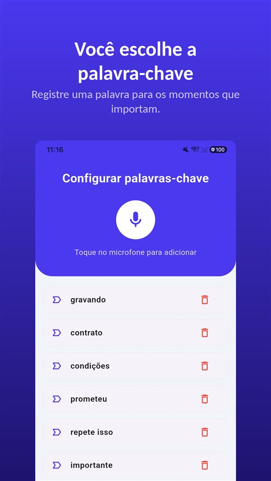

"Tem um minuto? Vamos ali na sala."

O gestor fala baixo. "A gente acha melhor você pedir para sair. Se você pedir, a gente não complica. Se não, vai ter que ser por justa causa."

Semanas depois, o que sobra daquela conversa é **uma carta de próprio punho pedindo demissão.**

O pedido de demissão é o fim da história. O que pode anulá-lo está no que foi dito antes dele — e no Brasil você pode guardar isso.

## Brasil e Portugal, lado a lado

| Pergunta | Brasil | Portugal |
|---|---|---|
| Saída sob pressão | Pedido sob coação pode ser anulado; prova do empregado | Vícios da vontade; não analisado em detalhe aqui |
| Saída combinada | Acordo do art. 484-A: metade da multa e do aviso indenizado, saque de 80% | Acordo de revogação escrito (art. 349.º CT) |
| Arrependimento | Não há prazo legal | 7 dias para fazer cessar o acordo (art. 350.º), salvo reconhecimento notarial presencial |
| Seguro ou subsídio de desemprego | Pedido de demissão e acordo: não | Demissão: não; acordo: só em certos casos e com quotas |
| Gravar a própria conversa sem avisar | Prova lícita (Tema 237) | Crime sem consentimento (art. 199.º CP) |

Os demais países de língua portuguesa não foram analisados neste artigo.

## Brasil: o que cada forma de saída tira de você

| Forma de saída | Multa do FGTS | Saque do FGTS | Seguro-desemprego |
|---|---|---|---|
| Dispensa sem justa causa | 40% | Sim | Sim |
| Rescisão indireta (art. 483) | 40% | Sim | Sim |
| Acordo (art. 484-A) | 20% | Até 80% | Não |
| Pedido de demissão | Não | Não | Não |

É por isso que a frase "pede para sair que é melhor para você" quase nunca é melhor para você.

O **acordo do art. 484-A**, criado pela **Reforma Trabalhista de 2017**, paga **pela metade** o aviso prévio, se indenizado, e a indenização sobre o saldo do FGTS. O saque fica limitado a **80%** do saldo, e a lei diz expressamente que esse acordo **não autoriza o ingresso no Programa de Seguro-Desemprego**.

## Pedido de demissão sob coação pode ser anulado

A Justiça do Trabalho anula o pedido de demissão obtido por **coação** e o converte em **dispensa sem justa causa**, com todas as verbas. O TST já deu provimento a recursos nesse sentido.

Mas há dois limites claros nas decisões:

- **A prova é do empregado.** Depois de formalizado o pedido e recebidas as verbas, o empregado não pode mudar a forma da ruptura **sem demonstrar fraude ou vício de consentimento**.
- **Não é coação** a empresa aconselhar o empregado a pedir demissão diante da **possibilidade real** de uma dispensa por justa causa.

Há também uma proteção específica: pelo **Tema 55** do TST, tese **vinculante**, o pedido de demissão da **empregada gestante** só é válido com **assistência do sindicato** ou da autoridade local competente. Sem isso, é inválido.

E existe a outra saída: quando a empresa descumpre suas obrigações, o empregado pode pedir a **rescisão indireta** (art. 483 da CLT). Há decisões que convertem um pedido de demissão em rescisão indireta quando o descumprimento fica comprovado, mas o tema divide as turmas.

O prazo para reclamar é de **dois anos** após o fim do contrato.

## Tudo depende da conversa

Houve coação? A ameaça de justa causa era real ou só pressão? Quem propôs o acordo? **Tudo isso está numa conversa que não deixa documento** — e o ônus da prova é seu.

Aqui o Brasil é favorável ao empregado. O STF fixou no **Tema 237 de repercussão geral (RE 583.937)** que **é lícita a prova consistente em gravação ambiental realizada por um dos interlocutores sem o conhecimento do outro**, e o **TST** aplica esse entendimento **inclusive quando o empregado grava o empregador**. Mais em [Gravar conversa sem a outra pessoa saber é crime?](/blog/pt-br/gravar-conversa/).

O problema é o momento. A conversa é marcada em cima da hora, dura dez minutos, e a frase que importa — "se não pedir, vai ser por justa causa" — vem sem aviso. Até você tirar o celular do bolso, desbloquear e apertar gravar, já passou.

O [TalkSafe](/talksafe/pt-br/) é um app de gravação para Android que começa a gravar quando ouve uma **palavra escolhida antes**. As palavras são reconhecidas **seja quem for que as diga**, então dá para escolher o que **o outro lado** costuma dizer nessa conversa: "acordo", "justa causa", "pedir demissão". Funciona com a **tela bloqueada**, e os **30 segundos anteriores** ficam no arquivo — a frase que fez você perceber o que estava acontecendo não se perde.

<figure class="shot"><figcaption>Configuração de palavras-chave. Dá para cadastrar várias; basta uma delas ser detectada para a gravação começar.</figcaption></figure>

O app grava o que o microfone ouve no ambiente — a conversa da qual você participa. Gravar conversas das quais você não participa é outra coisa e é crime (Lei 9.296, art. 10).

## Portugal: 7 dias para voltar atrás

- **Acordo de revogação**: deve constar de **documento assinado por ambas as partes**, ficando cada uma com uma cópia (art. 349.º do Código do Trabalho).
- **Arrependimento**: o trabalhador pode **fazer cessar o acordo** por comunicação escrita **até ao sétimo dia seguinte** à celebração, **devolvendo a compensação** recebida (art. 350.º). Isso **não se aplica** se o acordo for datado e as assinaturas tiverem **reconhecimento notarial presencial**. O mesmo mecanismo vale para quem se demite: a **denúncia** pode ser revogada no mesmo prazo, salvo reconhecimento notarial presencial (art. 402.º).
- **Subsídio de desemprego**: quem se demite não tem, em regra, direito. O acordo de revogação só conta como **desemprego involuntário** quando se baseia em motivos que permitiriam um **despedimento coletivo** ou a **extinção do posto de trabalho**, dentro dos **limites de quotas** do artigo 10.º do Decreto-Lei 220/2006.
- **Gravar**: o **artigo 199.º do Código Penal** pune quem, sem consentimento, grava palavras não destinadas ao público, **mesmo que lhe sejam dirigidas**. Em Portugal, o mais seguro é registrar logo depois, com a **sua própria voz**, o que foi dito e por quem — ou pedir consentimento: com "gravar" como palavra-chave, a gravação começa quando você pergunta "posso gravar a reunião?".

## Resumindo

- **Pedido de demissão** tira a multa do FGTS, o saque e o seguro-desemprego.
- **Acordo do art. 484-A**: metade da multa, saque de 80%, **sem seguro-desemprego**.
- Pedido **sob coação** pode ser anulado — **com prova**.
- **No Brasil, gravar a conversa da qual você participa é prova lícita.**
- **Em Portugal**, 7 dias para desfazer o acordo; gravar só com consentimento.
- **Não assine na sala.** Peça tempo.

Como provar assédio moral no trabalho: [Como provar assédio moral no trabalho](/blog/pt-br/assedio-moral/). O que fazer com a gravação depois: [O que fazer com uma gravação, e o que não fazer](/blog/pt-br/after-recording/).

## Fontes

- [Consolidação das Leis do Trabalho (Planalto)](https://www.planalto.gov.br/ccivil_03/decreto-lei/del5452.htm)
- [Código do Trabalho, legislação consolidada (Diário da República)](https://diariodarepublica.pt/dr/legislacao-consolidada/lei/2009-34546475)

Informação geral, não é aconselhamento jurídico. Para um caso concreto, procure um advogado trabalhista ou o seu sindicato.

