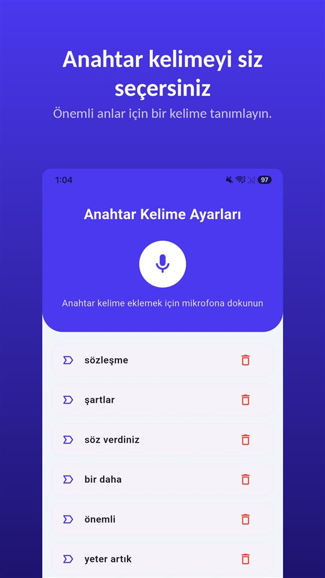

"Bir dakika gelir misin?"

İnsan kaynakları odasında masada bir kâğıt duruyor. Üstünde adınız, altında imza yeri. "Kendi isteğinle ayrılırsan referans veririz. Yoksa işler uzar, biliyorsun."

Birkaç hafta sonra o görüşmeden geriye kalan tek şey, **kendi elinizle attığınız imza** oluyor.

İstifa dilekçesi bir sonuçtur. Onu sakat kılan şey ise imzadan önce o odada söylenenlerdir.

## Bir bakışta

| Ayrılış şekli | Kıdem tazminatı | İşsizlik ödeneği | Dikkat edilecek nokta |
|---|---|---|---|
| İşçinin istifası | Yok | Yok | Baskıyla alındıysa geçersiz; baskıyı işçi ispat eder |
| İkale (işveren teklifi) | Anlaşmaya göre | Yok | Yargıtay işçiye makul yarar sağlanmasını arar |
| İşçinin haklı nedenle feshi (İK 24) | Var (en az 1 yıl kıdemle) | Var | 6 iş günü içinde (İK 26) |
| İşverenin geçerli neden olmadan feshi | Var (en az 1 yıl kıdemle) | Var | İşe iade için 1 ay içinde arabulucu (İK 20) |

Bu yazı Türkiye'yi anlatır. Türkçe konuşanların yaşadığı Almanya, Avusturya ve İsviçre için Almanca [Aufhebungsvertrag unter Druck](/blog/de/aufhebungsvertrag/) yazısına bakabilirsiniz; Hollanda, Belçika, Fransa ve KKTC bu yazıda ele alınmadı.

## Baskıyla alınan istifa

İstifa, işçinin tek taraflı iradesidir. İrade **korkutma** gibi bir **irade fesadı** ile sakatlanmışsa (TBK 37) istifaya değer verilmez.

Ama yük işçidedir. **Yargıtay 9. Hukuk Dairesi**, **4 Aralık 2024** tarihli kararında (**E. 2024/10868, K. 2024/15716**), istifanın iradeyi sakatlayan bir baskıyla alındığını **ispatlayamayan** işçinin kıdem tazminatı talebini kabul etmedi.

Bir istisna sık karşımıza çıkar: işe girerken imzalatılan **matbu, tarihsiz istifa dilekçeleri**. Tarih dahil boşlukları sonradan doldurulmuş böyle bir dilekçeye Yargıtay **değer vermemiştir**. İşverenin kıdem tazminatı ödemesi ya da kayıtlarda işveren feshi göstermesi gibi çelişkili davranışlar da dilekçenin gerçek iradeyi yansıtmadığına delil olarak değerlendirilir.

## İkale: "Karşılıklı anlaştık" demek yetmez

İşverenler çoğu zaman istifa yerine **ikale** (bozma sözleşmesi) önerir. İkale kanunda ayrıca düzenlenmemiştir; çerçevesini Yargıtay çizer.

- Teklif **işverenden** geliyorsa, işçiye kanuni tazminatlarının **ötesinde makul bir yarar** sağlanmalıdır. Aksi halde ikale geçersiz sayılabilir. Makul yararın değerlendirilmesinde işçinin **kıdemi** ve **pozisyonu** dikkate alınır.
- **Yargıtay 9. Hukuk Dairesi, 11 Nisan 2018** (E. 2017/23432, K. 2018/8361): kıdem ve ihbar tazminatına ek olarak **iki maaş** tutarında ödeme yapılmış; makul yarar var sayılmış, işe iade talebi reddedilmiştir.
- **İrade fesadı** iddiaları (TBK 30–38) ikalede **titizlikle** incelenir. İmza inkâr edilmiyor ve irade sakatlığı ispatlanamıyorsa dava reddedilir.
- Teklif **işçiden** geldiyse ek menfaat aranmaz.

Yani "karşılıklı anlaşma" yazan bir kâğıt, o kâğıda nasıl gelindiği sorusunu ortadan kaldırmaz.

## İşsizlik maaşı: hangi kelime yazıldığına bağlı

**4447 sayılı Kanun'un 51. maddesi**, işsizlik ödeneği için iş sözleşmesinin **belirli hallerden biriyle** sona ermesini arar. **İstifa ve ikale bu haller arasında değildir.** İşverenin geçerli neden göstermeden feshinde ya da işçinin **İK 24'teki haklı nedenlerle** feshinde ise ödenek hakkı doğabilir.

Çıkış kodu yanlış girildiyse, önce işverenden düzeltme istenir; olmazsa iş mahkemesine gidilir. İŞKUR düzeltilmiş kod üzerinden ödeme yapabilir. Ama bunun için **haklı nedeni kanıtlamanız** gerekir.

## Haklı fesih ve işe iade: süreler kısa

- **Haklı nedenle fesih (İK 24/II)**: Ahlak ve iyi niyet kurallarına aykırı davranışlar gibi hallerde işçi sözleşmeyi derhal feshedebilir ve kıdem tazminatına hak kazanabilir. Bu hak, durumu öğrendiğiniz günden itibaren **altı iş günü** içinde kullanılmalıdır (**İK 26**).
- **İşe iade (İK 20)**: Fesih bildiriminin tebliğinden itibaren **bir ay içinde arabulucuya başvurmak zorunludur**; süre **hak düşürücüdür**. İşyerinde **en az 30 işçi** ve **en az 6 aylık kıdem** gerekir. Arabulucuya gitmeden açılan dava usulden reddedilir.

## Her şey o görüşmeye bağlı

Baskı oldu mu, teklif kimden geldi, "yoksa işler uzar" cümlesi kuruldu mu — **hepsi yazılı iz bırakmayan bir konuşmanın içinde.** Ve ispat yükü sizde.

Türkiye'de o görüşmeyi gizlice kaydetmek ise **çözüm değildir**. **TCK 133/2**, katıldığınız **aleni olmayan** bir söyleşiyi diğer konuşanların **rızası olmadan** kaydetmeyi **altı aydan iki yıla kadar hapis veya adli para cezası** ile cezalandırır; **HMK 189/2**'ye göre hukuka aykırı elde edilmiş deliller dikkate alınamaz. Ayrıntılar [Gizli ses kaydı almak suç mu?](/blog/tr/ses-kaydi-suc-mu/) yazısında.

Güvenli olanlar:

- **Görüşmeden hemen sonra kendi sesinizle kayıt.** Kim ne dedi, hangi kelimelerle, odada kim vardı, ne kadar sürdü, düşünme süresi istediniz mi. Bu başkasının sözünü kaydetmek değil, kendi tanıklığınızı tarihli olarak saklamaktır.
- **Aynı gün yazılı bir mesaj**: "Bugünkü görüşmede benden istifa dilekçesi imzalamam istendi; düşünmek için süre talep ettim." İtiraz gelmemesi de bir delildir.
- **Herkesin rızasıyla kayıt.**

[TalkSafe](/talksafe/tr/), **önceden belirlediğiniz bir kelimeyi** duyduğunda kayda başlayan Android ve iPhone için bir ses kayıt uygulamasıdır ve **ekran kilitliyken** de çalışır. "Not al" gibi bir kelime belirleyin: koridorda ya da arabada söylediğiniz anda sesli notunuz başlar, telefonu çıkarmanız gerekmez. Görüşme açıkça kayda alınacaksa kelime sorunun içinde olabilir: "kayıt" kelimesini belirleyin, "Bu görüşmeyi kayda alabilir miyim?" diye sorduğunuz anda kayıt başlar ve cevap, **önceki 30 saniyeyle** birlikte dosyada olur. Daha fazlası [Önce bir şey söylersiniz: kaydı sesle başlatmak](/blog/tr/say-it-first/) yazısında.

<figure class="shot"><figcaption>Anahtar kelime ayarları. Birden fazla kelime kaydedebilirsiniz; herhangi birinin algılanması kaydı başlatır.</figcaption></figure>

## Kısaca

- Baskıyla alınan istifa geçersizdir, ama **baskıyı işçi ispat eder**.
- İşverenin teklif ettiği **ikalede makul yarar** aranır.
- **İstifa ve ikale işsizlik ödeneği kazandırmaz.**
- Haklı fesih için **6 iş günü**, işe iade için **1 ay** içinde arabulucu.
- **Odada imzalamayın.** Süre isteyin; aynı gün **kendi sesinizle kayıt** ve **yazılı mesaj**.

İş yerinde mobbingin nasıl ispatlanacağı: [İş yerinde mobbing nasıl ispatlanır?](/blog/tr/mobbing/). Bir kayıtla sonra ne yapılır: [Bir kayıtla ne yapmalı, ne yapmamalı](/blog/tr/after-recording/).

## Kaynaklar

- [4857 sayılı İş Kanunu (Mevzuat Bilgi Sistemi)](https://www.mevzuat.gov.tr/mevzuat?MevzuatNo=4857&MevzuatTur=1&MevzuatTertip=5)
- [4447 sayılı İşsizlik Sigortası Kanunu (Mevzuat Bilgi Sistemi)](https://www.mevzuat.gov.tr/mevzuat?MevzuatNo=4447&MevzuatTur=1&MevzuatTertip=5)

Genel bilgilendirmedir, hukuki danışmanlık değildir. Somut durumunuz için bir iş hukuku avukatına veya sendikanıza danışın.

