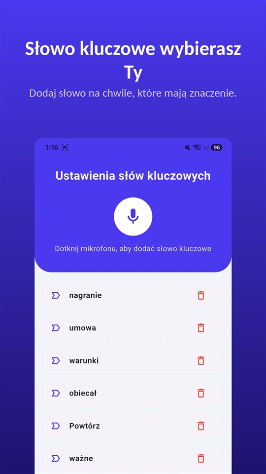

„Masz chwilę? Wpadnij do mnie.”

W pokoju kierownik i ktoś z kadr. Na biurku już wydrukowane porozumienie. „Proponujemy rozstanie za porozumieniem stron. Tak będzie lepiej dla wszystkich. Inaczej będziemy musieli pójść inną drogą.”

Kilka tygodni później z tej rozmowy zostaje tylko jedno: **Twój podpis.**

Porozumienie stron można podważyć tylko tym, co działo się przed podpisem. A to, co działo się przed podpisem, było rozmową.

## W skrócie

| Sposób rozstania | Kiedy zasiłek | Jak podważyć |
|---|---|---|
| Wypowiedzenie przez pracodawcę | Od dnia rejestracji | Odwołanie do sądu pracy w ciągu 21 dni (art. 264 k.p.) |
| Porozumienie stron z inicjatywy pracodawcy | Zwykle po 90 dniach; od razu przy upadłości, likwidacji lub zwolnieniach z przyczyn zakładu pracy | Uchylenie się od skutków przy groźbie bezprawnej, w ciągu roku |
| Wypowiedzenie przez pracownika | Po 90 dniach | Uchylenie się od skutków przy groźbie bezprawnej, w ciągu roku |

## Podpis pod groźbą można odwołać – ale tylko pod groźbą bezprawną

Porozumienie stron (art. 30 § 1 pkt 1 k.p.) i wypowiedzenie złożone przez pracownika to **oświadczenia woli**. Jeśli zostały złożone **pod wpływem groźby bezprawnej**, można się **uchylić od ich skutków** (art. 87 i 88 k.c. w zw. z art. 300 k.p.):

- **na piśmie**, w oświadczeniu skierowanym do pracodawcy,
- w ciągu **roku od chwili, gdy ustał stan obawy**; liczy się dojście oświadczenia do pracodawcy w tym terminie,
- przy czym **ciężar dowodu** spoczywa na pracowniku.

Granica jest wyraźna. Według **Sądu Najwyższego** pracodawca, który **wskazuje na możliwość rozwiązania umowy**, **nie posługuje się groźbą bezprawną** (wyrok z **10 października 2002 r., I PKN 439/01**).

SN wyjaśnił też w uchwale **II PZP 8/04**, że od porozumienia o rozwiązaniu umowy za odszkodowaniem **nie można uchylić się tylko w części** dotyczącej wysokości odszkodowania. Albo całe porozumienie, albo nic.

## Co porozumienie stron oznacza dla zasiłku

Od **1 czerwca 2025 r.** obowiązuje **ustawa o rynku pracy i służbach zatrudnienia**. Zasada pozostała ta sama:

- Po **porozumieniu stron** albo **własnym wypowiedzeniu** zasiłek przysługuje **dopiero po 90 dniach** od rejestracji, a **okres pobierania skraca się** o te 90 dni.
- **Wyjątek**: porozumienie zawarte z powodu **upadłości lub likwidacji pracodawcy** albo **zmniejszenia zatrudnienia z przyczyn dotyczących zakładu pracy** – wtedy zasiłek od dnia rejestracji.

Dlatego **przyczyna wpisana w porozumieniu** ma znaczenie. „Na wniosek pracownika” i „z przyczyn dotyczących pracodawcy” to różnica trzech miesięcy zasiłku.

## Co wypowiedzenie by Ci zostawiło

Od **wypowiedzenia** pracodawcy odwołujesz się do sądu pracy w ciągu **21 dni** od doręczenia (art. 264 k.p.). Przy porozumieniu stron nie ma czego zaskarżyć – zostaje tylko uchylenie się od skutków oświadczenia. Dlatego porozumienie jest proponowane tak chętnie.

Oświadczenia o rozwiązaniu umowy składa się **na piśmie** (art. 30 § 3 k.p.). Nie podpisuj w pokoju. Poproś o czas, zabierz projekt do domu, zapytaj o przyczynę, która ma się znaleźć w dokumencie.

## Wszystko zależy od rozmowy

Czy padła groźba? Jakimi słowami? Z czyjej inicjatywy wyszło porozumienie? **Wszystko to jest w rozmowie, która nie zostawia dokumentu** – a dowód obciąża Ciebie.

W Polsce nagranie rozmowy, w której się uczestniczy, co do zasady **nie jest przestępstwem**: **art. 267 § 3 Kodeksu karnego** dotyczy uzyskiwania informacji, do której nie jest się uprawnionym, a uczestnik rozmowy jest uprawniony do tego, co się do niego mówi. **Sąd Najwyższy** uznawał nagrania dokonane bez wiedzy rozmówcy za dowód w sprawach cywilnych, **jeśli nie podważono skutecznie ich autentyczności**. Więcej w [Czy można nagrywać rozmowę bez zgody?](/blog/pl/nagrywanie-rozmowy/).

Problemem jest moment. Rozmowa jest ustalana w ostatniej chwili, trwa dziesięć minut, a zdanie, które ma znaczenie, pada bez zapowiedzi. Zanim wyjmiesz telefon, odblokujesz go i naciśniesz nagrywanie, już minęło.

[TalkSafe](/talksafe/pl/) to aplikacja do nagrywania na Androida, która zaczyna nagrywać, gdy usłyszy **wybrane wcześniej słowo**. Słowa są rozpoznawane **niezależnie od tego, kto je wypowie**, więc można ustawić to, co zwykle mówi **druga strona** w takiej rozmowie: „porozumienie”, „dyscyplinarka”, „inną drogą”. Działa przy **zablokowanym ekranie**, a **30 sekund sprzed startu** zostaje w pliku – zdanie, po którym zorientowałeś się, o co chodzi, się nie gubi.

<figure class="shot"><figcaption>Ustawienia słów kluczowych. Można zapisać kilka słów; wystarczy, że zostanie wykryte jedno z nich.</figcaption></figure>

Nagrywanie rozmów, w których nie uczestniczysz – telefon zostawiony w pokoju, z którego wyszedłeś – to podsłuch i przestępstwo.

## Jeśli pracujesz w Niemczech, Holandii albo Wielkiej Brytanii

- **Niemcy**: umowa rozwiązująca (*Aufhebungsvertrag*) wymaga **formy pisemnej** (§ 623 BGB) i **nie można jej odwołać**; jest jednak nieważna, jeśli zawarto ją z naruszeniem **zasady uczciwych negocjacji** (BAG, 7 lutego 2019 r., 6 AZR 75/18). Bez ważnej przyczyny grozi **wstrzymanie zasiłku zwykle na 12 tygodni**. Nagranie własnej rozmowy **bez zgody jest przestępstwem** (§ 201 StGB) – bezpieczniej nagrać zaraz po rozmowie **własnym głosem**, co zostało powiedziane. Szczegóły po niemiecku: [Aufhebungsvertrag unter Druck](/blog/de/aufhebungsvertrag/).
- **Holandia**: umowa o rozwiązaniu (*vaststellingsovereenkomst*) musi być **pisemna**, a pracownik może od niej **odstąpić w ciągu 14 dni** bez podania przyczyny; jeśli w umowie brak o tym wzmianki – w ciągu **trzech tygodni** (art. 7:670b BW). Nagranie własnej rozmowy jest dozwolone. Po niderlandzku: [Vaststellingsovereenkomst onder druk](/blog/nl/vaststellingsovereenkomst/).
- **Wielka Brytania**: rozmowa o odejściu na uzgodnionych warunkach (*protected conversation*) jest co do zasady **niedopuszczalna jako dowód** w zwykłej sprawie o nieuczciwe zwolnienie (**sekcja 111A Employment Rights Act 1996**), ale **nie** w sprawach o dyskryminację czy nękanie i **nie wtedy**, gdy zachowanie było **niewłaściwe** (*improper behaviour*). Dla zakończeń zatrudnienia od **1 października 2026 r.** termin na pozew wynosi zwykle **sześć miesięcy minus jeden dzień**. Ukryte nagranie przez uczestnika **może** zostać dopuszczone przez trybunał. Po angielsku: [The exit conversation is off the record until it isn't](/blog/en/forced-resignation/).

Irlandia nie jest omówiona w tym artykule.

## Podsumowanie

- Od porozumienia lub wypowiedzenia złożonego **pod groźbą bezprawną** można się uchylić **na piśmie w ciągu roku**.
- **Zapowiedź zwolnienia** sama w sobie **nie jest** groźbą bezprawną; **dowód** po stronie pracownika.
- Porozumienie stron i własne wypowiedzenie: **zasiłek po 90 dniach**, chyba że porozumienie wynika z przyczyn zakładu pracy.
- **Nie podpisuj w pokoju.** Sprawdź, jaka przyczyna zostanie wpisana.
- **Nagranie własnej rozmowy** jest w Polsce co do zasady dozwolone.

Jak udowodnić mobbing: [Jak udowodnić mobbing w pracy?](/blog/pl/mobbing/). Co robić z nagraniem potem: [Co zrobić z nagraniem, a czego z nim nie robić](/blog/pl/after-recording/).

## Źródła

- [Kodeks pracy (ISAP, Sejm)](https://isap.sejm.gov.pl/isap.nsf/DocDetails.xsp?id=WDU19740240141)
- [Porozumienie stron lub wypowiedzenie umowy przez pracownika a prawo do zasiłku (Zielona Linia)](https://zielonalinia.gov.pl/porozumienie-stron-lub-wypowiedzenie-umowy-przez-pracownika-a-prawo-do-zasilku/)
- [Burgerlijk Wetboek Boek 7, art. 7:670b (wetten.overheid.nl)](https://wetten.overheid.nl/jci1.3:c:BWBR0005290&boek=7&titeldeel=10&afdeling=9&artikel=670b)
- [Employment Rights Act 1996, section 111A (legislation.gov.uk)](https://www.legislation.gov.uk/ukpga/1996/18/section/111A)

Informacja ogólna, nie porada prawna. W konkretnej sprawie skontaktuj się z adwokatem lub radcą prawnym od prawa pracy albo z Państwową Inspekcją Pracy.

