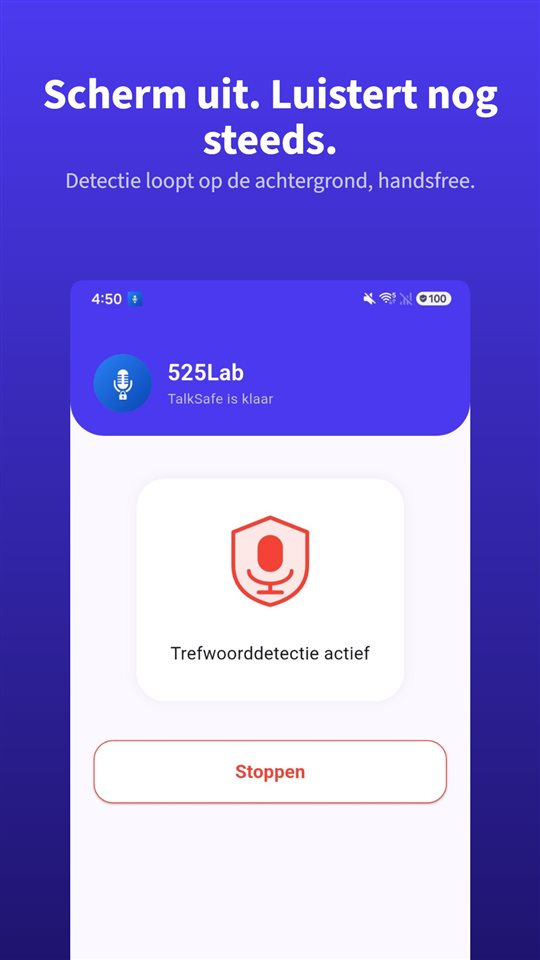

De klap, dan stilte. Beide bestuurders stappen uit.

En bijna altijd valt in de eerste seconden de zin die later het meest telt. "Ik zag je niet." "Ik had haast." "Sorry, mijn fout."

Daarna worden gegevens uitgewisseld, het schadeformulier ingevuld, iedereen rijdt verder. En **die zin staat nergens.**

Het schadeformulier heeft een vakje voor elke situatie. Voor wat er gezegd is, heeft het er geen.

## Nederland en België naast elkaar

| Vraag | Nederland | België |
|---|---|---|
| Plicht ter plaatse | Stoppen en identiteit kenbaar maken (art. 7 WVW) | Ter plaatse blijven, gegevens uitwisselen |
| Formulier | Europees schadeformulier | Europees aanrijdingsformulier |
| Is het formulier een schuldbekentenis? | Nee; verzekeraar beoordeelt aansprakelijkheid | Niet onderzocht in detail |
| Wegrijden | Strafbaar; melding bij politie binnen 12 uur sluit vervolging uit (met uitzonderingen) | Vluchtmisdrijf |
| Eigen gesprek opnemen | Mag (art. 139a Sr) | Mag (Cassatie 2015) |

Suriname, Aruba, Curaçao, Sint Maarten en Caribisch Nederland zijn voor deze vraag niet onderzocht.

## Wat je ter plaatse moet doen

- **Stoppen** en de plek veilig maken.
- **Gewonden?** Eerste hulp en **112**.
- **Gegevens uitwisselen**: naam, adres, kenteken, verzekering.

**Artikel 7 van de Wegenverkeerswet 1994** verplicht iedere betrokkene bij een verkeersongeval om te **stoppen** en zijn **identiteit kenbaar te maken** – ook bij lichte blikschade. Doorrijden is strafbaar; voor ongevallen met letsel is de maximumstraf verhoogd. Meld je je **binnen twaalf uur** bij de politie, voordat je als verdachte bent aangehouden of verhoord, en maak je je identiteit en die van het voertuig kenbaar, dan is vervolging voor het doorrijden uitgesloten – behalve als een slachtoffer in **hulpeloze toestand** is achtergelaten.

Let op wat de wet vraagt: identiteit en voertuig. **Over wat er gezegd is, vraagt hij niets.**

## Het schadeformulier is geen schuldbekentenis

Je vult het **Europees schadeformulier** samen met de andere bestuurder in: kruisjes voor de situatie, een schets, gegevens, handtekeningen.

Het invullen en ondertekenen betekent **niet** dat een van de partijen **schuld erkent**; je geeft alleen de **feitelijke situatie** weer. Je hoeft het dus niet eens te zijn over wie schuld heeft om het in te vullen. De **verzekeraar beoordeelt** aan de hand van het formulier de aansprakelijkheid; bij gedeelde schuld krijg je een deel van je schade vergoed. Lever het zo snel mogelijk in en kijk in je polis welke termijn je verzekeraar noemt.

De praktische regel: **schrijf en zeg niets als feit waar je niet zeker van bent.** "Heb je je pijn gedaan?" en "het was helemaal mijn schuld" zijn twee verschillende zinnen.

En andersom – daar gaat dit artikel over: **zegt de ander dat hij je niet zag, dan is dat de moeite waard om te bewaren.** Herinneringen schikken zich in de dagen daarna, vaak zonder kwade trouw, in een gunstiger vorm.

## Je eigen gesprek opnemen mag

In **Nederland** stelt **artikel 139a van het Wetboek van Strafrecht** alleen het opnemen strafbaar door iemand die **geen deelnemer** is. Een gesprek met de andere bestuurder waaraan je zelf deelneemt, mag je opnemen, ook zonder toestemming. De **Hoge Raad** oordeelde op **18 april 2014** dat in een civiele procedure **niet als algemene regel** geldt dat onrechtmatig verkregen bewijs buiten beschouwing blijft. Meer in [Mag je een gesprek stiekem opnemen?](/blog/nl/gesprek-opnemen/). Komt de politie ter plaatse, kijk dan in [Mag je de politie filmen of opnemen?](/blog/nl/recording-police/).

Het probleem is het moment. Je bent net aangereden, je hart bonkt, de auto moet van de rijbaan, de ander loopt al op je af. Niemand pakt in die toestand zijn telefoon, opent een app en drukt op een knop. En **de zin die ertoe doet valt in de eerste tien seconden** – de structuur uit [Waarom je altijd te laat op opnemen drukt](/blog/nl/recording-delay/), in zijn meest extreme vorm.

[TalkSafe](/talksafe/nl/) is een opname-app voor Android die begint met opnemen zodra hij een **vooraf gekozen woord** hoort – met een **vergrendeld scherm**, zonder de telefoon te ontgrendelen of de app te openen. Woorden worden herkend **wie ze ook zegt**, dus je kunt instellen wat **de andere bestuurder** meestal zegt: "verzekering", "gezien". Stel je **twee woorden in die waarschijnlijk in dezelfde zin vallen** – "ik heb je niet gezien, mijn verzekering regelt het" – dan wordt de herkenning nauwkeuriger. De **30 seconden daarvoor** staan in het bestand, dus de zin die viel voordat je het doorhad, gaat niet verloren.

<figure class="shot"><figcaption>Trefwoordherkenning actief. De app blijft op de achtergrond luisteren, ook met het scherm uit of de app gesloten.</figcaption></figure>

Daarnaast:

- **Foto's** voordat de auto's verplaatst worden: posities, schade, kentekens, borden.
- **Getuigen** met naam en telefoonnummer, voordat ze weg zijn.

Gesprekken van anderen opnemen is in beide landen strafbaar.

## België

- Je vult het **Europees aanrijdingsformulier** in, een formulier dat in alle EU-landen hetzelfde is. **Ter plaatse blijven en je gegevens uitwisselen is verplicht**, ook bij een klein ongeval op een parking.
- **Vluchtmisdrijf** veronderstelt dat je betrokken was, wist of redelijkerwijs moest weten dat er een ongeval gebeurde, en vrijwillig wegreed om de vaststellingen te ontlopen.
- **Opnemen**: een deelnemer die een communicatie opneemt, pleegt volgens het **Hof van Cassatie (2015)** geen misdrijf, en het Hof bevestigde op **14 juni 2021** dat onrechtmatig verkregen bewijs in burgerlijke zaken in beginsel is toegelaten.

## Kort gezegd

- **Stoppen, veilig maken, gewonden helpen, identiteit kenbaar maken** (art. 7 WVW).
- **Europees schadeformulier**: geen schuldbekentenis; de verzekeraar beoordeelt.
- Zeg en schrijf niets als feit waar je niet zeker van bent. **Foto's en getuigen** voordat de auto's verplaatst worden.
- **Wat er gezegd is**, staat op geen formulier – en **je eigen gesprek opnemen mag** in Nederland en België.

Wat je daarna met een opname doet: [Wat je met een opname doet, en wat je er niet mee doet](/blog/nl/after-recording/).

## Bronnen

- [Wegenverkeerswet 1994, artikel 7 (wetten.overheid.nl)](https://wetten.overheid.nl/jci1.3:c:BWBR0006622&hoofdstuk=II&paragraaf=1&artikel=7)
- [Wat moet je doen na een ongeval? (Wikifin, FSMA)](https://www.wikifin.be/nl/budget-betalen-lenen-en-verzekeren/verzekeren/auto-en-fietsverzekering/wat-moet-je-doen-na-een)

Algemene informatie, geen juridisch advies. Raadpleeg voor een concreet geval je verzekeraar of een advocaat.

