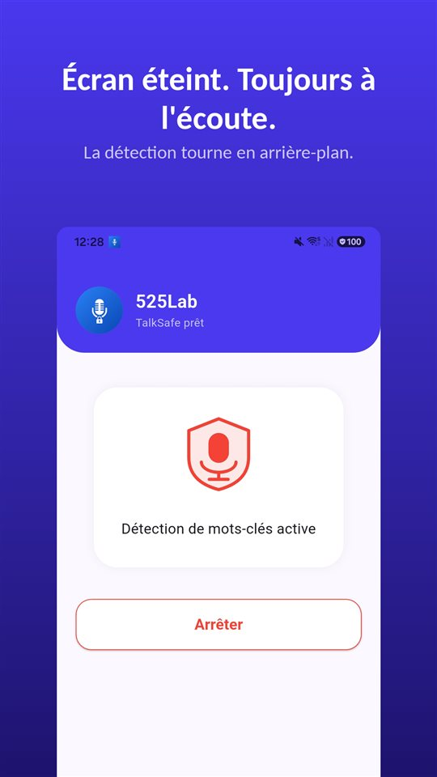

Le choc, puis le silence. Les deux conducteurs descendent.

Et presque toujours, dans les premières secondes, quelqu'un dit la phrase qui comptera le plus. « Je ne vous ai pas vu. » « J'étais pressé. » « Désolé, c'est de ma faute. »

Puis on échange les coordonnées, on remplit le constat, chacun repart. Et **cette phrase n'est nulle part.**

Le constat a une case pour chaque circonstance. Il n'en a aucune pour ce qui a été dit.

## France, Belgique, Suisse et Québec en un coup d'œil

| Question | France | Belgique | Suisse | Québec |
|---|---|---|---|---|
| Document de base | Constat amiable, à l'assureur dans les 5 jours ouvrés au moins | Constat européen d'accident | Non analysé | Constat amiable |
| Qui fixe la responsabilité | L'assureur, puis le juge | L'assureur, puis le juge | Non analysé | Son propre assureur (Convention d'indemnisation directe) ; corporel sans égard à la faute (SAAQ) |
| Partir sans s'arrêter | Délit de fuite (art. 434-10 CP) | Délit de fuite | Puni (art. 92 LCR) | Non analysé |
| Enregistrer sa conversation sans accord | Puni (art. 226-1 CP) | Permis au participant | Puni (art. 179ter CP) | Permis au participant |

Le Luxembourg et Monaco ne sont pas couverts par cet article.

## France : ce qu'il faut faire sur place

- **S'arrêter**, sécuriser les lieux, porter secours et appeler les secours s'il y a des blessés.
- **Remplir le constat amiable** avec l'autre conducteur : cases cochées, croquis, observations, signatures.
- **Le transmettre à son assureur** dans le délai prévu au contrat, qui ne peut pas être inférieur à **cinq jours ouvrés** (**article L113-2 du Code des assurances**).

Partir sans s'arrêter, en sachant qu'on vient de causer un accident, pour **échapper à sa responsabilité**, est un **délit de fuite** (**article 434-10 du Code pénal**) : jusqu'à **trois ans d'emprisonnement et 75 000 euros d'amende** sans circonstance aggravante.

Le **refus de signer** le constat, lui, n'est pas un délit de fuite. On remplit alors le constat seul, on le transmet non signé, avec l'immatriculation de l'autre véhicule et les coordonnées des témoins.

## « C'est ma faute » : ce que la phrase vaut vraiment

Deux idées reçues circulent, en sens opposés.

**La première : la phrase ne vous condamne pas d'office.** L'**article L124-2 du Code des assurances** prévoit que **l'aveu de la matérialité d'un fait ne peut être assimilé à la reconnaissance d'une responsabilité**, et l'assureur peut stipuler qu'**aucune reconnaissance de responsabilité** intervenue **en dehors de lui** ne lui est opposable.

**La seconde : la phrase n'est pas sans effet.** Le constat signé vaut **aveu extrajudiciaire** sur les circonstances de l'accident – un aveu que le juge apprécie librement, mais un aveu. Et la signature **n'engage que celui qui a signé**.

La règle pratique en découle : **ne pas affirmer ce dont on n'est pas sûr.** « Vous êtes blessé ? » et « c'est entièrement de ma faute » ne sont pas la même phrase.

Et l'inverse vaut aussi, c'est le sujet de cet article : **si l'autre conducteur dit qu'il ne vous a pas vu, cela vaut la peine d'être gardé.** Les souvenirs se réorganisent dans les jours qui suivent, souvent sans aucune mauvaise foi.

## Ce que personne ne réussit à garder

Le moment est le pire possible pour se préparer. Vous venez d'être percuté, le cœur bat vite, il faut dégager la voiture, l'autre conducteur arrive déjà. Personne, dans cet état, ne sort son téléphone, n'ouvre une application et n'appuie sur un bouton. C'est la structure décrite dans [Pourquoi on appuie toujours trop tard sur enregistrer](/blog/fr/recording-delay/), sous sa forme la plus extrême.

**En France, l'enregistrer en cachette n'est pas la solution.** L'**article 226-1 du Code pénal** punit l'enregistrement sans consentement de paroles prononcées à titre privé ou confidentiel, **même par un participant**. Le cadre complet est dans [Enregistrer une conversation à l'insu de quelqu'un : interdit en France, permis en Belgique et au Québec](/blog/fr/enregistrer-conversation/), et si la police arrive sur place, dans [Peut-on filmer ou enregistrer la police ?](/blog/fr/recording-police/).

Ce qui tient :

- **Des photos** avant de déplacer les véhicules : positions, dégâts, plaques, panneaux.
- **Les témoins**, nom et téléphone, avant qu'ils partent.
- **Votre propre récit, à voix haute, juste après.** Qui a dit quoi, avec quels mots, devant qui. Ce n'est pas enregistrer les paroles d'autrui : c'est votre témoignage, au plus près des faits.
- **Un enregistrement avec l'accord de l'autre.**

[TalkSafe](/talksafe/fr/) est une application d'enregistrement pour Android et iPhone qui démarre sur un **mot choisi à l'avance** et fonctionne **écran verrouillé**, sans déverrouiller le téléphone ni ouvrir l'application. Choisissez un mot comme « note » : dès que l'autre est reparti, vous le dites et votre récit commence, encore au bord de la route. Si l'échange doit être enregistré ouvertement, le mot peut être dans la question : avec « enregistrer », l'enregistrement commence quand vous demandez « Je peux enregistrer, pour qu'on ait la même version ? », et la réponse est dans le fichier, avec les **30 secondes précédentes**.

<figure class="shot"><figcaption>Détection des mots-clés active. L'application continue d'écouter en arrière-plan, écran éteint ou application fermée.</figcaption></figure>

## Belgique

- On remplit le **constat européen d'accident**, formulaire identique dans tous les pays de l'Union ; rester sur place et échanger ses coordonnées est obligatoire, même pour un accrochage sur un parking.
- Le **délit de fuite** suppose d'être impliqué, de savoir qu'un accident vient de se produire et de partir volontairement pour échapper aux constatations.
- **Enregistrer** : un participant qui enregistre sa propre conversation ne commet pas d'infraction (Cour de cassation, 2015). Comme le mot-clé n'est pas lié à une personne, il peut être un mot que l'autre conducteur dira, par exemple « assurance » ; en enregistrant aussi un second mot de la même phrase, comme « vu », la détection devient plus fiable. Les 30 secondes précédentes sont dans le fichier.

## Suisse

- S'il n'y a que des **dégâts matériels**, l'auteur doit **avertir immédiatement le lésé** et lui indiquer **son nom et son adresse** ; si c'est impossible, il doit **avertir sans délai la police** (**article 51, alinéa 3, LCR**). Un dégât minime n'en dispense pas. La violation de ces devoirs est punie selon l'**article 92 LCR**.
- **Enregistrer** sans consentement est puni (**article 179ter CP**). Ici aussi, votre récit à voix haute juste après est la voie sûre.

## Québec

- **Dommages corporels** : indemnisés par la **SAAQ sans égard à la faute**, selon le régime public en place depuis **1978**.
- **Dommages matériels** : ils relèvent des assureurs privés. Selon la **Convention d'indemnisation directe**, vous traitez avec **votre propre assureur**, qui détermine votre part de responsabilité. Le constat amiable **ne sert pas à confesser une faute** ni à établir une responsabilité égale.
- **Enregistrer** : un participant peut enregistrer sa propre conversation.

## En bref

- **S'arrêter, sécuriser, secourir, remplir le constat**, et l'envoyer à l'assureur dans les **5 jours ouvrés** au moins.
- **Photos et témoins** avant de déplacer les véhicules.
- « C'est ma faute » **n'est pas une reconnaissance de responsabilité** opposable d'office, mais le constat signé **vaut aveu** sur les faits.
- **Ce qui a été dit** n'est sur aucun formulaire. En France et en Suisse : **votre récit à voix haute** ou un enregistrement **avec accord** ; en Belgique et au Québec, le participant peut enregistrer.

Ce qu'on fait ensuite d'un enregistrement : [Ce qu'il faut faire d'un enregistrement, et ce qu'il ne faut pas en faire](/blog/fr/after-recording/).

## Sources

- [Loi fédérale sur la circulation routière, art. 51 (Fedlex)](https://www.fedlex.admin.ch/eli/cc/1959/679_705_685/fr#art_51)
- [Constat d'accident (Wikifin, FSMA)](https://www.wikifin.be/fr/thematiques/assurer/assurance-vehicules/en-pratique/constat-daccident)

Information générale, pas un avis juridique. Pour une situation précise, consultez votre assureur ou un avocat.

