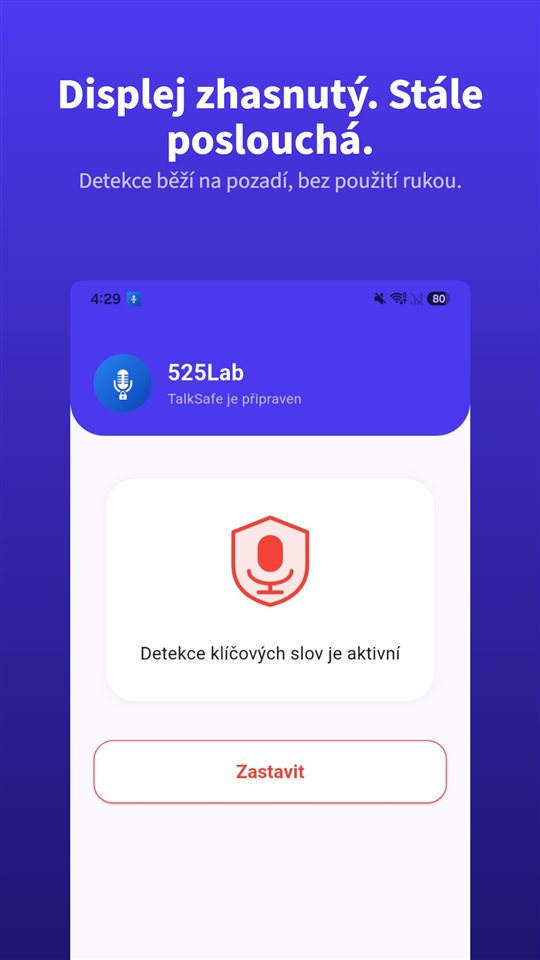

Náraz, pak ticho. Oba řidiči vystoupí.

A skoro vždycky v prvních vteřinách padne věta, na které bude později nejvíc záležet. „Já vás neviděl.“ „Spěchal jsem.“ „Promiňte, to je moje chyba.“

Pak se vymění údaje, vyplní se záznam, každý odjede. A **ta věta není nikde.**

Společný záznam má kolonku pro každou okolnost. Pro to, co bylo řečeno, nemá žádnou.

## Česko a Slovensko vedle sebe

| Otázka | Česko | Slovensko |
|---|---|---|
| Kdy volat policii | Zranění, usmrcení nebo škoda nad 200 000 Kč na jednom vozidle (od 1. 7. 2025) | Bez hranice škody (od 1. 7. 2022); mimo jiné zranění, alkohol, neshoda o vině |
| Jinak | Společný záznam, podepsaný, pojišťovně | Záznam o nehodě, podepsaný oběma |
| Náčrtek | Může ho nahradit fotodokumentace | Zde neověřeno |
| Vlastní rozhovor nahrát | K ochraně svých práv bez svolení (§ 88 OZ) | Jen se svolením, s výjimkami (§ 12 OZ) |

## Česko: kdy volat policii

Podle **§ 47 zákona o silničním provozu** jsou účastníci povinni nehodu **oznámit policii**, když:

- je někdo **usmrcen nebo zraněn**,
- **hmotná škoda** na jednom ze zúčastněných vozidel včetně přepravovaných věcí **zřejmě převyšuje 200 000 Kč** – tato hranice platí **od 1. července 2025**, dříve to bylo 100 000 Kč,
- je poškozena **pozemní komunikace** nebo **majetek třetí osoby**.

Ve všech ostatních případech jsou účastníci povinni **sepsat a podepsat společný záznam o dopravní nehodě** a předat ho pojišťovně. Od 1. července 2025 může **náčrtek nahradit fotodokumentace** a záznam **nemusí být vyplněn přímo na místě** – můžete odjet na klidné místo.

Všimněte si, co zákon chce: údaje, okolnosti, podpisy. **O tom, co kdo řekl, nechce nic.**

## Co znamená „to je moje chyba“

O odpovědnosti rozhoduje **pojišťovna** při likvidaci pojistné události – podle okolností nehody, záznamu, fotografií a svědků. Věta řečená v rozrušení **sama o sobě vinu neurčuje**.

Neznamená to ale, že nic neváží. Druhá strana se na ni později může odvolávat. Proto platí jednoduché pravidlo: **netvrďte jako fakt nic, čím si nejste jistí** – a nepište to ani do záznamu. „Nestalo se vám nic?“ a „je to celé moje vina“ jsou dvě různé věty.

A naopak, o čemž je tento článek: **když druhý řidič řekne, že vás neviděl, stojí to za uchování.** Vzpomínky se v dalších dnech přeskládají, často bez jakéhokoli zlého úmyslu, do výhodnější podoby.

## Nahrát vlastní rozhovor k ochraně svých práv

Podle **§ 86 občanského zákoníku** nelze bez svolení pořizovat zvukový záznam soukromého života člověka. Podle **§ 88 odst. 1** však svolení **není třeba**, pokud se záznam **pořídí nebo použije k výkonu nebo ochraně jiných práv nebo právem chráněných zájmů**. Doložit, co druhý řidič na místě řekl, je přesně takový případ. **Ústavní soud** v nálezu **II. ÚS 1774/14** rozhodl, že tajně pořízený záznam **nelze jako důkaz odmítnout jen proto**, že obsahuje projevy osobní povahy. Víc v [Je legální nahrávat rozhovor bez souhlasu?](/blog/cs/nahravani-rozhovoru/); přijede-li policie, v [Smí se nahrávat policie?](/blog/cs/recording-police/).

Problémem je okamžik. Právě do vás někdo narazil, srdce buší, auto je potřeba odstavit z vozovky a druhý řidič už jde k vám. Nikdo v takovém stavu nevytahuje telefon, neotevírá aplikaci a nemačká tlačítko. A **věta, na které záleží, padne v prvních deseti vteřinách** – struktura z [Proč tlačítko nahrávání mačkáte vždycky pozdě](/blog/cs/recording-delay/) v té nejkrajnější podobě.

[TalkSafe](/talksafe/cs/) je aplikace pro nahrávání na Android, která začne nahrávat, když uslyší **předem zvolené slovo** – při **zamčené obrazovce**, bez odemykání telefonu a bez otevírání aplikace. Slova rozpozná **bez ohledu na to, kdo je řekne**, takže lze nastavit, co obvykle říká **druhý řidič**: „pojišťovna“, „neviděl“. Uložíte-li **dvě slova, která pravděpodobně zazní ve stejné větě** – „neviděl jsem vás, zaplatí to pojišťovna“ – rozpoznávání bude spolehlivější. **30 sekund předtím** zůstane v souboru.

<figure class="shot"><figcaption>Rozpoznávání klíčových slov zapnuto. Aplikace poslouchá dál na pozadí i se zhasnutou obrazovkou nebo zavřenou aplikací.</figcaption></figure>

K tomu:

- **Fotky** dřív, než se s auty pohne: poloha, poškození, SPZ, značky.
- **Svědci** se jménem a telefonem, než odejdou.

Nahrávat rozhovory, kterých se neúčastníte, pod výjimku § 88 nespadá.

## Slovensko

- **Od 1. července 2022** (zákon č. **179/2022 Z. z.**) neplatí **žádná hranice škody** pro přivolání policie; dříve to bylo 3 990 eur.
- **Policie se volá** mimo jiné při **usmrcení nebo zranění**, **poškození cesty** nebo veřejného zařízení, **úniku nebezpečných látek**, podezření z **alkoholu nebo drog** a tehdy, když se účastníci **neshodnou na vině**.
- Jinak účastníci **sepíší a podepíší záznam o nehodě**. Odborníci upozorňují, že mezery v dokumentaci mohou vést k zamítnutí pojistného plnění – fotky poškození, poloh vozidel a okolí jsou proto o to důležitější.
- **Nahrávání**: podle **§ 12 slovenského občanského zákoníku** lze zvukový záznam pořídit nebo použít **jen se svolením**, s výjimkami. Bezpečnější je hned po odjezdu druhého řidiče nahrát **vlastním hlasem**, co se stalo a kdo co řekl – s klíčovým slovem jako „poznámka“ začne nahrávání, aniž byste vytahovali telefon.

## Shrnutí

- **V Česku policie** při zranění nebo škodě **nad 200 000 Kč** na jednom vozidle; jinak **společný záznam**.
- **Na Slovensku** bez hranice škody; policie i při **neshodě o vině**.
- Netvrďte jako fakt, čím si nejste jistí. **Fotky a svědci** před přesunem aut.
- **Co bylo řečeno**, se nikam nezapíše. V Česku lze vlastní rozhovor nahrát **k ochraně svých práv**; na Slovensku **vlastním hlasem hned potom**.

Co s nahrávkou potom: [Co s nahrávkou dělat, a co s ní nedělat](/blog/cs/after-recording/).

## Zdroje

- [Zákon č. 361/2000 Sb., o provozu na pozemních komunikacích (Zákony pro lidi)](https://www.zakonyprolidi.cz/cs/2000-361)
- [Změny v řešení dopravních nehod od 1. července 2025 (Policie ČR)](https://archiv.policie.gov.cz/clanek/zmeny-v-reseni-dopravnich-nehod-od-1-cervence-2025.aspx)
- [Zákon č. 8/2009 Z. z., o cestnej premávke (Slov-Lex)](https://www.slov-lex.sk/pravne-predpisy/SK/ZZ/2009/8/)

Obecné informace, nikoli právní rada. V konkrétní věci se obraťte na svou pojišťovnu nebo na advokáta.

