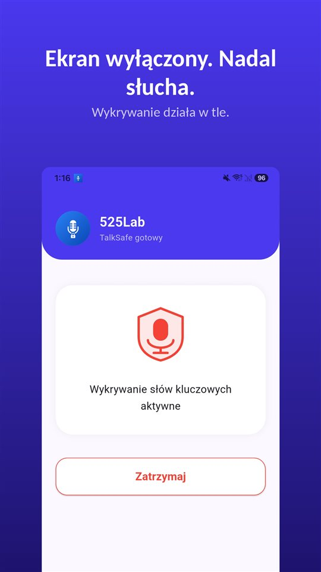

Uderzenie, potem cisza. Obaj kierowcy wysiadają.

I prawie zawsze w pierwszych sekundach pada zdanie, które później będzie najważniejsze. „Nie widziałem pana.” „Spieszyłem się.” „Przepraszam, to moja wina.”

Potem wymiana danych, jakieś zdjęcia, oświadczenie na kartce, każdy jedzie dalej. A **tego zdania nie ma nigdzie.**

Oświadczenie sprawcy opisuje, co się stało. Nie zapisuje tego, co zostało powiedziane.

## W skrócie

| Sytuacja | Co robić |
|---|---|
| Ktoś jest ranny (wypadek) | Pomoc, 112, policja |
| Tylko szkoda, kierowcy zgodni co do winy (kolizja) | Wymiana danych, oświadczenie sprawcy, zgłoszenie z OC sprawcy |
| Tylko szkoda, brak zgody co do winy | Policja |
| Odjazd bez wypełnienia obowiązków | Wykroczenie (art. 97 k.w.) |
| Nagranie własnej rozmowy | Co do zasady dozwolone |

## Co zrobić na miejscu

Obowiązki uczestnika zdarzenia drogowego określa **art. 44 ustawy Prawo o ruchu drogowym**:

- **zatrzymać się** i nie powodować dalszego zagrożenia,
- **zabezpieczyć** miejsce zdarzenia,
- **podać dane** pozostałym uczestnikom,
- przy **rannych** – udzielić pomocy i wezwać pogotowie oraz policję.

Opuszczenie miejsca zdarzenia bez wypełnienia tych obowiązków to **wykroczenie z art. 97 Kodeksu wykroczeń**.

Gdy nikt nie jest ranny, a kierowcy zgadzają się co do winy, policja nie jest potrzebna. Sprawca spisuje **oświadczenie**, które jest podstawą zgłoszenia szkody z jego **OC**. Gdy zgody nie ma – **wzywa się policję**.

## Oświadczenie sprawcy nie zamyka sprawy

To powszechne przekonanie: mamy kartkę z podpisem, sprawa załatwiona.

W praktyce bywa inaczej. **Ubezpieczyciel może dokonywać własnych ustaleń** i zdarza się, że kwestionuje okoliczności opisane przez uczestników – w jednej ze spraw (Sąd Rejonowy w Gdyni, I C 455/20) ubezpieczyciel podważał, czy do zderzenia doszło tak, jak zadeklarowali kierowcy, mimo spisanego oświadczenia o przyjęciu winy. Zdarza się też, że **sprawca po kilku dniach zmienia zdanie** i twierdzi, że podpisał pod wpływem stresu.

Dlatego oświadczenie warto wzmocnić:

- **zdjęciami** przed przestawieniem aut: położenie, uszkodzenia, tablice, znaki,
- **danymi świadków**, zanim odejdą,
- **zapisem tego, co padło na miejscu** – bo właśnie tego oświadczenie nie zawiera.

I zasada w drugą stronę: **nie stwierdzaj jako faktu tego, czego nie jesteś pewien.** „Nic się panu nie stało?” i „to całkowicie moja wina” to dwa różne zdania.

## Nagranie własnej rozmowy jest dozwolone

W Polsce nagranie rozmowy, w której się uczestniczy, co do zasady **nie jest przestępstwem**: **art. 267 § 3 Kodeksu karnego** dotyczy uzyskiwania informacji, do której nie jest się uprawnionym, a uczestnik rozmowy jest uprawniony do tego, co się do niego mówi. **Sąd Najwyższy** uznawał nagrania dokonane bez wiedzy rozmówcy za dowód w sprawach cywilnych, **jeśli nie podważono skutecznie ich autentyczności**. Więcej w [Czy można nagrywać rozmowę bez zgody?](/blog/pl/nagrywanie-rozmowy/). Jeśli na miejsce przyjedzie policja, zajrzyj do [Czy można nagrywać policję?](/blog/pl/recording-police/).

Problemem jest moment. Właśnie w ciebie uderzono, serce wali, trzeba zjechać z jezdni, a drugi kierowca już idzie. Nikt w takim stanie nie wyjmuje telefonu, nie otwiera aplikacji i nie naciska przycisku. A **zdanie, które ma znaczenie, pada w pierwszych dziesięciu sekundach** – to struktura z [Dlaczego przycisk nagrywania zawsze wciskasz za późno](/blog/pl/recording-delay/) w najbardziej skrajnej postaci.

[TalkSafe](/talksafe/pl/) to aplikacja do nagrywania na Androida i iPhone'a, która zaczyna nagrywać, gdy usłyszy **wybrane wcześniej słowo** – przy **zablokowanym ekranie**, bez odblokowywania telefonu i otwierania aplikacji. Słowa są rozpoznawane **niezależnie od tego, kto je wypowie**, więc można ustawić to, co zwykle mówi **drugi kierowca**: „ubezpieczenie”, „nie widziałem”. Zapisanie **dwóch słów, które zwykle padają w tym samym zdaniu**, sprawia, że wykrywanie jest dokładniejsze. **30 sekund sprzed startu** zostaje w pliku – zdanie, które padło, zanim się zorientowałeś, nie ginie.

<figure class="shot"><figcaption>Wykrywanie słów kluczowych aktywne. Aplikacja słucha dalej w tle przy wyłączonym ekranie albo zamkniętej aplikacji.</figcaption></figure>

Nagrywanie rozmów, w których nie uczestniczysz, to podsłuch i przestępstwo.

## Jeśli stłuczka zdarzyła się w Niemczech, Holandii albo Wielkiej Brytanii

- **Niemcy**: trzeba się **zatrzymać, zabezpieczyć miejsce, pomóc rannym** i na żądanie podać **imię, nazwisko, adres, prawo jazdy, dowód rejestracyjny i dane ubezpieczenia** (**§ 34 StVO**); odjazd bez tego jest przestępstwem (§ 142 StGB). Spontaniczne „to moja wina” zwykle nie jest wiążącym uznaniem winy, ale może być poszlaką. Nagranie rozmowy **bez zgody jest przestępstwem** (§ 201 StGB) – bezpieczniej nagrać zaraz potem **własnym głosem**, co zostało powiedziane. Po niemiecku: [Unfall – was tun?](/blog/de/unfall-was-tun/).
- **Holandia**: trzeba się **zatrzymać i podać swoją tożsamość** (**art. 7 Wegenverkeerswet**). Wspólne europejskie oświadczenie o zdarzeniu (*Europees schadeformulier*) **nie jest przyznaniem się do winy** – opisuje fakty, a odpowiedzialność ocenia ubezpieczyciel. Nagranie własnej rozmowy jest dozwolone. Po niderlandzku: [Aanrijding – wat te doen?](/blog/nl/aanrijding-wat-te-doen/).
- **Wielka Brytania**: kierowca musi się **zatrzymać** i na żądanie podać **imię i adres, dane właściciela i numer rejestracyjny**; jeśli danych nie podano, trzeba **zgłosić zdarzenie na policji jak najszybciej, a najpóźniej w ciągu 24 godzin** (**sekcja 170 Road Traffic Act 1988**). Po angielsku: [No accident form has a box for what was said](/blog/en/accident-scene/).

Irlandia nie jest omówiona w tym artykule.

## Podsumowanie

- **Zatrzymaj się, zabezpiecz miejsce, podaj dane**; przy rannych – 112 i policja.
- Przy zgodzie co do winy – **oświadczenie sprawcy**; bez zgody – **policja**.
- **Oświadczenie bywa kwestionowane.** Zdjęcia, świadkowie i zapis tego, co padło, je wzmacniają.
- **Nagranie własnej rozmowy** jest w Polsce co do zasady dozwolone.

Co zrobić z nagraniem potem: [Co zrobić z nagraniem, a czego z nim nie robić](/blog/pl/after-recording/).

## Źródła

- [Road Traffic Act 1988, section 170 (legislation.gov.uk)](https://www.legislation.gov.uk/ukpga/1988/52/section/170)
- [Wegenverkeerswet 1994, artikel 7 (wetten.overheid.nl)](https://wetten.overheid.nl/jci1.3:c:BWBR0006622&hoofdstuk=II&paragraaf=1&artikel=7)

Informacja ogólna, nie porada prawna. W konkretnej sprawie skontaktuj się ze swoim ubezpieczycielem albo z adwokatem lub radcą prawnym.

