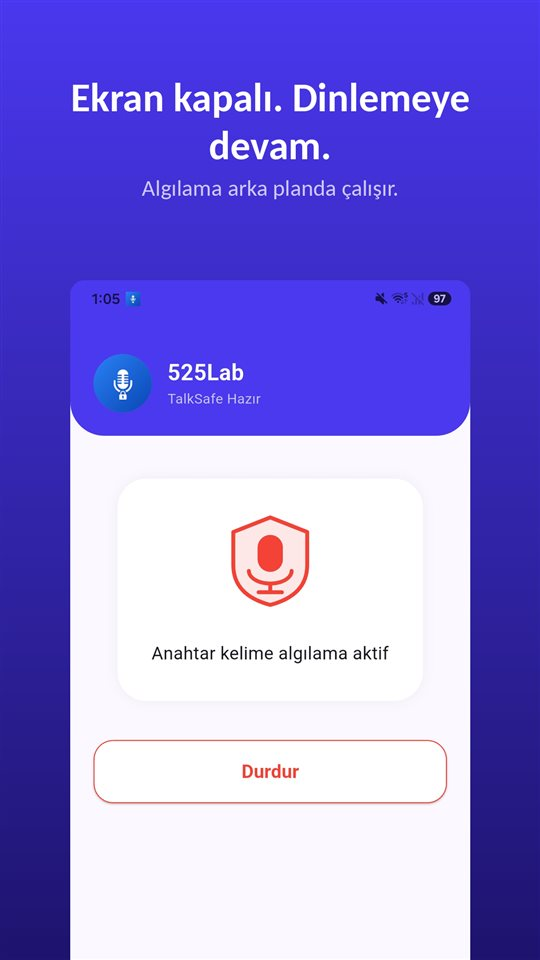

Çarpışma, sonra sessizlik. İki sürücü de araçtan iner.

Ve neredeyse her zaman, ilk birkaç saniyede en önemli cümle söylenir. "Sizi görmedim." "Acelem vardı." "Kusura bakmayın, benim hatam."

Sonra bilgiler alınır, tutanak doldurulur, herkes yoluna devam eder. Ve **o cümle hiçbir yerde yazmaz.**

Kaza tespit tutanağında her durum için bir kutu var. Söylenenler için hiçbir kutu yok.

## Bir bakışta

| Durum | Ne yapılır |
|---|---|
| Yaralı veya ölü var | 112 ve polis ya da jandarma; tutanağı görevliler düzenler |
| Yalnız maddi hasar, iki araç, sürücüler anlaşıyor | Anlaşmalı kaza tespit tutanağı (kağıt veya mobil) |
| Yalnız maddi hasar, sürücüler anlaşamıyor | Polis veya jandarma çağrılır |
| Tutanak sigortaya | Kağıt tutanak 5 iş günü içinde (sigorta kaynaklarına göre); mobil tutanakta ayrıca teslim gerekmez |
| Kusur oranı | Tutanak belirlemez; sigorta şirketi değerlendirir |

Bu yazı Türkiye'yi anlatır. Türkçe konuşanların yaşadığı Almanya, Avusturya ve İsviçre için Almanca [Unfall – was tun?](/blog/de/unfall-was-tun/) yazısına bakabilirsiniz; Hollanda, Belçika, Fransa ve KKTC bu yazıda ele alınmadı.

## Olay yerinde yapılacaklar

- **Durun ve güvenliği sağlayın.** Dörtlüleri yakın, reflektörü koyun.
- **Yaralı varsa** 112'yi arayın ve polis ya da jandarmaya haber verin. İlk yardım ve ihbar yükümlülükleri Karayolları Trafik Kanunu'nun **82. maddesinde** düzenlenir.
- **Yalnız maddi hasar varsa**, en az iki araç karışmışsa ve araçların geçerli **zorunlu trafik sigortası** varsa, sürücüler **anlaşmalı kaza tespit tutanağını** birlikte doldurabilir – kağıt üzerinde ya da **mobil kaza tutanağı** ile.
- **Anlaşamazsanız** polis veya jandarma çağrılır.

**Karayolları Trafik Kanunu'nun 81. maddesi**, anlaşma hali dışında maddi hasarlı kazalarda **izinsiz olay yerinden ayrılmayı** cezalandırır. Ya tutanağı birlikte doldurun ya da görevlileri bekleyin.

## Tutanak kusuru belirlemez

Çok yaygın bir yanlış anlama: tutanağı imzalayan kusuru kabul etmiş olur.

Oysa tutanak **kazanın nasıl olduğunu** kayda geçirir: araçların konumu, çizim, işaretlenen durumlar, imzalar. **Kusur oranını sigorta şirketi değerlendirir.** Sigorta kaynaklarına göre kağıt tutanak kazadan sonraki **5 iş günü** içinde sigorta şirketine iletilmelidir.

Bu yüzden iki kural önemli:

- **Emin olmadığınız bir şeyi tutanağa yazmayın.** Çizim ve işaretler, sözlerden daha ağır basar.
- **"Benim hatam" gibi cümleleri gerçek bir tespit gibi söylemeyin.** "Yaralandınız mı?" ile "Tamamen benim hatamdı" aynı cümle değildir.

Ve tersi de geçerli – bu yazının konusu da bu: **karşı taraf sizi görmediğini söylüyorsa, bu saklanmaya değer.** Anılar sonraki günlerde, çoğu zaman kötü niyet olmadan, daha lehte bir şekle girer.

## Kimsenin yakalayamadığı saniyeler

O an, hazırlık için mümkün olan en kötü andır. Çarpılmışsınız, nabzınız yüksek, aracı yoldan çekmeniz gerekiyor, karşı taraf yanınıza geliyor bile. Bu durumda kimse telefonu çıkarıp uygulama açıp düğmeye basmaz. Bu, [Kayıt tuşuna neden hep geç basılır](/blog/tr/recording-delay/) yazısında anlattığımız yapının en uç halidir.

Türkiye'de o konuşmayı **gizlice kaydetmek ise çözüm değildir.** **TCK 133/2**, katıldığınız **aleni olmayan** bir söyleşiyi diğer konuşanların **rızası olmadan** kaydetmeyi **altı aydan iki yıla kadar hapis veya adli para cezası** ile cezalandırır. Ayrıntılar [Gizli ses kaydı almak suç mu?](/blog/tr/ses-kaydi-suc-mu/) yazısında; polis olay yerine gelirse [Polisi kaydetmek yasak mı?](/blog/tr/recording-police/) yazısına bakın.

Güvenli olanlar:

- **Araçlar yerinden oynamadan fotoğraf**: konumlar, hasar, plakalar, levhalar.
- **Tanıklar**: ad ve telefon, gitmeden önce.
- **Kendi sesinizle, hemen sonra.** Kim ne dedi, hangi kelimelerle, kim duydu. Bu başkasının sözünü kaydetmek değil, kendi tanıklığınızı tarihli olarak saklamaktır.
- **Karşı tarafın rızasıyla kayıt.**

[TalkSafe](/talksafe/tr/), **önceden belirlediğiniz bir kelimeyi** duyduğunda kayda başlayan bir Android ses kayıt uygulamasıdır ve **ekran kilitliyken**, telefonun kilidini açmadan ve uygulamayı açmadan çalışır. "Not al" gibi bir kelime belirleyin: karşı taraf ayrılır ayrılmaz, hâlâ yol kenarındayken söyleyin ve kendi anlatımınız başlasın. Konuşma açıkça kayda alınacaksa kelime sorunun içinde olabilir: "kayıt" kelimesini belirleyin, "Aynı şeyi konuştuğumuzdan emin olmak için kayda alabilir miyim?" diye sorduğunuz anda kayıt başlar ve cevap, **önceki 30 saniyeyle** birlikte dosyada olur.

<figure class="shot"><figcaption>Anahtar kelime algılama etkin. Ekran kapalıyken ya da uygulama kapatılmışken arka planda dinlemeye devam eder.</figcaption></figure>

## Kısaca

- **Durun, güvenliği sağlayın, yaralı varsa 112 ve polis ya da jandarma.**
- Yalnız maddi hasarda **anlaşmalı tutanak**; anlaşamazsanız görevliler.
- **Tutanak kusuru belirlemez**; sigorta şirketi değerlendirir. Emin olmadığınızı yazmayın.
- **Söylenenler** hiçbir tutanakta yok. Türkiye'de: **kendi sesinizle hemen sonra** ya da **rızayla kayıt**.

Bir kayıtla sonra ne yapılır: [Bir kayıtla ne yapmalı, ne yapmamalı](/blog/tr/after-recording/).

## Kaynaklar

- [2918 sayılı Karayolları Trafik Kanunu (Mevzuat Bilgi Sistemi)](https://www.mevzuat.gov.tr/mevzuat?MevzuatNo=2918&MevzuatTur=1&MevzuatTertip=5)

Genel bilgilendirmedir, hukuki danışmanlık değildir. Somut durumunuz için sigorta şirketinize veya bir avukata danışın.

