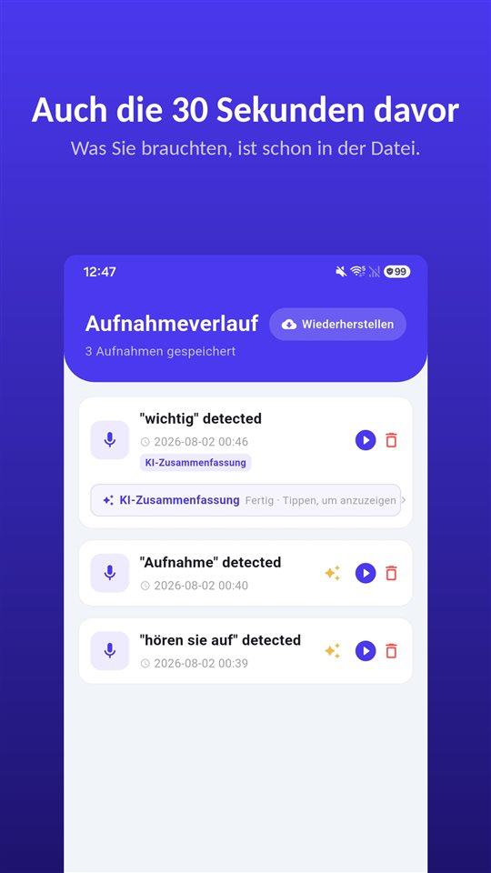

Sie gehen mit drei Fragen hinein. Die Ärztin beantwortet sie, sagt etwas zur Dosierung, erwähnt, worauf Sie achten sollen, und nach elf Minuten ist der Termin vorbei.

Auf dem Parkplatz fragt jemand, was sie gesagt hat. Die ehrliche Antwort: einen Teil davon.

Einer Übersichtsarbeit zufolge werden 40 bis 80 Prozent der medizinischen Informationen sofort wieder vergessen.

## Deutschland, Österreich und die Schweiz im Vergleich

| Frage | Deutschland | Österreich | Schweiz |
|---|---|---|---|
| Arztgespräch ohne Einwilligung aufnehmen | Strafbar (§ 201 StGB), Antragsdelikt | Eigenes Gespräch nicht strafbar; Weitergabe strafbar | Strafbar (Art. 179ter StGB) |
| Mit Einwilligung aufnehmen | Erlaubt | Erlaubt | Erlaubt |
| Abschrift unterschriebener Aufklärungsbögen | Ja (§ 630e Abs. 2 BGB) | Hier nicht ausgewertet | Hier nicht ausgewertet |
| Kopie der Patientenakte | Erste Kopie kostenlos (§ 630g BGB; EuGH C-307/22) | Hier nicht ausgewertet | Hier nicht ausgewertet |

## Das ist kein Konzentrationsproblem

Die Zahl stammt aus einer Übersichtsarbeit von **Kessels** im **Journal of the Royal Society of Medicine (2003)**: **40 bis 80 Prozent** der medizinischen Informationen, die Ärzte geben, werden **sofort wieder vergessen** – und von dem, was im Gedächtnis bleibt, wird ein Teil falsch erinnert.

Gründe sind Angst, Schmerzen, Fachbegriffe, Informationen, die nicht zu dem passen, was man vorher geglaubt hat. Mit Unaufmerksamkeit hat das wenig zu tun. Wer gerade eine Diagnose gehört hat, hört den nächsten Satz über die Einnahme schlicht schlechter.

## Was Sie schriftlich bekommen

Das deutsche Recht gibt Patienten mehr, als viele wissen:

- **Mündliche Aufklärung**: Nach **§ 630e Abs. 2 BGB** muss die Aufklärung **mündlich** erfolgen; ergänzend darf auf Unterlagen in Textform verwiesen werden.
- **Abschriften**: Unterlagen, die Sie im Zusammenhang mit **Aufklärung oder Einwilligung unterschrieben** haben, müssen Ihnen **als Abschrift** ausgehändigt werden.
- **Patientenakte**: Nach **§ 630g BGB** dürfen Sie **unverzüglich** Einsicht in Ihre **vollständige** Patientenakte nehmen und Abschriften verlangen, auch elektronisch. Die **erste Kopie ist kostenlos** – so hat es der **Europäische Gerichtshof** am **26. Oktober 2023 (C-307/22)** nach Art. 15 Abs. 3 DSGVO entschieden, und so steht es inzwischen auch in § 630g BGB. Begründen müssen Sie den Antrag nicht.

Was in keiner Akte steht: der Nachsatz der Ärztin, die beruhigende Einordnung, Ihre eigene Frage und wie genau sie beantwortet wurde.

## Aufnehmen: in Deutschland mit Einwilligung

**§ 201 StGB** stellt die unbefugte Aufnahme des **nichtöffentlich gesprochenen Wortes** unter Strafe – auch, wenn man selbst am Gespräch teilnimmt. Das Sprechzimmer ist dafür der typische Fall. Mit **Einwilligung** aller Beteiligten ist die Aufnahme aber **nicht unbefugt**. Mehr in [Gespräch heimlich aufnehmen: In Deutschland strafbar, in Österreich nicht](/blog/de/gespraech-aufnehmen/).

Die Frage selbst ist meist unproblematisch. Viele Ärzte haben nichts dagegen, wenn Patienten erklären, warum: „Darf ich das aufnehmen, damit ich zu Hause nichts vergesse?“ Und wenn doch, bleiben die Abschriften und die Akte.

## So muss im Sprechzimmer niemand etwas bedienen

Das Handy herausholen, entsperren, die App suchen, auf Aufnahme drücken – genau in dem Moment, in dem die Ärztin anfängt zu erklären. Das stört das Gespräch und kostet die ersten Sätze.

[TalkSafe](/talksafe/de/) ist eine Aufnahme-App für Android und iPhone, die bei einem **vorher festgelegten Wort** startet – bei **gesperrtem Bildschirm**, ohne das Handy zu entsperren oder die App zu öffnen. Legen Sie das Wort in Ihre Frage: Mit „aufnehmen“ beginnt die Aufnahme bei „Darf ich das aufnehmen, damit ich zu Hause nichts vergesse?“, und die Antwort ist in der Datei – zusammen mit den **30 Sekunden davor**. Registrieren Sie dazu ein zweites Wort aus demselben Satz, etwa „vergesse“, dann wird der Start zuverlässiger erkannt. Mehr in [Zuerst sagt man etwas](/blog/de/say-it-first/).

<figure class="shot"><figcaption>Aufnahmeverlauf. Jede Datei enthält auch die 30 Sekunden, bevor das Schlüsselwort erkannt wurde.</figcaption></figure>

## Wenn es um den Termin der Eltern geht

Wer die Termine eines älteren Elternteils nicht begleiten kann, kann trotzdem viel tun: vorher die Fragen aufschreiben, danach die **Abschriften** und die **Kopie der Akte** anfordern. Und auf dem Handy des Elternteils lässt sich das Wort vorher einrichten – dann muss er oder sie im Sprechzimmer nichts bedienen, nur die Frage stellen. Aufnehmen darf dabei, wer am Gespräch teilnimmt, und in Deutschland mit Einwilligung des Arztes.

## Österreich und die Schweiz

- **Österreich**: Die Aufnahme eines Gesprächs, an dem man **selbst teilnimmt**, ist **nicht strafbar**; die **Weitergabe** einer heimlichen Aufnahme an Dritte aber schon. Vorher zu fragen ist trotzdem der einfachste Weg. Weil das Schlüsselwort nicht an eine Person gebunden ist, kann es auch ein Wort sein, das die Ärztin wahrscheinlich sagt.
- **Schweiz**: Die Aufnahme eines nicht öffentlichen Gesprächs **ohne Einwilligung** der anderen Teilnehmer ist nach **Art. 179ter StGB** strafbar. Mit Einwilligung ist sie erlaubt.

Die Regeln zur Patientenakte in Österreich und der Schweiz sind hier nicht ausgewertet.

## Kurz gesagt

- **40 bis 80 Prozent** der Informationen sind direkt nach dem Termin weg – das ist normal.
- **Abschriften** unterschriebener Aufklärungsbögen und eine **kostenlose erste Kopie** der Patientenakte stehen Ihnen zu.
- **Aufnehmen in Deutschland und der Schweiz nur mit Einwilligung**; in Österreich ist das eigene Gespräch nicht strafbar.
- **Fragen Sie zu Beginn** – und legen Sie das Schlüsselwort in Ihre Frage.

Was man mit einer Aufnahme danach tut: [Was man mit einer Aufnahme tun sollte – und was nicht](/blog/de/after-recording/).

## Quellen

- [§ 630e BGB – Aufklärungspflichten (Gesetze im Internet, BMJ)](https://www.gesetze-im-internet.de/bgb/__630e.html)
- [§ 630g BGB – Einsichtnahme in die Patientenakte (Gesetze im Internet, BMJ)](https://www.gesetze-im-internet.de/bgb/__630g.html)
- [§ 201 StGB – Verletzung der Vertraulichkeit des Wortes (Gesetze im Internet, BMJ)](https://www.gesetze-im-internet.de/stgb/__201.html)
- [Kessels RPC: Patients' memory for medical information, J R Soc Med 2003 (PMC)](https://pmc.ncbi.nlm.nih.gov/articles/PMC539473/)

Allgemeine Information, keine Rechtsberatung. Im Einzelfall eine Anwältin oder einen Anwalt für Medizinrecht oder die Unabhängige Patientenberatung fragen.

