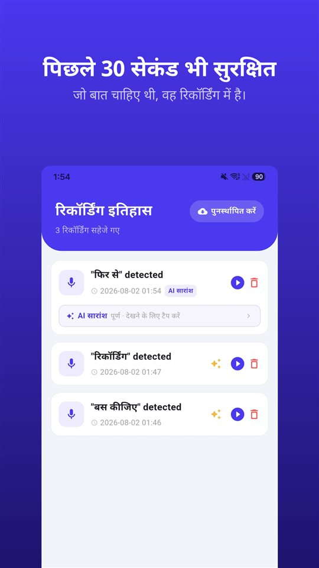

आप तीन सवाल लेकर अंदर जाते हैं। डॉक्टर जवाब देती हैं, दवा की ख़ुराक के बारे में कुछ जोड़ती हैं, बताती हैं किन बातों का ध्यान रखना है, और ग्यारह मिनट में मुलाक़ात ख़त्म।

पार्किंग में कोई पूछता है, "डॉक्टर ने क्या कहा?" सच्चा जवाब: थोड़ा-बहुत।

2003 के एक समीक्षा लेख के मुताबिक़ 40 से 80 प्रतिशत मेडिकल जानकारी तुरंत भूल जाती है।

## एक नज़र में

| सवाल | भारत |
|---|---|
| अपनी बातचीत रिकॉर्ड करना | इंटरसेप्शन नहीं (मलकानी, 1973) |
| मरीज़-डॉक्टर बातचीत पर अलग नियम | हमें नहीं मिला |
| मेडिकल रिकॉर्ड | 72 घंटे में (2002 विनियम 1.3.2) |
| अदालत में रिकॉर्डिंग | धारा 63(4) का प्रमाणपत्र |

यह लेख भारत के बारे में है। हिंदी बोलने वाले जिन लोगों पर दूसरे देशों का कानून लागू होता है, उनके लिए वह यहाँ नहीं जाँचा गया।

## यह ध्यान की कमी नहीं है

यह आँकड़ा **केसल्स** के समीक्षा लेख से है, जो **जर्नल ऑफ़ द रॉयल सोसाइटी ऑफ़ मेडिसिन (2003)** में छपा: स्वास्थ्यकर्मियों की दी गई **40 से 80 प्रतिशत** मेडिकल जानकारी **तुरंत भूल जाती है** – और जो याद रहता है, उसका एक हिस्सा ग़लत याद रहता है।

घबराहट, दर्द, डॉक्टरी शब्द, ऐसी बात जो पहले की सोच से मेल न खाए – इनमें से कुछ भी लापरवाही नहीं है। जिसने अभी-अभी बीमारी का नाम सुना हो, वह दवा कैसे लेनी है वाला अगला वाक्य कम सुन पाता है।

## मेडिकल रिकॉर्ड: 72 घंटे

**भारतीय चिकित्सा परिषद (व्यावसायिक आचरण, शिष्टाचार और नैतिकता) विनियम, 2002** के **विनियम 1.3.2** के अनुसार मरीज़, अधिकृत परिचारक या क़ानूनी प्राधिकरण के अनुरोध पर मेडिकल रिकॉर्ड **72 घंटे के भीतर** दिए जाने चाहिए। **राष्ट्रीय आयुर्विज्ञान आयोग** के **2023** के विनियम, रिपोर्टों के अनुसार, स्थगित रखे गए हैं; मौजूदा स्थिति आधिकारिक अधिसूचना से जाँच लीजिए।

जो किसी रिकॉर्ड में नहीं होता: मुलाक़ात के आख़िर में कही गई बात, आपके सवाल को कैसे समझा गया, "चिंता मत कीजिए" और उसके पीछे की बात।

## अपनी बातचीत की रिकॉर्डिंग

सुप्रीम कोर्ट ने 1973 में **आर. एम. मलकानी बनाम महाराष्ट्र राज्य** मामले में कहा कि बातचीत के एक पक्ष की अनुमति से की गई रिकॉर्डिंग **इंटरसेप्शन नहीं** है, और बातचीत प्रासंगिक हो, आवाज़ पहचानी जाए और सटीकता साबित हो तो वह **सबूत के रूप में स्वीकार्य** है। मरीज़ और डॉक्टर के बीच की बातचीत पर कोई **अलग नियम हमें नहीं मिला**। पूरा कानून [भारत में बातचीत रिकॉर्ड करना](/blog/hi/recording-law-india/) में है।

फिर भी इलाज भरोसे का रिश्ता है। **शुरुआत में पूछ लेना** – "क्या मैं इसे रिकॉर्ड कर लूँ, ताकि घर पर कुछ भूलूँ नहीं?" – ज़्यादातर बार आसान रहता है।

## केबिन में कुछ चलाना नहीं पड़ता

फ़ोन निकालना, अनलॉक करना, ऐप ढूँढना, रिकॉर्ड दबाना – ठीक उसी समय जब डॉक्टर समझाना शुरू करती हैं। इससे बातचीत रुकती है और पहले वाक्य छूट जाते हैं।

[TalkSafe](/talksafe/hi/) Android के लिए एक रिकॉर्डिंग ऐप है, जो **पहले से चुना हुआ शब्द** सुनते ही रिकॉर्डिंग शुरू करता है – **लॉक स्क्रीन** पर, फ़ोन अनलॉक किए या ऐप खोले बिना। शब्द को अपने सवाल में रखिए: "रिकॉर्ड" सेट करें तो "क्या मैं इसे रिकॉर्ड कर लूँ, ताकि घर पर कुछ भूलूँ नहीं?" पूछते ही रिकॉर्डिंग शुरू हो जाती है, और जवाब **पहले के 30 सेकंड** के साथ फ़ाइल में रहता है। उसी वाक्य का दूसरा शब्द, जैसे "भूलूँ", भी सेव करेंगे तो पहचान बेहतर होगी। शब्द को पहचाना जाता है **चाहे कोई भी बोले**, इसलिए आप डॉक्टर का आम शब्द, जैसे "ख़ुराक", भी सेट कर सकते हैं। विस्तार [पहले आप कुछ कहते हैं](/blog/hi/say-it-first/) में।

<figure class="shot"><figcaption>रिकॉर्डिंग हिस्ट्री। हर फ़ाइल में कीवर्ड पहचाने जाने से पहले के 30 सेकंड भी होते हैं।</figcaption></figure>

अदालत में इस्तेमाल करना हो तो **भारतीय साक्ष्य अधिनियम, 2023 की धारा 63(4)** के तहत **प्रमाणपत्र** चाहिए, जिसमें फ़ाइल की **हैश वैल्यू** दर्ज होती है – इसलिए **मूल फ़ाइल वैसी ही रखिए**।

## जब माता-पिता की मुलाक़ात हो

अगर आप साथ नहीं जा सकते: सवाल पहले साथ बैठकर लिख लीजिए, बाद में **मेडिकल रिकॉर्ड** माँग लीजिए, और शब्द पहले से उनके फ़ोन में सेट कर दीजिए – केबिन में उन्हें कुछ छूना नहीं पड़ेगा, बस सवाल पूछना होगा। रिकॉर्ड वही करता है जो बातचीत में शामिल है।

## संक्षेप में

- **40 से 80 प्रतिशत** जानकारी मुलाक़ात के तुरंत बाद चली जाती है – यह सामान्य है।
- **अपनी बातचीत की रिकॉर्डिंग** इंटरसेप्शन नहीं है; फिर भी **शुरुआत में पूछ लीजिए**।
- **मेडिकल रिकॉर्ड** 72 घंटे में (2002 विनियम 1.3.2)।
- शब्द को अपने सवाल में रखिए – केबिन में फ़ोन चलाने की ज़रूरत नहीं।

रिकॉर्डिंग के बाद क्या करें: [रिकॉर्डिंग के बाद क्या करें, और क्या न करें](/blog/hi/after-recording/)।

सामान्य जानकारी, कानूनी सलाह नहीं। अपने मामले के लिए किसी वकील से सलाह लीजिए।

