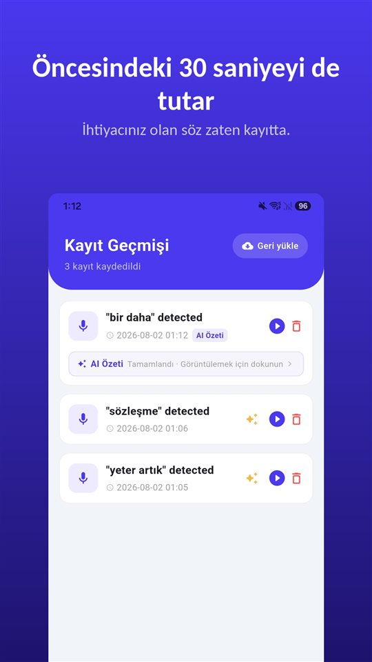

Üç soruyla giriyorsunuz. Doktor cevaplıyor, doz hakkında bir şey ekliyor, nelere dikkat etmeniz gerektiğini söylüyor ve muayene on bir dakikada bitiyor.

Otoparkta biri "Ne dedi?" diye soruyor. Dürüst cevap: bir kısmını.

2003 tarihli bir derlemeye göre tıbbi bilgilerin yüzde 40 ile 80'i hemen unutuluyor.

## Bir bakışta

| Soru | Türkiye |
|---|---|
| Muayeneyi doktorun rızası olmadan kaydetmek | Suç (TCK 133/2) |
| Doktorun izniyle kaydetmek | Mümkün |
| İzin yoksa | Yazılı özet, rapor ve sonuçların kopyası |
| Unutulan bilgi | Yüzde 40–80, hemen (Kessels, 2003) |

Bu yazı Türkiye'yi anlatır. Türkçe konuşanların yaşadığı Almanya, Avusturya ve İsviçre için Almanca [Arztgespräch aufnehmen](/blog/de/arztgespraech-aufnehmen/) yazısına bakabilirsiniz; Hollanda, Belçika, Fransa ve KKTC bu yazıda ele alınmadı.

## Bu bir dikkat sorunu değil

Rakam, **Kessels**'in **Journal of the Royal Society of Medicine**'de (**2003**) yayımlanan derlemesinden: sağlık çalışanlarının verdiği tıbbi bilgilerin **yüzde 40 ile 80'i hemen unutuluyor** – akılda kalanın bir kısmı da yanlış hatırlanıyor.

Kaygı, ağrı, tıbbi terimler, önceden inandığınız şeyle çelişen bir bilgi: bunların hiçbiri dikkatsizlik değil. Az önce bir teşhis duyan biri, ilacın nasıl kullanılacağına dair bir sonraki cümleyi daha az duyar.

## Kayıt: Türkiye'de doktorun izniyle

**TCK 133/2**, katıldığınız **aleni olmayan** bir söyleşiyi diğer konuşanların **rızası olmadan** kaydetmeyi **altı aydan iki yıla kadar hapis veya adli para cezası** ile cezalandırır. Muayene, tam olarak bu tür bir konuşmadır. Ayrıntılar [Gizli ses kaydı almak suç mu?](/blog/tr/ses-kaydi-suc-mu/) yazısında.

Yargıtay'ın **ani gelişen** ve **başka türlü ispat imkânı bulunmayan** durumlarda – tehdit, baskı altında belge imzalatılması gibi – kaydı farklı değerlendirdiği kararlar bulunduğu aktarılıyor. Ama bu **dar bir istisnadır**; önceden planlanmış, rutin bir muayene kaydına uygulanmaz.

Yol basit: **sormak.** Nedeniyle birlikte sorulduğunda çoğu zaman sorun olmaz: "Evde unutmamak için kayda alabilir miyim?" İzin verilmezse ısrar etmeyin; aşağıdaki yollar kalır.

## İzin yoksa elinizde ne kalır

- **Yazılı özet**: Görüşmeden sonra konuşulanları kısaca yazıp doktora ya da hastaneye iletin, yanlış anlaşılan bir şey varsa yazılı düzeltme isteyin.
- **Belgeler**: Rapor, reçete, tahlil sonuçları ve imzaladığınız onam formlarının kopyalarını isteyin ve saklayın.
- **Kendi sesinizle not**: Muayeneden hemen sonra, koridorda, doktorun ne söylediğini kendi sesinizle anlatın. Bu başkasının sözünü kaydetmek değil, kendi notunuzdur.

## Muayene odasında hiçbir şeye dokunmadan

Telefonu çıkarmak, kilidi açmak, uygulamayı bulmak, düğmeye basmak – tam doktor anlatmaya başladığı anda. Bu hem görüşmeyi böler hem de ilk cümleleri kaçırtır.

[TalkSafe](/talksafe/tr/), **önceden belirlediğiniz bir kelimeyi** duyduğunda kayda başlayan bir Android ses kayıt uygulamasıdır ve **ekran kilitliyken**, telefonun kilidini açmadan ve uygulamayı açmadan çalışır. Kelimeyi sorunuzun içine koyun: "kayıt" kelimesini belirleyin, "Evde unutmamak için kayda alabilir miyim?" diye sorduğunuz anda kayıt başlar ve doktorun cevabı, **önceki 30 saniyeyle** birlikte dosyada olur. Aynı cümleden ikinci bir kelime, örneğin "unutmamak", de kaydederseniz algılama daha güvenilir olur. Daha fazlası [Önce bir şey söylersiniz](/blog/tr/say-it-first/) yazısında.

<figure class="shot"><figcaption>Kayıt geçmişi. Her dosyada anahtar kelime algılanmadan önceki 30 saniye de bulunur.</figcaption></figure>

## Yaşlı bir yakınınızın muayenesi

Yakınınızın muayenesine gidemiyorsanız: soruları birlikte önceden yazın, sonra raporların kopyasını isteyin. Kelimeyi önceden onun telefonuna kurarsanız, muayene odasında hiçbir şeye dokunmadan sadece izni sorması yeter. Kaydı muayeneye katılan kişi yapar ve Türkiye'de doktorun izni gerekir.

## Kısaca

- Bilgilerin **yüzde 40–80'i** muayeneden hemen sonra kaybolur; bu normaldir.
- Türkiye'de muayeneyi **doktorun izniyle** kaydedin; rızasız kayıt **TCK 133/2** kapsamında suçtur.
- İzin yoksa **yazılı özet**, **belgelerin kopyası** ve **kendi sesinizle not**.
- **Başta sorun** – ve anahtar kelimeyi sorunuzun içine koyun.

Bir kayıtla sonra ne yapılır: [Bir kayıtla ne yapmalı, ne yapmamalı](/blog/tr/after-recording/).

## Kaynaklar

- [Kessels RPC: Patients' memory for medical information, J R Soc Med 2003 (PMC)](https://pmc.ncbi.nlm.nih.gov/articles/PMC539473/)

Genel bilgilendirmedir, hukuki danışmanlık değildir. Somut durumunuz için bir sağlık hukuku avukatına danışın.

