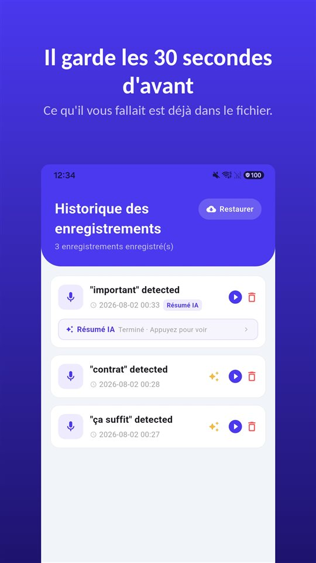

Vous entrez avec trois questions. La médecin y répond, ajoute un mot sur la posologie, mentionne ce qu'il faut surveiller, et la consultation est finie en onze minutes.

Sur le parking, quelqu'un vous demande ce qu'elle a dit. La réponse honnête : une partie.

Selon une revue de 2003, 40 à 80 % des informations médicales sont oubliées aussitôt.

## France, Belgique, Suisse et Québec en un coup d'œil

| Question | France | Belgique | Suisse | Québec |
|---|---|---|---|---|
| Enregistrer sans accord du médecin | Puni (art. 226-1 CP) | Pas une infraction pour le participant | Puni (art. 179ter CP) | Permis au participant |
| Enregistrer ouvertement, sans opposition | Consentement présumé (art. 226-1) | Permis | Non analysé | Permis |
| Accès au dossier | Sous 8 jours, 2 mois au-delà de 5 ans (L1111-7) | Droit de consultation (loi du 22 août 2002) | Non analysé | Non analysé |

## Ce n'est pas un problème d'attention

Le chiffre vient d'une revue de **Kessels** dans le **Journal of the Royal Society of Medicine (2003)** : **40 à 80 %** des informations médicales données par les soignants sont **oubliées immédiatement**, et une partie de ce qui reste est mal mémorisée.

L'inquiétude, la douleur, le vocabulaire, une information qui contredit ce qu'on croyait : rien de tout cela n'est de l'inattention. Celui qui vient d'entendre un diagnostic entend moins bien la phrase suivante sur la posologie.

## Ce que vous pouvez obtenir par écrit

En France, l'**article L1111-7 du Code de la santé publique** donne accès à votre **dossier médical** : les informations sont communiquées **au plus tard dans les huit jours** suivant la demande, et au plus tôt après un **délai de réflexion de 48 heures**. Le délai passe à **deux mois** si les informations datent de **plus de cinq ans**.

Ce qui ne figure dans aucun dossier : la remarque glissée en fin de consultation, la manière dont votre question a été comprise, le « ne vous inquiétez pas » et ce qu'il recouvrait.

## Enregistrer : en France, avec l'accord du médecin

L'**article 226-1 du Code pénal** punit l'enregistrement sans consentement de paroles prononcées à titre **privé ou confidentiel**, **même par un participant** – et une consultation est exactement ce genre de parole. Mais le même article prévoit que le **consentement est présumé** lorsque l'enregistrement a été fait **au vu et au su** de la personne, **sans qu'elle s'y soit opposée** alors qu'elle pouvait le faire. Le cadre complet est dans [Enregistrer une conversation à l'insu de quelqu'un : interdit en France, permis en Belgique et au Québec](/blog/fr/enregistrer-conversation/).

La question elle-même passe généralement bien, surtout avec la raison : « Je peux enregistrer, pour ne rien oublier en rentrant ? » Et si la réponse est non, restent le dossier et vos notes.

## Rien à manipuler dans le cabinet

Sortir le téléphone, le déverrouiller, chercher l'application, appuyer – au moment précis où la médecin commence à expliquer. Cela interrompt l'échange et coûte les premières phrases.

[TalkSafe](/talksafe/fr/) est une application d'enregistrement pour Android qui démarre sur un **mot choisi à l'avance** – **écran verrouillé**, sans déverrouiller le téléphone ni ouvrir l'application. Mettez le mot dans votre question : avec « enregistrer », l'enregistrement commence quand vous demandez « Je peux enregistrer, pour ne rien oublier en rentrant ? », et la réponse est dans le fichier, avec les **30 secondes précédentes**. En enregistrant aussi un second mot de la même phrase, comme « oublier », la détection devient plus fiable. Plus de détails dans [On dit d'abord quelque chose](/blog/fr/say-it-first/).

<figure class="shot"><figcaption>Historique des enregistrements. Chaque fichier contient aussi les 30 secondes qui précèdent la détection du mot-clé.</figcaption></figure>

## Quand c'est la consultation d'un parent

Si vous ne pouvez pas accompagner un parent âgé : préparez les questions avec lui, demandez ensuite le **dossier**, et réglez le mot à l'avance sur son téléphone – il n'aura rien à manipuler, seulement la question à poser. Enregistre celui qui participe à la consultation, et en France avec l'accord du médecin.

## Belgique

- Un participant qui enregistre sa propre conversation **ne commet pas d'infraction** (Cour de cassation, 2015).
- Le **Conseil national de l'Ordre des médecins** a estimé en **2023** que les **deux parties** à la relation de soins devraient **marquer leur accord** sur l'enregistrement, et qu'un enregistrement clandestin peut rompre la confiance. Demander d'abord reste donc la meilleure voie.
- La **loi du 22 août 2002 relative aux droits du patient** garantit le droit d'être **informé** sur son état de santé et de **consulter son dossier**, avec un droit de copie.

## Suisse et Québec

- **Suisse** : enregistrer une conversation non publique **sans le consentement** des autres participants est puni par l'**article 179ter du Code pénal**. Avec leur accord, c'est permis.
- **Québec** : un participant peut enregistrer sa propre conversation. Comme le mot-clé n'est pas lié à une personne, il peut aussi être un mot que le médecin dira, par exemple « dose ».

Les règles d'accès au dossier en Suisse et au Québec ne sont pas analysées ici.

## En bref

- **40 à 80 %** des informations disparaissent juste après la consultation – c'est normal.
- **Dossier médical** sous huit jours en France.
- **En France et en Suisse, enregistrer avec l'accord du médecin** ; en France, l'accord est présumé si vous enregistrez ouvertement sans opposition.
- **Demandez au début** – et mettez le mot-clé dans votre question.

Ce qu'on fait ensuite d'un enregistrement : [Ce qu'il faut faire d'un enregistrement, et ce qu'il ne faut pas en faire](/blog/fr/after-recording/).

## Sources

- [Kessels RPC : Patients' memory for medical information, J R Soc Med 2003 (PMC)](https://pmc.ncbi.nlm.nih.gov/articles/PMC539473/)

Information générale, pas un avis juridique. Pour une situation précise, consultez un avocat en droit de la santé ou une association de patients.

