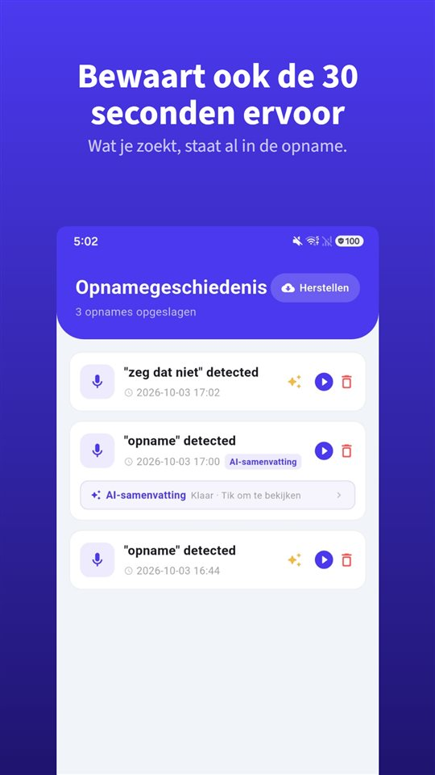

Je gaat naar binnen met drie vragen. De arts beantwoordt ze, zegt iets over de dosering, noemt waar je op moet letten, en na elf minuten is het consult voorbij.

Op de parkeerplaats vraagt iemand wat ze zei. Het eerlijke antwoord: een deel.

Volgens een overzichtsartikel uit 2003 wordt 40 tot 80 procent van de medische informatie meteen vergeten.

## Nederland en België naast elkaar

| Vraag | Nederland | België |
|---|---|---|
| Gesprek met arts opnemen zonder toestemming | Mag voor privégebruik; KNMG vraagt het te melden | Geen misdrijf voor deelnemer; Orde vraagt akkoord van beide partijen |
| Opname verspreiden | Alleen met toestemming van de zorgverlener | Niet onderzocht in detail |
| Arts heeft bezwaar | Informatie schriftelijk vragen (art. 7:448 BW) | Recht op informatie en inzage (wet van 22 augustus 2002) |

Suriname, Aruba, Curaçao, Sint Maarten en Caribisch Nederland zijn voor deze vraag niet onderzocht.

## Het is geen kwestie van opletten

Het cijfer komt uit een overzichtsartikel van **Kessels** in het **Journal of the Royal Society of Medicine (2003)**: **40 tot 80 procent** van de medische informatie die zorgverleners geven, wordt **meteen vergeten** – en een deel van wat blijft, wordt verkeerd onthouden.

Spanning, pijn, vaktaal, informatie die botst met wat je verwachtte: niets daarvan is onoplettendheid. Wie net een diagnose heeft gehoord, hoort de volgende zin over de dosering slechter.

## Opnemen mag – met een paar afspraken

Volgens de **KNMG** en de **Rijksoverheid** mag een patiënt een gesprek met een zorgverlener **opnemen voor privégebruik**, **ook zonder het te zeggen en zonder toestemming**. Daarbij gelden drie afspraken:

- De KNMG vraagt het **vooraf te melden**.
- **Openbaar maken of verspreiden** mag alleen **met toestemming** van de zorgverlener.
- Voor **beeldopnamen** (foto of video) gelden **strengere regels**.

Strafrechtelijk past dat bij **artikel 139a van het Wetboek van Strafrecht**: alleen wie **geen deelnemer** is, mag een gesprek niet opnemen. Meer in [Mag je een gesprek stiekem opnemen?](/blog/nl/gesprek-opnemen/).

Heeft de arts **bezwaar**, dan kun je vragen om de informatie **schriftelijk** mee te krijgen. De arts moet dat op jouw verzoek doen (**artikel 7:448 lid 1 BW**).

## Het gesprek met de bedrijfsarts

Veel mensen zoeken specifiek naar het gesprek met de bedrijfs- of arboarts. Strafrechtelijk verandert er niets: ook daar ben je **zelf deelnemer**, dus artikel 139a staat een opname niet in de weg. Omdat zo'n gesprek vaak gevolgen heeft voor je werk, je re-integratie en je uitkering, is het extra verstandig het **vooraf te melden** en de opname **alleen voor jezelf** te gebruiken – bijvoorbeeld om terug te luisteren wat er precies is afgesproken.

## In de spreekkamer hoef je niets te bedienen

Telefoon pakken, ontgrendelen, de app zoeken, op opnemen drukken – precies op het moment dat de arts begint uit te leggen. Dat onderbreekt het gesprek en kost de eerste zinnen.

[TalkSafe](/talksafe/nl/) is een opname-app voor Android en iPhone die begint met opnemen zodra hij een **vooraf gekozen woord** hoort – met een **vergrendeld scherm**, zonder de telefoon te ontgrendelen of de app te openen. Zet het woord in je vraag: met "opnemen" begint de opname zodra je vraagt "Vindt u het goed als ik dit opneem, zodat ik thuis niets vergeet?", en het antwoord staat in het bestand, samen met de **30 seconden daarvoor**. Stel je een tweede woord uit dezelfde zin in, zoals "vergeet", dan wordt de herkenning nauwkeuriger. Woorden worden herkend **wie ze ook zegt**, dus je kunt ook een woord kiezen dat de arts meestal gebruikt, zoals "dosering". Meer in [Eerst zeg je iets: een opname starten met je stem](/blog/nl/say-it-first/).

<figure class="shot"><figcaption>Opnamegeschiedenis. Elk bestand bevat ook de 30 seconden voordat het trefwoord herkend werd.</figcaption></figure>

## Als het om het consult van je ouder gaat

Kun je niet mee: schrijf de vragen samen op, vraag daarna om **schriftelijke informatie**, en stel het woord vooraf in op de telefoon van je ouder – in de spreekkamer hoeft hij of zij niets aan te raken. Opnemen doet wie aan het gesprek deelneemt.

## België

- Een deelnemer die een gesprek opneemt, **pleegt geen misdrijf** (Hof van Cassatie, 2015).
- De **Nationale Raad van de Orde der Artsen** vond in **2023** dat **beide partijen** in de zorgrelatie **akkoord** moeten gaan met een opname, omdat een heimelijke opname het vertrouwen kan schaden. Eerst vragen is dus ook in België de beste weg.
- De **wet van 22 augustus 2002 betreffende de rechten van de patiënt** geeft recht op **informatie** over je gezondheidstoestand en op **inzage in je dossier**.

## Kort gezegd

- **40 tot 80 procent** verdwijnt meteen na het consult – dat is normaal.
- **In Nederland mag je opnemen voor privégebruik**, ook bij de bedrijfsarts; meld het vooraf en verspreid het niet zonder toestemming.
- Heeft de arts bezwaar: vraag de informatie **schriftelijk** (art. 7:448 BW).
- **In België** is opnemen door een deelnemer geen misdrijf, maar de Orde vraagt akkoord van beide kanten.

Wat je daarna met een opname doet: [Wat je met een opname doet, en wat je er niet mee doet](/blog/nl/after-recording/).

## Bronnen

- [Kessels RPC: Patients' memory for medical information, J R Soc Med 2003 (PMC)](https://pmc.ncbi.nlm.nih.gov/articles/PMC539473/)
- [Burgerlijk Wetboek Boek 7, artikel 7:448 (wetten.overheid.nl)](https://wetten.overheid.nl/jci1.3:c:BWBR0005290&boek=7&titeldeel=7&afdeling=5&artikel=448)

Algemene informatie, geen juridisch advies. Raadpleeg voor een concreet geval het Juridisch Loket of een advocaat gezondheidsrecht.

