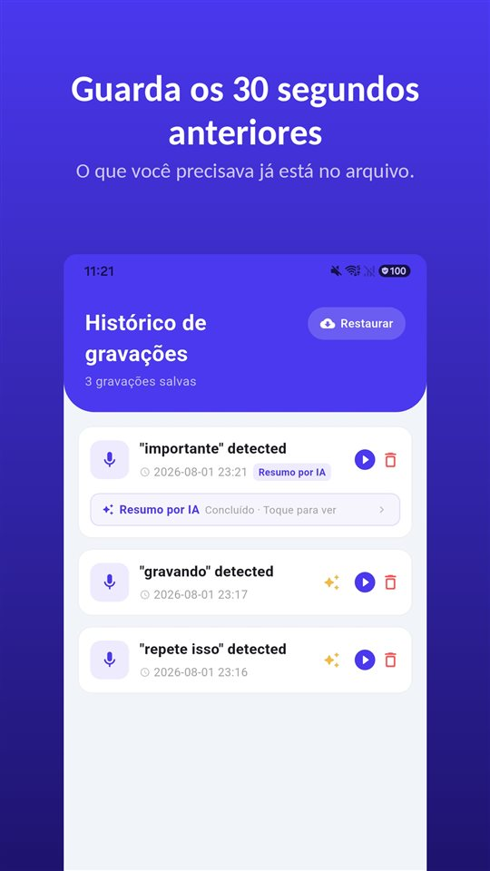

Você entra com três perguntas. A médica responde, acrescenta algo sobre a dose, fala no que observar, e a consulta acaba em onze minutos.

No estacionamento, alguém pergunta o que ela disse. A resposta sincera: uma parte.

Segundo uma revisão de 2003, 40% a 80% das informações médicas são esquecidas logo depois.

## Brasil e Portugal, lado a lado

| Pergunta | Brasil | Portugal |
|---|---|---|
| Paciente gravar a consulta sem avisar | Prova lícita (Tema 237) | Crime sem consentimento (art. 199.º CP) |
| Posição dos conselhos de medicina | Gravação com concordância do médico (pareceres) | Não analisado |
| Cópia do prontuário | Direito do paciente (art. 88 do Código de Ética Médica) | Não analisado aqui |

Os demais países de língua portuguesa não foram analisados neste artigo.

## Não é falta de atenção

O número vem de uma revisão de **Kessels** no **Journal of the Royal Society of Medicine (2003)**: **40% a 80%** das informações médicas dadas pelos profissionais são **esquecidas imediatamente** – e parte do que fica é lembrada de forma errada.

Ansiedade, dor, termos técnicos, uma informação que contradiz o que você achava: nada disso é desatenção. Quem acabou de ouvir um diagnóstico escuta pior a frase seguinte sobre como tomar o remédio.

## O que a lei diz e o que os conselhos dizem

**A lei.** O STF fixou no **Tema 237 de repercussão geral (RE 583.937)** que **é lícita a prova consistente em gravação ambiental realizada por um dos interlocutores sem o conhecimento do outro**. O paciente é interlocutor da consulta. Mais em [Gravar conversa sem a outra pessoa saber é crime?](/blog/pt-br/gravar-conversa/).

**Os conselhos de medicina.** Aqui o tom é outro. O **CREMERJ (Parecer 89/2000)** entendeu que o paciente pode gravar a consulta **com a concordância do médico**, que **pode se opor sem que a recusa configure falta ética**. Um parecer do **CREMESE (2018)** concluiu no mesmo sentido e observou que **não há resolução do CFM** que regule especificamente o tema.

Na prática, as duas coisas convivem: a gravação não é crime, mas a consulta é uma relação. **Pedir antes** – "Posso gravar, para não esquecer nada em casa?" – quase sempre resolve, e preserva a confiança.

## O que você pode pedir por escrito

O **art. 88 do Código de Ética Médica** proíbe o médico de **negar ao paciente acesso a seu prontuário** ou **deixar de fornecer cópia** quando solicitada, salvo em risco iminente ao próprio paciente ou a terceiros.

O que não está em prontuário nenhum: o comentário no fim da consulta, como a sua pergunta foi entendida, o "fica tranquilo" e o que ele queria dizer.

## Nada para mexer dentro do consultório

Tirar o celular, desbloquear, procurar o app, apertar gravar – bem na hora em que a médica começa a explicar. Isso corta a conversa e custa as primeiras frases.

O [TalkSafe](/talksafe/pt-br/) é um app de gravação para Android e iPhone que começa a gravar quando ouve uma **palavra escolhida antes** – com a **tela bloqueada**, sem desbloquear o celular nem abrir o app. Ponha a palavra na sua pergunta: com "gravar", a gravação começa quando você pergunta "Posso gravar, para não esquecer nada em casa?", e a resposta fica no arquivo, junto com os **30 segundos anteriores**. Cadastrar uma segunda palavra da mesma frase, como "esquecer", deixa a detecção mais precisa. Mais em [Primeiro você diz alguma coisa](/blog/pt-br/say-it-first/).

<figure class="shot"><figcaption>Histórico de gravações. Cada arquivo inclui os 30 segundos anteriores à detecção da palavra-chave.</figcaption></figure>

O app grava o que o microfone ouve no ambiente – a conversa da qual você participa. Gravar conversas das quais você não participa é outra coisa e é crime (Lei 9.296, art. 10).

## Quando é a consulta de um pai ou de uma mãe

Se você não pode acompanhar: escrevam as perguntas juntos antes, peçam depois a **cópia do prontuário** e deixem a palavra configurada no celular dele ou dela – na consulta, basta fazer a pergunta, sem mexer em nada. Quem grava é quem participa da consulta.

## Portugal

O **artigo 199.º do Código Penal** pune quem, sem consentimento, grava palavras não destinadas ao público, **mesmo que lhe sejam dirigidas**. Gravar a consulta, em Portugal, só **com o consentimento** do médico – e o pedido com "gravar" como palavra-chave funciona da mesma forma. Sem consentimento, o mais seguro é registrar **logo depois, com a sua própria voz**, o que foi dito.

## Resumindo

- **40% a 80%** do que se ouve some logo depois da consulta – é normal.
- **No Brasil**, a gravação feita pelo paciente é **prova lícita**; os conselhos recomendam a **concordância do médico**.
- **Cópia do prontuário** é direito seu (art. 88 do Código de Ética Médica).
- **Em Portugal**, gravar só com consentimento.
- **Pergunte no início** – e ponha a palavra-chave na pergunta.

O que fazer com a gravação depois: [O que fazer com uma gravação, e o que não fazer](/blog/pt-br/after-recording/).

## Fontes

- [Kessels RPC: Patients' memory for medical information, J R Soc Med 2003 (PMC)](https://pmc.ncbi.nlm.nih.gov/articles/PMC539473/)
- [Todo paciente tem direito à cópia do prontuário médico (CNJ)](https://www.cnj.jus.br/cnj-servico-todo-paciente-tem-direito-a-copia-do-prontuario-medico/)

Informação geral, não é aconselhamento jurídico. Para um caso concreto, procure um advogado de direito médico.

