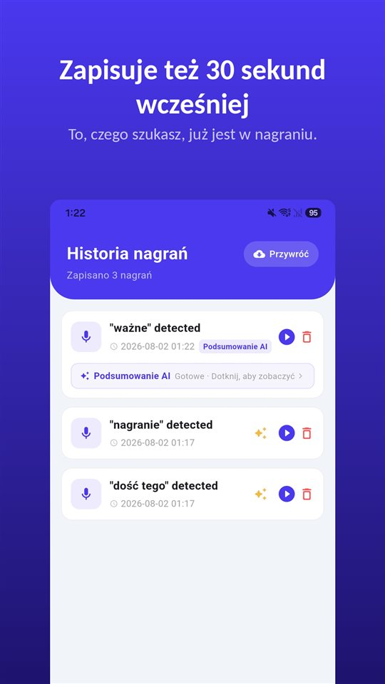

Wchodzisz z trzema pytaniami. Lekarka odpowiada, dodaje coś o dawkowaniu, mówi, na co uważać, i po jedenastu minutach wizyta się kończy.

Na parkingu ktoś pyta, co powiedziała. Szczera odpowiedź: część.

Według przeglądu z 2003 roku 40–80% informacji medycznych zapomina się od razu.

## W skrócie

| Pytanie | Polska |
|---|---|
| Nagranie wizyty przez pacjenta | Co do zasady dozwolone (uczestnik rozmowy) |
| Rozpowszechnianie nagrania | Osobna sprawa: dobra osobiste, dane osobowe |
| Pierwsza kopia dokumentacji medycznej | Bezpłatna (art. 28 ustawy o prawach pacjenta) |
| Ile się zapomina | 40–80% od razu (Kessels, 2003) |

## To nie jest kwestia uwagi

Liczba pochodzi z przeglądu **Kesselsa** w **Journal of the Royal Society of Medicine (2003)**: **40–80%** informacji medycznych przekazanych przez personel medyczny **zapomina się od razu** – a część tego, co zostaje, jest zapamiętana błędnie.

Lęk, ból, fachowe słownictwo, informacja sprzeczna z tym, czego się spodziewaliśmy – nic z tego nie jest nieuwagą. Kto przed chwilą usłyszał diagnozę, gorzej słyszy następne zdanie o dawkowaniu.

## Co dostaniesz na piśmie

Pacjent ma prawo dostępu do **dokumentacji medycznej**. Zgodnie z **art. 28 ustawy o prawach pacjenta i Rzeczniku Praw Pacjenta** **nie pobiera się opłaty** przy **pierwszym udostępnieniu** dokumentacji pacjentowi lub jego przedstawicielowi ustawowemu w żądanym zakresie. Za kolejne udostępnienia placówka może pobrać opłatę w granicach określonych ustawą.

Czego nie ma w żadnej dokumentacji: uwagi rzuconej na koniec wizyty, tego, jak zrozumiano twoje pytanie, „proszę się nie martwić” i tego, co się za nim kryło.

## Nagranie własnej rozmowy jest dozwolone

W Polsce nagranie rozmowy, w której się uczestniczy, co do zasady **nie jest przestępstwem**: **art. 267 § 3 Kodeksu karnego** dotyczy uzyskiwania informacji, do której nie jest się uprawnionym, a pacjent jest uczestnikiem wizyty. Więcej w [Czy można nagrywać rozmowę bez zgody?](/blog/pl/nagrywanie-rozmowy/).

Osobną sprawą jest **rozpowszechnianie**. Opublikowanie nagrania, zwłaszcza z wizerunkiem lekarza, bez jego zgody może naruszać dobra osobiste i przepisy o ochronie danych. Nagranie z wizyty służy temu, żeby odsłuchać, co zostało powiedziane, albo przekazać to rodzinie.

A choć prawo nie wymaga zgody, **zapytanie na początku** – „Czy mogę to nagrać, żeby nic nie zapomnieć?” – zwykle ułatwia rozmowę.

## W gabinecie niczego nie trzeba obsługiwać

Wyjąć telefon, odblokować, znaleźć aplikację, nacisnąć nagrywanie – akurat wtedy, gdy lekarka zaczyna tłumaczyć. To przerywa rozmowę i kosztuje pierwsze zdania.

[TalkSafe](/talksafe/pl/) to aplikacja do nagrywania na Androida, która zaczyna nagrywać, gdy usłyszy **wybrane wcześniej słowo** – przy **zablokowanym ekranie**, bez odblokowywania telefonu i otwierania aplikacji. Włóż słowo w pytanie: ze słowem „nagrać” nagrywanie zaczyna się, gdy pytasz „Czy mogę to nagrać, żeby nic nie zapomnieć?”, a odpowiedź jest w pliku razem z **30 sekundami sprzed startu**. Zapisanie drugiego słowa z tego samego zdania, na przykład „zapomnieć”, sprawia, że wykrywanie jest dokładniejsze. Słowa są rozpoznawane **niezależnie od tego, kto je wypowie**, więc można też ustawić słowo, które zwykle pada z ust lekarza, na przykład „dawka”. Więcej w [Najpierw coś mówisz](/blog/pl/say-it-first/).

<figure class="shot"><figcaption>Historia nagrań. Każdy plik zawiera też 30 sekund sprzed wykrycia słowa kluczowego.</figcaption></figure>

## Wizyta rodzica

Jeśli nie możesz towarzyszyć starszemu rodzicowi: spiszcie razem pytania, potem poproście o **dokumentację**, a słowo ustawcie wcześniej w jego telefonie – w gabinecie nie trzeba niczego dotykać. Nagrywa ten, kto uczestniczy w wizycie.

## Jeśli chodzisz do lekarza w Niemczech, Holandii albo Wielkiej Brytanii

- **Niemcy**: nagranie rozmowy z lekarzem **bez zgody** jest przestępstwem (**§ 201 StGB**). Pacjent ma prawo do wglądu w dokumentację i **pierwsza kopia jest bezpłatna** (§ 630g BGB; TSUE, 26 października 2023 r., C-307/22). Po niemiecku: [Arztgespräch aufnehmen](/blog/de/arztgespraech-aufnehmen/).
- **Holandia**: pacjent może nagrać rozmowę z lekarzem **do użytku prywatnego także bez zgody**; KNMG prosi, by o tym uprzedzić. Rozpowszechnienie nagrania wymaga zgody lekarza. Jeśli lekarz ma zastrzeżenia, można poprosić o informacje na piśmie (art. 7:448 BW). Po niderlandzku: [Gesprek met je arts opnemen](/blog/nl/gesprek-met-arts-opnemen/).
- **Wielka Brytania**: **BMA** zachęca lekarzy do **zgody** na nagrywanie, zwłaszcza gdy pacjent może mieć trudność z zapamiętaniem informacji, a pacjentów do **wcześniejszego zapytania**. Według BMA ukryte nagranie wyłącznie do celów osobistych raczej nie podlega przepisom o ochronie danych. Po angielsku: [Most of what the doctor said is gone by the parking lot](/blog/en/medical-consultation/).

Irlandia nie jest omówiona w tym artykule.

## Podsumowanie

- **40–80%** informacji znika zaraz po wizycie – to normalne.
- **Nagranie własnej wizyty** jest w Polsce co do zasady dozwolone; **rozpowszechnianie** to osobna sprawa.
- **Pierwsza kopia dokumentacji** jest bezpłatna.
- **Zapytaj na początku** – i włóż słowo kluczowe w pytanie.

Co zrobić z nagraniem potem: [Co zrobić z nagraniem, a czego z nim nie robić](/blog/pl/after-recording/).

## Źródła

- [Kessels RPC: Patients' memory for medical information, J R Soc Med 2003 (PMC)](https://pmc.ncbi.nlm.nih.gov/articles/PMC539473/)
- [Patients recording consultations (BMA)](https://www.bma.org.uk/advice-and-support/ethics/confidentiality-and-health-records/patients-recording-consultations)

Informacja ogólna, nie porada prawna. W konkretnej sprawie skontaktuj się z Rzecznikiem Praw Pacjenta albo z prawnikiem.

