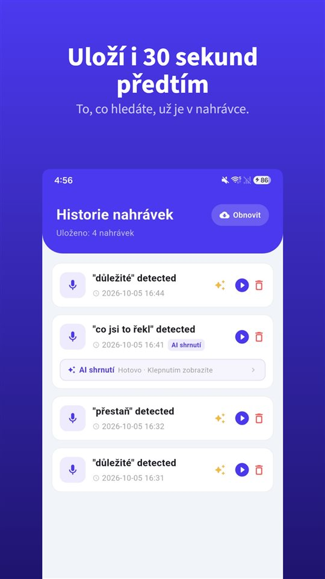

Jdete dovnitř se třemi otázkami. Lékařka na ně odpoví, dodá něco k dávkování, zmíní, čeho si všímat, a po jedenácti minutách je návštěva u konce.

Na parkovišti se vás někdo zeptá, co říkala. Upřímná odpověď: část.

Podle přehledové studie z roku 2003 se 40 až 80 % lékařských informací zapomene okamžitě.

## Česko a Slovensko vedle sebe

| Otázka | Česko | Slovensko |
|---|---|---|
| Nahrát lékaře bez souhlasu | K ochraně svých práv ano (§ 88 OZ) | Jen se svolením, s výjimkami (§ 12 OZ) |
| Postoj ministerstva | Návrh metodiky 2026: otevřeně, nezveřejňovat | Zde neověřeno |
| Kopie dokumentace | Výpisy, opisy a kopie (zákon o zdravotních službách) | Zde neověřeno |

## Nejde o nepozornost

Číslo pochází z přehledové studie **Kesselse** v časopise **Journal of the Royal Society of Medicine (2003)**: **40 až 80 %** lékařských informací, které zdravotníci podají, se **zapomene okamžitě** – a část toho, co zůstane, je zapamatována chybně.

Strach, bolest, odborné výrazy, informace, která odporuje tomu, co jsme čekali: nic z toho není nepozornost. Kdo právě slyšel diagnózu, slyší další větu o dávkování hůř.

## Nahrávat lze – a ministerstvo radí jak

Podle **§ 86 občanského zákoníku** nelze bez svolení pořizovat zvukový záznam soukromého života člověka. Podle **§ 88 odst. 1** však svolení **není třeba**, pokud se záznam **pořídí nebo použije k výkonu nebo ochraně jiných práv nebo právem chráněných zájmů**. Víc v [Je legální nahrávat rozhovor bez souhlasu?](/blog/cs/nahravani-rozhovoru/).

**Ministerstvo zdravotnictví** v roce **2026** zveřejnilo **návrh metodiky** *Pořizování nahrávek zdravotníků a jejich využití při šetření stížností a ve správním řízení*. Připomínky bylo možné podávat do **10. července 2026**; zda a v jaké podobě byla metodika přijata, jsme zde neověřovali. Návrh mimo jiné říká:

- Zdravotnická zařízení **nemohou nahrávání plošně zakázat**.
- Nahrávejte jen v **přiměřených situacích**, kdy informace nelze získat jinak.
- Volte **otevřené a předem oznámené** nahrávání, je-li to možné; **utajené nahrávky jsou až krajní možností**.
- Nahrávku **nezveřejňujte** ani jinak nešiřte a poskytněte ji jen orgánům, které ji smějí posoudit – například **ke stížnosti**.
- Cílem nahrávky nesmí být **nátlak či kompromitace**.

V praxi to znamená jednoduchou věc: **zeptejte se na začátku**. „Můžu si to nahrát, abych doma nic nezapomněl?“ zní jinak než skrytý telefon na stole.

## Co dostanete písemně

**Zákon o zdravotních službách** dává pacientovi právo **nahlížet do své zdravotnické dokumentace** a pořizovat si z ní **výpisy, opisy nebo kopie**.

Co v žádné dokumentaci není: poznámka na konci návštěvy, to, jak lékařka pochopila vaši otázku, „nemusíte se bát“ a co se za tím skrývalo.

## V ordinaci nemusíte nic ovládat

Vytáhnout telefon, odemknout, najít aplikaci, zmáčknout nahrávání – zrovna když lékařka začne vysvětlovat. To přeruší rozhovor a stojí první věty.

[TalkSafe](/talksafe/cs/) je aplikace pro nahrávání na Android a iPhone, která začne nahrávat, když uslyší **předem zvolené slovo** – při **zamčené obrazovce**, bez odemykání telefonu a bez otevírání aplikace. Dejte slovo do své otázky: se slovem „nahrát“ začne nahrávání, když se zeptáte „Můžu si to nahrát, abych doma nic nezapomněl?“, a odpověď je v souboru spolu s **30 sekundami předtím**. Uložíte-li i druhé slovo ze stejné věty, například „nezapomněl“, rozpoznávání bude spolehlivější. Víc v [Nejdřív něco řeknete: jak spustit nahrávání hlasem](/blog/cs/say-it-first/).

<figure class="shot"><figcaption>Historie nahrávek. Každý soubor obsahuje i 30 sekund před rozpoznáním klíčového slova.</figcaption></figure>

## Když jde o návštěvu rodiče

Pokud nemůžete starší rodiče doprovázet: sepište spolu otázky, potom si vyžádejte **výpis z dokumentace** a slovo nastavte předem v jejich telefonu – v ordinaci nemusí na nic sahat, jen se zeptat. Nahrává ten, kdo se rozhovoru účastní.

## Slovensko

Podle **§ 12 slovenského občanského zákoníku** lze zvukový záznam pořídit nebo použít **jen se svolením**, s výjimkami. Rozhovor s lékařem je proto nejbezpečnější nahrávat **po dohodě** – otázka s klíčovým slovem funguje stejně. Bez souhlasu si hned po návštěvě nahrajte **vlastním hlasem**, co lékař řekl; to není záznam cizích slov. Pravidla pro zdravotnickou dokumentaci na Slovensku zde nebyla ověřena.

## Shrnutí

- **40 až 80 %** informací zmizí hned po návštěvě – to je normální.
- **V Česku** lze lékaře nahrát **k ochraně svých práv** i bez souhlasu; návrh metodiky MZ radí **otevřené nahrávání** a **nezveřejňovat**.
- Máte právo na **výpisy a kopie** dokumentace.
- **Na Slovensku** jen **se svolením**.
- **Zeptejte se na začátku** – a dejte klíčové slovo do otázky.

Co s nahrávkou potom: [Co s nahrávkou dělat, a co s ní nedělat](/blog/cs/after-recording/).

## Zdroje

- [Návrh metodiky: Pořizování nahrávek zdravotníků (MZ ČR, PDF)](https://mzd.gov.cz/wp-content/uploads/2026/06/Porizovani-nahravek-zdravotniku-a-jejich-vyuziti-pri-setreni-stiznosti-a-ve-spravnim-rizeni.pdf)
- [Kessels RPC: Patients' memory for medical information, J R Soc Med 2003 (PMC)](https://pmc.ncbi.nlm.nih.gov/articles/PMC539473/)

Obecné informace, nikoli právní rada. V konkrétní věci se obraťte na advokáta se zaměřením na zdravotnické právo nebo na veřejného ochránce práv.

