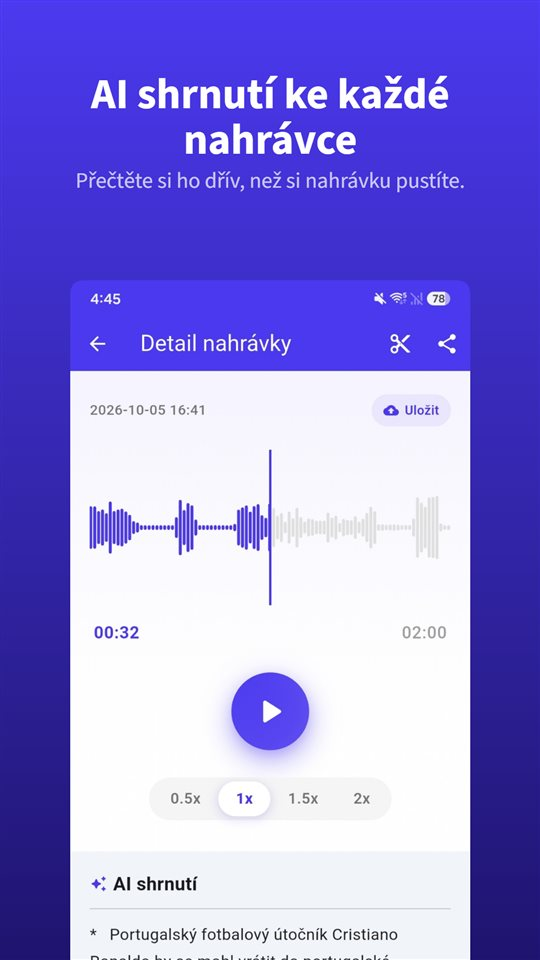

Porada trvala čtyřicet minut. Návštěva u lékaře dvanáct. Telefonát s pronajímatelem osm. Všechny tři máte v telefonu.

Teď se někdo ptá, co se domluvilo ohledně kauce. Víte, že to tam někde je.

Shrnutí vám řekne, kde poslouchat. Záznamem zůstává nahrávka.

## Tři cesty ke shrnutí na Androidu

| | Diktafon Google (Pixel) | Diktafon Samsung (Galaxy AI) | TalkSafe |
|---|---|---|---|
| Shrnutí | Ano | Ano, s Transcript Assist | Ano, ke každé nahrávce |
| Úplný přepis | Ano | Ano | Ne, jen shrnutí |
| Kde shrnutí vzniká | V zařízení (Gemini Nano) | Zde neověřeno | Na serveru |
| Jazyk | Při spuštění jen angličtina; ověřte v telefonu | Liší se podle regionu | Jazyk nahrávky |
| Další podmínky | Podporované modely Pixel | Účet Samsung; velmi krátké nahrávky se neshrnou | Android |
| Spustí nahrávání sám | Ne | Ne | Ano, na zvolené slovo, s 30 sekundami předtím |

Údaje níže vycházejí z dokumentace výrobců a zpráv v době psaní a mohou se změnit.

## Diktafon Google na Pixelu

Diktafon Google během nahrávání vytváří přepis a na podporovaných telefonech Pixel ho umí **shrnout přímo v zařízení** pomocí **Gemini Nano**. Vývojový tým Googlu popsal výsledek jako **tři odrážky** se jmény mluvčích, hlavními body a tématy. Při spuštění byla shrnutí **jen v angličtině**; samotný přepis podporuje mnohem více jazyků.

## Diktafon Samsung s Galaxy AI

Na telefonech Galaxy s Galaxy AI funkce **Transcript Assist** v Diktafonu převede nahrávku na přepis a umí ji **shrnout**. Podle stránek podpory Samsungu je pro shrnutí potřeba **být přihlášen k účtu Samsung** a **příliš krátkou nahrávku shrnout nelze**. Dostupné jazyky se liší podle regionu. Zda se shrnutí Diktafonu zpracovávají jen v zařízení, jsme z dokumentace Samsungu nedokázali ověřit.

## TalkSafe

[TalkSafe](/talksafe/cs/) vytvoří **ke každé nahrávce shrnutí od AI**. Zobrazí se jako krátký seznam bodů **pod přehrávačem** na obrazovce detailu, takže si přečtete, co zaznělo, dřív než se rozhodnete, zda nahrávku poslouchat znovu.

<figure class="shot"><figcaption>Detail nahrávky. Shrnutí od AI je pod přehrávačem, jako krátký seznam bodů.</figcaption></figure>

Čtyři věci, které se hodí vědět:

- **Shrnutí je v jazyce nahrávky.** Rozhovor v němčině se shrne v němčině, v japonštině v japonštině.
- **Je to shrnutí, ne přepis.** Text slovo od slova tu není. Přesné znění si poslechnete v souboru.
- **Funguje i na úsecích.** Vystřihněte potřebnou část – úsek se uloží jako nový soubor a originál zůstane – a shrnutí lze použít na tento úsek. Totéž platí pro úsek vyčištěný [odstraněním šumu pomocí AI v zařízení](/blog/cs/remove-background-noise/).
- **Shrnutí vzniká na serveru.** Rozpoznávání klíčových slov v TalkSafe běží celé v telefonu, ale kvůli shrnutí se nahrávka posílá na server.

Od ostatních dvou se TalkSafe liší tím, jak nahrávání začíná: **spustí se samo**, když zazní zvolené slovo, při **zamčené obrazovce**, a ponechá i **30 sekund před** tímto slovem. Shrnutí vám pak řekne, co je v souboru, který jste ani nemuseli spouštět. Víc v [Nejdřív něco řeknete](/blog/cs/say-it-first/).

## Kam zvuk putuje

To je otázka, kterou je dobré položit každé funkci shrnutí.

Shrnutí v zařízení nechá zvuk v telefonu. Shrnutí na serveru ho pošle ke zpracování jinam. Ani jedno není špatně, ale liší se – a rozdíl je nejdůležitější, když se rozhovoru účastní **další lidé**: jejich hlasy jsou v tom, co posíláte.

U pracovní porady nebo přednášky je shrnutí na serveru obvykle v pořádku. U rozhovoru, který by neměl opustit váš telefon, si nahrávku nechte a poslechněte ji sami.

K samotnému nahrávání: v Česku lze vlastní rozhovor nahrát bez svolení k ochraně svých práv (§ 88 občanského zákoníku), na Slovensku jen se svolením, s výjimkami. Víc v [Je legální nahrávat rozhovor bez souhlasu?](/blog/cs/nahravani-rozhovoru/).

## Co shrnutí vynechá

Shrnutí má být krátké a krátké znamená vybírat. Zmizí zaváhání před odpovědí, přesné číslo, věta, která změnila smysl té předchozí. Shrnutí od AI se také může prostě **mýlit**.

Používejte proto shrnutí k nalezení **které nahrávky a kterého místa**. Pak poslouchejte. A pokud může být nahrávka jednou důležitá – spor, stížnost, návštěva u lékaře, které musíte rozumět –, **uchovejte originál beze změn**. Soud nebo pojišťovna se dívá na nahrávku, ne na její shrnutí. Vysvětlujeme to v [Co s nahrávkou dělat, a co s ní nedělat](/blog/cs/after-recording/).

## Krátký postup

1. Nahrávejte, nebo nechte nahrávání spustit slovem.
2. Přečtěte si shrnutí a zjistěte, co v souboru je.
3. Potřebujete-li jen část, **vystřihněte ji**; originál zůstane.
4. Je-li tam šum, použijte na úsek **odstranění šumu**.
5. Přečtěte si shrnutí úseku a důležité místo si **poslechněte**.
6. Originál si nechte.

Funkce aplikací jiných firem vycházejí z jejich dokumentace a zpráv v době psaní a mohou se změnit. Vyvíjíme aplikaci pro nahrávání TalkSafe.

