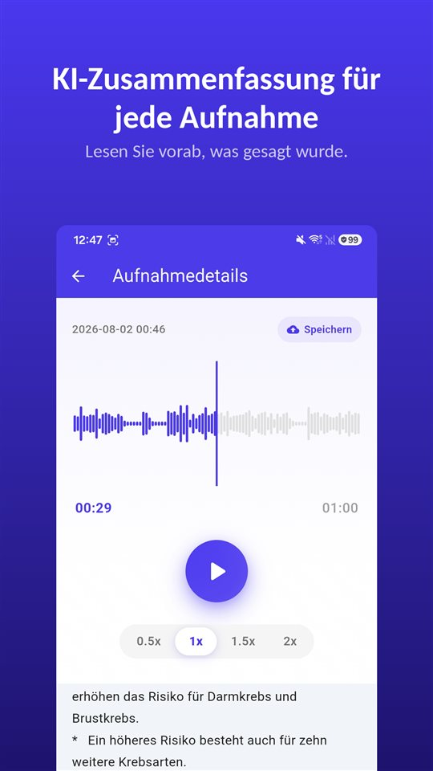

Die Besprechung dauerte vierzig Minuten. Der Arzttermin zwölf. Das Telefonat mit dem Vermieter acht. Alle drei sind auf dem Handy.

Jetzt fragt jemand, was zur Kaution vereinbart wurde. Sie wissen, dass es irgendwo darin steckt.

Eine Zusammenfassung sagt Ihnen, wo Sie hinhören müssen. Maßgeblich bleibt die Aufnahme.

## Drei Wege zu einer Zusammenfassung auf Android

| | Google Rekorder (Pixel) | Samsung-Sprachrekorder (Galaxy AI) | TalkSafe |
|---|---|---|---|
| Zusammenfassung | Ja | Ja, mit Transcript Assist | Ja, zu jeder Aufnahme |
| Vollständiges Transkript | Ja | Ja | Nein, nur Zusammenfassung |
| Wo die Zusammenfassung entsteht | Auf dem Gerät (Gemini Nano) | Hier nicht geprüft | Auf einem Server |
| Sprache | Zum Start nur Englisch; am Handy prüfen | Je nach Region unterschiedlich | Die Sprache der Aufnahme |
| Weitere Voraussetzungen | Unterstützte Pixel-Modelle | Samsung-Konto; sehr kurze Aufnahmen werden nicht zusammengefasst | Android |
| Startet die Aufnahme selbst | Nein | Nein | Ja, bei einem festgelegten Wort, mit den 30 Sekunden davor |

Die Angaben unten beruhen auf den Unterlagen der Hersteller und Berichten zum Zeitpunkt des Schreibens und können sich ändern.

## Googles Rekorder auf Pixel

Googles Rekorder-App transkribiert während der Aufnahme und kann auf unterstützten Pixel-Handys **das Transkript auf dem Gerät zusammenfassen** – mit **Gemini Nano**. Googles Entwicklerteam beschrieb das Ergebnis als **drei Stichpunkte** mit Sprechernamen, Kernaussagen und Themen. Zum Start gab es die Zusammenfassung **nur auf Englisch**; das Transkript selbst unterstützt viel mehr Sprachen.

## Der Samsung-Sprachrekorder mit Galaxy AI

Auf Galaxy-Handys mit Galaxy AI macht **Transcript Assist** im Sprachrekorder aus einer Aufnahme ein Transkript und kann es **zusammenfassen**. Laut Samsungs Support-Seiten muss man dafür **bei einem Samsung-Konto angemeldet** sein, und eine **zu kurze Aufnahme lässt sich nicht zusammenfassen**. Die verfügbaren Sprachen unterscheiden sich je nach Region. Ob die Zusammenfassungen des Sprachrekorders nur auf dem Gerät verarbeitet werden, konnten wir in Samsungs Unterlagen nicht bestätigen.

## TalkSafe

[TalkSafe](/talksafe/de/) erstellt **zu jeder Aufnahme eine KI-Zusammenfassung**. Sie erscheint als kurze Stichpunktliste **unter dem Player** in der Detailansicht – so lesen Sie, was gesagt wurde, bevor Sie entscheiden, ob Sie es noch einmal anhören.

<figure class="shot"><figcaption>Aufnahmedetails. Die KI-Zusammenfassung steht unter dem Player, als kurze Stichpunktliste.</figcaption></figure>

Vier Dinge sind gut zu wissen:

- **Die Zusammenfassung ist in der Sprache der Aufnahme.** Ein Gespräch auf Deutsch wird auf Deutsch zusammengefasst, eines auf Japanisch auf Japanisch.
- **Es ist eine Zusammenfassung, kein Transkript.** Einen Wort-für-Wort-Text gibt es nicht. Den genauen Wortlaut hören Sie in der Datei nach.
- **Sie funktioniert auch für Ausschnitte.** Schneiden Sie den benötigten Teil zu – er wird als neue Datei gespeichert, das Original bleibt erhalten –, und die Zusammenfassung lässt sich auf diesen Ausschnitt anwenden. Ebenso für einen Ausschnitt, der mit der [KI-Rauschunterdrückung auf dem Gerät](/blog/de/remove-background-noise/) bereinigt wurde.
- **Die Zusammenfassung entsteht auf einem Server.** Die Schlüsselwort-Erkennung von TalkSafe läuft vollständig auf dem Handy, aber für die Zusammenfassung wird die Aufnahme an einen Server geschickt.

Was TalkSafe von den beiden anderen unterscheidet, ist der Start: Die Aufnahme **beginnt von selbst**, wenn ein festgelegtes Wort fällt, bei **gesperrtem Bildschirm**, und behält die **30 Sekunden davor**. Die Zusammenfassung sagt Ihnen dann, was in einer Datei steckt, die Sie nicht einmal starten mussten. Mehr in [Zuerst sagt man etwas: eine Aufnahme mit der Stimme starten](/blog/de/say-it-first/).

## Wohin der Ton geht

Das ist die Frage, die man jeder Zusammenfassungsfunktion stellen sollte.

Eine Zusammenfassung auf dem Gerät lässt den Ton auf dem Handy. Eine Zusammenfassung auf einem Server schickt ihn zur Verarbeitung woandershin. Beides ist nicht falsch, aber es ist verschieden – und der Unterschied zählt am meisten, wenn **andere Personen** am Gespräch beteiligt sind: Ihre Stimmen sind in dem, was Sie senden.

Für eine Arbeitsbesprechung oder eine Vorlesung ist eine Server-Zusammenfassung meist kein Problem. Für ein Gespräch, das Ihr Handy nicht verlassen soll, behalten Sie die Aufnahme und hören sie selbst.

Für das Aufnehmen selbst gilt in Deutschland und der Schweiz: das nichtöffentlich gesprochene Wort anderer nur **mit Einwilligung** (§ 201 StGB, Art. 179ter StGB); in Österreich ist die Aufnahme des eigenen Gesprächs nicht strafbar. Mehr in [Gespräch heimlich aufnehmen](/blog/de/gespraech-aufnehmen/).

## Was eine Zusammenfassung weglässt

Eine Zusammenfassung soll kurz sein, und kurz heißt auswählen. Es fehlen das Zögern vor einer Antwort, die genaue Zahl, der Satz, der den Sinn des vorigen verändert hat. Eine KI-Zusammenfassung kann auch schlicht **falsch** sein.

Nutzen Sie die Zusammenfassung also, um **die richtige Aufnahme und die richtige Stelle** zu finden. Dann hören Sie hin. Und wenn eine Aufnahme einmal wichtig werden könnte – ein Streit, eine Beschwerde, ein Arzttermin, den Sie genau verstehen müssen –, **bewahren Sie das Original unverändert auf**. Ein Gericht oder eine Versicherung schaut auf die Aufnahme, nicht auf eine Zusammenfassung davon. Warum, steht in [Was man mit einer Aufnahme tun sollte – und was nicht](/blog/de/after-recording/).

## Eine kurze Routine

1. Aufnehmen – oder das Wort den Start übernehmen lassen.
2. Die Zusammenfassung lesen, um zu sehen, was in der Datei ist.
3. Brauchen Sie nur einen Teil, **zuschneiden**; das Original bleibt.
4. Ist es laut, die **Rauschunterdrückung** auf den Ausschnitt anwenden.
5. Die Zusammenfassung des Ausschnitts lesen und die wichtige Stelle **anhören**.
6. Das Original behalten.

Die Angaben zu Apps anderer Anbieter beruhen auf deren Unterlagen und Berichten zum Zeitpunkt des Schreibens und können sich ändern. Wir entwickeln die Aufnahme-App TalkSafe.

