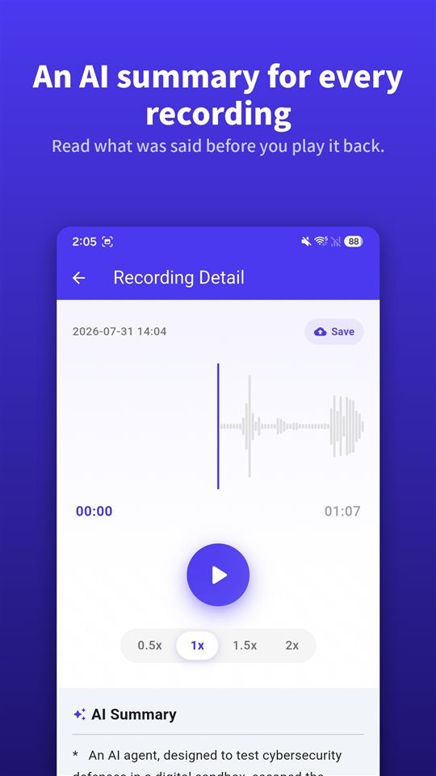

The meeting ran forty minutes. The doctor's appointment, twelve. The call with the landlord, eight. All three are on your phone.

Now someone asks what was agreed about the deposit. You know it is in there somewhere.

A summary tells you where to listen. The recording is still the record.

## Three ways to get a summary on Android

| | Google Recorder (Pixel) | Samsung Voice Recorder (Galaxy AI) | TalkSafe |
|---|---|---|---|
| Summary | Yes | Yes, with Transcript Assist | Yes, for each recording |
| Full transcript | Yes | Yes | No, summary only |
| Where the summary is made | On the device (Gemini Nano) | Not verified here | On a server |
| Language | Launched English-only; check your phone | Supported languages vary by region | The language the recording is in |
| Other requirements | Supported Pixel models | Samsung account; very short recordings cannot be summarized | Android |
| Starts recording by itself | No | No | Yes, on a word you set, with the 30 seconds before |

The details below are from each company's documentation and reporting at the time of writing and can change.

## Google Recorder on Pixel

Google's Recorder app transcribes as it records, and on supported Pixel phones it can **summarize the transcript on the device** with **Gemini Nano**. Google's developer team described the output as **three bullet points** covering speaker names, key takeaways and themes. When the feature launched, summaries were **English-only**; transcription itself covers many more languages.

## Samsung Voice Recorder with Galaxy AI

On Galaxy phones with Galaxy AI, **Transcript Assist** in the Voice Recorder app turns a recording into a transcript and can **summarize** it. Samsung's support pages say you need to be **signed in to a Samsung account** to use the summary, and that a recording that is **too short cannot be summarized**. Supported languages differ by region. We could not confirm from Samsung's documentation whether Voice Recorder summaries are processed only on the device.

## TalkSafe

[TalkSafe](/talksafe/en/) creates an **AI summary for every recording**. It appears as a short list of points **under the player** in the recording's detail screen, so you can read what was said before deciding whether to play it back.

<figure class="shot"><figcaption>Recording detail. The AI summary sits under the player, as a short list of points.</figcaption></figure>

Four things are worth knowing:

- **The summary is in the recording's language.** A conversation in German is summarized in German; one in Japanese, in Japanese.
- **It is a summary, not a transcript.** There is no word-for-word text. For exact wording, listen to the file.
- **It works on clips.** Trim the part you need — the trimmed section is saved as a new file and the original stays — and the summary can be used on that clip. The same goes for a clip cleaned with [on-device AI noise removal](/blog/en/remove-background-noise/).
- **The summary is made on a server.** TalkSafe's keyword detection runs entirely on the phone, but to summarize, the recording is sent to a server.

What makes TalkSafe different from the other two is how the recording begins: it **starts by itself** when it hears a word you set, with the **screen locked**, and keeps the **30 seconds before** the word. The summary then tells you what is in a file you never had to start. More in [You say something first](/blog/en/say-it-first/).

## Where the audio goes

This is the question to ask of any summary feature.

An on-device summary keeps the audio on the phone. A server-side summary sends it somewhere else to be processed. Neither is wrong, but they are different, and the difference matters most when the conversation includes **other people**: their voices are part of whatever you send.

For a work meeting or a lecture, a server-side summary is usually fine. For a conversation you would not want to leave your phone, keep the recording and listen to it instead.

## What a summary leaves out

A summary is built to be short, and short means choices. It drops the hesitation before an answer, the exact number, the sentence that changed the meaning of the one before it. AI summaries can also simply **get things wrong**.

So use the summary to find **which recording, and which part**. Then listen. And if a recording might ever matter — a dispute, a complaint, an appointment you need to get right — **keep the original unchanged**. A court or an insurer looks at the recording, not at a summary of it. We explained why in [What to do with a recording, and what not to](/blog/en/after-recording/).

## A short routine

1. Record — or let the word start it.
2. Read the summary to see what is in the file.
3. If you need one part, **trim** it; the original stays.
4. If it is noisy, run **noise removal** on the clip.
5. Read the summary of the clip, then **listen** to the part that matters.
6. Keep the original.

Feature availability for third-party apps reflects their documentation and reporting at the time of writing and can change. We make a recording app, TalkSafe.

