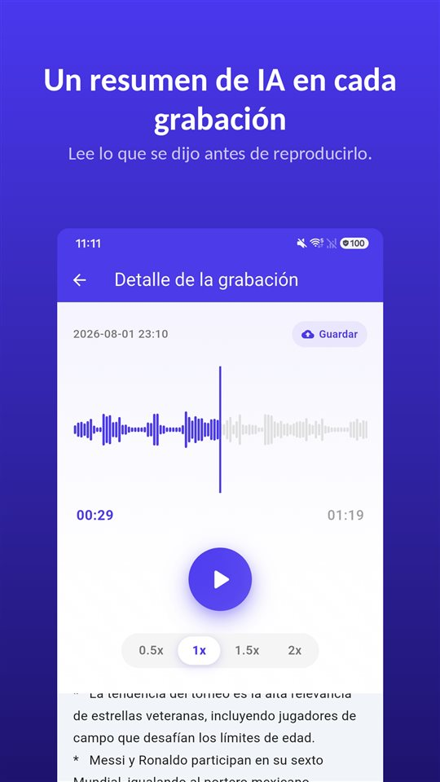

La reunión duró cuarenta minutos. La consulta médica, doce. La llamada con el casero, ocho. Las tres están en tu móvil.

Ahora alguien pregunta qué se acordó sobre la fianza. Sabes que está ahí, en alguna parte.

Un resumen te dice dónde escuchar. El registro sigue siendo la grabación.

## Tres formas de obtener un resumen en Android

| | Grabadora de Google (Pixel) | Grabadora de voz de Samsung (Galaxy AI) | TalkSafe |
|---|---|---|---|
| Resumen | Sí | Sí, con Transcript Assist | Sí, de cada grabación |
| Transcripción completa | Sí | Sí | No, solo resumen |
| Dónde se hace el resumen | En el dispositivo (Gemini Nano) | No verificado aquí | En un servidor |
| Idioma | Se lanzó solo en inglés; compruébalo en tu móvil | Varía según la región | El idioma de la grabación |
| Otros requisitos | Modelos Pixel compatibles | Cuenta Samsung; las grabaciones muy cortas no se resumen | Android |
| Empieza a grabar sola | No | No | Sí, con una palabra elegida, con los 30 segundos anteriores |

Los datos de abajo proceden de la documentación de cada empresa y de lo publicado al momento de escribir, y pueden cambiar.

## La Grabadora de Google en Pixel

La Grabadora de Google transcribe mientras graba y, en los Pixel compatibles, puede **resumir la transcripción en el dispositivo** con **Gemini Nano**. El equipo de desarrollo de Google describió el resultado como **tres viñetas** con los nombres de quienes hablan, las ideas clave y los temas. Al lanzarse, los resúmenes estaban **solo en inglés**; la transcripción en sí cubre muchos más idiomas.

## La grabadora de voz de Samsung con Galaxy AI

En los Galaxy con Galaxy AI, **Transcript Assist** de la grabadora de voz convierte una grabación en transcripción y puede **resumirla**. Según las páginas de soporte de Samsung, hace falta **iniciar sesión en una cuenta Samsung** para usar el resumen, y una grabación **demasiado corta no se puede resumir**. Los idiomas disponibles varían según la región. No pudimos confirmar en la documentación de Samsung si los resúmenes de la grabadora se procesan solo en el dispositivo.

## TalkSafe

[TalkSafe](/talksafe/es/) crea un **resumen con IA de cada grabación**. Aparece como una lista breve de puntos **bajo el reproductor**, en la pantalla de detalle, así que puedes leer qué se dijo antes de decidir si volver a escucharla.

<figure class="shot"><figcaption>Detalle de la grabación. El resumen con IA aparece bajo el reproductor, como una lista breve de puntos.</figcaption></figure>

Cuatro cosas que conviene saber:

- **El resumen está en el idioma de la grabación.** Una conversación en alemán se resume en alemán; una en japonés, en japonés.
- **Es un resumen, no una transcripción.** No hay texto palabra por palabra. Para las palabras exactas, escucha el archivo.
- **Funciona con tramos.** Recorta la parte que necesitas —el tramo se guarda como archivo nuevo y el original se conserva— y el resumen se puede usar en ese tramo. Lo mismo con un tramo limpiado con la [eliminación de ruido con IA en el dispositivo](/blog/es/remove-background-noise/).
- **El resumen se hace en un servidor.** La detección de palabras clave de TalkSafe funciona por completo en el teléfono, pero para resumir, la grabación se envía a un servidor.

Lo que distingue a TalkSafe de las otras dos es cómo empieza la grabación: **arranca sola** cuando oye una palabra que hayas elegido, con la **pantalla bloqueada**, y conserva los **30 segundos anteriores** a la palabra. El resumen te dice entonces qué hay en un archivo que ni siquiera tuviste que iniciar. Más en [Lo primero que se mueve no es la mano](/blog/es/say-it-first/).

## A dónde va el audio

Es la pregunta que hay que hacer a cualquier función de resumen.

Un resumen en el dispositivo deja el audio en el teléfono. Un resumen en un servidor lo envía a otro lugar para procesarlo. Ninguno es incorrecto, pero son distintos, y la diferencia importa más cuando en la conversación hay **otras personas**: sus voces van en lo que envías.

Para una reunión de trabajo o una clase, un resumen en servidor suele estar bien. Para una conversación que no querrías que saliera del teléfono, conserva la grabación y escúchala.

## Lo que un resumen deja fuera

Un resumen está hecho para ser corto, y corto significa elegir. Se pierde la duda antes de una respuesta, la cifra exacta, la frase que cambió el sentido de la anterior. Un resumen con IA también puede, sencillamente, **equivocarse**.

Así que usa el resumen para encontrar **qué grabación y qué parte**. Luego escucha. Y si una grabación puede llegar a importar —un conflicto, una reclamación, una consulta que tienes que entender bien—, **conserva el original sin cambios**. Un juzgado o una aseguradora miran la grabación, no un resumen de ella. Lo explicamos en [Qué hacer con una grabación, y qué no hacer con ella](/blog/es/after-recording/).

## Una rutina corta

1. Graba, o deja que la palabra la inicie.
2. Lee el resumen para ver qué hay en el archivo.
3. Si necesitas una parte, **recórtala**; el original se conserva.
4. Si hay ruido, aplica la **eliminación de ruido** al tramo.
5. Lee el resumen del tramo y **escucha** la parte que importa.
6. Conserva el original.

Las funciones de apps de terceros reflejan su documentación y lo publicado al momento de escribir, y pueden cambiar. Nosotros hacemos una app de grabación, TalkSafe.

