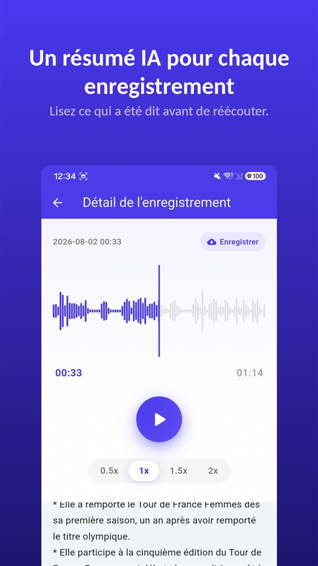

La réunion a duré quarante minutes. La consultation, douze. L'appel avec le propriétaire, huit. Les trois sont sur votre téléphone.

Quelqu'un demande maintenant ce qui a été convenu pour la caution. Vous savez que c'est dedans, quelque part.

Un résumé vous dit où écouter. La référence reste l'enregistrement.

## Trois façons d'obtenir un résumé sur Android

| | Enregistreur de Google (Pixel) | Enregistreur vocal Samsung (Galaxy AI) | TalkSafe |
|---|---|---|---|
| Résumé | Oui | Oui, avec Transcript Assist | Oui, pour chaque enregistrement |
| Transcription complète | Oui | Oui | Non, résumé seulement |
| Où le résumé est fait | Sur l'appareil (Gemini Nano) | Non vérifié ici | Sur un serveur |
| Langue | Anglais seulement au lancement ; à vérifier sur le téléphone | Variable selon la région | La langue de l'enregistrement |
| Autres conditions | Modèles Pixel compatibles | Compte Samsung ; les enregistrements très courts ne sont pas résumés | Android |
| Démarre l'enregistrement seul | Non | Non | Oui, sur un mot choisi, avec les 30 secondes précédentes |

Les informations ci-dessous proviennent de la documentation des éditeurs et de ce qui était publié au moment de la rédaction ; elles peuvent changer.

## L'Enregistreur de Google sur Pixel

L'Enregistreur de Google transcrit pendant l'enregistrement et, sur les Pixel compatibles, peut **résumer la transcription sur l'appareil** avec **Gemini Nano**. L'équipe de développement de Google a décrit le résultat comme **trois puces** reprenant les noms des personnes qui parlent, les points clés et les thèmes. Au lancement, les résumés étaient **en anglais seulement** ; la transcription couvre beaucoup plus de langues.

## L'Enregistreur vocal de Samsung avec Galaxy AI

Sur les Galaxy dotés de Galaxy AI, **Transcript Assist** dans l'Enregistreur vocal transforme un enregistrement en transcription et peut le **résumer**. D'après les pages d'assistance de Samsung, il faut être **connecté à un compte Samsung** pour utiliser le résumé, et un enregistrement **trop court ne peut pas être résumé**. Les langues disponibles varient selon la région. Nous n'avons pas pu confirmer dans la documentation de Samsung si les résumés de l'Enregistreur vocal sont traités uniquement sur l'appareil.

## TalkSafe

[TalkSafe](/talksafe/fr/) crée un **résumé par IA de chaque enregistrement**. Il apparaît sous forme de courte liste de points **sous le lecteur**, dans l'écran de détail : vous lisez ce qui a été dit avant de décider de réécouter.

<figure class="shot"><figcaption>Détail de l'enregistrement. Le résumé par IA s'affiche sous le lecteur, en courte liste de points.</figcaption></figure>

Quatre choses à savoir :

- **Le résumé est dans la langue de l'enregistrement.** Une conversation en allemand est résumée en allemand ; en japonais, en japonais.
- **C'est un résumé, pas une transcription.** Il n'y a pas de texte mot à mot. Pour les mots exacts, écoutez le fichier.
- **Il fonctionne sur des extraits.** Découpez la partie utile — l'extrait est enregistré comme nouveau fichier et l'original est conservé — et le résumé peut être utilisé sur cet extrait. De même pour un extrait nettoyé avec la [suppression du bruit par IA sur l'appareil](/blog/fr/remove-background-noise/).
- **Le résumé est fait sur un serveur.** La détection des mots-clés de TalkSafe fonctionne entièrement sur le téléphone, mais pour résumer, l'enregistrement est envoyé à un serveur.

Ce qui distingue TalkSafe des deux autres, c'est la façon dont l'enregistrement commence : il **démarre tout seul** quand il entend un mot choisi, **écran verrouillé**, et garde les **30 secondes précédentes**. Le résumé vous dit ensuite ce que contient un fichier que vous n'avez même pas eu à lancer. Plus de détails dans [On dit d'abord quelque chose](/blog/fr/say-it-first/).

## Où part l'audio

C'est la question à poser à toute fonction de résumé.

Un résumé sur l'appareil laisse l'audio dans le téléphone. Un résumé sur serveur l'envoie ailleurs pour être traité. Aucun des deux n'est faux, mais ils sont différents, et la différence compte surtout quand la conversation inclut **d'autres personnes** : leurs voix sont dans ce que vous envoyez.

Pour une réunion de travail ou un cours, un résumé sur serveur convient généralement. Pour une conversation qui ne devrait pas quitter votre téléphone, gardez l'enregistrement et écoutez-le.

Pour l'enregistrement lui-même : en France et en Suisse, enregistrer des paroles privées sans le consentement des autres est puni (art. 226-1 et 179ter des codes pénaux) ; en Belgique et au Québec, un participant peut enregistrer sa propre conversation. Le cadre complet est dans [Enregistrer une conversation à l'insu de quelqu'un](/blog/fr/enregistrer-conversation/).

## Ce qu'un résumé laisse de côté

Un résumé est fait pour être court, et court veut dire choisir. Disparaissent l'hésitation avant une réponse, le chiffre exact, la phrase qui a changé le sens de la précédente. Un résumé par IA peut aussi, tout simplement, **se tromper**.

Utilisez donc le résumé pour trouver **quel enregistrement, et quel passage**. Puis écoutez. Et si un enregistrement peut un jour compter — un litige, une réclamation, une consultation à bien comprendre —, **conservez l'original sans modification**. Un tribunal ou un assureur regarde l'enregistrement, pas son résumé. Nous l'expliquons dans [Ce qu'il faut faire d'un enregistrement, et ce qu'il ne faut pas en faire](/blog/fr/after-recording/).

## Une routine courte

1. Enregistrez, ou laissez le mot lancer l'enregistrement.
2. Lisez le résumé pour voir ce que contient le fichier.
3. S'il vous faut une partie, **découpez-la** ; l'original reste.
4. S'il y a du bruit, appliquez la **suppression du bruit** à l'extrait.
5. Lisez le résumé de l'extrait et **écoutez** le passage qui compte.
6. Gardez l'original.

Les fonctions des applications tierces reflètent leur documentation et ce qui était publié au moment de la rédaction, et peuvent changer. Nous développons une application d'enregistrement, TalkSafe.

