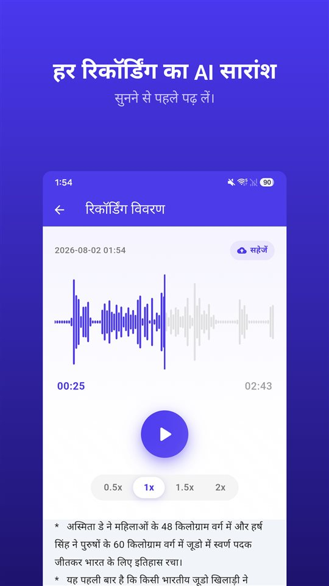

मीटिंग चालीस मिनट चली। डॉक्टर के पास बारह मिनट। मकान मालिक से फ़ोन पर आठ मिनट। तीनों आपके फ़ोन में हैं।

अब कोई पूछता है कि सिक्योरिटी डिपॉज़िट पर क्या तय हुआ था। आपको पता है कि वह कहीं इन्हीं में है।

सारांश बताता है कि कहाँ सुनना है। रिकॉर्ड अब भी रिकॉर्डिंग ही है।

## Android पर सारांश पाने के तीन तरीक़े

| | Google Recorder (Pixel) | Samsung Voice Recorder (Galaxy AI) | TalkSafe |
|---|---|---|---|
| सारांश | हाँ | हाँ, Transcript Assist से | हाँ, हर रिकॉर्डिंग का |
| पूरा ट्रांसक्रिप्ट | हाँ | हाँ | नहीं, सिर्फ़ सारांश |
| सारांश कहाँ बनता है | डिवाइस पर (Gemini Nano) | यहाँ जाँचा नहीं गया | सर्वर पर |
| भाषा | शुरुआत में सिर्फ़ अंग्रेज़ी; फ़ोन पर जाँचें | क्षेत्र के अनुसार अलग | रिकॉर्डिंग की भाषा |
| अन्य शर्तें | समर्थित Pixel मॉडल | Samsung खाता; बहुत छोटी रिकॉर्डिंग का सारांश नहीं बनता | Android |
| ख़ुद रिकॉर्डिंग शुरू करता है | नहीं | नहीं | हाँ, चुने हुए शब्द पर, पहले के 30 सेकंड के साथ |

नीचे दी गई जानकारी लिखते समय कंपनियों के दस्तावेज़ों और रिपोर्टों पर आधारित है और बदल सकती है।

## Pixel पर Google Recorder

Google Recorder रिकॉर्ड करते समय ट्रांसक्रिप्ट बनाता है, और समर्थित Pixel फ़ोन पर उस ट्रांसक्रिप्ट का **सारांश डिवाइस पर ही** **Gemini Nano** से बना सकता है। Google की डेवलपर टीम ने नतीजे को **तीन बिंदु** बताया, जिनमें बोलने वालों के नाम, मुख्य बातें और विषय होते हैं। शुरुआत में सारांश **सिर्फ़ अंग्रेज़ी** में थे; ट्रांसक्रिप्ट कहीं ज़्यादा भाषाओं में होता है।

## Galaxy AI के साथ Samsung Voice Recorder

Galaxy AI वाले Galaxy फ़ोन पर Voice Recorder का **Transcript Assist** रिकॉर्डिंग को ट्रांसक्रिप्ट में बदलता है और उसका **सारांश** भी बना सकता है। Samsung के सहायता पेजों के अनुसार सारांश के लिए **Samsung खाते में लॉग-इन** होना ज़रूरी है, और **बहुत छोटी रिकॉर्डिंग का सारांश नहीं बनता।** समर्थित भाषाएँ क्षेत्र के अनुसार अलग हैं। Voice Recorder के सारांश सिर्फ़ डिवाइस पर बनते हैं या नहीं, यह हम Samsung के दस्तावेज़ों से पक्का नहीं कर सके।

## TalkSafe

[TalkSafe](/talksafe/hi/) **हर रिकॉर्डिंग का AI सारांश** बनाता है। यह रिकॉर्डिंग के विवरण वाली स्क्रीन पर **प्लेयर के नीचे** छोटे बिंदुओं की सूची के रूप में दिखता है, ताकि दोबारा सुनने का फ़ैसला करने से पहले आप पढ़ सकें कि क्या कहा गया।

<figure class="shot"><figcaption>रिकॉर्डिंग का विवरण। AI सारांश प्लेयर के नीचे छोटे बिंदुओं की सूची के रूप में दिखता है।</figcaption></figure>

चार बातें जानने लायक़ हैं:

- **सारांश रिकॉर्डिंग की भाषा में होता है।** जर्मन बातचीत का सारांश जर्मन में, जापानी का जापानी में।
- **यह सारांश है, ट्रांसक्रिप्ट नहीं।** शब्दशः लिखा हुआ पाठ नहीं होता। सटीक शब्दों के लिए फ़ाइल सुनिए।
- **ट्रिम किए हिस्सों पर भी काम करता है।** ज़रूरी हिस्सा ट्रिम कीजिए — वह नई फ़ाइल के रूप में सेव होता है और मूल फ़ाइल बची रहती है — और उस हिस्से पर सारांश इस्तेमाल हो सकता है। [डिवाइस पर AI नॉइज़ रिमूवल](/blog/hi/remove-background-noise/) से साफ़ किए हिस्से पर भी यही बात लागू है।
- **सारांश सर्वर पर बनता है।** TalkSafe की कीवर्ड पहचान पूरी तरह फ़ोन के अंदर होती है, लेकिन सारांश के लिए रिकॉर्डिंग सर्वर पर भेजी जाती है।

बाकी दोनों से TalkSafe का फ़र्क़ रिकॉर्डिंग शुरू होने के तरीक़े में है: चुना हुआ शब्द सुनते ही यह **लॉक स्क्रीन पर ख़ुद शुरू** हो जाता है, और उस शब्द से **पहले के 30 सेकंड** भी रखता है। फिर सारांश बताता है कि उस फ़ाइल में क्या है जिसे आपको शुरू तक नहीं करना पड़ा। विस्तार [पहले आप कुछ कहते हैं: आवाज़ से रिकॉर्डिंग शुरू करना](/blog/hi/say-it-first/) में।

## आवाज़ कहाँ जाती है

किसी भी सारांश सुविधा से यह सवाल पूछना चाहिए।

डिवाइस पर बना सारांश आवाज़ को फ़ोन में ही रखता है। सर्वर पर बना सारांश आवाज़ को प्रोसेस करने के लिए कहीं और भेजता है। दोनों में से कोई ग़लत नहीं, पर दोनों अलग हैं, और यह फ़र्क़ तब सबसे ज़्यादा मायने रखता है जब बातचीत में **दूसरे लोग** हों: भेजी गई फ़ाइल में उनकी आवाज़ भी होती है।

दफ़्तर की मीटिंग या लेक्चर के लिए सर्वर पर सारांश आम तौर पर ठीक रहता है। जो बातचीत आप फ़ोन से बाहर नहीं जाने देना चाहते, उसकी रिकॉर्डिंग रखिए और ख़ुद सुनिए।

## सारांश क्या छोड़ देता है

सारांश छोटा होने के लिए बनता है, और छोटा होने का मतलब है चुनना। जवाब से पहले की झिझक, सटीक आँकड़ा, वह वाक्य जिसने पिछले वाक्य का मतलब बदल दिया — ये छूट जाते हैं। AI सारांश सीधे-सीधे **ग़लत भी हो सकता है।**

इसलिए सारांश से यह ढूँढिए कि **कौन-सी रिकॉर्डिंग और कौन-सा हिस्सा**। फिर सुनिए। और अगर कोई रिकॉर्डिंग कभी अहम हो सकती है — कोई विवाद, शिकायत, या डॉक्टर की ऐसी बात जिसे ठीक समझना ज़रूरी है — तो **मूल फ़ाइल बिना बदले रखिए**। अदालत या बीमा कंपनी सारांश नहीं, रिकॉर्डिंग देखती है। वजह [रिकॉर्डिंग के बाद क्या करें, और क्या न करें](/blog/hi/after-recording/) में बताई है।

## छोटा तरीक़ा

1. रिकॉर्ड कीजिए, या शब्द से रिकॉर्डिंग शुरू होने दीजिए।
2. फ़ाइल में क्या है, यह देखने के लिए सारांश पढ़िए।
3. एक हिस्सा चाहिए तो उसे **ट्रिम** कीजिए; मूल फ़ाइल बची रहती है।
4. शोर हो तो हिस्से पर **नॉइज़ रिमूवल** लगाइए।
5. हिस्से का सारांश पढ़िए और ज़रूरी हिस्सा **सुनिए**।
6. मूल फ़ाइल रखिए।

दूसरे ऐप की सुविधाएँ लिखते समय उनके दस्तावेज़ों और रिपोर्टों पर आधारित हैं और बदल सकती हैं। हम रिकॉर्डिंग ऐप TalkSafe बनाते हैं।

