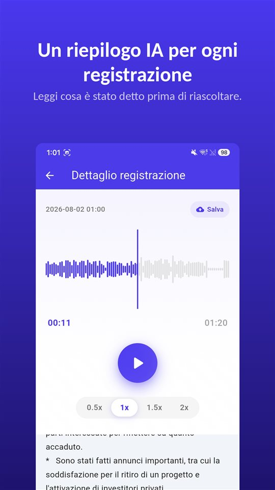

La riunione è durata quaranta minuti. La visita medica, dodici. La telefonata con il padrone di casa, otto. Sono tutte e tre nel telefono.

Ora qualcuno chiede cosa si è deciso sulla caparra. Sai che è lì dentro, da qualche parte.

Un riassunto ti dice dove ascoltare. Il documento resta la registrazione.

## Tre modi per avere un riassunto su Android

| | Registratore di Google (Pixel) | Registratore vocale Samsung (Galaxy AI) | TalkSafe |
|---|---|---|---|
| Riassunto | Sì | Sì, con Transcript Assist | Sì, per ogni registrazione |
| Trascrizione completa | Sì | Sì | No, solo riassunto |
| Dove si fa il riassunto | Sul dispositivo (Gemini Nano) | Non verificato qui | Su un server |
| Lingua | Al lancio solo inglese; verifica sul telefono | Varia per regione | La lingua della registrazione |
| Altri requisiti | Modelli Pixel compatibili | Account Samsung; le registrazioni molto brevi non si riassumono | Android |
| Avvia la registrazione da sola | No | No | Sì, con una parola scelta, con i 30 secondi precedenti |

Le informazioni che seguono vengono dalla documentazione delle aziende e da quanto pubblicato al momento della stesura, e possono cambiare.

## Il Registratore di Google sui Pixel

Il Registratore di Google trascrive mentre registra e, sui Pixel compatibili, può **riassumere la trascrizione sul dispositivo** con **Gemini Nano**. Il team di sviluppo di Google ha descritto il risultato come **tre punti elenco** con i nomi di chi parla, i punti chiave e i temi. Al lancio i riassunti erano **solo in inglese**; la trascrizione copre molte più lingue.

## Il Registratore vocale Samsung con Galaxy AI

Sui Galaxy con Galaxy AI, **Transcript Assist** del Registratore vocale trasforma una registrazione in trascrizione e può **riassumerla**. Secondo le pagine di assistenza Samsung serve **aver effettuato l'accesso a un account Samsung** per usare il riassunto, e una registrazione **troppo breve non si può riassumere**. Le lingue disponibili variano per regione. Dalla documentazione Samsung non siamo riusciti a confermare se i riassunti del Registratore vengano elaborati solo sul dispositivo.

## TalkSafe

[TalkSafe](/talksafe/it/) crea un **riassunto IA per ogni registrazione**. Compare come breve elenco di punti **sotto il lettore**, nella schermata di dettaglio, così puoi leggere cosa è stato detto prima di decidere se riascoltarla.

<figure class="shot"><figcaption>Dettaglio della registrazione. Il riassunto IA compare sotto il lettore, come breve elenco di punti.</figcaption></figure>

Quattro cose da sapere:

- **Il riassunto è nella lingua della registrazione.** Una conversazione in tedesco viene riassunta in tedesco; una in giapponese, in giapponese.
- **È un riassunto, non una trascrizione.** Non c'è testo parola per parola. Per le parole esatte, ascolta il file.
- **Funziona sui tratti.** Taglia la parte che ti serve —il tratto viene salvato come nuovo file e l'originale resta— e il riassunto si può usare su quel tratto. Vale anche per un tratto ripulito con la [rimozione del rumore con IA sul dispositivo](/blog/it/remove-background-noise/).
- **Il riassunto si fa su un server.** Il rilevamento delle parole chiave di TalkSafe avviene interamente sul telefono, ma per riassumere la registrazione viene inviata a un server.

Ciò che distingue TalkSafe dalle altre due è come inizia la registrazione: **parte da sola** quando sente una parola scelta, con lo **schermo bloccato**, e conserva i **30 secondi precedenti** alla parola. Il riassunto ti dice poi cosa c'è in un file che non hai nemmeno dovuto avviare. Di più in [Prima della mano si muove la voce](/blog/it/say-it-first/).

## Dove va l'audio

È la domanda da fare a qualsiasi funzione di riassunto.

Un riassunto sul dispositivo lascia l'audio nel telefono. Un riassunto su server lo invia altrove per elaborarlo. Nessuno dei due è sbagliato, ma sono diversi, e la differenza conta di più quando nella conversazione ci sono **altre persone**: le loro voci sono in ciò che invii.

Per una riunione di lavoro o una lezione, un riassunto su server di solito va bene. Per una conversazione che non vorresti uscisse dal telefono, tieni la registrazione e ascoltala.

## Cosa lascia fuori un riassunto

Un riassunto è fatto per essere breve, e breve significa scegliere. Si perde l'esitazione prima di una risposta, la cifra esatta, la frase che ha cambiato il senso di quella precedente. Un riassunto IA può anche, semplicemente, **sbagliare**.

Quindi usa il riassunto per trovare **quale registrazione e quale parte**. Poi ascolta. E se una registrazione potrà contare —una lite, un reclamo, una visita da capire bene—, **conserva l'originale senza modifiche**. Un giudice o un'assicurazione guardano la registrazione, non un suo riassunto. L'abbiamo spiegato in [Cosa fare con una registrazione, e cosa non farne](/blog/it/after-recording/).

## Una procedura breve

1. Registra, oppure lascia che la parola avvii la registrazione.
2. Leggi il riassunto per vedere cosa c'è nel file.
3. Se ti serve una parte, **tagliala**; l'originale resta.
4. Se c'è rumore, applica la **rimozione del rumore** al tratto.
5. Leggi il riassunto del tratto e **ascolta** la parte che conta.
6. Conserva l'originale.

Le funzioni delle app di terzi riflettono la loro documentazione e quanto pubblicato al momento della stesura, e possono cambiare. Noi realizziamo un'app di registrazione, TalkSafe.

