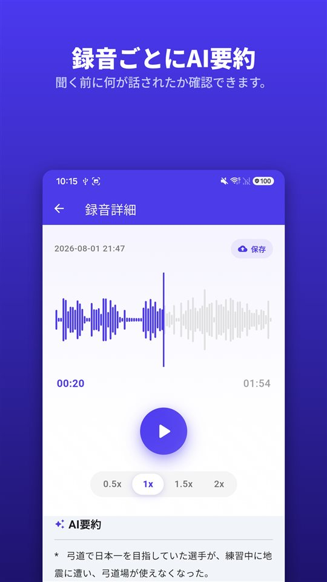

会議は40分、診察は12分、大家さんとの電話は8分。三つともスマートフォンに入っています。

そこへ誰かが聞きます。敷金の話はどう決まったのかと。どこかに入っていることは分かっています。

要約は、どこを聞けばいいかを教えてくれます。記録は、あくまで録音です。

## Androidで要約を得る三つの方法

| | Googleレコーダー（Pixel） | Samsungボイスレコーダー（Galaxy AI） | TalkSafe |
|---|---|---|---|
| 要約 | あり | あり（Transcript Assist） | 録音ごとにあり |
| 全文の文字起こし | あり | あり | なし、要約のみ |
| 要約する場所 | 端末内（Gemini Nano） | ここでは確認できず | サーバー |
| 言語 | 提供開始時は英語のみ、端末で確認 | 地域によって異なる | 録音した言語のまま |
| その他の条件 | 対応するPixel機種 | サムスンアカウント、ごく短い録音は要約不可 | Android |
| 録音が自分で始まるか | いいえ | いいえ | はい、決めた言葉で、直前30秒も含む |

以下の内容は執筆時点の各社の案内と報道にもとづくもので、変わることがあります。

## PixelのGoogleレコーダー

Googleレコーダーは録音しながら文字起こしをし、対応するPixelでは、その文字起こしを**端末内のGemini Nanoで要約**できます。Googleの開発チームは、出力を話者名、要点、テーマを含む**3つの箇条書き**だと説明しています。提供開始時の要約は**英語のみ**で、文字起こし自体はもっと多くの言語に対応しています。

## Galaxy AIのSamsungボイスレコーダー

Galaxy AIのあるGalaxyでは、ボイスレコーダーの**Transcript Assist**が録音を文字起こしにし、**要約**もできます。Samsungのサポート案内によると、要約を使うには**サムスンアカウントへのログイン**が必要で、**録音が短すぎると要約できません。** 対応言語は地域によって異なります。ボイスレコーダーの要約が端末内だけで処理されるかどうかは、Samsungの案内からは確認できませんでした。

## TalkSafe

[TalkSafe](/talksafe/ja/)は**録音ごとにAI要約**を作ります。録音の詳細画面の**再生バーの下**に短い箇条書きで表示されるので、聞き直す前に何が話されたかを先に読めます。

<figure class="shot"><figcaption>録音詳細画面。AI要約は再生バーの下に、短い箇条書きで表示されます。</figcaption></figure>

知っておくとよい四つのこと：

- **要約は録音した言語のままです。** ドイツ語の会話はドイツ語で、日本語の会話は日本語で要約されます。
- **文字起こしではなく要約です。** 言葉をそのまま書き起こした文章はありません。正確な言い回しはファイルを聞いて確かめます。
- **切り取ったファイルにも使えます。** 必要な区間を切り取ると、原本はそのまま残して新しいファイルとして保存され、そのファイルにも要約を使えます。[端末内のAIノイズ除去](/blog/ja/remove-background-noise/)で整えたファイルも同じです。
- **要約はサーバーで作られます。** TalkSafeのキーワード検知はすべてスマートフォンの中で行われますが、要約のためには録音をサーバーへ送ります。

ほかの二つと一番違うのは、録音の始まり方です。決めた言葉が聞こえると、**画面がロックされたまま自分で始まり**、その言葉の**直前30秒**まで残ります。要約は、自分で始めてもいないファイルに何が入っているかを教えてくれます。詳しくは[先に出るのは、手ではなく言葉です](/blog/ja/say-it-first/)にあります。

## 音声はどこへ行くのか

要約機能があるなら、必ず確かめたい点です。

端末内で要約すれば、音声はスマートフォンに残ります。サーバーで要約すれば、別の場所へ送られて処理されます。どちらが間違いということではなく、違うということです。その違いは、会話に**ほかの人**がいるときに一番大きくなります。送るファイルには、その人の声も入っています。

仕事の会議や講義なら、サーバーでの要約もたいてい問題ありません。スマートフォンの外に出したくない会話なら、要約ではなく録音を直接聞いてください。

## 要約が落とすもの

要約は短く作られ、短いということは選ぶということです。答える前のためらい、正確な数字、直前の文の意味を変えた一文が落ちます。AI要約は、単に**間違える**こともあります。

だから要約は**どの録音の、どの部分か**を探すのに使い、そのあとは自分で聞いてください。もめごと、苦情、正確でなければならない診察のように、あとで大事になりうる録音は**原本に手を加えずに保管**してください。裁判所や保険会社が見るのは要約ではなく録音です。理由は[録音したあとにすべきことと、してはいけないこと](/blog/ja/after-recording/)にまとめました。

## 短い手順

1. 録音します。または決めた言葉で始まるようにしておきます。
2. 要約を読み、ファイルに何が入っているかを見ます。
3. 一部だけ必要なら**切り取ります。** 原本は残ります。
4. 雑音が多ければ、切り取ったファイルに**ノイズ除去**をかけます。
5. 切り取ったファイルの要約を読み、大事な部分を**自分で聞きます。**
6. 原本はそのままにします。

他社アプリの機能は執筆時点の公式案内と報道にもとづいており、変わることがあります。私たちは録音アプリTalkSafeを作っています。

