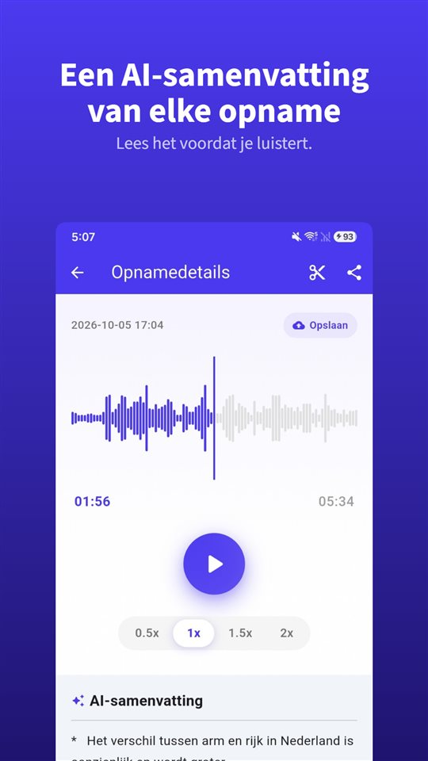

De vergadering duurde veertig minuten. Het consult twaalf. Het telefoontje met de verhuurder acht. Alle drie staan op je telefoon.

Nu vraagt iemand wat er over de borg is afgesproken. Je weet dat het erin zit, ergens.

Een samenvatting vertelt je waar je moet luisteren. Het bewijs blijft de opname.

## Drie manieren om een samenvatting te krijgen op Android

| | Google Recorder (Pixel) | Samsung Spraakrecorder (Galaxy AI) | TalkSafe |
|---|---|---|---|
| Samenvatting | Ja | Ja, met Transcript Assist | Ja, van elke opname |
| Volledige transcriptie | Ja | Ja | Nee, alleen samenvatting |
| Waar de samenvatting wordt gemaakt | Op het toestel (Gemini Nano) | Hier niet geverifieerd | Op een server |
| Taal | Bij de lancering alleen Engels; check op je telefoon | Verschilt per regio | De taal van de opname |
| Andere voorwaarden | Ondersteunde Pixel-modellen | Samsung-account; heel korte opnamen worden niet samengevat | Android |
| Begint zelf met opnemen | Nee | Nee | Ja, op een gekozen woord, met de 30 seconden daarvoor |

De gegevens hieronder komen uit de documentatie van de bedrijven en berichtgeving op het moment van schrijven, en kunnen veranderen.

## Googles Recorder op Pixel

Googles Recorder maakt tijdens het opnemen een transcriptie en kan op ondersteunde Pixel-telefoons **die transcriptie op het toestel samenvatten** met **Gemini Nano**. Het ontwikkelteam van Google beschreef het resultaat als **drie opsommingstekens** met de namen van de sprekers, de kernpunten en de thema's. Bij de lancering waren de samenvattingen **alleen in het Engels**; de transcriptie zelf ondersteunt veel meer talen.

## De Samsung Spraakrecorder met Galaxy AI

Op Galaxy-telefoons met Galaxy AI maakt **Transcript Assist** in de Spraakrecorder van een opname een transcriptie en kan die **samenvatten**. Volgens de supportpagina's van Samsung moet je **ingelogd zijn op een Samsung-account** om de samenvatting te gebruiken, en kan een **te korte opname niet worden samengevat**. De beschikbare talen verschillen per regio. Of de samenvattingen van de Spraakrecorder alleen op het toestel worden verwerkt, konden we in de documentatie van Samsung niet bevestigen.

## TalkSafe

[TalkSafe](/talksafe/nl/) maakt **van elke opname een AI-samenvatting**. Die verschijnt als korte lijst met punten **onder de speler** in het detailscherm, zodat je leest wat er is gezegd voordat je beslist of je het opnieuw beluistert.

<figure class="shot"><figcaption>Opnamedetails. De AI-samenvatting staat onder de speler, als korte lijst met punten.</figcaption></figure>

Vier dingen om te weten:

- **De samenvatting is in de taal van de opname.** Een gesprek in het Duits wordt in het Duits samengevat; een in het Japans in het Japans.
- **Het is een samenvatting, geen transcriptie.** Er is geen woord-voor-woordtekst. Voor de exacte bewoording luister je naar het bestand.
- **Het werkt op fragmenten.** Knip het deel dat je nodig hebt – het fragment wordt als nieuw bestand bewaard en het origineel blijft – en de samenvatting kun je op dat fragment gebruiken. Hetzelfde geldt voor een fragment dat is opgeschoond met de [AI-ruisonderdrukking op het toestel](/blog/nl/remove-background-noise/).
- **De samenvatting wordt op een server gemaakt.** De trefwoordherkenning van TalkSafe werkt volledig op de telefoon, maar om samen te vatten wordt de opname naar een server gestuurd.

Wat TalkSafe onderscheidt van de andere twee, is hoe de opname begint: hij **start vanzelf** zodra hij een gekozen woord hoort, met een **vergrendeld scherm**, en bewaart de **30 seconden daarvoor**. De samenvatting vertelt je dan wat er staat in een bestand dat je niet eens hoefde te starten. Meer in [Eerst zeg je iets](/blog/nl/say-it-first/).

## Waar het geluid heen gaat

Dat is de vraag die je elke samenvattingsfunctie moet stellen.

Een samenvatting op het toestel houdt het geluid op de telefoon. Een samenvatting op een server stuurt het ergens anders heen om te verwerken. Geen van beide is fout, maar ze zijn verschillend, en het verschil telt het zwaarst als er **andere mensen** aan het gesprek deelnemen: hun stemmen zitten in wat je verstuurt.

Voor een werkoverleg of een college is een samenvatting op een server meestal prima. Voor een gesprek dat je telefoon niet hoort te verlaten, houd je de opname en luister je zelf.

## Wat een samenvatting weglaat

Een samenvatting is gemaakt om kort te zijn, en kort betekent kiezen. Weg zijn de aarzeling voor een antwoord, het precieze getal, de zin die de betekenis van de vorige veranderde. Een AI-samenvatting kan ook gewoon **fout zitten**.

Gebruik de samenvatting dus om te vinden **welke opname en welk stuk**. Luister daarna. En als een opname ooit belangrijk kan worden – een geschil, een klacht, een consult dat je goed moet begrijpen – **bewaar het origineel ongewijzigd**. Een rechter of verzekeraar kijkt naar de opname, niet naar een samenvatting ervan. We legden uit waarom in [Wat je met een opname doet, en wat je er niet mee doet](/blog/nl/after-recording/).

## Een korte routine

1. Neem op, of laat het woord de opname starten.
2. Lees de samenvatting om te zien wat er in het bestand staat.
3. Heb je één deel nodig, **knip** het; het origineel blijft.
4. Is er ruis, pas dan **ruisonderdrukking** toe op het fragment.
5. Lees de samenvatting van het fragment en **luister** naar het stuk dat telt.
6. Bewaar het origineel.

De functies van apps van anderen zijn gebaseerd op hun documentatie en berichtgeving op het moment van schrijven en kunnen veranderen. Wij maken de opname-app TalkSafe.

