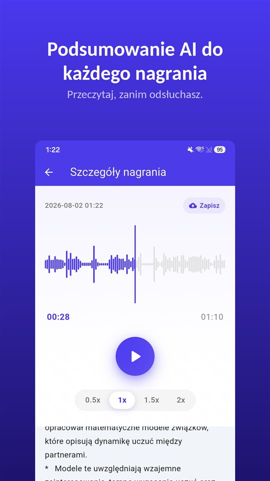

Zebranie trwało czterdzieści minut. Wizyta u lekarza dwanaście. Rozmowa z właścicielem mieszkania osiem. Wszystkie trzy są w telefonie.

Teraz ktoś pyta, co ustalono w sprawie kaucji. Wiesz, że to gdzieś tam jest.

Podsumowanie mówi, czego posłuchać. Zapisem wciąż jest nagranie.

## Trzy sposoby na podsumowanie na Androidzie

| | Dyktafon Google (Pixel) | Dyktafon Samsunga (Galaxy AI) | TalkSafe |
|---|---|---|---|
| Podsumowanie | Tak | Tak, z Transcript Assist | Tak, dla każdego nagrania |
| Pełna transkrypcja | Tak | Tak | Nie, tylko podsumowanie |
| Gdzie powstaje podsumowanie | Na urządzeniu (Gemini Nano) | Nie sprawdzono tutaj | Na serwerze |
| Język | Na start tylko angielski; sprawdź w telefonie | Zależy od regionu | Język nagrania |
| Inne wymagania | Obsługiwane modele Pixel | Konto Samsung; bardzo krótkie nagrania nie są streszczane | Android |
| Sam zaczyna nagrywać | Nie | Nie | Tak, po wybranym słowie, z 30 sekundami wcześniej |

Poniższe informacje pochodzą z dokumentacji producentów i publikacji z chwili pisania i mogą się zmienić.

## Dyktafon Google na Pixelu

Dyktafon Google tworzy transkrypcję w trakcie nagrywania, a na obsługiwanych telefonach Pixel potrafi **streścić transkrypcję na urządzeniu** za pomocą **Gemini Nano**. Zespół programistów Google opisał wynik jako **trzy punkty** z imionami mówiących, najważniejszymi wnioskami i tematami. Na starcie podsumowania były **tylko po angielsku**; sama transkrypcja obsługuje znacznie więcej języków.

## Dyktafon Samsunga z Galaxy AI

Na telefonach Galaxy z Galaxy AI funkcja **Transcript Assist** w Dyktafonie zamienia nagranie w transkrypcję i może je **podsumować**. Według stron pomocy Samsunga, aby korzystać z podsumowania, trzeba być **zalogowanym na konto Samsung**, a **zbyt krótkiego nagrania nie da się podsumować**. Dostępne języki zależą od regionu. W dokumentacji Samsunga nie udało nam się potwierdzić, czy podsumowania Dyktafonu są przetwarzane wyłącznie na urządzeniu.

## TalkSafe

[TalkSafe](/talksafe/pl/) tworzy **podsumowanie AI każdego nagrania**. Pojawia się ono jako krótka lista punktów **pod odtwarzaczem** na ekranie szczegółów, więc możesz przeczytać, co zostało powiedziane, zanim zdecydujesz, czy odsłuchać.

<figure class="shot"><figcaption>Szczegóły nagrania. Podsumowanie AI jest pod odtwarzaczem, jako krótka lista punktów.</figcaption></figure>

Cztery rzeczy, które warto wiedzieć:

- **Podsumowanie jest w języku nagrania.** Rozmowa po niemiecku jest streszczana po niemiecku, po japońsku – po japońsku.
- **To podsumowanie, nie transkrypcja.** Nie ma tekstu słowo w słowo. Dokładne sformułowania sprawdzisz w pliku.
- **Działa na fragmentach.** Przytnij potrzebną część – fragment zapisuje się jako nowy plik, a oryginał zostaje – i podsumowanie można zastosować do tego fragmentu. Tak samo dla fragmentu oczyszczonego [usuwaniem szumów AI na urządzeniu](/blog/pl/remove-background-noise/).
- **Podsumowanie powstaje na serwerze.** Wykrywanie słów kluczowych w TalkSafe działa w całości w telefonie, ale żeby streścić nagranie, jest ono wysyłane na serwer.

Od dwóch pozostałych TalkSafe różni się tym, jak zaczyna się nagranie: **startuje samo**, gdy usłyszy wybrane słowo, przy **zablokowanym ekranie**, i zachowuje **30 sekund sprzed** tego słowa. Podsumowanie mówi wtedy, co jest w pliku, którego nawet nie musiałeś włączać. Więcej w [Najpierw coś mówisz](/blog/pl/say-it-first/).

## Dokąd trafia dźwięk

To pytanie warto zadać każdej funkcji podsumowania.

Podsumowanie na urządzeniu zostawia dźwięk w telefonie. Podsumowanie na serwerze wysyła go gdzie indziej do przetworzenia. Żadne nie jest złe, ale są różne, a różnica ma największe znaczenie, gdy w rozmowie biorą udział **inne osoby**: ich głosy są w tym, co wysyłasz.

Przy zebraniu w pracy czy wykładzie podsumowanie na serwerze zwykle nie stanowi problemu. Przy rozmowie, która nie powinna opuszczać telefonu, zachowaj nagranie i odsłuchaj je sam.

## Co pomija podsumowanie

Podsumowanie ma być krótkie, a krótkie znaczy: wybrane. Znika wahanie przed odpowiedzią, dokładna liczba, zdanie, które zmieniło sens poprzedniego. Podsumowanie AI może też po prostu **się mylić**.

Używaj więc podsumowania, by znaleźć **które nagranie i który fragment**. Potem słuchaj. A jeśli nagranie może kiedyś mieć znaczenie – spór, reklamacja, wizyta, którą trzeba dobrze zrozumieć – **zachowaj oryginał bez zmian**. Sąd czy ubezpieczyciel patrzy na nagranie, nie na jego streszczenie. Wyjaśniamy to w [Co zrobić z nagraniem, a czego z nim nie robić](/blog/pl/after-recording/).

## Krótka kolejność

1. Nagraj albo pozwól, by słowo uruchomiło nagrywanie.
2. Przeczytaj podsumowanie, żeby zobaczyć, co jest w pliku.
3. Jeśli potrzebujesz części, **przytnij ją**; oryginał zostaje.
4. Jeśli jest szum, zastosuj do fragmentu **usuwanie szumów**.
5. Przeczytaj podsumowanie fragmentu i **odsłuchaj** to, co ważne.
6. Zachowaj oryginał.

Funkcje aplikacji innych firm opisano na podstawie ich dokumentacji i publikacji z chwili pisania; mogą się zmienić. Tworzymy aplikację do nagrywania TalkSafe.

