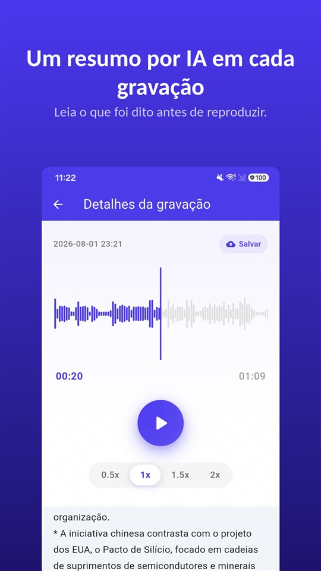

A reunião durou quarenta minutos. A consulta, doze. A ligação com o proprietário, oito. As três estão no seu celular.

Agora alguém pergunta o que ficou combinado sobre a caução. Você sabe que está ali, em algum lugar.

O resumo diz onde ouvir. O registro continua sendo a gravação.

## Três jeitos de ter um resumo no Android

| | Gravador do Google (Pixel) | Gravador de Voz da Samsung (Galaxy AI) | TalkSafe |
|---|---|---|---|
| Resumo | Sim | Sim, com Transcript Assist | Sim, de cada gravação |
| Transcrição completa | Sim | Sim | Não, só resumo |
| Onde o resumo é feito | No aparelho (Gemini Nano) | Não verificado aqui | Em um servidor |
| Idioma | No lançamento, só inglês; confira no celular | Varia por região | O idioma da gravação |
| Outros requisitos | Modelos Pixel compatíveis | Conta Samsung; gravações muito curtas não são resumidas | Android |
| Começa a gravar sozinho | Não | Não | Sim, com uma palavra escolhida, com os 30 segundos anteriores |

As informações abaixo vêm da documentação de cada empresa e do que foi publicado até a data deste texto, e podem mudar.

## O Gravador do Google no Pixel

O Gravador do Google transcreve enquanto grava e, nos Pixel compatíveis, pode **resumir a transcrição no próprio aparelho** com o **Gemini Nano**. A equipe de desenvolvimento do Google descreveu o resultado como **três tópicos** com os nomes de quem fala, os pontos principais e os temas. No lançamento, os resumos eram **só em inglês**; a transcrição cobre muito mais idiomas.

## O Gravador de Voz da Samsung com Galaxy AI

Nos Galaxy com Galaxy AI, o **Transcript Assist** do Gravador de Voz transforma a gravação em transcrição e pode **resumi-la**. Segundo as páginas de suporte da Samsung, é preciso estar **conectado a uma conta Samsung** para usar o resumo, e uma gravação **curta demais não pode ser resumida**. Os idiomas disponíveis variam por região. Não conseguimos confirmar na documentação da Samsung se os resumos do Gravador de Voz são processados só no aparelho.

## TalkSafe

O [TalkSafe](/talksafe/pt-br/) cria um **resumo por IA de cada gravação**. Ele aparece como uma lista curta de tópicos **abaixo do player**, na tela de detalhes, então você lê o que foi dito antes de decidir se vai ouvir de novo.

<figure class="shot"><figcaption>Detalhes da gravação. O resumo por IA fica abaixo do player, em uma lista curta de tópicos.</figcaption></figure>

Quatro coisas que vale saber:

- **O resumo sai no idioma da gravação.** Uma conversa em alemão é resumida em alemão; uma em japonês, em japonês.
- **É resumo, não transcrição.** Não há texto palavra por palavra. Para as palavras exatas, ouça o arquivo.
- **Funciona em trechos.** Corte a parte que você precisa — o trecho é salvo como arquivo novo e o original fica — e o resumo pode ser usado nesse trecho. O mesmo vale para um trecho limpo com a [remoção de ruído com IA no aparelho](/blog/pt-br/remove-background-noise/).
- **O resumo é feito em um servidor.** A detecção de palavras-chave do TalkSafe funciona totalmente no celular, mas para resumir, a gravação é enviada a um servidor.

O que diferencia o TalkSafe dos outros dois é como a gravação começa: ela **começa sozinha** quando ouve uma palavra escolhida, com a **tela bloqueada**, e guarda os **30 segundos anteriores** à palavra. O resumo então diz o que tem num arquivo que você nem precisou iniciar. Mais em [Primeiro você diz alguma coisa](/blog/pt-br/say-it-first/).

## Para onde vai o áudio

É a pergunta a fazer a qualquer função de resumo.

Um resumo no aparelho deixa o áudio no celular. Um resumo em servidor envia o áudio para outro lugar para ser processado. Nenhum dos dois está errado, mas são diferentes, e a diferença pesa mais quando a conversa tem **outras pessoas**: a voz delas vai junto no que você envia.

Para uma reunião de trabalho ou uma aula, o resumo em servidor costuma ser tranquilo. Para uma conversa que você não gostaria que saísse do celular, guarde a gravação e ouça você mesmo.

Quanto à gravação em si: no Brasil, gravar uma conversa da qual você participa é prova lícita (Tema 237 do STF); em Portugal, gravar sem consentimento é crime (artigo 199.º do Código Penal). Mais em [Gravar conversa sem a outra pessoa saber é crime?](/blog/pt-br/gravar-conversa/).

## O que um resumo deixa de fora

Um resumo é feito para ser curto, e curto quer dizer escolher. Some a hesitação antes de uma resposta, o número exato, a frase que mudou o sentido da anterior. Um resumo por IA também pode simplesmente **errar**.

Então use o resumo para achar **qual gravação e qual trecho**. Depois, ouça. E se uma gravação puder importar um dia — uma briga, uma reclamação, uma consulta que você precisa entender direito —, **guarde o original sem alterações**. Um juiz ou uma seguradora olha a gravação, não um resumo dela. Explicamos em [O que fazer com uma gravação, e o que não fazer](/blog/pt-br/after-recording/).

## Uma rotina curta

1. Grave, ou deixe a palavra iniciar a gravação.
2. Leia o resumo para ver o que tem no arquivo.
3. Se precisar de uma parte, **corte**; o original fica.
4. Se houver ruído, aplique a **remoção de ruído** no trecho.
5. Leia o resumo do trecho e **ouça** a parte que importa.
6. Guarde o original.

As funções de apps de terceiros refletem a documentação e o que foi publicado até a data deste texto, e podem mudar. Nós fazemos um app de gravação, o TalkSafe.

