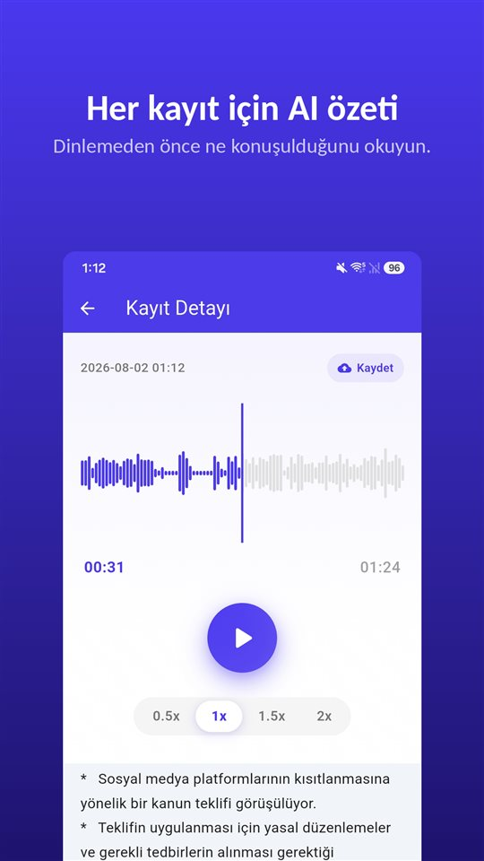

Toplantı kırk dakika sürdü. Doktor muayenesi on iki. Ev sahibiyle telefon görüşmesi sekiz. Üçü de telefonunuzda.

Şimdi biri depozito konusunda ne konuşulduğunu soruyor. Bir yerde orada olduğunu biliyorsunuz.

Özet size nereyi dinleyeceğinizi söyler. Asıl kayıt yine ses dosyasıdır.

## Android'de özet almanın üç yolu

| | Google Kaydedici (Pixel) | Samsung Ses Kaydedici (Galaxy AI) | TalkSafe |
|---|---|---|---|
| Özet | Var | Var, Transcript Assist ile | Var, her kayıt için |
| Tam döküm | Var | Var | Yok, yalnızca özet |
| Özetin yapıldığı yer | Cihaz üzerinde (Gemini Nano) | Burada doğrulanmadı | Bir sunucuda |
| Dil | Çıkışta yalnızca İngilizce; telefonunuzda kontrol edin | Bölgeye göre değişir | Kaydın dili |
| Diğer koşullar | Desteklenen Pixel modelleri | Samsung hesabı; çok kısa kayıtlar özetlenmez | Android |
| Kaydı kendisi başlatır mı | Hayır | Hayır | Evet, belirlediğiniz bir kelimeyle, önceki 30 saniyeyle birlikte |

Aşağıdaki bilgiler, yazıldığı tarihteki şirket belgelerine ve haberlere dayanır ve değişebilir.

## Pixel'de Google Kaydedici

Google Kaydedici kayıt yaparken döküm çıkarır ve desteklenen Pixel telefonlarda bu dökümü **cihaz üzerinde Gemini Nano ile özetleyebilir**. Google'ın geliştirici ekibi sonucu, konuşanların adlarını, ana noktaları ve konuları içeren **üç madde** olarak tanımladı. Çıkışta özetler **yalnızca İngilizceydi**; dökümün kendisi çok daha fazla dili destekler.

## Galaxy AI ile Samsung Ses Kaydedici

Galaxy AI olan Galaxy telefonlarda Ses Kaydedici'deki **Transcript Assist** bir kaydı dökümüne çevirir ve **özetleyebilir**. Samsung destek sayfalarına göre özeti kullanmak için **bir Samsung hesabına giriş yapmış** olmanız gerekir ve **çok kısa bir kayıt özetlenemez**. Desteklenen diller bölgeye göre değişir. Ses Kaydedici özetlerinin yalnızca cihaz üzerinde işlenip işlenmediğini Samsung belgelerinden doğrulayamadık.

## TalkSafe

[TalkSafe](/talksafe/tr/) **her kayıt için bir yapay zekâ özeti** oluşturur. Özet, kayıt ayrıntısı ekranında **oynatıcının altında** kısa bir madde listesi olarak görünür; böylece tekrar dinleyip dinlememeye karar vermeden önce ne konuşulduğunu okuyabilirsiniz.

<figure class="shot"><figcaption>Kayıt ayrıntısı. Yapay zekâ özeti oynatıcının altında, kısa bir madde listesi olarak görünür.</figcaption></figure>

Bilmeye değer dört şey:

- **Özet kaydın dilindedir.** Almanca bir konuşma Almanca, Japonca bir konuşma Japonca özetlenir.
- **Bu bir özet, döküm değil.** Kelimesi kelimesine metin yoktur. Tam ifadeler için dosyayı dinleyin.
- **Kırpılmış bölümlerde de çalışır.** İhtiyacınız olan kısmı kırpın — bölüm yeni bir dosya olarak kaydedilir, orijinal korunur — ve özet bu bölüme uygulanabilir. [Cihaz üzerindeki yapay zekâ gürültü giderme](/blog/tr/remove-background-noise/) ile temizlenmiş bir bölüm için de aynısı geçerli.
- **Özet bir sunucuda yapılır.** TalkSafe'in anahtar kelime algılaması tamamen telefonda çalışır, ama özet için kayıt bir sunucuya gönderilir.

TalkSafe'i diğer ikisinden ayıran, kaydın nasıl başladığıdır: belirlediğiniz bir kelimeyi duyunca **ekran kilitliyken kendiliğinden başlar** ve kelimeden **önceki 30 saniyeyi** saklar. Özet de size, başlatmanız bile gerekmeyen bir dosyada ne olduğunu söyler. Daha fazlası [Önce bir şey söylersiniz](/blog/tr/say-it-first/) yazısında.

## Ses nereye gidiyor

Her özet özelliğine sorulması gereken soru budur.

Cihaz üzerinde özet, sesi telefonda bırakır. Sunucuda özet, sesi işlenmek üzere başka bir yere gönderir. İkisi de yanlış değil ama farklıdır; fark en çok konuşmada **başka kişiler** olduğunda önem kazanır: onların sesleri de gönderdiğiniz dosyadadır.

Bir iş toplantısı ya da ders için sunucuda özet genellikle sorun değildir. Telefonunuzdan çıkmasını istemediğiniz bir konuşma içinse kaydı saklayın ve kendiniz dinleyin.

Kaydın kendisi için: Türkiye'de katıldığınız aleni olmayan bir konuşmayı diğerlerinin rızası olmadan kaydetmek TCK 133/2 kapsamında suçtur. Ayrıntılar [Gizli ses kaydı almak suç mu?](/blog/tr/ses-kaydi-suc-mu/) yazısında.

## Bir özetin dışarıda bıraktıkları

Özet kısa olmak için yapılır; kısa olmak da seçmek demektir. Bir cevaptan önceki tereddüt, tam rakam, bir önceki cümlenin anlamını değiştiren cümle kaybolur. Yapay zekâ özeti düpedüz **yanılabilir** de.

Bu yüzden özeti **hangi kayıt ve hangi bölüm** olduğunu bulmak için kullanın. Sonra dinleyin. Bir gün önemli olabilecek bir kayıtsa — bir anlaşmazlık, bir şikâyet, doğru anlamanız gereken bir muayene — **orijinali değiştirmeden saklayın**. Mahkeme ya da sigorta şirketi özete değil, kayda bakar. Nedenini [Bir kayıtla ne yapmalı, ne yapmamalı](/blog/tr/after-recording/) yazısında anlattık.

## Kısa bir sıra

1. Kaydedin ya da kelimenin başlatmasına bırakın.
2. Dosyada ne olduğunu görmek için özeti okuyun.
3. Bir kısmı gerekiyorsa **kırpın**; orijinal kalır.
4. Gürültülüyse bölüme **gürültü giderme** uygulayın.
5. Bölümün özetini okuyun ve önemli kısmı **dinleyin**.
6. Orijinali saklayın.

Diğer uygulamaların özellikleri yazıldığı tarihteki belgelerine ve haberlere dayanır ve değişebilir. Biz TalkSafe adlı bir kayıt uygulaması geliştiriyoruz.

