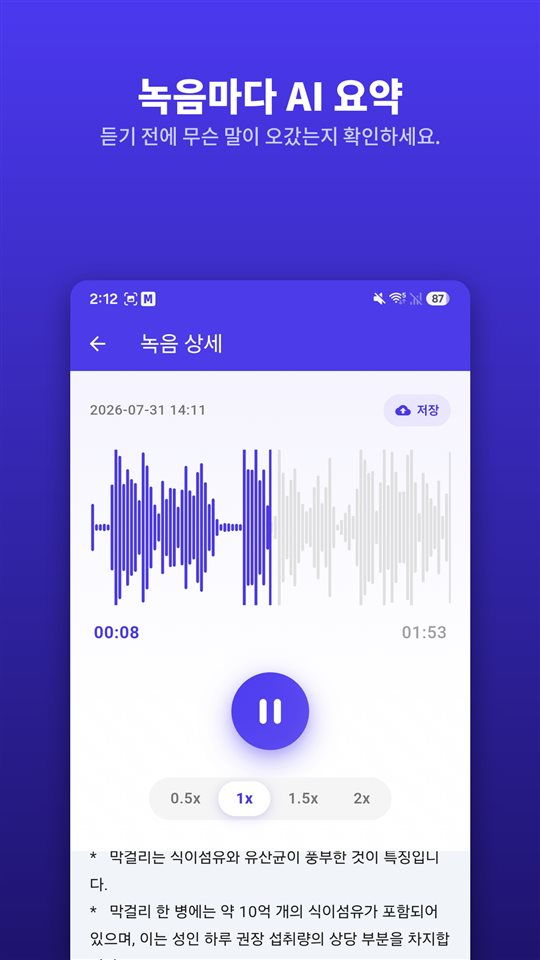

회의는 40분, 진료는 12분, 집주인과의 통화는 8분이었습니다. 셋 다 휴대폰에 있습니다.

그런데 누가 묻습니다. 보증금 얘기는 어떻게 정했느냐고. 어딘가에 들어 있다는 건 압니다.

요약은 어디를 들을지 알려줍니다. 기록은 여전히 녹음입니다.

## 안드로이드에서 요약을 받는 세 가지 방법

| | 구글 녹음(픽셀) | 삼성 음성 녹음(갤럭시 AI) | TalkSafe |
|---|---|---|---|
| 요약 | 있음 | 있음(Transcript Assist) | 녹음마다 있음 |
| 전체 받아쓰기 | 있음 | 있음 | 없음, 요약만 |
| 요약하는 곳 | 기기 안(Gemini Nano) | 여기서는 확인하지 못함 | 서버 |
| 언어 | 출시 때는 영어만, 휴대폰에서 확인 | 지역마다 다름 | 녹음한 언어 그대로 |
| 그 밖의 조건 | 지원되는 픽셀 기종 | 삼성 계정, 아주 짧은 녹음은 요약 안 됨 | 안드로이드 |
| 녹음이 스스로 시작되나 | 아니요 | 아니요 | 예, 정해둔 말이 들리면, 직전 30초 포함 |

아래 내용은 작성 시점의 각 회사 안내와 보도를 기준으로 했으며 바뀔 수 있습니다.

## 픽셀의 구글 녹음 앱

구글 녹음 앱은 녹음하면서 받아쓰기를 하고, 지원되는 픽셀 폰에서는 그 받아쓰기를 **기기 안의 Gemini Nano로 요약**할 수 있습니다. 구글 개발팀은 결과를 화자 이름, 핵심 내용, 주제를 담은 **세 줄 항목**이라고 설명했습니다. 출시 당시 요약은 **영어만** 지원했고, 받아쓰기 자체는 훨씬 많은 언어를 지원합니다.

## 갤럭시 AI의 삼성 음성 녹음

갤럭시 AI가 있는 갤럭시 폰에서는 음성 녹음 앱의 **Transcript Assist**가 녹음을 받아쓰기로 바꾸고 **요약**도 할 수 있습니다. 삼성 고객지원 안내에 따르면 요약을 쓰려면 **삼성 계정에 로그인**해야 하고, **녹음이 너무 짧으면 요약되지 않습니다.** 지원 언어는 지역마다 다릅니다. 음성 녹음 요약이 기기 안에서만 처리되는지는 삼성 안내에서 확인하지 못했습니다.

## TalkSafe

[TalkSafe](/talksafe/)는 **녹음마다 AI 요약**을 만듭니다. 녹음 상세 화면의 **재생기 아래**에 짧은 항목 목록으로 나와서, 다시 듣기 전에 무슨 말이 오갔는지 먼저 읽을 수 있습니다.

<figure class="shot"><figcaption>녹음 상세 화면. AI 요약이 재생기 아래에 짧은 항목 목록으로 나옵니다.</figcaption></figure>

알아두면 좋은 네 가지:

- **요약은 녹음한 언어 그대로 나옵니다.** 독일어 대화는 독일어로, 일본어 대화는 일본어로 요약됩니다.
- **받아쓰기가 아니라 요약입니다.** 말을 그대로 옮긴 글은 없습니다. 정확한 표현은 파일을 들어서 확인합니다.
- **잘라낸 파일에도 쓸 수 있습니다.** 필요한 구간을 잘라내면 원본은 그대로 두고 새 파일로 저장되고, 그 파일에도 요약을 쓸 수 있습니다. [기기 안 AI 노이즈 제거](/blog/ko/remove-background-noise/)로 정리한 파일도 마찬가지입니다.
- **요약은 서버에서 만들어집니다.** TalkSafe의 키워드 감지는 모두 휴대폰 안에서 이루어지지만, 요약을 위해서는 녹음을 서버로 보냅니다.

다른 두 앱과 가장 다른 점은 녹음이 시작되는 방식입니다. 정해둔 말이 들리면 **화면이 잠긴 채로 스스로 시작**되고, 그 말이 나오기 **직전 30초**까지 남습니다. 요약은 그렇게 내가 시작하지도 않은 파일에 무엇이 들어 있는지 알려줍니다. 자세한 내용은 [말이 먼저 나옵니다: 목소리로 녹음을 시작한다는 것](/blog/ko/say-it-first/)에 있습니다.

## 녹음이 어디로 가는지

요약 기능이 있다면 꼭 물어야 할 질문입니다.

기기 안에서 요약하면 소리가 휴대폰에 남습니다. 서버에서 요약하면 다른 곳으로 보내져 처리됩니다. 어느 쪽이 틀렸다는 게 아니라 다르다는 것이고, 그 차이는 대화에 **다른 사람**이 있을 때 가장 크게 다가옵니다. 보내는 파일에는 그 사람의 목소리도 들어 있습니다.

업무 회의나 강의라면 서버 요약도 대개 괜찮습니다. 휴대폰 밖으로 나가지 않았으면 하는 대화라면, 요약 대신 녹음을 직접 들으세요.

## 요약이 빠뜨리는 것

요약은 짧게 만들어지고, 짧다는 건 고른다는 뜻입니다. 대답 전의 머뭇거림, 정확한 숫자, 바로 앞 문장의 뜻을 바꾼 한 문장이 빠집니다. AI 요약은 그냥 **틀릴 수도 있습니다.**

그래서 요약은 **어떤 녹음의 어느 부분**인지 찾는 데 쓰고, 그다음엔 직접 들으세요. 분쟁, 민원, 꼭 정확해야 하는 진료처럼 나중에 중요해질 수 있는 녹음은 **원본을 손대지 않고 보관**하세요. 법원이나 보험사가 보는 것은 요약이 아니라 녹음입니다. 이유는 [녹음한 다음에 해야 할 일과 하지 말아야 할 일](/blog/ko/after-recording/)에 정리했습니다.

## 짧은 순서

1. 녹음합니다. 또는 정해둔 말로 시작되게 둡니다.
2. 요약을 읽고 파일에 무엇이 있는지 봅니다.
3. 한 부분만 필요하면 **잘라냅니다.** 원본은 남습니다.
4. 잡음이 많으면 잘라낸 파일에 **노이즈 제거**를 합니다.
5. 잘라낸 파일의 요약을 읽고, 중요한 부분을 **직접 듣습니다.**
6. 원본은 그대로 둡니다.

다른 앱의 기능은 작성 시점의 공식 안내와 보도를 기준으로 했으며 바뀔 수 있습니다. 저희는 녹음 앱 TalkSafe를 만들고 있습니다.

