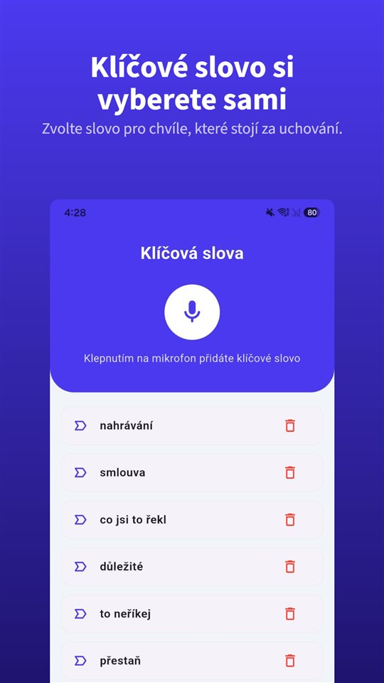

Někdo vám do telefonu začne říkat něco důležitého. Hledáte na iPhonu tlačítko pro nahrávání a nenacházíte ho, přestože návody na internetu ho popisují.

Tlačítko existuje, jen ne tady. **Od iOS 18 umí aplikace Telefon na iPhonu nahrávat hovory** a po spuštění uslyší obě strany oznámení. **V Evropské unii ale Apple tuto funkci nenabízí**, takže ani v Česku a na Slovensku.

Nahrávání hovorů na iPhonu není stavěné ke skrývání: ohlásí se a zanechá záznam. V Česku a na Slovensku chybí; mimo EU většinou je.

## Dostupnost a právo v Česku a na Slovensku

| Země | Nahrávání hovorů na iPhonu | Nahrání vlastního hovoru bez souhlasu | Základ |
|---|---|---|---|
| Česká republika | Není k dispozici (EU) | Svolení není třeba, pokud se záznam pořídí nebo použije k výkonu nebo ochraně práv; nesmí jít o nepřiměřený zásah | § 86, 88, 90 obč. zák. |
| Slovensko | Není k dispozici (EU) | Zvukový záznam jen se svolením, s výjimkami pro úřední, vědecké, umělecké a zpravodajské účely | § 12 obč. zák.; § 377 tr. zák. |

Dostupnost odpovídá dokumentaci Apple z listopadu 2026 a může se změnit; rozhodující je stránka Apple o dostupnosti funkcí iOS a iPadOS. Právo podrobněji popisuje [Je legální nahrávat rozhovor bez souhlasu? V Česku rozhoduje účel, na Slovensku svolení](/blog/cs/nahravani-rozhovoru/).

## Tři způsoby v jedné tabulce

| Způsob | Kde funguje | Dozví se to druhá strana? | Kde je nahrávka |
|---|---|---|---|
| Vestavěné nahrávání na iPhonu (iOS 18 nebo novější) | Většina světa; ne v EU a dalších 18 místech | Hlasové oznámení pro obě strany, pravidelně opakované | Složka Záznamy hovorů v Poznámkách |
| Aplikace s konferenčním hovorem | Operátor musí podporovat konferenční hovory; většinou placené | Podle aplikace | Servery firmy, která aplikaci provozuje |
| Hlasitý odposlech, nahrávání místnosti (druhé zařízení nebo TalkSafe na stejném iPhonu) | Všude | Žádné automatické oznámení | Zařízení, které nahrává |

## Jak funguje vestavěné nahrávání

1. Zavolejte z aplikace **Telefon**.
2. Během hovoru klepněte na tlačítko na obrazovce hovoru a potom na **Záznam hovoru**.
3. Obě strany hovoru uslyší hlasové oznámení, že se hovor nahrává.
4. Nahrávání zastavíte dalším klepnutím nebo prostě zavěsíte.
5. Nahrávka se automaticky uloží do složky **Záznamy hovorů v aplikaci Poznámky**. Klepnutím na **„Zobrazit uložený hovor“** ji tam otevřete.

Apple uvádí několik podmínek. Nahrávat lze **hovor s jednou další osobou** a funkce se vztahuje i na **zvukové hovory FaceTime**, nejen na běžné telefonáty. Z Poznámek lze zvukový soubor uložit jinam nebo sdílet.

**Přepis** se zobrazí jen ve vybraných oblastech a jazycích: angličtina (USA, Spojené království, Kanada, Austrálie, Indie, Nový Zéland, Singapur), japonština, korejština, mandarínská čínština (pevninská Čína, Tchaj-wan), kantonština (Hongkong), portugalština (Brazílie) a španělština (Mexiko, USA). **Čeština ani slovenština mezi nimi nejsou.** **Shrnutí** vytvoří Apple Intelligence na iPhonu 15 Pro, iPhonu 15 Pro Max a iPhonu 16 nebo novějším.

## Proč druhá strana oznámení slyší

Nejčastěji hledaná otázka zní, jestli to jde, aniž by o tom druhý věděl. Odpověď Apple je jasná.

- Po spuštění nahrávání slyší oznámení **obě strany**.
- Oznámení se během hovoru **pravidelně opakuje**.
- Dokumentace Apple nepopisuje žádné nastavení, které by ho vypínalo.
- Apple žádá, abyste se před nahráváním **ujistili, že druhá strana s nahráváním souhlasí**.

Důvod je ten, že stejná funkce se prodává v mnoha zemích. Tam, kde musí s nahráním hovoru souhlasit všichni účastníci, je oznámení, které **slyší všichni**, způsob, jak funkce tento požadavek splní už sama. Aplikace Telefon od Googlu na Androidu dělá totéž.

Oznámení pomáhá i tomu, kdo nahrává. Rozhovor, který po něm pokračuje, v sobě nese důkaz, že **obě strany o nahrávání věděly**.

## Co v Česku a na Slovensku zbývá

**Aplikace s konferenčním hovorem.** Většina aplikací na nahrávání hovorů pro iPhone funguje tak, že **zavolá na nahrávací linku firmy a spojí ji s hovorem do konference.** Nahrává se na serverech firmy, ne v telefonu; operátor musí podporovat konferenční hovory a většina takových služeb je placená. Apple upozorňuje, že takové aplikace třetích stran **mohou hovor nahrávat bez varování.**

**Hlasitý odposlech a nahrávání místnosti.** Nahrává se místnost, ne linka, takže to funguje všude. Za cenu horší kvality, šumu v pozadí a toho, že hovor slyší každý poblíž. Šum lze odstranit dodatečně; jak, popisuje [Jak odstranit hluk v pozadí z hlasové nahrávky na Androidu](/blog/cs/remove-background-noise/). Takto lze použít i TalkSafe. Když je hovor na hlasitém odposlechu, TalkSafe na stejném iPhonu slyší i hlas z reproduktoru a začne nahrávat, jakmile rozpozná vaše klíčové slovo.

**Nástroj na právu nic nemění.** Na Slovensku je zvukový záznam podle § 12 občanského zákoníku možný jen se svolením, s uvedenými výjimkami, ať už ho pořídíte čímkoli; v Česku rozhoduje, k čemu záznam slouží.

## Rozhovor tváří v tvář nemá tlačítko

U hovoru je tlačítko na obrazovce, tam kde funkce existuje. U rozhovoru tváří v tvář ne. Než vytáhnete telefon, odemknete ho a otevřete diktafon, podstatná věta už zazněla.

Na tuhle chvíli je [TalkSafe](https://hcompany-kr.github.io/talksafe/cs/). **TalkSafe není aplikace na nahrávání hovorů.** Je to aplikace pro nahrávání na Android a iPhone, která se spustí, když uslyší **předem zvolené slovo**, funguje při **zamčené obrazovce** a ukládá i **30 sekund před začátkem**. Klíčové slovo není vázané na mluvčího, takže to může být i slovo, které řekne druhá strana.

Kde je potřeba souhlas, nebo když se prostě chcete zeptat, může klíčové slovo nahrát rovnou i souhlas. Nastavte slovo ze své otázky, například **„nahrát“**. „Můžu si ten rozhovor nahrát?“ spustí nahrávání a odpověď je v souboru.

<figure class="shot"><figcaption>Nastavení klíčových slov. Můžete uložit několik slov; stačí, aby bylo rozpoznáno jedno z nich.</figcaption></figure>

Jedna věc platí jen na iPhonu: **když během detekce aplikaci úplně ukončíte, detekce se zastaví a objeví se oznámení s výzvou detekci znovu spustit.** Dokud TalkSafe v přepínači aplikací nesmahnete nahoru, poslouchá dál.

## Stručně

- Nahrávání hovorů je **od iOS 18 vestavěné v aplikaci Telefon**: během hovoru tlačítko, pak Záznam hovoru.
- **Obě strany slyší oznámení**, které se během hovoru opakuje.
- Nahrávky jdou do složky **Záznamy hovorů v Poznámkách**; čeština ani slovenština nejsou jazyky přepisu.
- **V Česku, na Slovensku a ve zbytku EU funkce není k dispozici.**
- Na Slovensku je zvukový záznam možný jen se svolením (s výjimkami); v Česku rozhoduje účel záznamu.

Proč aplikace na nahrávání hovorů na Androidu přestaly fungovat a které telefony ještě nahrávají z výroby, popisuje [Proč aplikace na nahrávání hovorů na Androidu přestaly fungovat a co funguje dál](/blog/cs/call-recording-android/).

## Zdroje

- [Nahrávání a přepisování hovorů na iPhonu (Podpora Apple)](https://support.apple.com/cs-cz/guide/iphone/iph57c6590e9/ios)
- [Record and transcribe a call on iPhone, Personal Safety User Guide (Apple)](https://support.apple.com/guide/personal-safety/record-and-transcribe-a-call-on-iphone-ipsfa513e1a6/web)
- [How to record a call on iPhone and iPad (Apple)](https://support.apple.com/en-us/121583)
- [iOS and iPadOS Feature Availability: Phone (Apple)](https://www.apple.com/ios/feature-availability/#phone-call-recording)

Dostupnost podle zemí a jazyků odpovídá dokumentaci Apple z listopadu 2026 a může se změnit. Obecné informace, nikoli právní rada. V konkrétní věci se obraťte na advokáta.

