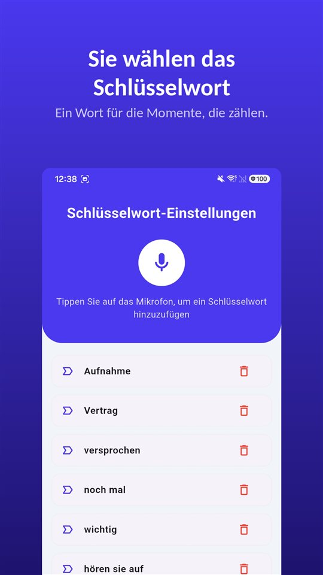

Am Telefon sagt jemand etwas Wichtiges. Sie suchen auf dem iPhone eine Aufnahmetaste und finden keine, obwohl Anleitungen im Netz sie beschreiben.

Die Taste gibt es, nur nicht hier. **Seit iOS 18 nimmt die Telefon-App des iPhone Anrufe auf**, und beim Start hören beide Seiten eine Ansage. **In der Europäischen Union bietet Apple die Funktion aber nicht an** – Deutschland, Österreich, Luxemburg und Belgien eingeschlossen. In der Schweiz ist sie verfügbar.

Die Anrufaufnahme des iPhone ist nicht zum Verbergen gebaut: Sie kündigt sich an und hält fest. In Deutschland und Österreich fehlt sie, in der Schweiz ist sie da.

## Verfügbarkeit und Recht im deutschsprachigen Raum

| Land | Anrufaufnahme des iPhone | Eigenes Telefonat ohne Einwilligung aufnehmen | Grundlage |
|---|---|---|---|
| Deutschland | Nicht verfügbar (EU) | Strafbar, auch als Teilnehmer | § 201 StGB |
| Österreich | Nicht verfügbar (EU) | Nicht nach Abs. 1 strafbar; Weitergabe an Dritte ohne Zustimmung strafbar | § 120 StGB |
| Schweiz | Verfügbar | Strafbar auf Antrag; Ausnahme für Bestellungen und Reservationen im Geschäftsverkehr | Art. 179ter, 179quinquies StGB |
| Liechtenstein | Von Apple nicht eigens genannt, nicht bestätigt | Wie Österreich | § 120 StGB |
| Luxemburg | Nicht verfügbar (EU) | Wortlaut ohne Ausnahme für Teilnehmer | Art. 2 Gesetz vom 11.08.1982 |
| Belgien | Nicht verfügbar (EU) | Keine Straftat für den Teilnehmer; Verwendung in Schädigungsabsicht strafbar | Art. 314bis StGB, Kassationshof 2015 |

Stand der Verfügbarkeit ist Apples Dokumentation vom November 2026. Sie kann sich ändern; maßgeblich ist Apples Seite zur Verfügbarkeit von iOS- und iPadOS-Features. Die Rechtslage im Einzelnen steht in [Gespräch heimlich aufnehmen: In Deutschland strafbar, in Österreich nicht – und was das vor Gericht heißt](/blog/de/gespraech-aufnehmen/).

## Drei Wege im Vergleich

| Weg | Wo er funktioniert | Wird das Gegenüber informiert? | Wo die Aufnahme liegt |
|---|---|---|---|
| Eingebaute Anrufaufnahme (ab iOS 18) | Großteil der Welt, Schweiz eingeschlossen; nicht in der EU und 18 weiteren Ländern | Ansage für beide, regelmäßig wiederholt | Ordner „Anrufaufnahmen“ in Notizen |
| App mit Dreierkonferenz | Netzbetreiber muss Konferenzschaltung unterstützen; meist kostenpflichtig | Je nach App | Server des App-Anbieters |
| Freisprechen, mit zweitem Gerät aufgenommen | Überall | Keine automatische Ansage | Das aufnehmende Gerät |

## So funktioniert die eingebaute Anrufaufnahme

1. Rufen Sie in der App **„Telefon“** an.
2. Tippen Sie während des Anrufs auf die Taste im Anrufbildschirm und dann auf **„Anrufaufnahme“**.
3. Beide Teilnehmer hören eine Ansage, dass der Anruf aufgezeichnet wird.
4. Zum Beenden tippen Sie erneut oder legen einfach auf.
5. Die Aufnahme wird automatisch im Ordner **„Anrufaufnahmen“ der App „Notizen“** gesichert. Mit **„Gesicherten Anruf anzeigen“** öffnen Sie sie dort.

Apple nennt dazu einige Bedingungen. Aufnehmen lässt sich ein Gespräch **mit einer anderen Person**, und neben normalen Telefonaten auch ein **FaceTime-Audioanruf**. Aus Notizen kann die Audiodatei an anderer Stelle gesichert oder geteilt werden.

**Transkripte** gibt es nur in ausgewählten Regionen und Sprachen: Englisch (USA, Vereinigtes Königreich, Kanada, Australien, Indien, Neuseeland, Singapur), Japanisch, Koreanisch, Mandarin (Festland-China, Taiwan), Kantonesisch (Hongkong), Portugiesisch (Brasilien) und Spanisch (Mexiko, USA). **Deutsch ist nicht dabei.** Eine **Zusammenfassung** erstellt Apple Intelligence auf dem iPhone 15 Pro, iPhone 15 Pro Max und iPhone 16 oder neuer.

## Warum das Gegenüber die Ansage hört

Am häufigsten wird gesucht, ob es auch ohne Wissen des anderen geht. Apples Antwort ist eindeutig.

- Beim Start hören **beide** eine Ansage.
- Die Ansage wird während des Gesprächs **regelmäßig wiederholt**.
- Apples Dokumentation beschreibt keine Einstellung, mit der sie sich abschalten lässt.
- Apple fordert dazu auf, **vorher zu klären, ob das Gegenüber mit der Aufnahme einverstanden ist**.

Der Grund: Dieselbe Funktion wird in vielen Ländern angeboten. Wo alle Teilnehmer einer Aufnahme zustimmen müssen, ist eine Ansage, die **alle hören**, der Weg, diese Anforderung schon in der Funktion zu erfüllen. Die Google-Telefon-App auf Android macht es genauso.

Für die Schweiz heißt das nicht automatisch, dass jede Aufnahme erlaubt ist. Ob Weitersprechen nach der Ansage als Einwilligung im Sinne von Art. 179ter StGB gilt, regelt Apple nicht. Sicher ist, das Einverständnis ausdrücklich einzuholen – am besten so, dass es selbst auf der Aufnahme zu hören ist.

## Was in Deutschland und Österreich bleibt

**Apps mit Dreierkonferenz.** Die meisten Apps zur Anrufaufnahme auf dem iPhone **rufen eine Aufnahmeleitung des Anbieters an und schalten sie zur Dreierkonferenz zusammen.** Aufgenommen wird auf den Servern des Anbieters, nicht auf dem Telefon; der Netzbetreiber muss Konferenzschaltungen unterstützen, und die meisten Dienste kosten Geld. Apple weist darauf hin, dass solche Drittanbieter-Apps **einen Anruf ohne Warnung aufnehmen können.**

**Freisprechen, mit einem zweiten Gerät aufgenommen.** Hier wird der Raum aufgenommen, nicht die Leitung; das funktioniert überall. Dafür sinkt die Tonqualität, Hintergrundgeräusche kommen hinzu, und wer in der Nähe ist, hört mit. Geräusche lassen sich nachträglich entfernen; wie, steht in [Hintergrundgeräusche aus einer Sprachaufnahme entfernen – so geht es auf Android](/blog/de/remove-background-noise/).

**An der Rechtslage ändert das Werkzeug nichts.** In Deutschland ist die Aufnahme eines Telefonats ohne Einwilligung nach § 201 StGB strafbar, gleich mit welchem Gerät oder welcher App. Fragen Sie also vorher – oder lassen Sie es.

## Ein Gespräch von Angesicht zu Angesicht hat keine Taste

Bei einem Anruf liegt die Taste auf dem Bildschirm, wo es sie gibt. Im direkten Gespräch nicht. Bis das Telefon aus der Tasche ist, entsperrt und eine Aufnahme-App offen, ist der entscheidende Satz vorbei.

Dafür gibt es [TalkSafe](https://hcompany-kr.github.io/talksafe/de/). **TalkSafe ist keine App zur Anrufaufnahme.** Es ist eine Aufnahme-App für Android und iPhone, die bei einem **vorher festgelegten Wort** startet, bei **gesperrtem Bildschirm** funktioniert und die **30 Sekunden vor dem Start** mitspeichert. Das Schlüsselwort ist an keinen Sprecher gebunden; es kann also auch ein Wort sein, das das Gegenüber sagen wird.

In Deutschland, wo die Aufnahme ohne Einwilligung strafbar ist, passt das gut zur Frage selbst: Legen Sie ein Wort aus Ihrer Frage fest, etwa **„aufnehmen“**. „Ist es in Ordnung, wenn ich das aufnehme?“ startet die Aufnahme, und die Antwort ist darauf zu hören.

<figure class="shot"><figcaption>Schlüsselwort-Einstellungen. Sie können mehrere Wörter hinterlegen; es reicht, wenn eines davon erkannt wird.</figcaption></figure>

Eine Sache gilt nur auf dem iPhone: **Wird die App während der Erkennung vollständig beendet, stoppt die Erkennung, und eine Mitteilung fordert dazu auf, sie neu zu starten.** Solange Sie TalkSafe nicht im App-Umschalter nach oben wegwischen, hört es weiter zu.

## Kurz gesagt

- Die Anrufaufnahme ist **seit iOS 18 in der Telefon-App eingebaut**: während des Anrufs auf die Taste, dann „Anrufaufnahme“.
- **Beide hören eine Ansage**, die sich im Gespräch wiederholt.
- Aufnahmen landen im Ordner **„Anrufaufnahmen“ in Notizen**; Deutsch gehört nicht zu den Transkriptsprachen.
- **In Deutschland, Österreich und der übrigen EU ist sie nicht verfügbar**, in der Schweiz schon.
- In Deutschland bleibt die Aufnahme ohne Einwilligung strafbar, mit jedem Werkzeug.

Warum Anrufaufnahme-Apps auf Android nicht mehr funktionieren und welche Telefone noch ab Werk aufnehmen, steht in [Warum Anrufaufnahme-Apps auf Android nicht mehr funktionieren – und was noch geht](/blog/de/call-recording-android/).

## Quellen

- [Anruf auf dem iPhone aufnehmen und transkribieren (Apple Support)](https://support.apple.com/de-de/guide/iphone/iph57c6590e9/ios)
- [Record and transcribe a call on iPhone, Personal Safety User Guide (Apple)](https://support.apple.com/guide/personal-safety/record-and-transcribe-a-call-on-iphone-ipsfa513e1a6/web)
- [How to record a call on iPhone and iPad (Apple)](https://support.apple.com/en-us/121583)
- [iOS and iPadOS Feature Availability: Phone (Apple)](https://www.apple.com/ios/feature-availability/#phone-call-recording)

Die Verfügbarkeit nach Land und Sprache entspricht Apples Dokumentation vom November 2026 und kann sich ändern. Allgemeine Information, keine Rechtsberatung. Wenden Sie sich im Einzelfall an eine Anwältin oder einen Anwalt.

