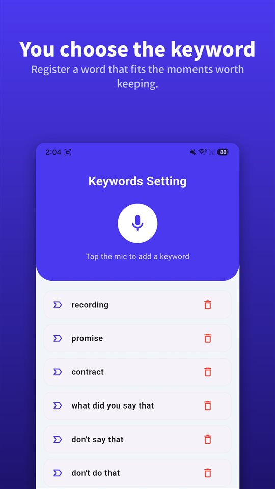

Someone on the phone starts saying something that matters. There is a record button on your iPhone screen. You hesitate: are you allowed to press it, and will they know?

Short answer: **you can press it, and they will know.** Call recording arrived in the iPhone Phone app with iOS 18, and when it starts, both people hear an announcement that the call is being recorded.

iPhone call recording is not a hidden feature. It announces itself and keeps a record. And it works in the US and the UK, but not in the European Union or Turkey.

## Three ways, one table

| Method | Where it works | Does the other person get told? | Where it is saved |
|---|---|---|---|
| Built-in iPhone call recording (iOS 18 or later) | Most regions, including the US, UK, Canada, Australia and India; not the EU, Turkey and 17 others | Audio notice to both people, repeated periodically | Call Recordings folder in Notes |
| Three-way-call recorder app | Needs three-way calling from your carrier; usually paid | Depends on the app | The app company's servers |
| Speakerphone, recorded on a second device | Anywhere | No automatic notice | The device that recorded it |

This reflects Apple's documentation as of November 2026. Availability changes, so Apple's iOS and iPadOS Feature Availability page is the place to double-check.

## Recording a call with the built-in feature

1. Make a call in the **Phone** app.
2. During the call, tap the button on the call screen, then tap **Call Recording**.
3. Both people hear an audio notice that the call is being recorded.
4. To stop, tap it again or simply hang up.
5. The recording is saved automatically to the **Call Recordings folder in the Notes app**. Tap **View Saved Call** to open it there.

Apple adds a few conditions. Recording works **when you are talking to one other person**, and it covers **FaceTime audio calls** as well as regular phone calls. From Notes you can save the audio file elsewhere or share it.

## Transcripts and summaries, depending on language

**Transcripts** appear only in select regions and languages. Apple lists call transcription for English (US, UK, Canada, Australia, India, New Zealand, Singapore), Japanese, Korean (South Korea), Mandarin Chinese (China mainland, Taiwan), Cantonese (Hong Kong), Portuguese (Brazil) and Spanish (Mexico, US). Each statement in the transcript is attributed to a speaker, and you can tap a passage to play the audio from that point.

**Summaries** come from Apple Intelligence, on the iPhone 15 Pro, iPhone 15 Pro Max and iPhone 16 or later.

Apple also says to check a transcript's accuracy before relying on it, because it may not be a perfect representation of the conversation. For a call that matters, listen to the recording too.

## Why the other person hears it

The question people search most is whether they can do it without the other person knowing. Apple's answer is plain.

- When recording starts, **both people** hear an audio notice.
- The notice **replays periodically** during the call.
- Apple's documentation does not describe any setting that turns the notice off.
- Apple tells you to **make sure the other person is willing to be recorded** before you start.

The reason is that the same feature ships in many jurisdictions. In places where every participant must consent before a call is recorded, an announcement that **everyone on the call hears** is how the feature meets that requirement by design. Google's Phone app on Android does the same thing.

It also helps the person recording. A conversation that continues after the announcement carries its own proof that **both sides knew it was being recorded**.

## Where it is not available

As of November 2026, Apple says call recording is not available in these 19 places:

**Azerbaijan, Bahrain, Egypt, the European Union, Iran, Iraq, Jordan, Kuwait, Morocco, Nigeria, Oman, Pakistan, Qatar, Russia, Saudi Arabia, South Africa, Turkey, the United Arab Emirates and Yemen.**

The US, the UK, Canada, Australia, India, New Zealand and Singapore are not on the list. **Ireland, as an EU member, is.** If you call family or clients in Europe, their iPhone may not have the same button.

## Recorder apps and speakerphone: two other routes

**Three-way-call recorder apps.** Most iPhone call recorder apps work by **calling the company's recording line and merging it into a three-way call.** The recording happens on the company's servers rather than on the phone, your carrier has to support three-way calling, and most of these services are paid. Apple notes that such third-party apps **may record a call without providing a warning.**

**Speakerphone, recorded on a second device.** This records the room rather than the line, so it works anywhere. The costs are lower audio quality, background noise, and everyone nearby hearing the call. Noise can be removed afterwards; the options are in [How to remove background noise from a voice recording on Android](/blog/en/remove-background-noise/).

Either way, **the law does not change with the tool.** Under US federal law a participant may record their own call; about a dozen states require everyone's consent; and recording a call you are not part of is interception. The state-by-state picture is in [Is it legal to record a conversation you're in?](/blog/en/recording-consent-law/) and [Nine states are strict. The rest of the list is an argument.](/blog/en/state-recording-consent/) Rules in other English-speaking countries are not covered here.

## A conversation in person has no button to press

For a call, the record button is on the screen. A conversation in person is different. By the time you take out the phone, unlock it and open a recorder, the line that mattered has already gone by.

That gap is what [TalkSafe](https://hcompany-kr.github.io/talksafe/en/) is for. **TalkSafe is not a call recorder.** It is a voice recorder for Android and iPhone that starts when it hears a **word you set in advance**, works with the **screen locked**, and saves the **30 seconds before the start** with the file. The keyword is not tied to who says it, so you can set one the other person is likely to use.

<figure class="shot"><figcaption>Keyword settings. You can register several keywords; any one of them being detected starts a recording.</figcaption></figure>

One thing to know on iPhone: **if you fully close the app while detection is on, detection stops and a notification asks you to start it again.** As long as you don't swipe TalkSafe away in the app switcher, it keeps listening.

## In short

- iPhone call recording is **built into the Phone app from iOS 18.** Tap the button during a call, then Call Recording.
- **Both people hear an announcement**, and it repeats during the call.
- Recordings go to the **Call Recordings folder in Notes**, with transcripts in supported languages and Apple Intelligence summaries.
- It works in the **US, UK, Canada, Australia and India**, and **not in the EU, Turkey and 17 other places.**
- Whatever the tool, recording a call you are not part of is interception.

Why third-party call recorders stopped working on Android, and which phones still record natively, is in [Why call recording stopped working on your Android, and what still does](/blog/en/call-recording-android/).

## Sources

- [Record and transcribe a call on iPhone (Apple Support)](https://support.apple.com/guide/iphone/record-and-transcribe-a-call-iph57c6590e9/ios)
- [Record and transcribe a call on iPhone, Personal Safety User Guide (Apple)](https://support.apple.com/guide/personal-safety/record-and-transcribe-a-call-on-iphone-ipsfa513e1a6/web)
- [How to record a call on iPhone and iPad (Apple)](https://support.apple.com/en-us/121583)
- [iOS and iPadOS Feature Availability: Phone (Apple)](https://www.apple.com/ios/feature-availability/#phone-call-recording)

Regional and language availability reflects Apple's documentation as of November 2026 and may change. General information, not legal advice — recording law differs by country and by state.

