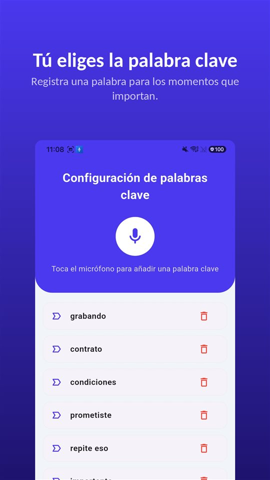

Al otro lado del teléfono alguien empieza a decir algo importante. En la pantalla del iPhone hay un botón para grabar. Dudas: ¿puedes pulsarlo? ¿Se va a enterar?

La respuesta corta: **puedes pulsarlo, y se va a enterar.** La grabación de llamadas llegó a la app Teléfono del iPhone con iOS 18, y al empezar, los dos oyen un aviso de que la llamada se está grabando. Eso, si estás en un país donde existe: **en España no aparece.**

La grabación de llamadas del iPhone no es una función para ocultar. Avisa y deja constancia. Funciona en México, en el resto de América Latina y en Estados Unidos, pero no en la Unión Europea.

## Tres formas, una tabla

| Método | Dónde funciona | ¿Se avisa a la otra persona? | Dónde se guarda |
|---|---|---|---|
| Grabación de llamadas integrada (iOS 18 o posterior) | La mayoría de regiones, incluidas América Latina y EE. UU.; no en la UE (España incluida) ni en otros 18 lugares | Aviso de audio a los dos, repetido periódicamente | Carpeta “Grabaciones de llamadas” de Notas |
| App que graba con llamada a tres | El operador debe permitir la llamada a tres; casi siempre de pago | Depende de la app | Los servidores de la empresa de la app |
| Manos libres, grabando la habitación (otro dispositivo o TalkSafe en el mismo iPhone) | En cualquier sitio | Sin aviso automático | El dispositivo que graba |

Los datos corresponden a la documentación de Apple en noviembre de 2026. La disponibilidad cambia, así que conviene confirmarla en la página de disponibilidad de funciones de iOS y iPadOS de Apple.

## Cómo se usa la grabación integrada

1. Haz una llamada desde la app **Teléfono**.
2. Durante la llamada, toca el botón de la pantalla de llamada y luego **“Grabación de llamadas”**.
3. Los dos participantes oyen un aviso de audio de que la llamada se está grabando.
4. Para detenerla, vuelve a tocarlo o simplemente cuelga.
5. La grabación se guarda automáticamente en la carpeta **“Grabaciones de llamadas” de la app Notas**. Toca **“Acceder a la llamada guardada”** para abrirla allí.

Apple añade algunas condiciones. Se puede grabar **cuando hablas con una sola persona**, y la función cubre también las **llamadas de audio de FaceTime**, no solo las telefónicas. Desde Notas puedes guardar el archivo de audio en otro sitio o compartirlo.

## Transcripción y resumen, según el idioma

La **transcripción** solo aparece en algunas regiones e idiomas. Apple la ofrece para el inglés (EE. UU., Reino Unido, Canadá, Australia, India, Nueva Zelanda, Singapur), el japonés, el coreano, el chino mandarín (China continental, Taiwán), el cantonés (Hong Kong), el portugués (Brasil) y el **español de México y de Estados Unidos**. El español de España y de otros países de América Latina no figura en esa lista. En la transcripción se identifica a quién dijo cada frase, y al tocar un fragmento se reproduce desde ese punto.

El **resumen** lo hace Apple Intelligence, en el iPhone 15 Pro, el iPhone 15 Pro Max y el iPhone 16 o posterior.

Apple recuerda que hay que comprobar la exactitud de una transcripción antes de fiarse de ella, porque puede no reflejar perfectamente la conversación. Si la llamada importa, escucha también la grabación.

## Por qué la otra persona lo oye

La pregunta que más se busca es si se puede grabar sin que el otro lo sepa. La respuesta de Apple es clara.

- Al empezar la grabación, **los dos** oyen un aviso de audio.
- El aviso **se repite periódicamente** durante la llamada.
- La documentación de Apple no describe ningún ajuste para desactivar el aviso.
- Apple pide **asegurarse de que la otra persona está dispuesta a que se la grabe** antes de empezar.

El motivo es que la misma función se vende en muchos países. En los lugares donde todos los participantes deben consentir antes de que se grabe una llamada, un aviso que **oyen todos** es la forma en que la función cumple ese requisito por diseño. La app Teléfono de Google en Android hace lo mismo.

También le sirve a quien graba. Una conversación que sigue después del aviso lleva dentro la prueba de que **las dos partes sabían que se estaba grabando**.

## Dónde no está disponible

En noviembre de 2026, Apple indica que la grabación de llamadas no está disponible en estos 19 lugares:

**Arabia Saudí, Azerbaiyán, Baréin, Catar, Egipto, Emiratos Árabes Unidos, Irak, Irán, Jordania, Kuwait, Marruecos, Nigeria, Omán, Pakistán, Rusia, Sudáfrica, Turquía, Yemen y la Unión Europea.**

**España, como miembro de la UE, está incluida.** México, Argentina, Colombia, Chile, Perú y el resto de países hispanohablantes de América no están en la lista, igual que Estados Unidos. Si hablas con familia o clientes a un lado y otro del Atlántico, uno de los dos iPhone puede tener el botón y el otro no.

## Apps y manos libres: los otros dos caminos

**Apps que graban con llamada a tres.** La mayoría de las apps para grabar llamadas en el iPhone funcionan **llamando a una línea de grabación de la empresa y uniéndola en una llamada a tres.** La grabación se hace en los servidores de la empresa, no en el teléfono; el operador tiene que permitir la llamada a tres, y casi todas son de pago. Apple advierte que estas apps de terceros **pueden grabar una llamada sin avisar.**

**Manos libres, grabando la habitación.** Graba el sonido de la habitación, no la línea, así que funciona en cualquier país, también en España. A cambio, baja la calidad, entra ruido de fondo y quien esté cerca oye la llamada. El ruido se puede quitar después; las opciones están en [Cómo quitar el ruido de fondo de una grabación de voz en Android](/blog/es/remove-background-noise/). TalkSafe sirve para esto. Con la llamada en manos libres, TalkSafe en el mismo iPhone oye también la voz que sale del altavoz y empieza a grabar cuando detecta tu palabra clave.

En cualquier caso, **la ley no cambia con la herramienta.** En España, quien participa en la conversación puede grabarla: el Tribunal Constitucional estableció en la STC 114/1984 que el secreto de las comunicaciones no se puede oponer al propio interlocutor. Grabar una llamada en la que no participas es otra cosa y es delito. Cómo se trata en España está en [¿Es legal grabar una conversación en España? Grabar sí, difundir no](/blog/es/recording-consent-law/), y en América Latina en [Grabar tu propia conversación: país por país](/blog/es/grabar-latinoamerica/).

## Una conversación en persona no tiene botón

En una llamada, el botón está en la pantalla. En una conversación cara a cara no. Entre sacar el teléfono, desbloquearlo y abrir una grabadora, la frase que importaba ya ha pasado.

Para ese hueco está [TalkSafe](https://hcompany-kr.github.io/talksafe/es/). **TalkSafe no es una app para grabar llamadas.** Es una grabadora de voz para Android y iPhone que empieza cuando escucha una **palabra que hayas elegido**, funciona con la **pantalla bloqueada** y guarda también los **30 segundos anteriores al inicio**. La palabra clave no está ligada a quién la dice, así que puedes elegir una que probablemente diga la otra persona.

<figure class="shot"><figcaption>Ajustes de palabras clave. Puedes registrar varias; basta con que se detecte una para que empiece la grabación.</figcaption></figure>

Una cosa a tener en cuenta en el iPhone: **si cierras la app por completo mientras la detección está activa, la detección se detiene y aparece una notificación que pide volver a iniciarla.** Mientras no deslices TalkSafe hacia arriba en el selector de apps, sigue escuchando.

## En resumen

- La grabación de llamadas del iPhone **viene en la app Teléfono desde iOS 18.** Durante la llamada, toca el botón y luego “Grabación de llamadas”.
- **Los dos participantes oyen un aviso**, que se repite durante la llamada.
- Las grabaciones van a la carpeta **“Grabaciones de llamadas” de Notas**, con transcripción en español de México y de EE. UU. y resumen con Apple Intelligence.
- Funciona en **América Latina y Estados Unidos**, y **no en España ni en el resto de la UE.**
- Con cualquier herramienta, grabar una llamada en la que no participas es delito.

Por qué dejaron de funcionar las apps de grabar llamadas en Android, y qué teléfonos siguen grabando de serie, está en [Por qué dejaron de funcionar las apps para grabar llamadas en Android](/blog/es/call-recording-android/).

## Fuentes

- [Grabar y transcribir una llamada en el iPhone (Soporte de Apple)](https://support.apple.com/es-es/guide/iphone/iph57c6590e9/ios)
- [Record and transcribe a call on iPhone, Personal Safety User Guide (Apple)](https://support.apple.com/guide/personal-safety/record-and-transcribe-a-call-on-iphone-ipsfa513e1a6/web)
- [How to record a call on iPhone and iPad (Apple)](https://support.apple.com/en-us/121583)
- [iOS and iPadOS Feature Availability: Phone (Apple)](https://www.apple.com/ios/feature-availability/#phone-call-recording)

La disponibilidad por país e idioma corresponde a la documentación de Apple de noviembre de 2026 y puede cambiar. Información general, no asesoramiento jurídico. Para un caso concreto, consulta con un abogado.

