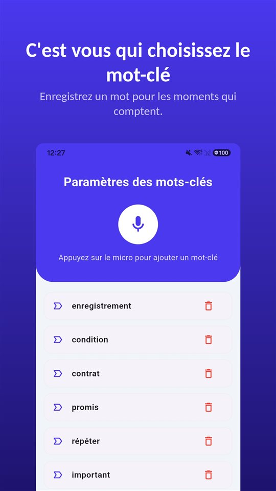

Au téléphone, quelqu'un commence à dire quelque chose d'important. Vous cherchez un bouton d'enregistrement sur l'iPhone et vous ne le trouvez pas, alors que des tutoriels en parlent.

Le bouton existe, mais pas ici. **Depuis iOS 18, l'app Téléphone de l'iPhone enregistre les appels**, et les deux interlocuteurs entendent un avertissement au démarrage. **Dans l'Union européenne, Apple ne propose pas la fonction** : France, Belgique et Luxembourg compris. En Suisse et au Québec, elle est disponible.

L'enregistrement d'appel de l'iPhone n'est pas fait pour cacher : il prévient et garde une trace. Il manque en France et en Belgique, il existe en Suisse et au Québec.

## Disponibilité et droit dans les pays francophones

| Pays | Enregistrement d'appel de l'iPhone | Enregistrer son propre appel sans accord | Base |
|---|---|---|---|
| France | Non disponible (UE) | Punissable, même pour un participant | Art. 226-1 Code pénal |
| Belgique | Non disponible (UE) | Pas une infraction pour le participant ; l'usage dans l'intention de nuire est puni | Art. 314bis Code pénal, Cassation 2015 |
| Suisse | Disponible | Punissable sur plainte ; exception pour commandes et réservations dans les affaires | Art. 179ter, 179quinquies Code pénal |
| Luxembourg | Non disponible (UE) | Le texte ne prévoit pas d'exception pour le participant | Art. 2, loi du 11 août 1982 |
| Monaco | Non cité par Apple, non vérifié | Le texte ne prévoit pas d'exception pour le participant | Art. 308-2 Code pénal |
| Québec | Disponible (Canada) | Permis pour un participant | Art. 184 Code criminel (Canada) |

La disponibilité correspond à la documentation d'Apple de novembre 2026 ; elle peut changer, et la page d'Apple sur la disponibilité des fonctionnalités d'iOS et d'iPadOS fait foi. Le détail du droit est dans [Enregistrer une conversation à l'insu de quelqu'un : interdit en France, permis en Belgique et au Québec](/blog/fr/enregistrer-conversation/). Les pays francophones d'Afrique ne sont pas couverts ici.

## Trois méthodes comparées

| Méthode | Où elle fonctionne | L'autre personne est-elle prévenue ? | Où l'enregistrement est conservé |
|---|---|---|---|
| Enregistrement intégré (iOS 18 ou ultérieur) | La plupart des pays, dont la Suisse et le Canada ; pas l'UE ni 18 autres pays | Avertissement audio aux deux, répété régulièrement | Dossier « Enregistrements d'appel » de Notes |
| Application à appel à trois | L'opérateur doit permettre l'appel à trois ; le plus souvent payante | Selon l'application | Les serveurs de l'éditeur |
| Haut-parleur, en enregistrant la pièce (second appareil ou TalkSafe sur le même iPhone) | Partout | Pas d'avertissement automatique | L'appareil qui enregistre |

## Comment fonctionne l'enregistrement intégré

1. Passez un appel depuis l'app **Téléphone**.
2. Pendant l'appel, touchez le bouton de l'écran d'appel, puis **« Enregistrement d'appel »**.
3. Les deux participants entendent un avertissement audio indiquant que l'appel est enregistré.
4. Pour arrêter, touchez de nouveau ou raccrochez.
5. L'enregistrement est sauvegardé automatiquement dans le dossier **« Enregistrements d'appel » de l'app Notes**. Touchez **« Affichez l'appel enregistré »** pour l'y ouvrir.

Apple précise quelques conditions. L'enregistrement vaut pour un appel **avec une seule autre personne**, et il couvre les **appels audio FaceTime** autant que les appels téléphoniques. Depuis Notes, le fichier audio peut être sauvegardé ailleurs ou partagé.

La **transcription** n'apparaît que dans certaines régions et langues : anglais (États-Unis, Royaume-Uni, Canada, Australie, Inde, Nouvelle-Zélande, Singapour), japonais, coréen, mandarin (Chine continentale, Taïwan), cantonais (Hong Kong), portugais (Brésil) et espagnol (Mexique, États-Unis). **Le français n'y figure pas.** Un **résumé** est produit par Apple Intelligence sur l'iPhone 15 Pro, l'iPhone 15 Pro Max et l'iPhone 16 ou ultérieur.

## Pourquoi l'autre personne entend l'avertissement

La question la plus recherchée est de savoir si l'on peut enregistrer sans que l'autre le sache. La réponse d'Apple est nette.

- Au démarrage, **les deux** entendent un avertissement audio.
- L'avertissement est **répété régulièrement** pendant l'appel.
- La documentation d'Apple ne décrit aucun réglage pour le désactiver.
- Apple demande de **s'assurer que l'autre personne accepte d'être enregistrée** avant de commencer.

La raison : la même fonction est vendue dans de nombreux pays. Là où tous les participants doivent consentir à l'enregistrement d'un appel, un avertissement que **tout le monde entend** est la façon dont la fonction répond à cette exigence par construction. L'app Téléphone de Google sur Android fait de même.

En Suisse, cela ne veut pas dire que tout enregistrement devient permis. Apple ne dit pas si continuer à parler après l'avertissement vaut consentement au sens de l'article 179ter. Le plus sûr est de demander l'accord expressément, de préférence de façon à ce qu'il s'entende sur l'enregistrement.

## Ce qui reste en France et en Belgique

**Applications à appel à trois.** La plupart des applications d'enregistrement d'appels sur iPhone **appellent une ligne d'enregistrement de l'éditeur et la fusionnent en appel à trois.** L'enregistrement se fait sur les serveurs de l'éditeur, pas sur le téléphone ; l'opérateur doit permettre l'appel à trois, et la plupart de ces services sont payants. Apple signale que ces applications tierces **peuvent enregistrer un appel sans avertissement.**

**Haut-parleur, en enregistrant la pièce.** On enregistre la pièce, pas la ligne : cela fonctionne partout. En contrepartie, la qualité baisse, le bruit de fond s'ajoute et les personnes à proximité entendent l'appel. Le bruit peut être retiré ensuite ; les méthodes sont dans [Comment retirer le bruit de fond d'un enregistrement vocal sur Android](/blog/fr/remove-background-noise/). TalkSafe peut servir ainsi. Avec l'appel sur haut-parleur, TalkSafe sur le même iPhone entend aussi la voix qui sort du haut-parleur et démarre l'enregistrement quand il détecte votre mot-clé.

**L'outil ne change rien au droit.** En France, enregistrer un appel sans le consentement de l'autre reste punissable au titre de l'article 226-1 du Code pénal, quel que soit l'appareil ou l'application. Demandez d'abord.

## Une conversation en face à face n'a pas de bouton

Pour un appel, le bouton est à l'écran, là où la fonction existe. En face à face, non. Le temps de sortir le téléphone, de le déverrouiller et d'ouvrir un enregistreur, la phrase qui comptait est passée.

C'est à cela que sert [TalkSafe](https://hcompany-kr.github.io/talksafe/fr/). **TalkSafe n'est pas une application d'enregistrement d'appels.** C'est une application d'enregistrement pour Android et iPhone qui démarre sur un **mot choisi à l'avance**, fonctionne **écran verrouillé** et conserve les **30 secondes précédant le démarrage**. Le mot-clé n'est lié à aucun locuteur : ce peut être un mot que l'autre personne dira.

En France, où l'enregistrement sans consentement est punissable, cela s'accorde bien avec la demande elle-même : choisissez comme mot-clé un mot de votre question, par exemple **« enregistrer »**. « Je peux enregistrer ? » lance l'enregistrement, et la réponse y figure.

<figure class="shot"><figcaption>Réglages des mots-clés. Vous pouvez en enregistrer plusieurs ; il suffit que l'un d'eux soit détecté pour que l'enregistrement démarre.</figcaption></figure>

Un point propre à l'iPhone : **si l'on ferme complètement l'application pendant la détection, la détection s'arrête et une notification invite à la relancer.** Tant que vous ne balayez pas TalkSafe vers le haut dans le sélecteur d'apps, il continue d'écouter.

## En bref

- L'enregistrement d'appel est **intégré à l'app Téléphone depuis iOS 18** : pendant l'appel, le bouton, puis « Enregistrement d'appel ».
- **Les deux entendent un avertissement**, répété pendant l'appel.
- Les enregistrements vont dans le dossier **« Enregistrements d'appel » de Notes** ; le français n'est pas une langue de transcription.
- **Pas disponible en France, en Belgique, au Luxembourg ni dans le reste de l'UE** ; disponible en Suisse et au Québec.
- En France, enregistrer sans consentement reste punissable, quel que soit l'outil.

Pourquoi les applications d'enregistrement d'appels ne marchent plus sur Android, et quels téléphones enregistrent encore d'origine, est expliqué dans [Pourquoi les applications d'enregistrement d'appels ne marchent plus sur Android, et ce qui fonctionne encore](/blog/fr/call-recording-android/).

## Sources

- [Enregistrer et transcrire un appel sur l'iPhone (Assistance Apple)](https://support.apple.com/fr-fr/guide/iphone/iph57c6590e9/ios)
- [Record and transcribe a call on iPhone, Personal Safety User Guide (Apple)](https://support.apple.com/guide/personal-safety/record-and-transcribe-a-call-on-iphone-ipsfa513e1a6/web)
- [How to record a call on iPhone and iPad (Apple)](https://support.apple.com/en-us/121583)
- [iOS and iPadOS Feature Availability: Phone (Apple)](https://www.apple.com/ios/feature-availability/#phone-call-recording)

La disponibilité par pays et par langue correspond à la documentation d'Apple de novembre 2026 et peut changer. Information générale, pas un conseil juridique. Pour un cas précis, consultez un avocat.

