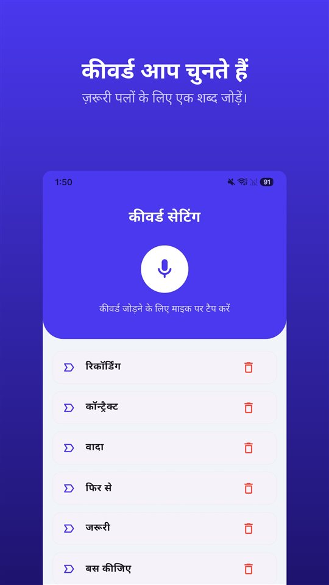

फ़ोन पर सामने वाला कोई ज़रूरी बात कहने लगता है। iPhone की स्क्रीन पर रिकॉर्ड करने का बटन है। मन में सवाल आता है: दबा सकते हैं? सामने वाले को पता चलेगा?

छोटा जवाब: **दबा सकते हैं, और उन्हें पता चलेगा।** iOS 18 से iPhone के फ़ोन ऐप में कॉल रिकॉर्डिंग आ गई है, और शुरू होते ही दोनों लोगों को सूचना सुनाई देती है कि कॉल रिकॉर्ड हो रही है।

iPhone की कॉल रिकॉर्डिंग छिपाने के लिए नहीं बनी है: वह बताती है और रिकॉर्ड रखती है। भारत में यह उपलब्ध है, यूरोपीय संघ में नहीं।

## भारत में क्या स्थिति है

| सवाल | भारत में | आधार |
|---|---|---|
| iPhone की अपनी कॉल रिकॉर्डिंग | उपलब्ध; रिकॉर्डिंग की भाषा सूची में हिंदी, ट्रांसक्रिप्ट सिर्फ़ अंग्रेज़ी (भारत) में | Apple का दस्तावेज़ (नवंबर 2026) |
| बातचीत के एक पक्ष की अनुमति से रिकॉर्डिंग | इंटरसेप्शन नहीं; शर्तें पूरी होने पर सबूत | सुप्रीम कोर्ट, आर. एम. मलकानी (1973) |
| बोलने वाले की सहमति के बिना रिकॉर्डिंग | सिर्फ़ इस वजह से अस्वीकार्य नहीं | सुप्रीम कोर्ट, विभोर गर्ग बनाम नेहा (2025) |
| सबूत के रूप में पेश करना | प्रमाणपत्र ज़रूरी | भारतीय साक्ष्य अधिनियम, 2023, धारा 63 |
| दूसरों के संदेश को इंटरसेप्ट करना | अपराध: 3 साल तक की जेल या 2 करोड़ रुपये तक जुर्माना, या दोनों | दूरसंचार अधिनियम, 2023, धारा 42 |

उपलब्धता नवंबर 2026 के Apple दस्तावेज़ों के अनुसार है और बदल सकती है; Apple का iOS और iPadOS फ़ीचर उपलब्धता पेज ही आख़िरी संदर्भ है। क़ानून विस्तार से [भारत में बातचीत रिकॉर्ड करना: रिकॉर्डिंग आसान हिस्सा है, प्रमाणपत्र नहीं](/blog/hi/recording-law-india/) में है। भारत के अलावा जिन देशों में हिंदी बोली जाती है, वे यहाँ शामिल नहीं हैं।

## तीन तरीके, एक तालिका

| तरीका | कहाँ काम करता है | सामने वाले को सूचना? | रिकॉर्डिंग कहाँ रहती है |
|---|---|---|---|
| iPhone की अपनी कॉल रिकॉर्डिंग (iOS 18 या बाद का) | भारत समेत ज़्यादातर जगहें; यूरोपीय संघ और 18 अन्य जगहें नहीं | दोनों को ऑडियो सूचना, समय-समय पर दोहराई जाती है | नोट्स ऐप का कॉल रिकॉर्डिंग फ़ोल्डर |
| थ्री-वे कॉल से रिकॉर्ड करने वाला ऐप | ऑपरेटर को कॉन्फ़्रेंस कॉल सपोर्ट करनी चाहिए; ज़्यादातर पेड | ऐप पर निर्भर | ऐप कंपनी के सर्वर |
| स्पीकर पर, दूसरे डिवाइस से रिकॉर्ड | हर जगह | कोई अपने-आप सूचना नहीं | रिकॉर्ड करने वाला डिवाइस |

## iPhone की कॉल रिकॉर्डिंग कैसे इस्तेमाल करें

1. **फ़ोन** ऐप से कॉल करें।
2. कॉल के दौरान कॉल स्क्रीन के बटन पर टैप करें, फिर **“कॉल रिकॉर्डिंग”** पर टैप करें।
3. दोनों लोगों को एक ऑडियो सूचना सुनाई देती है कि कॉल रिकॉर्ड की जा रही है।
4. रोकने के लिए दोबारा टैप करें या बस कॉल काट दें।
5. रिकॉर्डिंग अपने आप **नोट्स ऐप के कॉल रिकॉर्डिंग फ़ोल्डर** में सेव हो जाती है। वहाँ खोलने के लिए **“सहेजी गई कॉल देखें”** पर टैप करें।

Apple कुछ शर्तें भी बताता है। रिकॉर्डिंग **एक व्यक्ति से बात करते समय** होती है, और सामान्य फ़ोन कॉल के साथ **FaceTime ऑडियो कॉल** भी रिकॉर्ड हो सकती है। नोट्स से ऑडियो फ़ाइल को कहीं और सेव या शेयर किया जा सकता है।

**ट्रांसक्रिप्ट** सिर्फ़ कुछ क्षेत्रों और भाषाओं में आता है: अंग्रेज़ी (अमेरिका, ब्रिटेन, कनाडा, ऑस्ट्रेलिया, **भारत**, न्यूज़ीलैंड, सिंगापुर), जापानी, कोरियाई, मैंडरिन चीनी (मुख्य भूमि चीन, ताइवान), कैंटोनीज़ (हांगकांग), पुर्तगाली (ब्राज़ील) और स्पेनिश (मेक्सिको, अमेरिका)। **हिंदी इस सूची में नहीं है।** **सारांश** Apple Intelligence बनाता है, iPhone 15 Pro, iPhone 15 Pro Max और iPhone 16 या उसके बाद के मॉडल पर।

Apple यह भी कहता है कि ट्रांसक्रिप्ट पर भरोसा करने से पहले उसकी सटीकता जाँच लें, क्योंकि वह बातचीत को पूरी तरह सही नहीं दिखा सकता। ज़रूरी कॉल हो तो रिकॉर्डिंग भी सुनें।

## सामने वाले को सूचना क्यों सुनाई देती है

सबसे ज़्यादा खोजा जाने वाला सवाल है कि क्या सामने वाले को बताए बिना रिकॉर्ड हो सकता है। Apple का जवाब साफ़ है।

- रिकॉर्डिंग शुरू होते ही **दोनों** को ऑडियो सूचना सुनाई देती है।
- सूचना कॉल के दौरान **समय-समय पर दोहराई** जाती है।
- Apple के दस्तावेज़ों में इस सूचना को बंद करने की कोई सेटिंग नहीं बताई गई है।
- Apple कहता है कि शुरू करने से पहले **पक्का कर लें कि सामने वाला रिकॉर्ड होने के लिए तैयार है**।

वजह यह है कि वही सुविधा कई देशों में बिकती है। जहाँ कॉल रिकॉर्ड करने से पहले सभी की सहमति ज़रूरी है, वहाँ **सबको सुनाई देने वाली** सूचना ही वह तरीका है जिससे सुविधा अपने भीतर यह शर्त पूरी करती है। Android पर Google का फ़ोन ऐप भी यही करता है।

यह सूचना रिकॉर्ड करने वाले के भी काम आती है। सूचना के बाद जारी रही बातचीत में ख़ुद यह सबूत रहता है कि **दोनों पक्षों को रिकॉर्डिंग की जानकारी थी**।

## कहाँ उपलब्ध नहीं है

नवंबर 2026 में Apple के अनुसार कॉल रिकॉर्डिंग इन 19 जगहों पर उपलब्ध नहीं है:

**अज़रबैजान, बहरीन, मिस्र, यूरोपीय संघ, ईरान, इराक़, जॉर्डन, कुवैत, मोरक्को, नाइजीरिया, ओमान, पाकिस्तान, क़तर, रूस, सऊदी अरब, दक्षिण अफ़्रीका, तुर्की, संयुक्त अरब अमीरात और यमन।**

**भारत इस सूची में नहीं है।** खाड़ी देशों में रहने वाले परिवार या ग्राहकों से बात करते हों, तो ध्यान रखें कि सऊदी अरब, संयुक्त अरब अमीरात, क़तर, कुवैत, ओमान और बहरीन इस सूची में हैं; वहाँ के iPhone में यही बटन नहीं होगा।

## ऐप और स्पीकर: दो और रास्ते

**थ्री-वे कॉल से रिकॉर्ड करने वाले ऐप।** iPhone के ज़्यादातर कॉल रिकॉर्डिंग ऐप **कंपनी की रिकॉर्डिंग लाइन को कॉल करके उसे थ्री-वे कॉल में जोड़ते** हैं। रिकॉर्डिंग फ़ोन पर नहीं, कंपनी के सर्वर पर होती है; ऑपरेटर को कॉन्फ़्रेंस कॉल सपोर्ट करनी चाहिए, और ज़्यादातर सेवाएँ पेड हैं। Apple बताता है कि ऐसे थर्ड-पार्टी ऐप **बिना चेतावनी के कॉल रिकॉर्ड कर सकते हैं।**

**स्पीकर पर, दूसरे डिवाइस से रिकॉर्ड।** इसमें लाइन नहीं, कमरे की आवाज़ रिकॉर्ड होती है, इसलिए यह हर जगह काम करता है। बदले में आवाज़ की क्वालिटी गिरती है, पीछे का शोर आता है, और पास बैठे लोग कॉल सुन लेते हैं। शोर बाद में हटाया जा सकता है; तरीके [Android पर वॉइस रिकॉर्डिंग से पीछे का शोर कैसे हटाएँ](/blog/hi/remove-background-noise/) में हैं।

**औज़ार बदलने से क़ानून नहीं बदलता।** जिस कॉल में आप शामिल नहीं हैं, उसे किसी भी डिवाइस या ऐप से रिकॉर्ड करना इंटरसेप्शन है।

## आमने-सामने की बातचीत में बटन नहीं होता

कॉल में बटन स्क्रीन पर होता है। आमने-सामने की बातचीत में नहीं। फ़ोन निकालने, अनलॉक करने और रिकॉर्डर खोलने तक सबसे ज़रूरी बात निकल चुकी होती है।

इसी पल के लिए [TalkSafe](https://hcompany-kr.github.io/talksafe/hi/) है। **TalkSafe कॉल रिकॉर्डिंग ऐप नहीं है।** यह Android और iPhone के लिए एक वॉइस रिकॉर्डर ऐप है, जो **पहले से चुना हुआ शब्द** सुनते ही शुरू होता है, **स्क्रीन लॉक** रहने पर भी काम करता है, और **शुरुआत से पहले के 30 सेकंड** भी सेव करता है। कीवर्ड बोलने वाले से बँधा नहीं है, इसलिए ऐसा शब्द भी चुना जा सकता है जो सामने वाला कहेगा।

अगर आप पहले पूछना चाहें, तो कीवर्ड सहमति भी रिकॉर्ड कर सकता है। अपने सवाल का एक शब्द सेट कीजिए, जैसे **„रिकॉर्ड”**। „क्या मैं यह बातचीत रिकॉर्ड कर सकता हूँ?” पूछते ही रिकॉर्डिंग शुरू हो जाती है, और जवाब फ़ाइल में होता है।

<figure class="shot"><figcaption>कीवर्ड सेटिंग। आप कई कीवर्ड सेव कर सकते हैं; उनमें से कोई एक पहचाना जाते ही रिकॉर्डिंग शुरू हो जाती है।</figcaption></figure>

iPhone पर एक बात याद रखें: **डिटेक्शन चालू रहते हुए ऐप को पूरी तरह बंद कर दें, तो डिटेक्शन रुक जाता है और एक नोटिफ़िकेशन डिटेक्शन दोबारा शुरू करने को कहता है।** जब तक आप ऐप स्विचर में TalkSafe को ऊपर स्वाइप करके बंद नहीं करते, वह सुनता रहता है।

## संक्षेप में

- iPhone की कॉल रिकॉर्डिंग **iOS 18 से फ़ोन ऐप में ही** है: कॉल के दौरान बटन, फिर “कॉल रिकॉर्डिंग”।
- **दोनों लोगों को सूचना सुनाई देती है**, जो कॉल के दौरान दोहराई जाती है।
- रिकॉर्डिंग **नोट्स ऐप के कॉल रिकॉर्डिंग फ़ोल्डर** में जाती है; ट्रांसक्रिप्ट अंग्रेज़ी (भारत) में है, हिंदी में नहीं।
- **भारत में उपलब्ध है**, यूरोपीय संघ और खाड़ी के कई देशों में नहीं।
- किसी भी औज़ार से, जिस कॉल में आप शामिल नहीं हैं उसे रिकॉर्ड करना इंटरसेप्शन है।

Android पर कॉल रिकॉर्डिंग ऐप क्यों बंद हुए और कौन-से फ़ोन अब भी अपने डायलर से रिकॉर्ड करते हैं, यह [Android पर कॉल रिकॉर्डिंग ऐप क्यों बंद हो गए, और अब क्या काम करता है](/blog/hi/call-recording-android/) में है।

## स्रोत

- [iPhone पर, कोई कॉल रिकॉर्ड और ट्रांसक्राइब करें (Apple सहायता)](https://support.apple.com/hi-in/guide/iphone/iph57c6590e9/ios)
- [Record and transcribe a call on iPhone, Personal Safety User Guide (Apple)](https://support.apple.com/guide/personal-safety/record-and-transcribe-a-call-on-iphone-ipsfa513e1a6/web)
- [How to record a call on iPhone and iPad (Apple)](https://support.apple.com/en-us/121583)
- [iOS and iPadOS Feature Availability: Phone (Apple)](https://www.apple.com/ios/feature-availability/#phone-call-recording)

देश और भाषा के अनुसार उपलब्धता नवंबर 2026 के Apple दस्तावेज़ों पर आधारित है और बदल सकती है। यह सामान्य जानकारी है, क़ानूनी सलाह नहीं। अपने मामले के लिए किसी वकील से सलाह लें।

