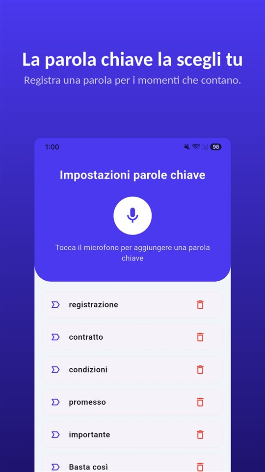

Al telefono qualcuno comincia a dire una cosa importante. Cerchi un pulsante per registrare sull'iPhone e non lo trovi. Online leggi che dovrebbe esserci.

C'è, ma non in Italia. **Da iOS 18 l'app Telefono dell'iPhone registra le chiamate**, e quando la registrazione parte entrambi sentono un avviso. **Nell'Unione Europea, però, Apple non offre la funzione.**

La registrazione delle chiamate dell'iPhone non è fatta per nascondere: avvisa e lascia traccia. E in Italia non è disponibile, mentre nella Svizzera italiana sì.

## Tre modi, una tabella

| Metodo | Dove funziona | L'altra persona viene avvisata? | Dove viene salvata |
|---|---|---|---|
| Registrazione integrata dell'iPhone (iOS 18 o successivo) | Gran parte del mondo, Svizzera compresa; non nell'UE (Italia compresa) né in altri 18 luoghi | Avviso sonoro a entrambi, ripetuto periodicamente | Cartella “Registrazioni chiamate” di Note |
| App con chiamata a tre | Serve la chiamata a tre dell'operatore; di solito a pagamento | Dipende dall'app | I server dell'azienda dell'app |
| Vivavoce, registrando la stanza (altro dispositivo o TalkSafe sullo stesso iPhone) | Ovunque, anche in Italia | Nessun avviso automatico | Il dispositivo che registra |

I dati seguono la documentazione di Apple di novembre 2026. La disponibilità cambia, quindi conviene verificarla sulla pagina di Apple sulla disponibilità delle funzionalità di iOS e iPadOS.

## Come si usa dove è disponibile

1. Fai una chiamata dall'app **Telefono**.
2. Durante la chiamata, tocca il pulsante nella schermata della chiamata e poi **“Registrazione chiamata”**.
3. Entrambi i partecipanti sentono un avviso sonoro che la chiamata viene registrata.
4. Per fermarla, tocca di nuovo o chiudi la chiamata.
5. La registrazione viene salvata automaticamente nella cartella **“Registrazioni chiamate” dell'app Note**. Tocca **“Visualizza chiamata salvata”** per aprirla lì.

Apple aggiunge alcune condizioni. Si può registrare **quando si parla con una sola persona**, e la funzione vale anche per le **chiamate audio FaceTime**, non solo per quelle telefoniche. Da Note si può salvare il file audio altrove o condividerlo.

## Trascrizione e riassunto, a seconda della lingua

La **trascrizione** compare solo in alcune zone e lingue. Apple la offre per inglese (Stati Uniti, Regno Unito, Canada, Australia, India, Nuova Zelanda, Singapore), giapponese, coreano, cinese mandarino (Cina continentale, Taiwan), cantonese (Hong Kong), portoghese (Brasile) e spagnolo (Messico, Stati Uniti). **L'italiano non è nell'elenco.** Nella trascrizione è indicato chi ha detto ogni frase.

Il **riassunto** lo fa Apple Intelligence, su iPhone 15 Pro, iPhone 15 Pro Max e iPhone 16 o successivi.

## Perché l'altra persona lo sente

La domanda più cercata è se si può registrare senza che l'altro lo sappia. La risposta di Apple è netta.

- Quando la registrazione parte, **entrambi** sentono un avviso sonoro.
- L'avviso **si ripete periodicamente** durante la chiamata.
- La documentazione di Apple non descrive alcuna impostazione per disattivarlo.
- Apple chiede di **assicurarsi che l'altra persona sia d'accordo** prima di iniziare.

Il motivo è che la stessa funzione viene venduta in molti paesi. Dove tutti i partecipanti devono acconsentire prima che una chiamata venga registrata, un avviso che **sentono tutti** è il modo in cui la funzione rispetta quel requisito per costruzione. L'app Telefono di Google su Android fa lo stesso.

Serve anche a chi registra. Una conversazione che continua dopo l'avviso porta con sé la prova che **entrambi sapevano di essere registrati**.

## Dove non è disponibile

A novembre 2026 Apple indica che la registrazione delle chiamate non è disponibile in questi 19 luoghi:

**Azerbaigian, Bahrain, Egitto, Unione Europea, Iran, Iraq, Giordania, Kuwait, Marocco, Nigeria, Oman, Pakistan, Qatar, Russia, Arabia Saudita, Sudafrica, Turchia, Emirati Arabi Uniti e Yemen.**

**L'Italia, come membro dell'UE, è inclusa.** La Svizzera non è nell'elenco, e nemmeno Stati Uniti, Regno Unito, Brasile o Argentina. San Marino e la Città del Vaticano non sono nominati: per questi due casi non abbiamo trovato un'indicazione di Apple e non li consideriamo verificati.

## Le alternative che funzionano anche in Italia

**App che registrano con la chiamata a tre.** La maggior parte delle app per registrare le chiamate su iPhone funziona **chiamando una linea di registrazione dell'azienda e unendola in una chiamata a tre.** La registrazione avviene sui server dell'azienda, non sul telefono; l'operatore deve consentire la chiamata a tre e quasi tutte sono a pagamento. Apple avverte che queste app di terze parti **possono registrare una chiamata senza alcun avviso.**

**Vivavoce, registrando la stanza.** Registra il suono della stanza, non la linea, quindi funziona ovunque. In cambio la qualità cala, entra il rumore di fondo e chi è vicino sente la chiamata. Il rumore si può togliere dopo; i modi sono in [Come togliere il rumore di fondo da una registrazione vocale su Android](/blog/it/remove-background-noise/). TalkSafe si può usare così. Con la chiamata in vivavoce, TalkSafe sullo stesso iPhone sente anche la voce che esce dall'altoparlante e inizia a registrare quando rileva la parola chiave.

In ogni caso **la legge non cambia con lo strumento.** In Italia, secondo l'orientamento consolidato della Cassazione, chi partecipa alla conversazione può registrarla senza che sia un'intercettazione; registrare una telefonata tra altri è invece reato. Nella **Svizzera italiana**, l'articolo 179ter del Codice penale svizzero punisce, a querela di parte, chi registra senza consenso una conversazione non pubblica a cui partecipa, con un'eccezione per le chiamate d'affari su ordinazioni e prenotazioni (art. 179quinquies). Il quadro italiano è in [È legale registrare una conversazione in Italia? Registrare sì, diffondere no](/blog/it/registrare-conversazione/).

## Una conversazione di persona non ha un pulsante

In una chiamata il pulsante è sullo schermo, dove la funzione c'è. In una conversazione faccia a faccia no. Tra tirare fuori il telefono, sbloccarlo e aprire un registratore, la frase che contava è già passata.

Per quel momento c'è [TalkSafe](https://hcompany-kr.github.io/talksafe/it/). **TalkSafe non è un'app per registrare le chiamate.** È un registratore vocale per Android e iPhone che parte quando sente una **parola scelta in anticipo**, funziona con lo **schermo bloccato** e salva anche i **30 secondi precedenti all'avvio**. La parola chiave non è legata a chi la pronuncia, quindi se ne può scegliere una che dirà probabilmente l'altra persona.

<figure class="shot"><figcaption>Impostazioni delle parole chiave. Puoi registrarne diverse; basta che ne venga rilevata una perché la registrazione parta.</figcaption></figure>

Una cosa da sapere su iPhone: **se chiudi del tutto l'app mentre il rilevamento è attivo, il rilevamento si ferma e compare una notifica che chiede di riavviarlo.** Finché non chiudi TalkSafe scorrendo verso l'alto nella vista delle app aperte, continua ad ascoltare.

## In breve

- La registrazione delle chiamate **è integrata nell'app Telefono da iOS 18**: durante la chiamata si tocca il pulsante e poi “Registrazione chiamata”.
- **Entrambi sentono un avviso**, che si ripete durante la chiamata.
- Le registrazioni finiscono nella cartella **“Registrazioni chiamate” di Note**; l'italiano non è tra le lingue della trascrizione.
- **In Italia e nel resto dell'UE non è disponibile**; in Svizzera sì.
- Con qualsiasi strumento, registrare una telefonata tra altri è reato.

Perché le app per registrare le chiamate non funzionano più su Android, e quali telefoni registrano ancora di serie, è in [Perché le app per registrare le chiamate non funzionano più su Android](/blog/it/call-recording-android/).

## Fonti

- [Registrare e trascrivere una chiamata su iPhone (Supporto Apple)](https://support.apple.com/it-it/guide/iphone/iph57c6590e9/ios)
- [Record and transcribe a call on iPhone, Personal Safety User Guide (Apple)](https://support.apple.com/guide/personal-safety/record-and-transcribe-a-call-on-iphone-ipsfa513e1a6/web)
- [How to record a call on iPhone and iPad (Apple)](https://support.apple.com/en-us/121583)
- [iOS and iPadOS Feature Availability: Phone (Apple)](https://www.apple.com/ios/feature-availability/#phone-call-recording)

La disponibilità per paese e lingua segue la documentazione di Apple di novembre 2026 e può cambiare. Informazioni generali, non consulenza legale. Per un caso concreto rivolgiti a un avvocato.

