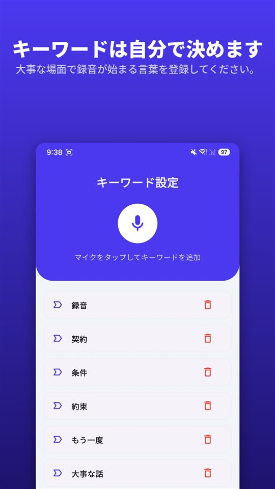

電話の相手が大事なことを話し始めました。iPhoneの画面には録音のボタンがあります。押していいのか、押したら相手に分かるのか、迷います。

結論から言うと、**押せますし、相手には分かります。** iOS 18からiPhoneの電話アプリに通話録音が入り、録音を始めると双方に録音中であることが音声で知らされます。

iPhoneの通話録音は隠すための機能ではなく、知らせたうえで残すための機能です。そして日本では使えますが、EUとトルコでは使えません。

## 3つの方法を1つの表で

| 方法 | 使える場所 | 相手への通知 | 保存先 |
|---|---|---|---|
| iPhone標準の通話録音(iOS 18以降) | 日本を含むほとんどの地域。EU・トルコなど19か所を除く | 双方に音声で通知、通話中に定期的に繰り返し | メモアプリの「通話録音」フォルダ |
| 3者通話方式の録音アプリ | 通信事業者の3者通話対応が必要、多くは有料 | アプリによって異なる | アプリ提供会社のサーバー |
| スピーカーにして別の機器で録音 | どこでも | 自動の通知なし | 録音した機器 |

2026年11月時点のアップル公式の案内に基づいています。対応地域は変わることがあるので、アップルの「iOSとiPadOSで利用できる機能」のページで確認するのが確実です。

## iPhone標準の通話録音の使い方

1. **電話アプリ**で電話をかけます。
2. 通話中に画面のボタンをタップしてから、**「通話録音」**をタップします。
3. 通話が録音されることが、音声で双方に知らされます。
4. 止めるときはもう一度タップするか、電話を切ります。
5. 録音は**メモアプリの「通話録音」フォルダ**に自動で保存されます。「保存された通話を表示」をタップするとメモアプリで開きます。

アップルの案内にはいくつか条件も書かれています。録音できるのは**1対1の通話**で、通常の電話だけでなく**FaceTimeオーディオ通話**も録音できます。録音ファイルはメモアプリからほかの場所に保存したり共有したりできます。

## 文字起こしと要約は言語によって

**文字起こし**は一部の地域と言語でのみ表示されます。アップルが挙げる通話の文字起こしの対応言語は、英語(米国・英国・カナダ・オーストラリア・インド・ニュージーランド・シンガポール)、**日本語(日本)**、韓国語(韓国)、中国語(中国本土・台湾)、広東語(香港)、ポルトガル語(ブラジル)、スペイン語(メキシコ・米国)です。文字起こしでは発言ごとに話した人が区別され、文をタップするとその部分から聞き直せます。

**要約**はApple Intelligenceが有効な機器で表示されます。対象はiPhone 15 Pro、iPhone 15 Pro Max、iPhone 16以降のモデルで、日本語もApple Intelligenceの対応言語です。

アップルは、文字起こしが会話を完全に再現しているとは限らないので、頼る前に正確さを確認するよう添えています。大事な通話なら録音そのものも聞き直すのが確実です。

## 相手に録音のアナウンスが流れる理由

いちばん多く検索されるのは「相手に知られずに録音できるか」です。アップルの答えははっきりしています。

- 録音を始めると、**双方に**音声で通知されます。
- その通知は**通話中に定期的に繰り返され**ます。
- アップルの案内文書には、この音声通知をオフにする設定は記載されていません。
- アップルは、録音を始める前に**相手が録音に同意しているか確認する**よう書いています。

日本の法律だけを見れば、この通知は必須ではありません。日本には秘密録音そのものを直接禁じる規定がなく、自分が参加している会話を録音することは原則として違法ではないとされています。それでもアップルが通知を入れているのは、同じ機能を多くの国で提供しているからです。通話の参加者全員の同意がなければ録音できない地域があり、**全員に聞こえるアナウンスは、その要件を機能の中で満たす仕組み**です。AndroidのGoogle電話アプリも同じ方式をとっています。

逆に言えば、この通知は録音する側にも役に立ちます。アナウンスのあとも続いた会話には、**双方が録音を知ったうえで話した**ことが録音の中に一緒に残ります。

## 使えない国と地域

アップルが2026年11月時点で通話録音を利用できないとしているのは、次の19か所です。

**アゼルバイジャン、バーレーン、エジプト、欧州連合、イラン、イラク、ヨルダン、クウェート、モロッコ、ナイジェリア、オマーン、パキスタン、カタール、ロシア、サウジアラビア、南アフリカ、トルコ、アラブ首長国連邦、イエメン。**

日本、米国、英国、韓国、カナダ、オーストラリア、インド、ブラジルはこの一覧にありません。一方で、ドイツ・フランス・イタリア・スペインなど**EU加盟国はすべて含まれます。** ヨーロッパにいる家族や取引先と電話する場合、相手のiPhoneには同じボタンがないことがあります。

## 録音アプリとスピーカー、ほかの2つの方法

**3者通話方式の録音アプリ。** iPhone向けの通話録音アプリの多くは、**アプリ提供会社の録音回線を呼び出して3者通話に合流させる**方式で動きます。録音はスマートフォンではなくその会社のサーバーで行われ、通信事業者が3者通話に対応している必要があり、ほとんどが有料です。アップルは、こうした他社製アプリが**警告なしに通話を録音する場合がある**と案内しています。

**スピーカーにして別の機器で録音。** 通話回線ではなく部屋の音を録るので、どこでも使えます。その代わり音質が落ち、周りの雑音が入り、近くの人に通話が聞こえます。雑音はあとから取り除けます。方法は[録音の雑音を消す方法、Androidでできる4つのやり方](/blog/ja/remove-background-noise/)にあります。

どちらの方法でも**法律は変わりません。** 録音の道具が変わっても、同意についてのルールは同じです。日本で当事者による録音がどう扱われるかは[日本には「盗聴罪」がありません](/blog/ja/recording-consent-law/)にまとめてあります。日本以外の国の法律はこの記事では扱っていません。

## 対面の会話にはボタンを押す間がありません

通話の録音はボタンが画面にあるので押せば済みます。対面の会話は違います。話が荒れた瞬間にスマートフォンを取り出し、ロックを解除して録音アプリを開くあいだに、いちばん大事な言葉は過ぎてしまいます。

[TalkSafe](https://hcompany-kr.github.io/talksafe/ja/)はその部分のためのアプリです。**TalkSafeは通話録音アプリではありません。** あらかじめ決めておいた言葉が聞こえると録音を始めるAndroid・iPhoneの録音アプリで、画面がロックされた状態でも動作し、録音が始まると**その直前30秒**もあわせて保存します。キーワードは話す人に関係なく検知されるので、相手が言いそうな言葉を設定しておくこともできます。

<figure class="shot"><figcaption>キーワード設定画面。複数登録でき、どれか一つが検知されれば録音が始まります。</figcaption></figure>

iPhoneで使うときに一つだけ覚えておいてください。**検知中にアプリを完全に終了すると検知が止まり、検知を再開するよう促す通知が表示されます。** アプリスイッチャーでTalkSafeを上にスワイプして閉じなければ、聞き続けます。

## まとめ

- iPhoneの通話録音は**iOS 18から電話アプリに標準で**入っています。通話中にボタンをタップし、「通話録音」を選びます。
- 録音を始めると**双方に音声で通知され**、通知は通話中に繰り返されます。
- 録音は**メモアプリの「通話録音」フォルダ**に保存され、日本語の文字起こしとApple Intelligenceの要約が使えます。
- **日本では使えますが、EU・トルコなど19か所では使えません。**
- どの道具を使っても、自分が参加していない通話を録音してよいことにはなりません。

Androidで通話録音アプリが動かなくなった理由と、標準の電話アプリで録音できる機種については[通話録音アプリが動かなくなった理由と、それでも残っている方法](/blog/ja/call-recording-android/)にあります。

## 出典

- [iPhoneで通話を録音して文字に起こす(Appleサポート)](https://support.apple.com/ja-jp/guide/iphone/iph57c6590e9/ios)
- [Record and transcribe a call on iPhone, Personal Safety User Guide (Apple)](https://support.apple.com/guide/personal-safety/record-and-transcribe-a-call-on-iphone-ipsfa513e1a6/web)
- [How to record a call on iPhone and iPad (Apple)](https://support.apple.com/en-us/121583)
- [iOS and iPadOS Feature Availability: Phone (Apple)](https://www.apple.com/ios/feature-availability/#phone-call-recording)

対応地域と言語は2026年11月時点のアップルの案内に基づいており、変わることがあります。この記事は一般的な情報であり、法的助言ではありません。具体的な事案は弁護士にご相談ください。

