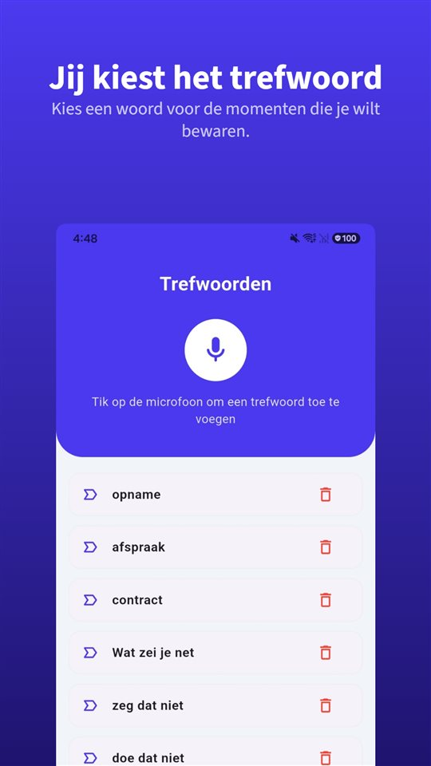

Iemand zegt aan de telefoon iets belangrijks. Je zoekt op je iPhone een opnameknop en vindt er geen, terwijl handleidingen online hem beschrijven.

De knop bestaat, maar niet hier. **Sinds iOS 18 kan de Telefoon-app van de iPhone gesprekken opnemen**, en bij de start horen beide kanten een melding. **In de Europese Unie biedt Apple de functie niet aan**, dus ook niet in Nederland en België.

Gespreksopname op de iPhone is niet gemaakt om te verbergen: ze kondigt zich aan en legt vast. In Nederland en België ontbreekt ze; buiten de EU is ze er meestal wel.

## Beschikbaarheid en recht in het Nederlandse taalgebied

| Land | Gespreksopname op de iPhone | Eigen gesprek opnemen zonder toestemming | Grondslag |
|---|---|---|---|
| Nederland | Niet beschikbaar (EU) | Toegestaan | Art. 139a, 139b, 139c Sr |
| België | Niet beschikbaar (EU) | Geen misdrijf (Cassatie 2015) | Art. 314bis Sw. |
| Suriname | Niet op Apples uitzonderingslijst | Toegestaan | Art. 187d WvSr |
| Aruba | Niet apart genoemd door Apple, niet bevestigd | Toegestaan | Art. 2:71 WvSr |
| Curaçao | Niet apart genoemd door Apple, niet bevestigd | Toegestaan | Art. 2:71 WvSr |
| Sint Maarten | Niet apart genoemd door Apple, niet bevestigd | Toegestaan | Art. 2:71 WvSr |

De beschikbaarheid volgt Apples documentatie van november 2026 en kan veranderen; Apples pagina over beschikbare features van iOS en iPadOS is leidend. Aruba, Curaçao en Sint Maarten zijn geen lid van de EU, maar Apple noemt ze niet apart, dus we laten dat open. Caribisch Nederland (Bonaire, Sint Eustatius en Saba) is hier niet behandeld. Het recht staat uitgebreider in [Mag je een gesprek stiekem opnemen? In Nederland en België wel, als je zelf meepraat](/blog/nl/gesprek-opnemen/).

## Drie manieren in één tabel

| Manier | Waar het werkt | Krijgt de ander een melding? | Waar de opname staat |
|---|---|---|---|
| Ingebouwde gespreksopname (iOS 18 of nieuwer) | Het grootste deel van de wereld; niet in de EU en 18 andere plaatsen | Audiomelding voor beiden, regelmatig herhaald | Map 'Gespreksopnamen' in Notities |
| App met drieweggesprek | Provider moet drieweggesprekken ondersteunen; meestal betaald | Verschilt per app | Servers van het app-bedrijf |
| Luidspreker, de ruimte opgenomen (tweede toestel of TalkSafe op dezelfde iPhone) | Overal | Geen automatische melding | Het toestel dat opneemt |

## Zo werkt de ingebouwde gespreksopname

1. Bel vanuit de **Telefoon-app**.
2. Tik tijdens het gesprek op de knop in het belscherm en daarna op **'Gespreksopname'**.
3. Beide gesprekspartners horen een audiomelding dat het gesprek wordt opgenomen.
4. Om te stoppen tik je nog eens of hang je gewoon op.
5. De opname wordt automatisch bewaard in de map **'Gespreksopnamen' in de Notities-app**. Tik op **'Bekijk bewaard gesprek'** om hem daar te openen.

Apple noemt een paar voorwaarden. Opnemen kan **als je met één andere persoon belt**, en de functie geldt ook voor **FaceTime-audiogesprekken**, niet alleen voor gewone telefoongesprekken. Vanuit Notities kun je het audiobestand ergens anders bewaren of delen.

Een **transcript** verschijnt alleen in bepaalde regio's en talen: Engels (VS, VK, Canada, Australië, India, Nieuw-Zeeland, Singapore), Japans, Koreaans, Mandarijn (China, Taiwan), Kantonees (Hongkong), Portugees (Brazilië) en Spaans (Mexico, VS). **Nederlands staat er niet bij.** Een **samenvatting** maakt Apple Intelligence op de iPhone 15 Pro, iPhone 15 Pro Max en iPhone 16 of nieuwer.

## Waarom de ander de melding hoort

De vraag die het meest gezocht wordt: kan het zonder dat de ander het weet? Apples antwoord is duidelijk.

- Bij de start horen **beide** kanten een audiomelding.
- De melding wordt tijdens het gesprek **regelmatig herhaald**.
- Apples documentatie beschrijft geen instelling om haar uit te zetten.
- Apple vraagt om **vooraf na te gaan of de ander het goed vindt** dat het gesprek wordt opgenomen.

Nederlands recht eist die melding niet van een deelnemer. Ze is er omdat dezelfde functie in veel landen wordt verkocht. Waar alle deelnemers moeten instemmen voordat een gesprek mag worden opgenomen, is een melding die **iedereen hoort** de manier waarop de functie daar zelf al aan voldoet. De Telefoon-app van Google op Android doet hetzelfde.

De melding helpt ook wie opneemt. Een gesprek dat na de melding doorgaat, bevat zelf het bewijs dat **beide kanten wisten dat er werd opgenomen**.

## Wat er in Nederland en België overblijft

**Apps met een drieweggesprek.** De meeste apps om gesprekken op te nemen op de iPhone werken door **een opnamelijn van het bedrijf te bellen en die samen te voegen tot een drieweggesprek.** De opname gebeurt op de servers van het bedrijf, niet op de telefoon; je provider moet drieweggesprekken ondersteunen, en de meeste diensten zijn betaald. Apple waarschuwt dat zulke apps van derden **een gesprek zonder waarschuwing kunnen opnemen.**

**Luidspreker, met de ruimte opgenomen.** Je neemt de ruimte op, niet de lijn, dus het werkt overal. De prijs: minder geluidskwaliteit, achtergrondgeluid, en wie in de buurt is hoort mee. Achtergrondgeluid kun je achteraf weghalen; hoe staat in [Achtergrondgeluid uit een spraakopname halen op Android](/blog/nl/remove-background-noise/). Ook TalkSafe kun je zo gebruiken. Staat het gesprek op de luidspreker, dan hoort TalkSafe op dezelfde iPhone ook de stem uit de luidspreker en begint met opnemen zodra hij je trefwoord herkent.

**Het gereedschap verandert het recht niet.** In Nederland en België mag je je eigen gesprek opnemen; een gesprek van anderen opnemen waaraan je niet deelneemt is strafbaar, met welk toestel of welke app ook.

## Een gesprek in persoon heeft geen knop

Bij een telefoongesprek staat de knop op het scherm, waar de functie bestaat. In een gesprek in persoon niet. Tegen de tijd dat je telefoon uit je zak is, ontgrendeld en een opname-app open staat, is de zin die ertoe deed al voorbij.

Daarvoor is [TalkSafe](https://hcompany-kr.github.io/talksafe/nl/). **TalkSafe is geen app om telefoongesprekken op te nemen.** Het is een opname-app voor Android en iPhone die start zodra hij een **vooraf gekozen woord** hoort, werkt met een **vergrendeld scherm** en ook de **30 seconden vóór de start** bewaart. Het trefwoord is niet aan een spreker gebonden; het kan dus ook een woord zijn dat de ander zal zeggen.

Wie liever eerst vraagt, kan de toestemming meteen mee opnemen. Stel een woord uit je vraag in, bijvoorbeeld **„opnemen”**. „Mag ik dit gesprek opnemen?” start de opname, en het antwoord staat in het bestand.

<figure class="shot"><figcaption>Trefwoordinstellingen. Je kunt meerdere woorden instellen; het is genoeg dat er één herkend wordt.</figcaption></figure>

Eén ding geldt alleen op de iPhone: **als je de app helemaal afsluit terwijl de detectie aanstaat, stopt de detectie en verschijnt een melding die vraagt haar opnieuw te starten.** Zolang je TalkSafe niet omhoog wegveegt in de appkiezer, blijft hij luisteren.

## Kort gezegd

- Gespreksopname zit **sinds iOS 18 in de Telefoon-app**: tijdens het gesprek op de knop, dan 'Gespreksopname'.
- **Beide kanten horen een melding**, die tijdens het gesprek terugkomt.
- Opnamen komen in de map **'Gespreksopnamen' in Notities**; Nederlands is geen transcriptietaal.
- **In Nederland, België en de rest van de EU is de functie niet beschikbaar**; Suriname staat niet op Apples uitzonderingslijst.
- Je eigen gesprek opnemen mag in Nederland en België; dat van anderen niet, met welk gereedschap ook.

Waarom apps om gesprekken op te nemen op Android niet meer werken, en welke telefoons nog standaard opnemen, staat in [Waarom apps om gesprekken op te nemen op Android niet meer werken, en wat nog wel werkt](/blog/nl/call-recording-android/).

## Bronnen

- [Een gesprek opnemen en transcriberen op de iPhone (Apple Support)](https://support.apple.com/nl-nl/guide/iphone/iph57c6590e9/ios)
- [Record and transcribe a call on iPhone, Personal Safety User Guide (Apple)](https://support.apple.com/guide/personal-safety/record-and-transcribe-a-call-on-iphone-ipsfa513e1a6/web)
- [How to record a call on iPhone and iPad (Apple)](https://support.apple.com/en-us/121583)
- [iOS and iPadOS Feature Availability: Phone (Apple)](https://www.apple.com/ios/feature-availability/#phone-call-recording)

De beschikbaarheid per land en taal volgt Apples documentatie van november 2026 en kan veranderen. Algemene informatie, geen juridisch advies. Raadpleeg voor een concreet geval een advocaat.

