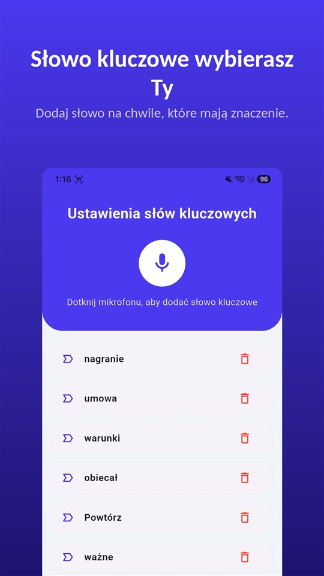

Ktoś przez telefon zaczyna mówić coś ważnego. Szukasz na iPhonie przycisku nagrywania i go nie ma, choć poradniki w sieci go opisują.

Przycisk istnieje, ale nie w Polsce. **Od iOS 18 aplikacja Telefon na iPhonie nagrywa połączenia**, a po starcie obie strony słyszą komunikat. **W Unii Europejskiej Apple tej funkcji nie udostępnia.** W Wielkiej Brytanii tak.

Nagrywanie połączeń na iPhonie nie służy do ukrywania: uprzedza i zostawia ślad. W Polsce, Niemczech i Holandii go nie ma; w Wielkiej Brytanii jest.

## Co obowiązuje w Polsce i tam, gdzie mieszka wielu Polaków

| Kraj | Nagrywanie połączeń w iPhonie | Nagranie własnej rozmowy bez zgody | Podstawa |
|---|---|---|---|
| Polska | Niedostępne (UE) | Co do zasady nie jest przestępstwem | Art. 267 § 3 Kodeksu karnego |
| Niemcy | Niedostępne (UE) | Przestępstwo, także dla uczestnika | § 201 StGB |
| Holandia | Niedostępne (UE) | Dozwolone dla uczestnika | Art. 139a i 139c kodeksu karnego |
| Wielka Brytania | Dostępne | Na własny użytek co do zasady nie jest przestępstwem | — |

Dostępność według dokumentacji Apple z listopada 2026 r.; może się zmienić, a rozstrzyga strona Apple o dostępności funkcji systemów iOS i iPadOS. Prawo w szczegółach opisuje [Czy można nagrywać rozmowę bez zgody? W Polsce uczestnik może, rozpowszechnianie to inna sprawa](/blog/pl/nagrywanie-rozmowy/). Irlandia i pozostałe kraje nie są tu omówione.

## Trzy sposoby w jednej tabeli

| Sposób | Gdzie działa | Czy rozmówca jest uprzedzany? | Gdzie trafia nagranie |
|---|---|---|---|
| Wbudowane nagrywanie w iPhonie (iOS 18 lub nowszy) | Większość świata, w tym Wielka Brytania; nie UE i 18 innych miejsc | Komunikat dla obu stron, powtarzany okresowo | Folder Nagrania połączeń w Notatkach |
| Aplikacja z połączeniem trójstronnym | Operator musi obsługiwać połączenia konferencyjne; zwykle płatna | Zależy od aplikacji | Serwery firmy od aplikacji |
| Głośnik, nagrywany drugim urządzeniem | Wszędzie | Brak automatycznego komunikatu | Urządzenie, które nagrywa |

## Jak działa wbudowane nagrywanie

1. Zadzwoń z aplikacji **Telefon**.
2. W trakcie połączenia stuknij przycisk na ekranie połączenia, a potem **Nagranie połączenia**.
3. Obaj uczestnicy słyszą komunikat dźwiękowy, że połączenie jest nagrywane.
4. Aby zatrzymać, stuknij ponownie albo po prostu się rozłącz.
5. Nagranie zapisuje się automatycznie w folderze **Nagrania połączeń w aplikacji Notatki**. Stuknij **Wyświetl zachowane połączenie**, aby je tam otworzyć.

Apple podaje kilka warunków. Nagrywać można **rozmowę z jedną osobą**, a funkcja obejmuje też **połączenia audio FaceTime**, nie tylko zwykłe rozmowy. Z Notatek plik audio można zapisać gdzie indziej albo udostępnić.

**Transkrypcja** pojawia się tylko w wybranych regionach i językach: angielski (USA, Wielka Brytania, Kanada, Australia, Indie, Nowa Zelandia, Singapur), japoński, koreański, mandaryński (Chiny kontynentalne, Tajwan), kantoński (Hongkong), portugalski (Brazylia) i hiszpański (Meksyk, USA). **Polskiego nie ma na tej liście.** **Podsumowanie** tworzy Apple Intelligence na iPhonie 15 Pro, iPhonie 15 Pro Max i iPhonie 16 lub nowszym.

## Dlaczego rozmówca słyszy komunikat

Najczęściej szukane pytanie brzmi: czy da się nagrać tak, żeby druga strona nie wiedziała. Odpowiedź Apple jest jasna.

- Gdy nagrywanie się zaczyna, **obie strony** słyszą komunikat.
- Komunikat **powtarza się okresowo** w trakcie rozmowy.
- Dokumentacja Apple nie opisuje żadnego ustawienia, które by go wyłączało.
- Apple prosi, by przed nagrywaniem **upewnić się, że rozmówca się zgadza**.

Powód: ta sama funkcja jest sprzedawana w wielu krajach. Tam, gdzie na nagranie rozmowy muszą zgodzić się wszyscy uczestnicy, komunikat, który **słyszą wszyscy**, spełnia ten wymóg już w samej funkcji. Aplikacja Telefon Google na Androidzie robi to samo.

Komunikat przydaje się też nagrywającemu. Rozmowa, która toczy się dalej po nim, sama w sobie zawiera dowód, że **obie strony wiedziały o nagrywaniu**.

## Co zostaje w Polsce i reszcie UE

**Aplikacje z połączeniem trójstronnym.** Większość aplikacji do nagrywania połączeń na iPhonie działa tak, że **dzwoni się na linię nagrywającą firmy i łączy ją z rozmową w połączenie trójstronne.** Nagranie powstaje na serwerach firmy, nie w telefonie; operator musi obsługiwać połączenia konferencyjne, a większość takich usług jest płatna. Apple ostrzega, że takie aplikacje innych firm **mogą nagrywać połączenie bez żadnego ostrzeżenia.**

**Głośnik, nagrywany drugim urządzeniem.** Nagrywa się pomieszczenie, a nie linię, więc działa wszędzie. W zamian spada jakość, wchodzi hałas w tle, a osoby w pobliżu słyszą rozmowę. Hałas można usunąć później; sposoby są w [Jak usunąć hałas w tle z nagrania głosu na Androidzie](/blog/pl/remove-background-noise/).

**Prawo nie zmienia się razem z narzędziem.** W Polsce uczestnik może co do zasady nagrać własną rozmowę; w Niemczech jest to przestępstwo bez zgody, niezależnie od urządzenia czy aplikacji.

## Rozmowa twarzą w twarz nie ma przycisku

W połączeniu przycisk jest na ekranie, tam gdzie funkcja działa. W rozmowie twarzą w twarz nie. Zanim wyjmiesz telefon, odblokujesz go i otworzysz dyktafon, najważniejsze zdanie już padło.

Na ten moment jest [TalkSafe](https://hcompany-kr.github.io/talksafe/pl/). **TalkSafe nie jest aplikacją do nagrywania połączeń.** To aplikacja do nagrywania na Androida i iPhone'a, która startuje, gdy usłyszy **wybrane wcześniej słowo**, działa przy **zablokowanym ekranie** i zapisuje też **30 sekund sprzed startu**. Słowo kluczowe nie jest przypisane do mówiącego, więc może to być słowo, które powie druga osoba.

Jeśli rozmawiasz z kimś w Niemczech albo po prostu wolisz zapytać, słowo kluczowe może nagrać także zgodę. Ustaw słowo z twojego pytania, na przykład **„nagrać”**. „Mogę nagrać tę rozmowę?” uruchamia nagrywanie, a odpowiedź jest w pliku.

<figure class="shot"><figcaption>Ustawienia słów kluczowych. Można zapisać kilka słów; wystarczy, że zostanie wykryte jedno z nich.</figcaption></figure>

Jedna rzecz dotyczy tylko iPhone'a: **jeśli całkowicie zamkniesz aplikację w trakcie wykrywania, wykrywanie się zatrzyma, a powiadomienie poprosi o ponowne jego włączenie.** Dopóki nie przesuniesz TalkSafe w górę w przełączniku aplikacji, nasłuchuje dalej.

## W skrócie

- Nagrywanie połączeń jest **wbudowane w aplikację Telefon od iOS 18**: w trakcie rozmowy przycisk, a potem Nagranie połączenia.
- **Obie strony słyszą komunikat**, który powtarza się w trakcie rozmowy.
- Nagrania trafiają do folderu **Nagrania połączeń w Notatkach**; polskiego nie ma wśród języków transkrypcji.
- **W Polsce, Niemczech, Holandii i reszcie UE funkcja jest niedostępna**; w Wielkiej Brytanii działa.
- W Polsce uczestnik może co do zasady nagrać własną rozmowę; w Niemczech bez zgody to przestępstwo.

Dlaczego aplikacje do nagrywania rozmów na Androidzie przestały działać i które telefony wciąż nagrywają fabrycznie, opisuje [Dlaczego aplikacje do nagrywania rozmów na Androidzie przestały działać i co nadal działa](/blog/pl/call-recording-android/).

## Źródła

- [Nagrywanie i transkrybowanie połączeń na iPhonie (Wsparcie Apple)](https://support.apple.com/pl-pl/guide/iphone/iph57c6590e9/ios)
- [Record and transcribe a call on iPhone, Personal Safety User Guide (Apple)](https://support.apple.com/guide/personal-safety/record-and-transcribe-a-call-on-iphone-ipsfa513e1a6/web)
- [How to record a call on iPhone and iPad (Apple)](https://support.apple.com/en-us/121583)
- [iOS and iPadOS Feature Availability: Phone (Apple)](https://www.apple.com/ios/feature-availability/#phone-call-recording)

Dostępność według krajów i języków odpowiada dokumentacji Apple z listopada 2026 r. i może się zmienić. Informacje ogólne, nie porada prawna. W konkretnej sprawie skonsultuj się z prawnikiem.

