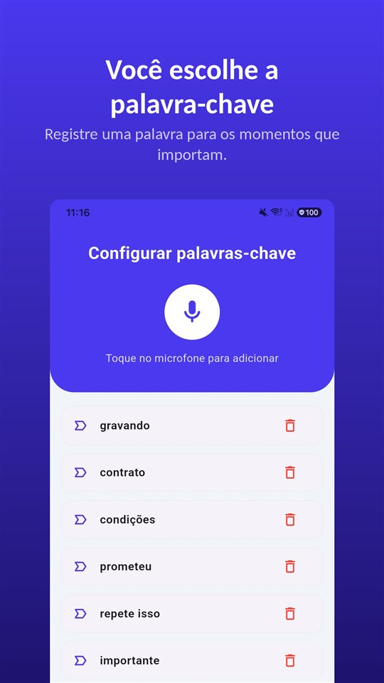

Do outro lado da linha, alguém começa a dizer uma coisa importante. Na tela do iPhone tem um botão para gravar. Bate a dúvida: pode apertar? A pessoa vai saber?

Resposta curta: **pode, e ela vai saber.** A gravação de ligações chegou ao app Telefone do iPhone com o iOS 18, e quando começa, os dois lados ouvem um aviso de que a ligação está sendo gravada.

A gravação de ligação do iPhone não foi feita para esconder: ela avisa e deixa registro. Funciona no Brasil, com transcrição em português, e não funciona em Portugal.

## O que vale no Brasil e em Portugal

| País | Gravação de ligação do iPhone | Gravar a própria ligação sem avisar | Base |
|---|---|---|---|
| Brasil | Disponível, com transcrição em português do Brasil | Permitido para quem participa da conversa | STF Tema 237; Lei 9.296/1996, art. 10-A |
| Portugal | Não disponível (União Europeia) | Crime, mesmo para quem participa | Art. 199.º do Código Penal |

A disponibilidade segue a documentação da Apple de novembro de 2026 e pode mudar; a página de disponibilidade de recursos do iOS e do iPadOS da Apple é a referência. Os outros países de língua portuguesa não foram pesquisados aqui.

## Três jeitos, uma tabela

| Jeito | Onde funciona | A outra pessoa é avisada? | Onde fica a gravação |
|---|---|---|---|
| Gravação embutida do iPhone (iOS 18 ou posterior) | A maior parte do mundo, Brasil incluído; não na União Europeia nem em outros 18 lugares | Aviso de áudio para os dois, repetido periodicamente | Pasta Gravações de Ligações do Notas |
| App que grava com chamada a três | A operadora precisa permitir chamada em conferência; quase sempre pago | Depende do app | Os servidores da empresa do app |
| Viva-voz gravado com outro aparelho | Em qualquer lugar | Sem aviso automático | O aparelho que gravou |

## Como usar a gravação embutida

1. Faça uma ligação pelo app **Telefone**.
2. Durante a ligação, toque no botão da tela da ligação e depois em **Gravação de Ligação**.
3. Os dois participantes ouvem um aviso de áudio de que a ligação está sendo gravada.
4. Para parar, toque de novo ou simplesmente desligue.
5. A gravação é salva automaticamente na pasta **Gravações de Ligações do app Notas**. Toque em **“Veja a ligação salva”** para abrir lá.

A Apple acrescenta algumas condições. Dá para gravar **quando você está falando com uma única pessoa**, e a função vale também para **chamadas de áudio do FaceTime**, não só para ligações telefônicas. Pelo Notas, o arquivo de áudio pode ser salvo em outro lugar ou compartilhado.

## Transcrição e resumo em português

A **transcrição** aparece só em algumas regiões e idiomas, e o **português do Brasil está entre eles**. A lista da Apple inclui inglês (EUA, Reino Unido, Canadá, Austrália, Índia, Nova Zelândia, Singapura), japonês, coreano, mandarim (China continental, Taiwan), cantonês (Hong Kong), português (Brasil) e espanhol (México, EUA). Na transcrição, cada frase aparece com quem a disse, e tocar num trecho toca o áudio a partir dali.

O **resumo** é feito pela Apple Intelligence, no iPhone 15 Pro, no iPhone 15 Pro Max e no iPhone 16 ou posterior.

A Apple lembra que é preciso conferir a exatidão de uma transcrição antes de confiar nela, porque ela pode não representar a conversa com perfeição. Se a ligação importa, ouça também a gravação.

## Por que a outra pessoa ouve o aviso

A pergunta mais buscada é se dá para gravar sem a outra pessoa saber. A resposta da Apple é clara.

- Quando a gravação começa, **os dois** ouvem um aviso de áudio.
- O aviso **se repete periodicamente** durante a ligação.
- A documentação da Apple não descreve nenhum ajuste para desligar o aviso.
- A Apple pede para **verificar se a outra pessoa aceita ser gravada** antes de começar.

No Brasil, a lei não exige esse aviso de quem participa da conversa. Ele existe porque a mesma função é vendida em muitos países. Onde todos os participantes precisam concordar antes de uma ligação ser gravada, um aviso que **todos ouvem** é o jeito de a função cumprir essa exigência por construção. O app Telefone do Google no Android faz o mesmo.

E o aviso também ajuda quem grava. Uma conversa que continua depois dele carrega dentro dela a prova de que **os dois lados sabiam que estavam sendo gravados**.

## Onde não está disponível

Em novembro de 2026, a Apple diz que a gravação de chamadas não está disponível nestes 19 lugares:

**Azerbaijão, Bahrein, Egito, União Europeia, Irã, Iraque, Jordânia, Kuwait, Marrocos, Nigéria, Omã, Paquistão, Catar, Rússia, Arábia Saudita, África do Sul, Turquia, Emirados Árabes Unidos e Iêmen.**

**O Brasil não está na lista; Portugal, como membro da União Europeia, está.** Se você liga para família ou clientes em Portugal, o iPhone do outro lado pode não ter o mesmo botão.

## Apps e viva-voz: os outros dois caminhos

**Apps que gravam com chamada a três.** A maioria dos apps de gravar ligação no iPhone funciona **ligando para uma linha de gravação da empresa e juntando tudo numa chamada a três.** A gravação acontece nos servidores da empresa, não no celular; a operadora precisa permitir chamada em conferência, e quase todos são pagos. A Apple avisa que esses apps de terceiros **podem gravar uma ligação sem dar aviso.**

**Viva-voz gravado com outro aparelho.** Grava o som do ambiente, não a linha, então funciona em qualquer lugar. Em troca, a qualidade cai, entra ruído de fundo e quem está perto ouve a ligação. O ruído dá para tirar depois; os jeitos estão em [Como tirar o ruído de fundo de uma gravação de voz no Android](/blog/pt-br/remove-background-noise/).

Em qualquer caso, **a lei não muda com a ferramenta.** No Brasil, quem participa da conversa pode gravar; o que a lei pune é a interceptação de conversa alheia. Em Portugal, gravar sem consentimento é crime mesmo para quem participa. O quadro completo está em [Gravar conversa sem a outra pessoa saber é crime? No Brasil e em Portugal, a resposta é oposta](/blog/pt-br/gravar-conversa/).

## Conversa presencial não tem botão

Numa ligação, o botão está na tela. Numa conversa cara a cara, não. Entre tirar o celular do bolso, desbloquear e abrir um gravador, a frase que importava já passou.

É para esse momento que existe o [TalkSafe](https://hcompany-kr.github.io/talksafe/pt-br/). **O TalkSafe não é um app de gravar ligação.** É um app de gravação de voz para Android e iPhone que começa quando ouve uma **palavra escolhida por você**, funciona com a **tela bloqueada** e salva também os **30 segundos anteriores ao início**. A palavra-chave não está presa a quem fala, então dá para escolher uma que a outra pessoa provavelmente vai dizer.

<figure class="shot"><figcaption>Configuração de palavras-chave. Dá para cadastrar várias; basta uma delas ser detectada para a gravação começar.</figcaption></figure>

Uma coisa para saber no iPhone: **se você fechar o app por completo enquanto a detecção está ativa, a detecção para e aparece uma notificação pedindo para reiniciá-la.** Enquanto você não deslizar o TalkSafe para cima no seletor de apps, ele continua ouvindo.

## Resumindo

- A gravação de ligação do iPhone **vem no app Telefone desde o iOS 18**: durante a ligação, toque no botão e depois em Gravação de Ligação.
- **Os dois ouvem um aviso**, que se repete durante a ligação.
- As gravações vão para a pasta **Gravações de Ligações do Notas**, com transcrição em português do Brasil e resumo pela Apple Intelligence.
- **Funciona no Brasil e não funciona em Portugal** nem no resto da União Europeia.
- Com qualquer ferramenta, gravar a conversa dos outros é interceptação.

Por que os apps de gravar ligação pararam de funcionar no Android, e quais celulares ainda gravam de fábrica, está em [Por que os apps de gravar ligação pararam de funcionar no Android, e o que ainda funciona](/blog/pt-br/call-recording-android/).

## Fontes

- [Grave e transcreva uma ligação no iPhone (Suporte da Apple)](https://support.apple.com/pt-br/guide/iphone/iph57c6590e9/ios)
- [Record and transcribe a call on iPhone, Personal Safety User Guide (Apple)](https://support.apple.com/guide/personal-safety/record-and-transcribe-a-call-on-iphone-ipsfa513e1a6/web)
- [How to record a call on iPhone and iPad (Apple)](https://support.apple.com/en-us/121583)
- [iOS and iPadOS Feature Availability: Phone (Apple)](https://www.apple.com/ios/feature-availability/#phone-call-recording)

A disponibilidade por país e idioma segue a documentação da Apple de novembro de 2026 e pode mudar. Informação geral, não é aconselhamento jurídico. Para um caso concreto, consulte um advogado.

