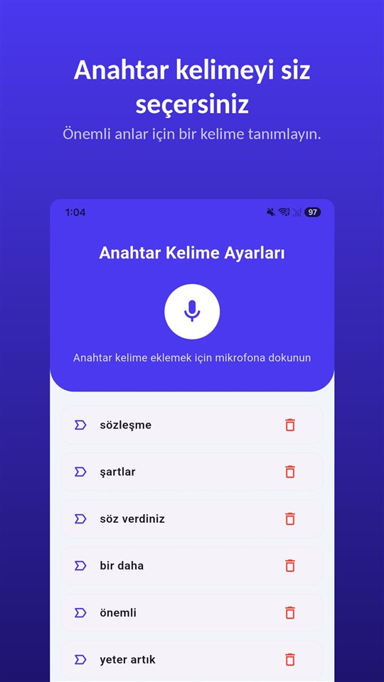

Telefonda biri önemli bir şey söylemeye başlıyor. iPhone'da bir kayıt düğmesi arıyorsunuz ama bulamıyorsunuz; internetteki anlatımlarda ise var.

Düğme var, ama Türkiye'de değil. **iOS 18'den beri iPhone'un Telefon uygulaması aramaları kaydedebiliyor** ve kayıt başlayınca iki taraf da bir uyarı duyuyor. **Apple bu özelliği Türkiye'de ve Avrupa Birliği'nde sunmuyor.** İsviçre'de sunuyor.

iPhone'un arama kaydı gizlemek için değil: haber veriyor ve iz bırakıyor. Türkiye'de, Almanya'da ve Fransa'da yok; İsviçre'de var.

## Türkiye ve Avrupa'daki Türkçe konuşanlar için durum

| Ülke | iPhone arama kaydı | Kendi görüşmenizi rıza olmadan kaydetmek | Dayanak |
|---|---|---|---|
| Türkiye | Yok | Suç | TCK 133/2 |
| Almanya | Yok (AB) | Suç, katılımcı için de | Ceza Kanunu § 201 |
| Avusturya | Yok (AB) | 1. fıkraya girmez; kaydı rıza olmadan üçüncü kişiye vermek suç | Ceza Kanunu § 120 |
| İsviçre | Var | Şikâyet üzerine suç; ticari siparişler ve rezervasyonlar hariç | Ceza Kanunu md. 179ter, 179quinquies |
| Fransa | Yok (AB) | Suç, katılımcı için de | Ceza Kanunu md. 226-1 |
| Belçika | Yok (AB) | Katılımcı için suç değil; zarar verme amacıyla kullanmak suç | Ceza Kanunu md. 314bis, Yargıtay 2015 |
| Hollanda | Yok (AB) | Katılımcı için suç değil | Ceza Kanunu md. 139a, 139c |

Kullanılabilirlik, Apple'ın Kasım 2026 tarihli belgelerine göredir ve değişebilir; esas alınacak yer Apple'ın iOS ve iPadOS özelliklerinin kullanılabilirliği sayfasıdır. Türkiye'deki kuralın ayrıntısı [Gizli ses kaydı almak suç mu? Türkiye'de kendi konuşmanızı kaydetmek de suç](/blog/tr/ses-kaydi-suc-mu/) yazısında.

## Üç yol, bir tablo

| Yol | Nerede çalışır | Karşı taraf haberdar edilir mi? | Kayıt nerede durur |
|---|---|---|---|
| iPhone'un yerleşik arama kaydı (iOS 18 ve sonrası) | Dünyanın çoğu yeri, İsviçre dahil; Türkiye, AB ve 17 yer daha hariç | İki tarafa sesli uyarı, belirli aralıklarla tekrar | Notlar'daki Arama Kayıtları klasörü |
| Üçlü görüşmeyle kaydeden uygulama | Operatörün üçlü görüşmeye izin vermesi gerekir; çoğu ücretli | Uygulamaya göre değişir | Uygulama şirketinin sunucuları |
| Hoparlöre alıp odayı kaydetmek (başka bir cihaz ya da aynı iPhone'daki TalkSafe) | Her yerde | Otomatik uyarı yok | Kaydı yapan cihaz |

## Yerleşik arama kaydı nasıl çalışır

1. **Telefon** uygulamasından bir arama yapın.
2. Arama sırasında arama ekranındaki düğmeye, ardından **Arama Kaydı'na** dokunun.
3. İki katılımcı da aramanın kaydedildiğini belirten sesli bir uyarı duyar.
4. Durdurmak için yeniden dokunun veya telefonu kapatın.
5. Kayıt otomatik olarak **Notlar uygulamasındaki Arama Kayıtları klasörüne** kaydedilir. Orada açmak için **Kaydedilen Aramayı Görüntüle'ye** dokunun.

Apple birkaç koşul da belirtiyor. Kayıt **tek bir kişiyle konuşurken** yapılabiliyor ve normal telefon aramalarının yanında **FaceTime sesli aramalarını** da kapsıyor. Ses dosyası Notlar'dan başka bir yere kaydedilebiliyor veya paylaşılabiliyor.

**Döküm** yalnızca belirli bölgelerde ve dillerde çıkıyor: İngilizce (ABD, Birleşik Krallık, Kanada, Avustralya, Hindistan, Yeni Zelanda, Singapur), Japonca, Korece, Mandarin Çincesi (Çin anakarası, Tayvan), Kantonca (Hong Kong), Portekizce (Brezilya) ve İspanyolca (Meksika, ABD). **Türkçe bu listede yok.** **Özet** ise iPhone 15 Pro, iPhone 15 Pro Max ve iPhone 16 veya sonrasında Apple Intelligence ile oluşturuluyor.

## Karşı taraf uyarıyı neden duyuyor

En çok aranan soru, karşı taraf bilmeden kayıt yapılıp yapılamayacağı. Apple'ın cevabı açık.

- Kayıt başladığında **iki taraf da** sesli bir uyarı duyar.
- Uyarı görüşme boyunca **belirli aralıklarla tekrarlanır**.
- Apple'ın belgelerinde bu uyarıyı kapatan bir ayar anlatılmıyor.
- Apple, başlamadan önce **karşı tarafın kaydedilmeyi kabul ettiğinden emin olunmasını** istiyor.

Sebebi, aynı özelliğin birçok ülkede satılması. Bir görüşmenin kaydedilmesi için tüm katılımcıların rızasının gerektiği yerlerde, **herkesin duyduğu** bir uyarı, özelliğin bu şartı kendi içinde karşılama yoludur. Android'deki Google Telefon uygulaması da aynısını yapıyor.

Bu uyarı kaydı yapan için de işe yarar. Uyarıdan sonra devam eden bir konuşma, **iki tarafın da kaydedildiğini bildiğini** kendi içinde taşır.

## Türkiye'de ve AB'de geriye kalanlar

**Üçlü görüşmeyle kaydeden uygulamalar.** iPhone'daki arama kaydı uygulamalarının çoğu, **şirketin kayıt hattını arayıp onu üçlü görüşmede birleştirerek** çalışır. Kayıt telefonda değil şirketin sunucularında yapılır; operatörün üçlü görüşmeye izin vermesi gerekir ve çoğu ücretlidir. Apple, bu tür üçüncü taraf uygulamaların **bir aramayı uyarı vermeden kaydedebileceğini** belirtiyor.

**Hoparlöre alıp odayı kaydetmek.** Hat değil oda kaydedildiği için her yerde çalışır. Karşılığında ses kalitesi düşer, arka plan gürültüsü girer ve yakındakiler görüşmeyi duyar. Gürültü sonradan giderilebilir; yolları [Android'de bir ses kaydındaki arka plan gürültüsü nasıl giderilir](/blog/tr/remove-background-noise/) yazısında. TalkSafe da bu şekilde kullanılabilir. Arama hoparlördeyken aynı iPhone'daki TalkSafe hoparlörden gelen sesi de duyar ve anahtar kelimenizi algıladığında kayda başlar.

**Kanun araca göre değişmez.** Türkiye'de katıldığınız bir görüşmeyi diğer tarafın rızası olmadan kaydetmek, hangi cihaz ya da uygulamayla olursa olsun TCK 133/2'ye göre suçtur. Önce sorun.

## Yüz yüze konuşmanın düğmesi yok

Bir aramada, özelliğin olduğu yerlerde düğme ekrandadır. Yüz yüze bir konuşmada değil. Telefonu çıkarıp kilidini açana ve bir kayıt uygulaması açana kadar önemli cümle geçmiş olur.

[TalkSafe](https://hcompany-kr.github.io/talksafe/tr/) bu an için var. **TalkSafe bir arama kaydı uygulaması değildir.** **Önceden belirlediğiniz bir kelimeyi** duyduğunda başlayan, **ekran kilitliyken** çalışan ve **başlangıçtan önceki 30 saniyeyi** de saklayan, Android ve iPhone için bir ses kayıt uygulamasıdır. Anahtar kelime konuşan kişiye bağlı değildir; karşı tarafın söyleyeceği bir kelime de seçilebilir.

Rızasız kaydın suç olduğu Türkiye'de bu, sorunun kendisiyle iyi örtüşür: sorunuzdaki bir kelimeyi, örneğin **"kayıt"** kelimesini anahtar kelime yapın. "Bu konuşmayı kayıt altına alabilir miyim?" diye sorduğunuzda kayıt başlar ve cevap da dosyada olur.

<figure class="shot"><figcaption>Anahtar kelime ayarları. Birden fazla kelime kaydedebilirsiniz; herhangi birinin algılanması kaydı başlatır.</figcaption></figure>

iPhone'a özgü bir nokta: **algılama açıkken uygulamayı tamamen kapatırsanız algılama durur ve algılamayı yeniden başlatmanızı isteyen bir bildirim gelir.** TalkSafe'i uygulama değiştiricide yukarı kaydırıp kapatmadığınız sürece dinlemeye devam eder.

## Özet

- iPhone'un arama kaydı **iOS 18'den beri Telefon uygulamasında yerleşik**: arama sırasında düğmeye, sonra Arama Kaydı'na dokunulur.
- **İki taraf da bir uyarı duyar** ve uyarı görüşme boyunca tekrarlanır.
- Kayıtlar **Notlar'daki Arama Kayıtları klasörüne** gider; Türkçe döküm dilleri arasında değil.
- **Türkiye'de ve AB'de yok**, İsviçre'de var.
- Türkiye'de rızasız kayıt, hangi araçla olursa olsun suçtur.

Android'de arama kaydı uygulamalarının neden artık çalışmadığı ve hangi telefonların hâlâ fabrikadan kayıt yaptığı [Android'de arama kaydı uygulamaları neden artık çalışmıyor, ve hâlâ ne çalışıyor](/blog/tr/call-recording-android/) yazısında.

## Kaynaklar

- [iPhone'da aramanın kaydını yapma ve onu yazıya çevirme (Apple Destek)](https://support.apple.com/tr-tr/guide/iphone/iph57c6590e9/ios)
- [Record and transcribe a call on iPhone, Personal Safety User Guide (Apple)](https://support.apple.com/guide/personal-safety/record-and-transcribe-a-call-on-iphone-ipsfa513e1a6/web)
- [How to record a call on iPhone and iPad (Apple)](https://support.apple.com/en-us/121583)
- [iOS and iPadOS Feature Availability: Phone (Apple)](https://www.apple.com/ios/feature-availability/#phone-call-recording)

Ülke ve dil bazında kullanılabilirlik, Apple'ın Kasım 2026 tarihli belgelerine dayanır ve değişebilir. Genel bilgidir, hukuki danışmanlık değildir. Somut bir durum için bir avukata danışın.

