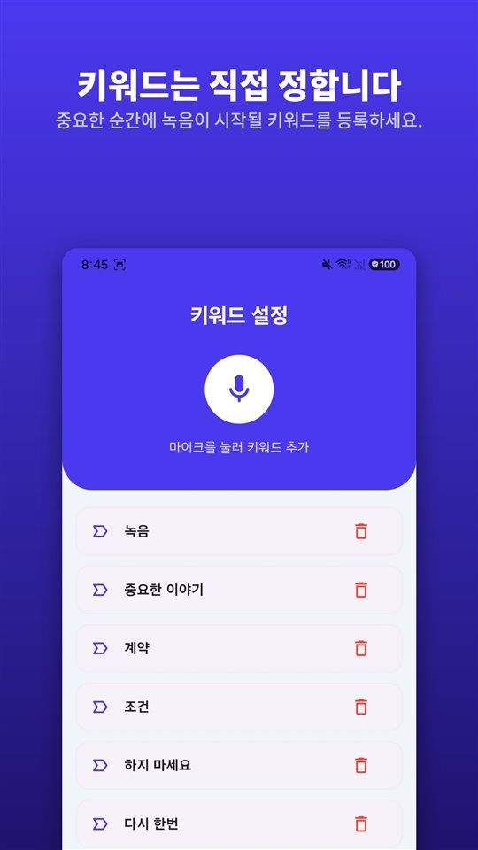

통화 중에 상대가 중요한 말을 꺼냅니다. 아이폰 화면을 보니 녹음 버튼이 있습니다. 눌러도 되는지, 누르면 상대가 아는지 망설여집니다.

결론부터 말하면 **누를 수 있고, 상대는 압니다.** iOS 18부터 아이폰 전화 앱에 통화 녹음이 들어왔고, 녹음을 시작하면 두 사람 모두 녹음 중이라는 안내 음성을 듣습니다.

아이폰 통화 녹음은 숨기는 기능이 아니라 알리고 남기는 기능입니다. 그리고 한국에서는 쓸 수 있지만, 유럽 연합과 튀르키예에서는 쓸 수 없습니다.

## 세 가지 방법을 한 표로

| 방법 | 쓸 수 있는 곳 | 상대에게 안내 | 저장되는 곳 |
|---|---|---|---|
| 아이폰 기본 통화 녹음 (iOS 18 이상) | 한국 포함 대부분 지역. EU·튀르키예 등 19곳 제외 | 두 사람 모두 음성 안내, 통화 중 주기적으로 반복 | 메모 앱 '통화 녹음' 폴더 |
| 3자 통화 방식의 녹음 앱 | 통신사가 3자 통화를 지원해야 함, 대개 유료 | 앱마다 다름 | 앱 회사의 서버 |
| 스피커폰으로 받고 다른 기기로 녹음 | 어디서나 | 자동 안내 없음 | 녹음한 기기 |

기준은 2026년 11월 애플 공식 안내입니다. 지원 지역은 바뀔 수 있으니 애플의 「iOS 및 iPadOS 기능 지원 여부」 페이지에서 한 번 더 확인하는 것이 확실합니다.

## 아이폰 기본 통화 녹음, 이렇게 씁니다

1. **전화 앱**에서 전화를 겁니다.
2. 통화 중에 화면의 버튼을 탭한 다음 **'통화 녹음'**을 탭합니다.
3. 두 사람 모두에게 통화가 녹음되고 있다는 음성 안내가 들립니다.
4. 멈출 때는 다시 탭하거나 그냥 전화를 끊습니다.
5. 녹음은 **메모 앱의 '통화 녹음' 폴더**에 자동으로 저장됩니다. '저장된 통화를 봅니다.'를 탭하면 메모 앱에서 바로 열립니다.

애플 안내에는 몇 가지 조건이 함께 적혀 있습니다. **한 명의 상대와 통화할 때만** 녹음할 수 있고, 일반 전화뿐 아니라 **FaceTime 오디오 통화**도 녹음할 수 있습니다. 녹음 파일은 메모 앱에서 다른 곳에 저장하거나 공유할 수 있습니다.

## 받아쓰기와 요약도 됩니다, 언어에 따라

**받아쓰기(전사문)**는 일부 지역과 언어에서만 나옵니다. 애플이 밝힌 통화 받아쓰기 지원 언어는 영어(미국·영국·캐나다·호주·인도·뉴질랜드·싱가포르), 일본어, **한국어(대한민국)**, 중국어(본토·대만), 광둥어(홍콩), 포르투갈어(브라질), 스페인어(멕시코·미국)입니다. 전사문에는 누가 어떤 말을 했는지가 구분되어 표시되고, 특정 문장을 눌러 그 부분부터 다시 들을 수 있습니다.

**요약**은 Apple Intelligence가 켜진 기기에서 나옵니다. iPhone 15 Pro, iPhone 15 Pro Max, iPhone 16 이후 모델이 대상이고, 한국어도 Apple Intelligence 지원 언어입니다.

애플은 전사문이 대화를 완벽하게 옮긴 것이 아닐 수 있으니 기대기 전에 정확한지 확인하라고 덧붙이고 있습니다. 중요한 통화라면 녹음 원본을 같이 들어보는 것이 맞습니다.

## 상대방에게 안내 음성이 나가는 이유

검색창에 가장 많이 들어오는 질문이 "상대방이 모르게 할 수 있나"입니다. 애플의 답은 분명합니다.

- 녹음을 시작하면 **두 사람 모두** 안내 음성을 듣습니다.
- 그 안내는 **통화 중에 주기적으로 다시** 나옵니다.
- 애플의 안내 문서에는 이 음성 안내를 끄는 설정이 나오지 않습니다.
- 애플은 녹음을 시작하기 전에 **상대가 녹음에 동의하는지 확인하라**고 적고 있습니다.

한국 법만 보면 이 안내가 꼭 필요한 것은 아닙니다. 통신비밀보호법은 대화 당사자가 녹음하는 것을 금지하지 않고, 미리 알릴 의무도 없습니다. 그런데도 애플이 안내를 넣은 것은 같은 기능을 여러 나라에서 팔기 때문입니다. 통화 참여자 전원의 동의가 있어야 녹음할 수 있는 지역이 있고, **양쪽 모두에게 들리는 안내 음성은 그 요건을 기능 안에서 해결하는 방식**입니다. 안드로이드의 구글 전화 앱도 같은 방식을 씁니다.

반대로 생각하면 이 안내는 녹음을 하는 사람에게도 도움이 됩니다. 안내를 듣고도 이어진 대화는 **양쪽이 녹음 사실을 알고 한 말**이라는 점이 녹음 안에 함께 남습니다.

## 안 되는 나라

애플이 2026년 11월 현재 통화 녹음을 지원하지 않는다고 밝힌 곳은 다음 19곳입니다.

**아제르바이잔, 바레인, 이집트, 유럽 연합, 이란, 이라크, 요르단, 쿠웨이트, 모로코, 나이지리아, 오만, 파키스탄, 카타르, 러시아, 사우디아라비아, 남아프리카, 튀르키예, 아랍에미리트, 예멘.**

한국, 미국, 일본, 영국, 캐나다, 호주, 인도, 브라질과 중남미는 이 목록에 없습니다. 반면 독일·프랑스·이탈리아·스페인·네덜란드·폴란드 같은 **EU 회원국은 전부 빠져 있습니다.** 해외에 사는 가족이나 거래처와 통화하는 분이라면, 상대 아이폰에는 같은 버튼이 없을 수 있다는 점을 알아두면 좋습니다.

## 녹음 앱과 스피커폰, 두 가지 다른 길

**3자 통화 방식의 녹음 앱.** 아이폰용 통화 녹음 앱은 대개 **앱 회사의 녹음 회선을 불러 3자 통화로 합치는** 방식으로 동작합니다. 녹음은 휴대폰이 아니라 그 회사 서버에서 이루어지고, 통신사가 3자 통화를 지원해야 하며, 대부분 유료입니다. 애플은 이런 서드파티 앱이 **경고 없이 통화를 녹음할 수 있다**고 안내합니다.

**스피커폰으로 받고 다른 기기로 녹음.** 통화선이 아니라 방 안의 소리를 녹음하는 방법이라 어디서나 됩니다. 대신 음질이 떨어지고, 주변 소음이 섞이고, 근처 사람에게 통화 내용이 들립니다. 소음은 나중에 걷어낼 수 있습니다. 방법은 [녹음 파일 잡음 제거, 안드로이드에서 하는 네 가지 방법](/blog/ko/remove-background-noise/)에 있습니다.

어느 쪽이든 **법은 같습니다.** 녹음 도구가 바뀐다고 동의 요건이 바뀌지 않습니다. 한국에서는 내가 참여한 통화를 녹음하는 것은 통신비밀보호법 위반이 아니지만, **내가 빠진 다른 사람들 사이의 통화를 녹음하면 처벌**됩니다. 자세한 내용은 [한국에서 대화 녹음은 합법인가](/blog/ko/korea-recording-law/)에 정리해두었습니다.

## 통화가 아닌 대화는 버튼을 누를 틈이 없습니다

통화 녹음은 버튼이 화면에 있으니 누르면 됩니다. 직접 만나 나누는 대화는 다릅니다. 말이 거칠어지는 순간 휴대폰을 꺼내 잠금을 풀고 녹음 앱을 여는 사이에 가장 중요한 말은 이미 지나갑니다.

[TalkSafe](https://hcompany-kr.github.io/talksafe/)는 이 부분을 위한 앱입니다. **TalkSafe는 통화 녹음 앱이 아닙니다.** 미리 정해둔 말이 들리면 녹음을 시작하는 안드로이드·아이폰 녹음 앱이고, 화면이 잠긴 상태에서도 동작하며, 녹음이 시작되면 **시작 직전 30초까지** 함께 저장합니다. 키워드는 말하는 사람에 묶여 있지 않아서 상대가 할 법한 말을 걸어둘 수도 있습니다.

<figure class="shot"><figcaption>키워드 설정 화면. 여러 개를 등록할 수 있고, 어느 하나만 감지되어도 녹음이 시작됩니다.</figcaption></figure>

아이폰에서 쓸 때 하나만 기억해 두면 됩니다. **감지 중에 앱을 완전히 종료하면 감지가 멈추고, 다시 감지를 시작하라는 알림이 뜹니다.** 앱 전환 화면에서 TalkSafe를 위로 밀어 닫지 않으면 계속 듣습니다.

## 정리

- 아이폰 통화 녹음은 **iOS 18부터 전화 앱에 기본으로** 들어 있습니다. 통화 중 버튼을 탭하고 '통화 녹음'을 누르면 됩니다.
- 녹음을 시작하면 **두 사람 모두 안내 음성을 듣고**, 안내는 통화 중 주기적으로 반복됩니다.
- 녹음은 **메모 앱 '통화 녹음' 폴더**에 저장되고, 한국어 받아쓰기와 Apple Intelligence 요약을 쓸 수 있습니다.
- **한국에서는 쓸 수 있고, EU·튀르키예 등 19곳에서는 쓸 수 없습니다.**
- 어떤 도구를 쓰든 내가 빠진 통화를 녹음하는 것은 범죄입니다.

안드로이드에서 통화 녹음 앱이 왜 안 되는지, 갤럭시는 왜 되는지는 [통화 녹음 앱이 전부 안 되는 이유, 그리고 갤럭시는 왜 되는가](/blog/ko/call-recording-android/)에 있습니다.

## 출처

- [iPhone에서 통화 녹음 및 전사하기 (Apple 지원)](https://support.apple.com/ko-kr/guide/iphone/iph57c6590e9/ios)
- [Record and transcribe a call on iPhone, Personal Safety User Guide (Apple)](https://support.apple.com/guide/personal-safety/record-and-transcribe-a-call-on-iphone-ipsfa513e1a6/web)
- [How to record a call on iPhone and iPad (Apple)](https://support.apple.com/en-us/121583)
- [iOS and iPadOS Feature Availability: Phone (Apple)](https://www.apple.com/ios/feature-availability/#phone-call-recording)

기능 지원 지역과 언어는 2026년 11월 애플 안내를 기준으로 하며 바뀔 수 있습니다. 이 글은 일반적인 정보 제공을 위한 것이며 법률 자문이 아닙니다. 구체적인 사안은 변호사와 상담하시기 바랍니다.

