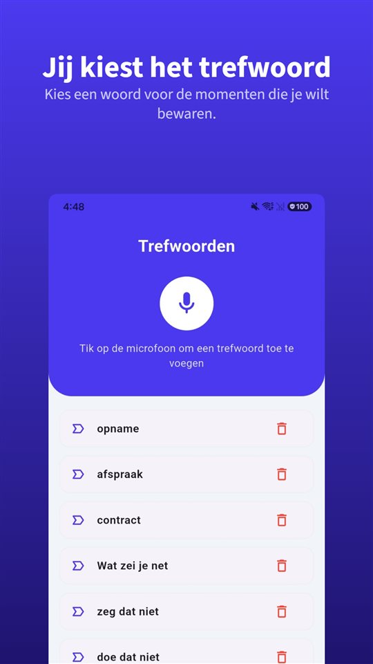

In het gesprek klinkt alles goed.

„Dat bedrag kunnen we wel bieden, en twee dagen thuiswerken is geen probleem.”

Dan komt het contract. Het salaris klopt. Over thuiswerken staat er niets in. Als je ernaar vraagt:

„Dat hangt natuurlijk af van wat het team nodig heeft.”

De voorwaarden worden hardop afgesproken. Op papier staat alleen wat in het contract komt, en het gesprek laat geen spoor na.

## Wat geldt in het Nederlandse taalgebied

| Land | Schriftelijke informatie verplicht | Termijn | Eigen gesprek opnemen zonder toestemming |
|---|---|---|---|
| Nederland | Ja (art. 7:655 BW) | Binnen een week of een maand na de start, afhankelijk van het gegeven | Toegestaan voor een deelnemer (art. 139a Sr) |
| België | Ja (wet van 7 oktober 2022) | Uiterlijk op de eerste werkdag | Geen misdrijf voor een deelnemer (Cassatie 2015) |

Suriname, Aruba, Curaçao en Sint Maarten hebben we voor dit artikel niet onderzocht.

Overal geldt: **een arbeidsovereenkomst kan ook mondeling tot stand komen.** De schriftelijke informatie bewijst de voorwaarden, ze maakt ze niet. Maar wie zich beroept op iets wat alleen in het gesprek is gezegd, moet het bewijzen.

## Nederland: een week of een maand

Sinds **1 augustus 2022** moet de werkgever de informatie uit artikel 7:655 BW — onder meer functie, salaris, arbeidsduur, plaats en proeftijd — **binnen een week of binnen een maand** na het begin van de werkzaamheden schriftelijk of elektronisch verstrekken, afhankelijk van het gegeven. Wie al vóór die datum in dienst was, kan de informatie opvragen; de werkgever moet die dan binnen een maand geven.

Wat in het sollicitatiegesprek is toegezegd, hoeft daar niet in te staan. Een thuiswerkafspraak, een bonus of een functietitel die alleen mondeling is genoemd, moet je zelf kunnen aantonen.

## België: uiterlijk de eerste werkdag

De wet van **7 oktober 2022**, in werking sinds 10 november 2022, zet de Europese richtlijn over transparante en voorspelbare arbeidsvoorwaarden om. De essentiële informatie over de arbeidsrelatie moet **uiterlijk op de eerste werkdag** worden gegeven, in de arbeidsovereenkomst of in een ander geschrift. Wijzigingen worden ook schriftelijk meegedeeld.

## Wat je dezelfde dag kunt doen

**Bewaar de vacature.** Vacatures verdwijnen zodra de functie vervuld is. Een schermafbeelding van de dag dat je solliciteerde, is wat je later kunt laten zien.

**Stuur dezelfde dag een samenvatting.** „Dank voor het gesprek. Zoals besproken: € X bruto per maand, twee dagen thuiswerken per week, start op 3 maart.” Ook zonder antwoord ligt er dan vast hoe het aanbod werd begrepen op het moment dat het werd gedaan.

**Als alles mondeling gebeurt, is een opname het verslag.** In Nederland en België mag je een gesprek waaraan je zelf deelneemt opnemen ([Mag je een gesprek stiekem opnemen? In Nederland en België wel, als je zelf meepraat](/blog/nl/gesprek-opnemen/)). Verspreiden is een andere zaak; de opname is voor jezelf en, als het zover komt, voor de rechter.

Daarvoor is [TalkSafe](https://hcompany-kr.github.io/talksafe/nl/) gemaakt. Het is een opname-app voor Android en iPhone die start zodra hij een **vooraf gekozen woord** hoort, werkt met een **vergrendeld scherm** en ook de **30 seconden vóór de start** bewaart. Trefwoorden worden herkend wie ze ook uitspreekt, dus je kunt woorden instellen die vallen als het over salaris en voorwaarden gaat. Het moment waarop de bedragen genoemd worden, mis je dan niet.

<figure class="shot"><figcaption>Trefwoordinstellingen. Je kunt meerdere woorden instellen; het is genoeg dat er één herkend wordt.</figcaption></figure>

Hoe een mondelinge afspraak staat tegenover een schriftelijk stuk, lees je in [Is een mondelinge afspraak geldig? Ja, maar wat als de offerte iets anders zegt?](/blog/nl/mondelinge-afspraak/). Gaat het niet om het begin maar om het einde van het dienstverband: [Vaststellingsovereenkomst onder druk: 14 dagen bedenktijd, je WW, en waarom ontslag nemen in een opwelling niet altijd telt](/blog/nl/vaststellingsovereenkomst/).

## Kort gezegd

- Een arbeidsovereenkomst kan mondeling tot stand komen; wie een mondelinge toezegging inroept, moet die bewijzen.
- Nederland: schriftelijke informatie binnen een week of een maand (art. 7:655 BW). België: uiterlijk op de eerste werkdag.
- Bewaar de vacature en vat de afspraken dezelfde dag schriftelijk samen.
- Een gesprek waaraan je deelneemt mag je in Nederland en België opnemen; verspreiden is iets anders.

## Bronnen

- [Transparante en voorspelbare arbeidsvoorwaarden (FOD Werkgelegenheid, België)](https://werk.belgie.be/nl/themas/arbeidsreglementering/transparante-en-voorspelbare-arbeidsvoorwaarden)

Algemene informatie, geen juridisch advies. Raadpleeg voor een concreet geval een advocaat of je vakbond.

