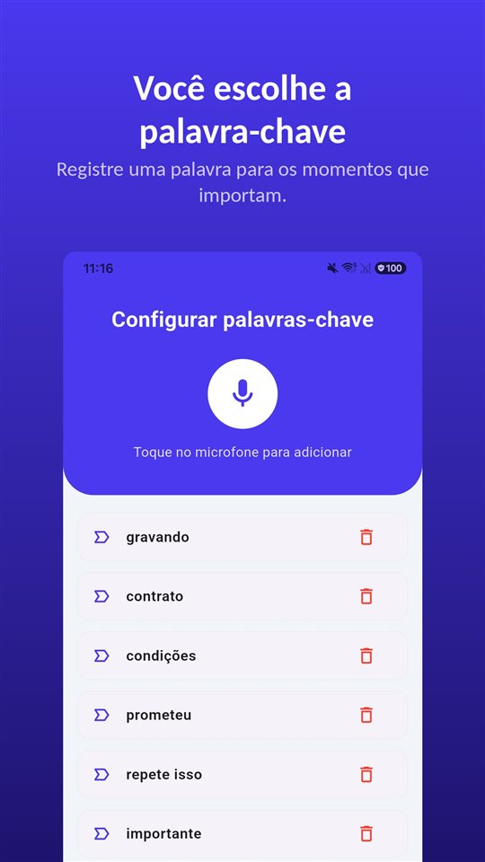

Na entrevista, tudo certo.

"A gente cobre o valor que você pediu, e dois dias de home office não tem problema."

O contrato chega. O salário está certo. Sobre home office, nada. Quando você pergunta, a resposta é:

"Isso depende da necessidade da equipe."

As condições são combinadas de boca. Só vira papel o que entra no contrato, e a entrevista não deixa rastro.

## O que vale no Brasil e em Portugal

| País | Contrato verbal | Registro ou informação por escrito | Promessa frustrada | Gravar a própria conversa sem avisar |
|---|---|---|---|---|
| Brasil | Válido (art. 443 CLT) | Anotação na CTPS em 5 dias úteis (art. 29 CLT) | Pode gerar indenização por dano moral ou perda de uma chance | Lícito para quem participa (STF, Tema 237) |
| Portugal | — | Informação ao trabalhador em 7 dias e em um mês (CT, arts. 106.º e 107.º) | Não pesquisado aqui | Crime, mesmo para quem participa (art. 199.º CP) |

Os outros países de língua portuguesa não foram pesquisados aqui.

## Brasil: vale o combinado, mas é preciso provar

O contrato de trabalho pode ser acordado **tácita ou expressamente, verbalmente ou por escrito** (art. 443 da CLT). O que foi combinado na entrevista vale. O problema é provar.

**A carteira.** O empregador tem **5 dias úteis** para anotar na CTPS a data de admissão, a remuneração e as condições especiais (art. 29 da CLT, com a redação da Lei 13.874/2019), e o trabalhador deve ter acesso à anotação na CTPS digital em até **48 horas**. O que foi dito na entrevista, porém, raramente aparece ali.

**A promessa frustrada.** Quando a empresa promete a vaga de forma concreta — exame admissional, pedido de documentos, data de início — e desiste sem justificativa, a Justiça do Trabalho tem reconhecido indenização com base na **boa-fé e na lealdade**, que valem já antes do contrato. Há decisões que reconhecem a **perda de uma chance** quando o candidato recusou outra oportunidade por causa da promessa. Mas é o trabalhador quem precisa provar que a promessa existiu; passar por um processo seletivo e não ser chamado não basta.

Nos dois casos, o que decide é **o que dá para mostrar** sobre o que foi dito.

## Portugal: dois prazos para informar

O Código do Trabalho obriga o empregador a informar o trabalhador sobre os aspetos relevantes do contrato. Parte das informações deve ser prestada **até ao sétimo dia** após o início da execução do contrato e as restantes **no prazo de um mês** (artigos 106.º e 107.º, na redação da Agenda do Trabalho Digno). A violação é **contraordenação grave**, e se o empregador não informar a duração e as condições do período experimental no prazo, presume-se que as partes acordaram excluí-lo.

## O que fazer no mesmo dia

**Salve o anúncio.** Vagas saem do ar quando são preenchidas. Um print do dia em que você se candidatou é o que vai mostrar depois.

**Mande um resumo no mesmo dia.** "Obrigado pela conversa. Conforme combinado: R$ X por mês, dois dias de home office por semana, início no dia 3." Mesmo sem resposta, fica registrado como a proposta foi entendida no momento em que foi feita.

**Se tudo acontece de boca, a gravação é o registro.** No Brasil, quem participa da conversa pode gravá-la ([Gravar conversa sem a outra pessoa saber é crime? No Brasil e em Portugal, a resposta é oposta](/blog/pt-br/gravar-conversa/)). Em Portugal, não sem consentimento; lá, pergunte antes e deixe a resposta gravada.

O [TalkSafe](https://hcompany-kr.github.io/talksafe/pt-br/) foi feito para esse tipo de conversa. É um app de gravação de voz para Android e iPhone que começa quando ouve uma **palavra escolhida por você**, funciona com a **tela bloqueada** e salva também os **30 segundos anteriores ao início**. As palavras-chave são detectadas seja quem for que as diga, então dá para escolher palavras que aparecem quando se fala de salário e condições. O momento em que os números aparecem não fica de fora.

<figure class="shot"><figcaption>Configuração de palavras-chave. Dá para cadastrar várias; basta uma delas ser detectada para a gravação começar.</figcaption></figure>

Como um acordo verbal se sustenta diante de um documento escrito está em [Contrato verbal tem validade? Tem, mas e quando o orçamento diz outra coisa?](/blog/pt-br/contrato-verbal/). Se o problema não é a entrada, mas a saída: [Forçado a pedir demissão: quando o pedido é nulo, o que o acordo do art. 484-A tira de você e como provar a pressão](/blog/pt-br/forcado-a-pedir-demissao/).

## Resumindo

- No Brasil, o contrato pode ser verbal (art. 443 CLT); quem alega uma condição combinada de boca precisa prová-la.
- A CTPS deve ser anotada em 5 dias úteis; a promessa de emprego frustrada sem justificativa pode gerar indenização.
- Em Portugal, o empregador informa por escrito em 7 dias e em um mês; a violação é contraordenação grave.
- Salve o anúncio, mande um resumo no mesmo dia e, onde for lícito, grave a conversa da qual você participa.

## Fontes

- [Perda de uma chance: empresa indenizará candidata por oportunidade de emprego perdida após promessa de contratação frustrada (TRT-3)](https://portal.trt3.jus.br/internet/conheca-o-trt/comunicacao/noticias-juridicas/perda-de-uma-chance-empresa-indenizara-candidata-por-oportunidade-emprego-perdida-apos-promessa-de-contratacao-frustrada)

Informação geral, não é aconselhamento jurídico. Para um caso concreto, consulte um advogado ou o seu sindicato.

