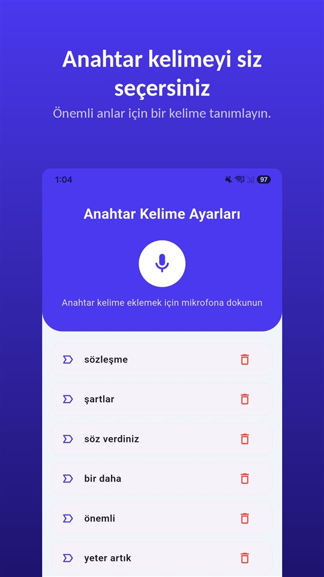

Mülakatta her şey yolunda.

"İstediğiniz rakamı veririz, haftada iki gün evden çalışmak da sorun değil."

Sonra sözleşme geliyor. Maaş doğru. Evden çalışmaya dair tek kelime yok. Sorduğunuzda cevap şu:

"O, ekibin ihtiyacına göre değişir."

Koşullar sözlü konuşulur. Yazıya geçen yalnızca sözleşmeye girendir, mülakat ise geride iz bırakmaz.

## Türkiye'de ne geçerli

| Konu | Kural | Dayanak |
|---|---|---|
| Sözlü iş sözleşmesi | Geçerli; kanunda aksi yoksa özel şekle tabi değil | İş Kanunu md. 8 |
| Bir yıl ve daha uzun sözleşmeler | Yazılı yapılması zorunlu | İş Kanunu md. 8 |
| Yazılı sözleşme yoksa | İşveren en geç iki ay içinde çalışma koşullarını gösteren yazılı belge verir | İş Kanunu md. 8 |
| Belge verilmezse | Her işçi için idari para cezası (tutar her yıl yeniden değerlenir) | İş Kanunu md. 99 |
| Kendi konuşmanızı rıza olmadan kaydetmek | Suç: altı aydan iki yıla kadar hapis veya adli para cezası | TCK md. 133/2 |

Avrupa'da çalışan Türkçe konuşanlar için geçerli olan, çalıştıkları ülkenin kanunudur; bu yazıda yalnızca Türkiye ele alındı.

## Sözlü sözleşme geçerli, ama ispat sizde

İş sözleşmesi, kanunda aksi belirtilmedikçe özel bir şekle tabi değildir. Yani mülakatta "anlaştık" denip işe başlandıysa bir iş sözleşmesi vardır.

Sorun, **neye** anlaşıldığıdır. Yazılı sözleşmede olmayan ve yalnızca mülakatta söylenmiş bir koşula — uzaktan çalışma, prim, unvan — dayanan çalışan, bunu ispat etmek zorundadır. Mülakat ise genellikle hiçbir belge bırakmaz.

## İki aylık yazılı belge yükümlülüğü

Süresi **bir yıl ve daha fazla** olan iş sözleşmeleri yazılı yapılmalıdır. Yazılı sözleşme yapılmamışsa işveren **en geç iki ay içinde** işçiye şunları gösteren yazılı bir belge vermek zorundadır (İş Kanunu md. 8):

- genel ve özel çalışma koşulları,
- günlük veya haftalık çalışma süresi,
- temel ücret ve varsa ücret ekleri,
- ücret ödeme dönemi,
- süre belirlenmişse süre ve fesih koşulları.

Bu belgeyi vermeyen işverene **her işçi için** idari para cezası uygulanır; tutar her yıl yeniden değerleme oranıyla güncellenir.

Bu belge mülakatta söylenenleri kapsamak zorunda değildir. Mülakatta söylenen bir koşul belgede yoksa, belgeyi aldığınız gün yazılı olarak sormak, sonradan ispat için önemli bir adımdır.

## İş ilanı

Türk hukukunda iş ilanındaki koşulların işe alımdan sonra işçi aleyhine değiştirilmesini ayrıca yasaklayan bir hüküm bulamadık. İlan bir sözleşme değildir. Ama ilanın, başvurduğunuz günkü ekran görüntüsü, mülakatta neyin konuşulduğunu destekleyen bir belgedir.

## Aynı gün yapılabilecekler

**İlanı kaydedin.** İlanlar pozisyon dolunca kalkar. Başvurduğunuz günün ekran görüntüsü, sonradan "öyle bir şey hiç söylenmedi" dendiğinde göstereceğiniz şeydir.

**Aynı akşam yazılı özet gönderin.** "Görüşme için teşekkürler. Konuştuğumuz gibi: aylık net X TL, haftada iki gün uzaktan çalışma, 3 Mart'ta başlangıç." Cevap gelmese bile, teklifin yapıldığı anda nasıl anlaşıldığının bir kaydı olur.

**Sözlü kalan bir görüşmeyi kaydetmek isterseniz: rızayla.** Türkiye'de katıldığınız bir konuşmayı karşı tarafın rızası olmadan kaydetmek suçtur ([Gizli ses kaydı almak suç mu? Türkiye'de kendi konuşmanızı kaydetmek de suç](/blog/tr/ses-kaydi-suc-mu/)). Yargıtay'ın tanıdığı istisna, tehdit veya hakarete uğrayıp başka türlü ispat imkânı olmayan durumlar içindir; bir maaş görüşmesi buna girmez. Açıkça sormak ise serbesttir: "Yanlış not almamak için bu görüşmeyi kayıt altına alabilir miyim?" Kaydın içinde duyulan bir onay, onayın en iyi kanıtıdır.

Bunun için [TalkSafe](https://hcompany-kr.github.io/talksafe/tr/) işe yarar. TalkSafe, **önceden belirlediğiniz bir kelimeyi** duyduğunda başlayan, **ekran kilitliyken** çalışan ve **başlangıçtan önceki 30 saniyeyi** de saklayan, Android ve iPhone için bir ses kayıt uygulamasıdır. Sorunuzdaki bir kelimeyi, örneğin **"kayıt"** kelimesini anahtar kelime yaparsanız kayıt soruyla birlikte başlar ve cevap da dosyada olur. Telefonu elinize almanız gerekmez.

<figure class="shot"><figcaption>Anahtar kelime ayarları. Birden fazla kelime kaydedebilirsiniz; herhangi birinin algılanması kaydı başlatır.</figcaption></figure>

Sözlü bir anlaşmanın yazılı bir teklifle çeliştiği durumlar [Sözlü sözleşme geçerli mi? Geçerli, ama yazılı teklifle çelişince ne olur?](/blog/tr/sozlu-sozlesme/) yazısında. Sorun işe girişte değil de ayrılışta çıkarsa: [İstifaya zorlama: Baskıyla imzalatılan istifa ve ikale sözleşmesi, kıdem tazminatı ve işsizlik maaşı](/blog/tr/istifaya-zorlama/).

## Özet

- İş sözleşmesi sözlü de kurulabilir; sözlü vaade dayanan çalışan onu ispat etmek zorundadır.
- Bir yıl ve daha uzun sözleşmeler yazılı yapılır; yazılı sözleşme yoksa işveren iki ay içinde çalışma koşullarını gösteren yazılı belge verir.
- İlanı kaydedin, vaatleri aynı gün yazılı özetleyin.
- Konuşmayı rıza olmadan kaydetmek TCK 133/2'ye göre suçtur; kaydedecekseniz önce sorun ve onayı da kayda alın.

## Kaynaklar

- [4857 sayılı İş Kanunu (Mevzuat Bilgi Sistemi)](https://www.mevzuat.gov.tr/mevzuat?MevzuatNo=4857&MevzuatTur=1&MevzuatTertip=5)

Genel bilgidir, hukuki danışmanlık değildir. Somut bir durum için bir avukata veya sendikanıza danışın.

