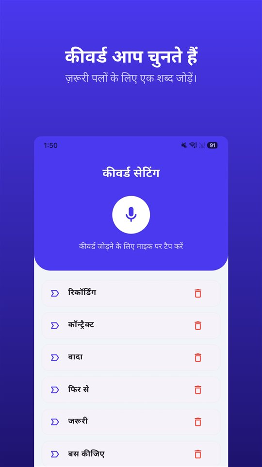

इंटरव्यू अच्छा जाता है।

„जो पैकेज आपने माँगा है, वो हो जाएगा, और हफ़्ते में दो दिन वर्क फ़्रॉम होम में कोई दिक़्क़त नहीं।”

फिर लेटर आता है। सैलरी ठीक है। वर्क फ़्रॉम होम के बारे में कुछ नहीं। पूछने पर जवाब मिलता है:

„वो टीम की ज़रूरत पर निर्भर करेगा।”

शर्तें ज़ुबानी तय होती हैं। लिखा वही जाता है जो लेटर में आता है, और इंटरव्यू कोई निशान नहीं छोड़ता।

## भारत में क्या स्थिति है

| सवाल | भारत में | आधार |
|---|---|---|
| मौखिक समझौता | अनुबंध हो सकता है; शर्तें साबित करनी होंगी | भारतीय अनुबंध अधिनियम, 1872, धारा 10 |
| अपॉइंटमेंट लेटर | हर कर्मचारी को देना अनिवार्य, 21 नवंबर 2025 से | OSH कोड, 2020, धारा 6(1)(f) |
| बातचीत के एक पक्ष की अनुमति से रिकॉर्डिंग | इंटरसेप्शन नहीं; शर्तें पूरी होने पर सबूत | सुप्रीम कोर्ट, आर. एम. मलकानी (1973) |
| बोलने वाले की सहमति के बिना रिकॉर्डिंग | सिर्फ़ इस वजह से अस्वीकार्य नहीं | सुप्रीम कोर्ट, विभोर गर्ग बनाम नेहा (2025) |
| सबूत के रूप में पेश करना | प्रमाणपत्र ज़रूरी | भारतीय साक्ष्य अधिनियम, 2023, धारा 63 |

भारत के अलावा जिन देशों में हिंदी बोली जाती है, वे यहाँ शामिल नहीं हैं।

## मौखिक वादा भी अनुबंध है, लेकिन सबूत आपको देना है

भारतीय अनुबंध अधिनियम की धारा 10 के तहत स्वतंत्र सहमति, वैध प्रतिफल और वैध उद्देश्य वाला समझौता अनुबंध है। नौकरी की शर्तें मौखिक रूप से भी तय हो सकती हैं।

परेशानी यह है कि **क्या** तय हुआ। जो शर्त — वर्क फ़्रॉम होम, बोनस, पद — सिर्फ़ इंटरव्यू में कही गई और किसी लेटर में नहीं है, उसका दावा करने वाले को उसे साबित करना होगा। और इंटरव्यू आम तौर पर कोई काग़ज़ नहीं छोड़ता।

## अपॉइंटमेंट लेटर अब अनिवार्य है

व्यावसायिक सुरक्षा, स्वास्थ्य और कार्य दशा संहिता, 2020 (OSH कोड) की धारा 6(1)(f) के तहत नियोक्ता को **हर कर्मचारी** को अपॉइंटमेंट लेटर देना होता है। चारों लेबर कोड **21 नवंबर 2025** से लागू हैं। लेटर में पद, श्रेणी, वेतन और सामाजिक सुरक्षा जैसी जानकारी होती है; ब्योरे केंद्र और राज्य के नियमों में तय होते हैं, इसलिए अपने राज्य के नियम भी देखें।

लेकिन अपॉइंटमेंट लेटर में वही आता है जो कंपनी लिखती है। इंटरव्यू में कही गई बात अपने आप उसमें नहीं आती।

## उसी दिन क्या करें

**जॉब पोस्टिंग सेव करें।** पोस्ट भर जाने पर विज्ञापन हट जाते हैं। आवेदन वाले दिन का स्क्रीनशॉट ही बाद में दिखाने वाली चीज़ है।

**उसी शाम ईमेल में सार भेजें।** „बातचीत के लिए धन्यवाद। जैसा तय हुआ: X लाख सालाना CTC, हफ़्ते में दो दिन वर्क फ़्रॉम होम, 3 मार्च से जॉइनिंग।” जवाब न भी आए, तो रिकॉर्ड रहता है कि ऑफ़र जिस वक़्त दिया गया, उसे कैसे समझा गया।

**अगर सब ज़ुबानी हो, तो रिकॉर्डिंग ही रिकॉर्ड है।** भारत में जिस बातचीत में आप शामिल हैं, उसकी रिकॉर्डिंग को सुप्रीम कोर्ट ने इंटरसेप्शन नहीं माना है ([भारत में बातचीत रिकॉर्ड करना: रिकॉर्डिंग आसान हिस्सा है, प्रमाणपत्र नहीं](/blog/hi/recording-law-india/))। सबूत के रूप में इस्तेमाल करना हो, तो मूल फ़ाइल बिना बदले रखें; धारा 63 का प्रमाणपत्र उसी पर टिकता है।

इसी के लिए [TalkSafe](https://hcompany-kr.github.io/talksafe/hi/) बना है। यह Android और iPhone के लिए एक वॉइस रिकॉर्डर ऐप है, जो **पहले से चुना हुआ शब्द** सुनते ही शुरू होता है, **स्क्रीन लॉक** रहने पर भी काम करता है, और **शुरुआत से पहले के 30 सेकंड** भी सेव करता है। कीवर्ड कोई भी बोले, पहचाना जाता है, इसलिए सैलरी और शर्तों की बात में आने वाले शब्द सेट किए जा सकते हैं। जिस पल आँकड़े बोले जाते हैं, वह छूटता नहीं।

<figure class="shot"><figcaption>कीवर्ड सेटिंग। आप कई कीवर्ड सेव कर सकते हैं; उनमें से कोई एक पहचाना जाते ही रिकॉर्डिंग शुरू हो जाती है।</figcaption></figure>

मौखिक समझौता लिखित दस्तावेज़ के सामने कैसे टिकता है, यह [मौखिक समझौता मान्य है? हाँ, लेकिन जब लिखित कोटेशन में कुछ और लिखा हो तब?](/blog/hi/verbal-contract/) में है। अगर दिक़्क़त नौकरी की शुरुआत में नहीं, आख़िर में है: [ज़बरदस्ती इस्तीफ़ा: दबाव में दिया गया रेज़िग्नेशन कब चुनौती दिया जा सकता है, और सबूत कहाँ से आता है](/blog/hi/forced-resignation/)।

## संक्षेप में

- मौखिक समझौता भी अनुबंध हो सकता है; ज़ुबानी शर्त का दावा करने वाले को उसे साबित करना होगा।
- 21 नवंबर 2025 से हर कर्मचारी को अपॉइंटमेंट लेटर देना अनिवार्य है (OSH कोड, धारा 6(1)(f))।
- जॉब पोस्टिंग सेव करें और उसी दिन तय शर्तें ईमेल में लिखकर भेजें।
- जिस बातचीत में आप शामिल हैं, उसकी रिकॉर्डिंग इंटरसेप्शन नहीं है; मूल फ़ाइल सँभालकर रखें।

## स्रोत

- [Govt. notifies 21 November 2025 for enforcement of the OSH Code (Taxmann)](https://www.taxmann.com/post/blog/govt-notifies-enforcement-of-occupational-safety-health-working-conditions-code)

यह सामान्य जानकारी है, क़ानूनी सलाह नहीं। अपने मामले के लिए किसी वकील या श्रम विभाग से सलाह लें।

