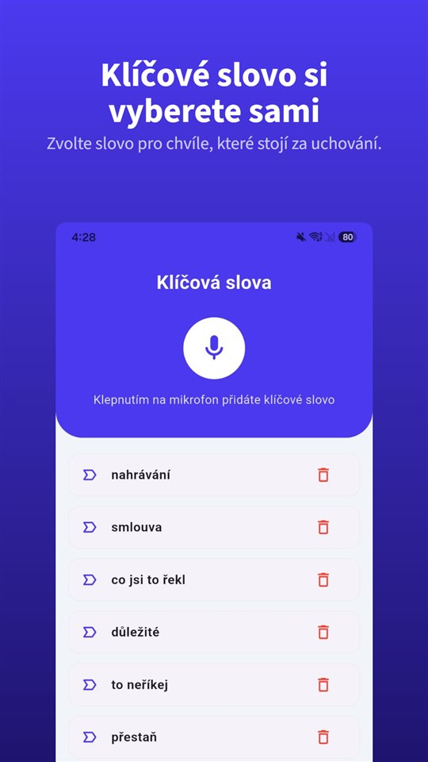

Na pohovoru zní všechno dobře.

„Tu částku, kterou jste chtěl, zvládneme, a dva dny z domova nejsou problém.“

Přijde smlouva. Mzda sedí. O práci z domova tam není nic. Když se zeptáte:

„To záleží na potřebách týmu.“

Podmínky se domlouvají nahlas. Na papíře je jen to, co se dostane do smlouvy, a pohovor nezanechá stopu.

## Co platí v Česku a na Slovensku

| Země | Písemná pracovní smlouva | Další písemné informace | Nahrávka rozhovoru bez souhlasu |
|---|---|---|---|
| Česko | Ano, s druhem práce, místem výkonu a dnem nástupu (§ 34 ZP) | Do 7 dnů od vzniku pracovního poměru (§ 37 ZP) | Bez svolení jen k výkonu nebo ochraně práv, nepřiměřeně ne (§ 86, 88, 90 OZ) |
| Slovensko | Ano, jedno vyhotovení dostane zaměstnanec | Lhůty jsme v zákoně neověřili | Zásadně jen se svolením (§ 12 OZ) |

## Česko: smlouva písemně, zbytek do 7 dnů

Pracovní smlouva **musí být uzavřena písemně** a musí obsahovat druh práce, místo nebo místa výkonu práce a den nástupu (§ 34 zákoníku práce). Každá strana dostane jedno vyhotovení.

Co ve smlouvě není, o tom musí zaměstnavatel zaměstnance **písemně informovat nejpozději do 7 dnů od vzniku pracovního poměru** (§ 37 ZP): mimo jiné o bližším označení druhu a místa práce, dovolené, zkušební době, výpovědní době, týdenní pracovní době, mzdě a její splatnosti. Informace může přijít i elektronicky, pokud si ji zaměstnanec může uložit a vytisknout. O změnách musí zaměstnavatel informovat **nejpozději v den, kdy změna nabývá účinnosti**.

Nic z toho ale nemusí obsahovat to, co zaznělo na pohovoru. Kdo se dovolává ústně slíbené podmínky — práce z domova, prémie, pozice — musí ji prokázat.

## Slovensko

Pracovní poměr na Slovensku **vzniká na základě písemné pracovní smlouvy** a zaměstnavatel musí zaměstnanci odevzdat jedno vyhotovení. Další lhůty slovenského Zákonníku práce pro informování jsme pro tento článek v zákoně neověřili, a proto je tu neuvádíme.

## Co udělat ještě týž den

**Uložte si inzerát.** Inzeráty mizí, jakmile je místo obsazeno. Snímek obrazovky ze dne, kdy jste se ucházeli, je to, na co můžete později ukázat.

**Pošlete shrnutí ještě týž den.** „Děkuji za rozhovor. Jak jsme se domluvili: X Kč hrubého, dva dny práce z domova týdně, nástup 3. března.“ I bez odpovědi zůstane záznam o tom, jak byla nabídka pochopena ve chvíli, kdy zazněla.

**Pokud vše zazní jen ústně: nahrát se souhlasem.** V Česku rozhoduje účel záznamu, na Slovensku je třeba svolení ([Je legální nahrávat rozhovor bez souhlasu? V Česku rozhoduje účel, na Slovensku svolení](/blog/cs/nahravani-rozhovoru/)). Otevřená otázka — „Můžu si to nahrát, abych si nic nezapsal špatně?“ — je v pořádku a souhlas, který je slyšet přímo na nahrávce, je jeho nejlepším důkazem.

K tomu se hodí [TalkSafe](https://hcompany-kr.github.io/talksafe/cs/). Je to aplikace pro nahrávání na Android a iPhone, která se spustí, když uslyší **předem zvolené slovo**, funguje při **zamčené obrazovce** a ukládá i **30 sekund před začátkem**. Když nastavíte slovo ze své otázky, například **„nahrát“**, nahrávání začne otázkou a odpověď je v souboru. Telefon přitom nemusíte brát do ruky.

<figure class="shot"><figcaption>Nastavení klíčových slov. Můžete uložit několik slov; stačí, aby bylo rozpoznáno jedno z nich.</figcaption></figure>

Jak obstojí ústní domluva proti písemnému dokumentu, popisuje [Ústní smlouva platí. Jak ale dokázat, co se domluvilo, když v rozpočtu stojí něco jiného?](/blog/cs/ustni-smlouva/). Pokud nejde o začátek, ale o konec pracovního poměru: [Dohoda o rozvázání pracovního poměru pod nátlakem: dva měsíce na žalobu, odstupné a co se změnilo u podpory](/blog/cs/dohoda-pod-natlakem/).

## Stručně

- Pracovní smlouva se v Česku i na Slovensku uzavírá písemně; ústně slíbenou podmínku, která ve smlouvě chybí, musí zaměstnanec prokázat.
- V Česku musí zaměstnavatel o dalších podmínkách písemně informovat do 7 dnů od vzniku pracovního poměru.
- Uložte si inzerát a ještě týž den shrňte domluvené podmínky písemně.
- Nahrávat se souhlasem, který je slyšet na nahrávce; v Česku rozhoduje účel, na Slovensku svolení.

## Zdroje

- [Zákon č. 262/2006 Sb., zákoník práce (Zákony pro lidi)](https://www.zakonyprolidi.cz/cs/2006-262)
- [Nástup do zamestnania na Slovensku (slovensko.sk)](https://www.slovensko.sk/sk/zivotne-situacie/zivotna-situacia/_nastup-do-zamestnania-na-slove/)

Obecné informace, nikoli právní rada. V konkrétní věci se obraťte na advokáta nebo odborovou organizaci.

