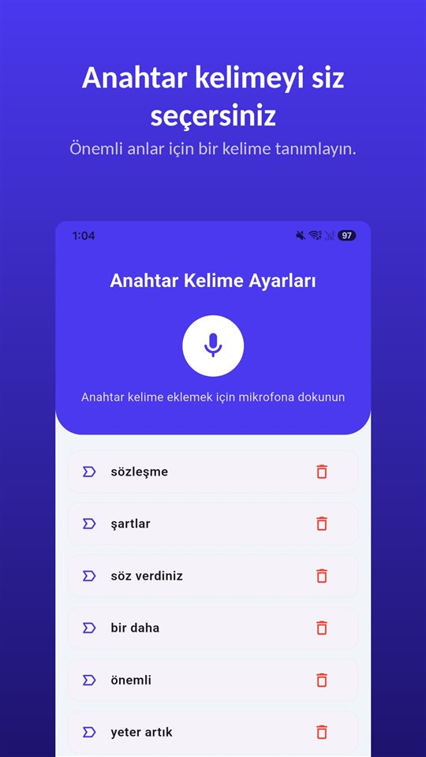

Test sürüşü güzel geçiyor.

"Hatasız, boyasız, triger seti yeni değişti."

Üç hafta sonra servis, ön tarafta onarılmış bir hasar buluyor. Sözleşmede tek satır var: **olduğu gibi satılmıştır.**

Satıcının söyledikleri satın alma kararını verir. Sözleşmede yazanlar ise anlaşmazlığı.

## Türkiye'de ne geçerli

| Konu | Kural | Dayanak |
|---|---|---|
| Satıcının sorumluluğu | Satıcı satılanın ayıplı olmasından sorumludur | TBK md. 219 vd. |
| Galeriden alım | Alıcı tüketiciyse tüketici mevzuatı da uygulanır | 6502 sayılı Kanun |
| "Olduğu gibi satılmıştır" | Sorumluluk sözleşmeyle kaldırılabilir; satıcı ağır kusurluysa hükümsüz | TBK md. 221 |
| Gizli ayıp bildirimi | Ortaya çıkınca hemen; bildirilmezse ayıplı kabul edilmiş sayılır | TBK md. 223 |
| Zamanaşımı | Teslimden itibaren 2 yıl; hile veya ağır kusurda işlemez | TBK md. 231 |
| Satıcıyla konuşmayı rıza olmadan kaydetmek | Suç | TCK md. 133/2 |

Avrupa'da araç alan Türkçe konuşanlar için geçerli olan, bulundukları ülkenin kanunudur; bu yazıda yalnızca Türkiye ele alındı.

## Satıcı ayıptan sorumludur

Türk Borçlar Kanunu'na göre satıcı, satılanın ayıplı olmasından sorumludur (TBK md. 219 vd.). Bu, aracı sahibinden de alsanız galeriden de alsanız geçerlidir. Galeriden alımda alıcı tüketiciyse 6502 sayılı Tüketicinin Korunması Hakkında Kanun da devreye girer.

## "Olduğu gibi satılmıştır" ne kadar korur

Taraflar satıcının ayıptan sorumluluğunu sözleşmeyle **kaldırabilir veya sınırlayabilir**. Ama satıcı aracı ayıplı olarak devretmekte **ağır kusurluysa**, bu tür her anlaşma **kesin olarak hükümsüzdür** (TBK md. 221). Bildiği hasarı saklayan satıcı, sözleşmedeki o satırın arkasına saklanamaz.

## Süreler: hemen bildir, iki yılı kaçırma

- **Gözden geçirme.** Alıcı aracı teslim aldıktan sonra imkân bulur bulmaz gözden geçirmeli, bir ayıp görürse uygun süre içinde satıcıya bildirmelidir.
- **Gizli ayıp.** Olağan bir kontrolle görülemeyecek bir ayıp sonradan çıkarsa, **hemen** satıcıya bildirilmelidir; bildirilmezse araç bu ayıpla kabul edilmiş sayılır (TBK md. 223). Bildirimi ispatlanabilir bir yolla yapmak sonradan işe yarar.
- **Zamanaşımı.** Dava, kural olarak **teslimden itibaren iki yıl** içinde açılmalıdır. Ayıp satıcının **hilesi veya ağır kusuruyla** gizlenmişse satıcı bu süreden yararlanamaz (TBK md. 231).

Gizli ayıp çoğu zaman bilirkişi incelemesiyle ortaya konur. Alım öncesi ekspertiz yasal bir zorunluluk değildir ama sonradan "bu ayıp satışta vardı" demenin en sağlam dayanağıdır.

## Söylenen, sözleşmede yazmıyor

Her yerde aynı sorun var: **sözleşmede yazmayanı ispat etmek gerekir.** "Hatasız", "boyasız", "triger yeni" test sürüşünde söylenir, masada değil.

**Sözleri sözleşmeye yazdırın.** "Satıcının beyanına göre hasarsızdır" gibi bir satırı, kilometreyle birlikte sözleşmeye eklemek en basit yoldur.

**İlanı kaydedin.** İlan satıştan sonra kalkar. Açıklamanın ekran görüntüsü, sonradan göstereceğiniz şeydir.

**Aynı gün yazılı özet gönderin.** "Söylediğiniz gibi: hasarsız, triger 120.000 km'de değişti." Mesajla gelen bir cevap, bir delildir.

**Kaydedecekseniz: önce sorun.** Türkiye'de katıldığınız bir konuşmayı rıza olmadan kaydetmek suçtur ([Gizli ses kaydı almak suç mu? Türkiye'de kendi konuşmanızı kaydetmek de suç](/blog/tr/ses-kaydi-suc-mu/)). Açıkça sormak serbesttir ve kaydın içinde duyulan bir onay, onayın en iyi kanıtıdır.

Bunun için [TalkSafe](https://hcompany-kr.github.io/talksafe/tr/) işe yarar. TalkSafe, **önceden belirlediğiniz bir kelimeyi** duyduğunda başlayan, **ekran kilitliyken** çalışan ve **başlangıçtan önceki 30 saniyeyi** de saklayan, Android ve iPhone için bir ses kayıt uygulamasıdır. Sorunuzdaki bir kelimeyi, örneğin **"kayıt"** kelimesini anahtar kelime yaparsanız, "Unutmamak için bu konuşmayı kayıt altına alabilir miyim?" diye sorduğunuzda kayıt başlar ve cevap da dosyada olur. Telefon cebinizde kalabilir.

<figure class="shot"><figcaption>Anahtar kelime ayarları. Birden fazla kelime kaydedebilirsiniz; herhangi birinin algılanması kaydı başlatır.</figcaption></figure>

Sözlü bir anlaşmanın yazılı bir belgeyle çeliştiği durumlar [Sözlü sözleşme geçerli mi? Geçerli, ama yazılı teklifle çelişince ne olur?](/blog/tr/sozlu-sozlesme/) yazısında.

## Özet

- Satıcı satılanın ayıplı olmasından sorumludur; galeriden alımda tüketici mevzuatı da uygulanır.
- "Olduğu gibi satılmıştır" satıcı ağır kusurluysa hükümsüzdür.
- Gizli ayıbı ortaya çıkınca hemen bildirin; dava süresi teslimden itibaren iki yıldır, hile veya ağır kusurda bu süre işlemez.
- Söylenenleri sözleşmeye yazdırın, ilanı kaydedin, aynı gün yazılı özet gönderin; kaydedecekseniz önce sorun.

## Kaynaklar

- [6098 sayılı Türk Borçlar Kanunu (Mevzuat Bilgi Sistemi)](https://www.mevzuat.gov.tr/mevzuat?MevzuatNo=6098&MevzuatTur=1&MevzuatTertip=5)

Genel bilgidir, hukuki danışmanlık değildir. Somut bir durum için bir avukata veya tüketici hakem heyetine danışın.

