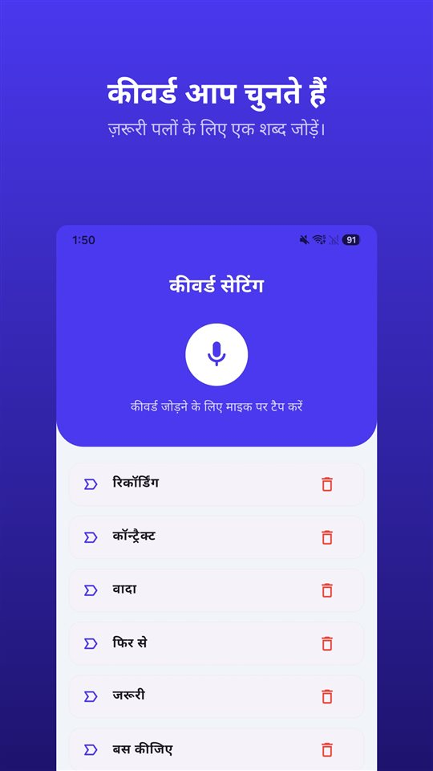

टेस्ट ड्राइव अच्छी रहती है।

„कभी एक्सीडेंट नहीं हुआ, फ़र्स्ट ओनर, सर्विस पूरी कंपनी में हुई है।”

तीन हफ़्ते बाद मैकेनिक बताता है कि आगे का हिस्सा ठीक करवाया गया है। काग़ज़ में बस इतना लिखा है: **जैसी है वैसी बेची गई।**

विक्रेता जो कहता है, उससे ख़रीद तय होती है। जो लिखा है, उससे झगड़ा तय होता है।

## भारत में क्या स्थिति है

| सवाल | भारत में | आधार |
|---|---|---|
| क्वालिटी की निहित वारंटी | सामान्य नियम 'ख़रीदार सावधान'; कुछ अपवाद | सेल ऑफ़ गुड्स एक्ट, 1930, धारा 16 |
| कारोबारी विक्रेता, विवरण के आधार पर बिक्री | उचित जाँच में न दिखने वाली ख़राबियों की ज़िम्मेदारी (अलग समझौता न हो तो) | धारा 16 का अपवाद |
| डीलर का क्वालिटी के बारे में झूठा प्रतिनिधित्व | अनुचित व्यापार व्यवहार | उपभोक्ता संरक्षण अधिनियम, 2019 |
| निजी व्यक्ति से ख़रीद | उपभोक्ता संरक्षण अधिनियम आम तौर पर लागू नहीं | — |
| जिस बातचीत में आप शामिल हैं, उसकी रिकॉर्डिंग | इंटरसेप्शन नहीं | सुप्रीम कोर्ट, आर. एम. मलकानी (1973) |

भारत के अलावा जिन देशों में हिंदी बोली जाती है, वे यहाँ शामिल नहीं हैं।

## 'ख़रीदार सावधान' और उसका अपवाद

सेल ऑफ़ गुड्स एक्ट, 1930 की **धारा 16** का सामान्य नियम है: क्वालिटी की कोई निहित वारंटी नहीं — यानी **ख़रीदार सावधान**। सेकंड हैंड कार में यह नियम ख़रीदार पर भारी पड़ता है।

लेकिन एक अहम अपवाद है: जब सामान **विवरण के आधार पर** बेचा जाए और विक्रेता **उसी सामान का कारोबार** करता हो, तो वह ऐसी ख़राबियों के लिए ज़िम्मेदार है जो **उचित जाँच में नहीं दिखतीं** — जब तक अलग से कुछ और तय न हुआ हो। डीलर से ख़रीदी कार में यही अपवाद काम आता है।

## डीलर: उपभोक्ता संरक्षण अधिनियम, 2019

उपभोक्ता संरक्षण अधिनियम, 2019 में **अनुचित व्यापार व्यवहार** की परिभाषा में यह भी शामिल है कि सामान को किसी ख़ास **मानक, क्वालिटी या ग्रेड** का झूठा बताया जाए। उपभोक्ता आयोगों ने पहले एक्सीडेंट में रही कार को **बिना बताए** बेचने को अनुचित व्यापार व्यवहार और ग़लत बयानी माना है। शिकायत ज़िला उपभोक्ता आयोग में की जाती है।

## मालिक से सीधे ख़रीद

निजी व्यक्ति से कार ख़रीदने पर उपभोक्ता संरक्षण अधिनियम **आम तौर पर लागू नहीं होता**, क्योंकि विक्रेता व्यापारी नहीं है। तब बात अनुबंध और विक्रेता के बयानों पर आती है — और **जो वादा सिर्फ़ ज़ुबानी था, उसे आपको साबित करना होगा।**

## जो कहा गया, वह काग़ज़ में नहीं है

„एक्सीडेंट नहीं हुआ”, „ओडोमीटर असली है”, „क्लच नया है” — ये बातें टेस्ट ड्राइव पर होती हैं, काग़ज़ों पर नहीं।

**वादे लिखवाएँ।** सबसे आसान: बिक्री के काग़ज़ में „विक्रेता के अनुसार एक्सीडेंट-फ़्री” और ओडोमीटर रीडिंग।

**विज्ञापन सेव करें।** बिक्री के बाद हट जाता है। उसका स्क्रीनशॉट बाद में दिखाने की चीज़ है।

**उसी दिन संदेश में सार भेजें।** „जैसा आपने बताया: कभी एक्सीडेंट नहीं हुआ, टाइमिंग बेल्ट 1,20,000 किमी पर बदली गई।” संदेश में आया जवाब सबूत है।

**रिकॉर्डिंग भी सबूत है।** भारत में जिस बातचीत में आप शामिल हैं, उसकी रिकॉर्डिंग को सुप्रीम कोर्ट ने इंटरसेप्शन नहीं माना है ([भारत में बातचीत रिकॉर्ड करना: रिकॉर्डिंग आसान हिस्सा है, प्रमाणपत्र नहीं](/blog/hi/recording-law-india/))। सबूत के रूप में इस्तेमाल करना हो, तो मूल फ़ाइल बिना बदले रखें; धारा 63 का प्रमाणपत्र उसी पर टिकता है।

इसी के लिए [TalkSafe](https://hcompany-kr.github.io/talksafe/hi/) बना है। यह Android और iPhone के लिए एक वॉइस रिकॉर्डर ऐप है, जो **पहले से चुना हुआ शब्द** सुनते ही शुरू होता है, **स्क्रीन लॉक** रहने पर भी काम करता है, और **शुरुआत से पहले के 30 सेकंड** भी सेव करता है। कीवर्ड कोई भी बोले, पहचाना जाता है, इसलिए विक्रेता के आम शब्द — **„एक्सीडेंट”**, **„वारंटी”**, **„सर्विस”** — सेट किए जा सकते हैं। टेस्ट ड्राइव के दौरान फ़ोन जेब में ही रह सकता है।

<figure class="shot"><figcaption>कीवर्ड सेटिंग। आप कई कीवर्ड सेव कर सकते हैं; उनमें से कोई एक पहचाना जाते ही रिकॉर्डिंग शुरू हो जाती है।</figcaption></figure>

मौखिक समझौता लिखित दस्तावेज़ के सामने कैसे टिकता है, यह [मौखिक समझौता मान्य है? हाँ, लेकिन जब लिखित कोटेशन में कुछ और लिखा हो तब?](/blog/hi/verbal-contract/) में है।

## संक्षेप में

- सामान्य नियम 'ख़रीदार सावधान' है (सेल ऑफ़ गुड्स एक्ट, धारा 16), लेकिन कारोबारी विक्रेता छिपी ख़राबियों के लिए ज़िम्मेदार हो सकता है।
- डीलर का क्वालिटी के बारे में झूठा प्रतिनिधित्व उपभोक्ता संरक्षण अधिनियम, 2019 के तहत अनुचित व्यापार व्यवहार है।
- निजी व्यक्ति से ख़रीद पर यह अधिनियम आम तौर पर लागू नहीं होता; मौखिक वादे आपको साबित करने होंगे।
- वादे लिखवाएँ, विज्ञापन सेव करें, उसी दिन संदेश भेजें, और जिस बातचीत में आप शामिल हैं उसे रिकॉर्ड करें।

## स्रोत

- [The Rule of Caveat Emptor: Meaning and Exception (Legal Service India)](https://www.legalserviceindia.com/legal/article-7747-the-rule-of-caveat-emptor-meaning-and-exception.html)

यह सामान्य जानकारी है, क़ानूनी सलाह नहीं। अपने मामले के लिए किसी वकील या ज़िला उपभोक्ता आयोग से सलाह लें।

